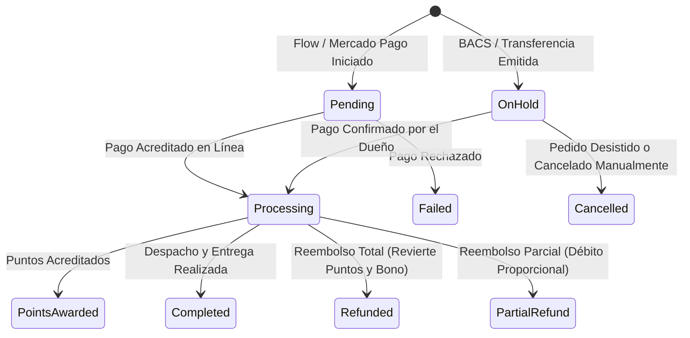

# REGLAS DE NEGOCIO FINANCIERAS, PROMOCIONALES Y TRANSACCIONALES DE AKIBARA
**Documento Maestro y Autoridad Única del Sistema de Precios, Descuentos, Cupones, Puntos y Transacciones**  
*Akibara (akibara.cl) · Versión 2.0 Definitiva y Homologada con ADR-010 · Noviembre 2026*

---

## ÍNDICE GENERAL

1. [Filosofía Financiera y Principios Rectores](#1-filosofía-financiera-y-principios-rectores)
2. [Modelo de Inventario Físico y Descuentos de Catálogo](#2-modelo-de-inventario-físico-y-descuentos-de-catálogo)
   - 2.1. Modelo 100% Stock Físico Inmediato vs. Agotado (ADR-010)
   - 2.2. Descuentos por Taxonomía / Editorial (`TaxonomyDiscount`)
3. [Programa de Referidos («Invita a un Amigo»)](#3-programa-de-referidos-invita-a-un-amigo)
4. [Programa de Lealtad «Akibara Rewards» (Puntos & Cashback)](#4-programa-de-lealtad-akibara-rewards-puntos--cashback)
   - 4.1. Reglas de Acumulación (Earn) y Niveles (`Tiers`)
   - 4.2. Reglas de Canje (Redeem)
   - 4.3. Bonificaciones del Programa
   - 4.4. Vencimiento y Auditoría FIFO
5. [Políticas de Despacho y Envío Gratis](#5-políticas-de-despacho-y-envío-gratis)
   - 5.1. Umbral Oficial y Transportista
   - 5.2. Comportamiento frente a Descuentos, Puntos y Cupones
6. [Matriz de Coexistencia, Conflictos y Apilamiento (Stacking Matrix)](#6-matriz-de-coexistencia-conflictos-y-apilamiento-stacking-matrix)
   - 6.1. Tabla General de Coexistencia
   - 6.2. Traza Técnica de Ejecución (Orden de Hooks de WooCommerce)
7. [Ciclo Transaccional, Pasarelas de Pago y Gestión BACS Nativa](#7-ciclo-transaccional-pasarelas-de-pago-y-gestión-bacs-nativa)
   - 7.1. Pasarelas de Pago y Gestión BACS (Transferencias Nativas)
   - 7.2. Estados del Pedido y Ciclo de Vida del Dinero
   - 7.3. Política Contable de Cancelaciones y Reembolsos
8. [Glosario Maestro de Parámetros Técnicos y Opciones de Base de Datos](#8-glosario-maestro-de-parámetros-técnicos-y-opciones-de-base-de-datos)

---

## 1. FILOSOFÍA FINANCIERA Y PRINCIPIOS RECTORES

La arquitectura comercial y transaccional de Akibara está diseñada bajo cinco pilares inquebrantables:

1. **Protección Ciega del Margen Comercial (Anti-Stacking & Best-Wins):**
   Ningún descuento, cupón o beneficio promocional puede acumularse indiscriminadamente sobre otro. Siempre rige el principio **Best-Wins** (el cliente recibe la mejor oferta individual disponible) sin degradar el precio por debajo del costo de adquisición (COGS) más el flete logístico.
2. **Anti Double-Dipping (Cero Beneficio Duplicado):**
   Los programas de recompensa (Akibara Rewards) acumulan puntos **estrictamente sobre el desembolso neto real en dinero**, deduciendo cupones, promociones y puntos canjeados.
3. **Moneda Canónica sin Fracciones (CLP estricto):**
   Toda transacción se realiza en Pesos Chilenos (CLP). WooCommerce maneja cero decimales (`wc_get_price_decimals() = 0`). Todo redondeo financiero se ejecuta con `round(..., 0)` al final del cálculo en neto, protegiendo la paridad tributaria frente al SII (IVA 19% incluido en precios de lista).
4. **Techo Comercial Global de la Tienda (`DiscountCeiling`):**
   Existe una compuerta maestra de negocio en base de datos (`akb_discount_max_pct`), fijada por defecto en **15%**. Ninguna campaña editorial ni promoción puede superar este techo en runtime sin intervención explícita del dueño en el panel.
5. **Cero Hardcoding y Soberanía Total desde wp-admin:**
   Todos los parámetros de negocio (umbrales, porcentajes, niveles de fidelización, pisos mínimos y modos operativos) leen de `wp_options` mediante las capas tipadas de cada plugin (`Akibara\Rewards\Support\Options` y módulos de `akibara-business`), garantizando control directo sin despliegues de código.

---

## 2. MODELO DE INVENTARIO FÍSICO Y DESCUENTOS DE CATÁLOGO

### 2.1. Modelo 100% Stock Físico Inmediato vs. Agotado (ADR-010)
Conforme a [ADR-010](brain/decisiones/ADR-010-erradicacion-preventa-a-pedido-packs-y-ediciones-pais.md), Akibara opera exclusivamente con inventario físico real en su bodega de Santiago. Se erradicaron de raíz los módulos de Preventa / A Pedido (`onbackorder`) y «Arma tu Pack» (`SeriesBundles`).
- **`instock` (Disponible):** inventario físico positivo controlado por WooCommerce nativo.
- **`outofstock` (Agotado):** sin stock físico disponible; habilita «Avísame cuando vuelva» sin reservas ni pagos anticipados.

### 2.2. Descuentos por Taxonomía / Editorial (`TaxonomyDiscount`)
- Permite campañas por editorial vinculadas a `wp_termmeta` (`_akb_taxonomy_discount_pct`).
- **Política de Cupones (`stacks_with_coupons` / `akibara_taxonomy_discount_coupon_mode`):**
  Operando bajo el modo **`best_wins`**, los cupones legítimos conviven mediante evaluación de mayor beneficio sin apilamiento ciego.

---

## 3. PROGRAMA DE REFERIDOS («INVITA A UN AMIGO»)

- **Mapeo a Base de Datos y Código (`Referrals.php`):**
  * Descuento al invitado: `$2.000 CLP` (`Referrals::AKB_REF_AMOUNT = 2000`, cupón virtual con prefijo `refreferido-`).
  * Piso mínimo de compra: `akb_rewards_referral_min_order = 30000` (\$30.000 CLP).
  * Premio al padrino: `akb_rewards_referral_points = 500` (\$500 CLP en puntos por defecto, configurable en panel).
  * Ventana de cookie: `akb_rewards_referral_cookie_days = 30` días.
- **Control de Fuga y Antifraude:**
  El piso mínimo de **\$30.000 CLP** preserva el margen en órdenes de entrada; se bloquea autoreferencia por código o coincidencia de correo y se exige orden genuina (`completed` por defecto).

---

## 4. PROGRAMA DE LEALTAD «AKIBARA REWARDS» (PUNTOS & CASHBACK)

### 4.1. Reglas de Acumulación (Earn) y Niveles (`Tiers`)
- **Tasa Base de Acumulación:** **2 puntos por cada \$100 CLP** gastados (`akb_rewards_earn_points = 2`, `akb_rewards_earn_amount = 100`), equivalente a un **2% de cashback neto** (`1.0x`), con multiplicadores configurables para niveles **Coleccionista** (`>= 2.000` pts históricos, `1.2x`) y **Residente de Akiba** (`>= 8.000` pts históricos, `1.5x`).
- **Base de Acreditación Honesta:**
  $$\text{Base} = \max\Big(0, \; (\text{Total Ítems con IVA tras Descuentos}) - \text{Canje Neto en Puntos}\Big)$$
  El flete logístico y los montos pagados con cupones o puntos NO generan puntos (Anti Double-Dipping).

### 4.2. Reglas de Canje (Redeem)
- **Valor Facial:** **1 punto = \$1 CLP** (`akb_rewards_redeem_value = 1`).
- **Inyección en Carrito:** Fee negativo con neutralidad fiscal SII (IVA 19% deducido en neto).
- **Límites Paramétricos en Base de Datos (`Options.php`):**

| Parámetro | Opción en BD | Valor por Defecto | Descripción |
|---|---|---:|---|
| **Piso Mínimo de Carrito** | `akb_rewards_redeem_min_cart` | **\$50.000 CLP** | Mínimo en productos para habilitar selector de puntos (`0` = sin mínimo). |
| **Mínimo de Puntos por Canje** | `akb_rewards_redeem_min_points` | **100 pts** | Mínimo \$100 CLP de canje. |
| **Tope Nominal por Pedido** | `akb_rewards_redeem_max_amount` | **5.000 pts** | Máximo canjeable en CLP por pedido (`DEFAULT_REDEEM_MAX_AMOUNT`). |
| **Tope Porcentual** | `akb_rewards_redeem_max_pct` | **50%** | Nunca cubre más del 50% de la mercadería (`DEFAULT_REDEEM_MAX_PCT`). |

### 4.3. Bonificaciones del Programa
- **Bono de Bienvenida:** **500 puntos (\$500 CLP)** acreditados automáticamente en la primera compra pagada con dinero real (`akb_rewards_welcome_bonus`).
- **Cumpleaños:** **1.000 puntos (\$1.000 CLP)** otorgados una vez al año al cliente registrado (`akb_rewards_birthday_points`).
- **Programa de Referidos («Invita a un amigo»):** **500 puntos (\$500 CLP)** de fábrica para el padrino tras completarse la primera compra del invitado (`akb_rewards_referral_points`).
- **Reseñas con Foto Aprobadas:** **500 puntos (\$500 CLP)** por reseña verificada con fotografía, tras aprobación editorial (`akb_rewards_review_points`).

### 4.4. Vencimiento y Auditoría FIFO
- **Caducidad:** Los puntos expiran a los **12 meses** (`akb_rewards_expiry_months = 12`) evaluados mediante algoritmo FIFO estricto sobre el ledger.

---

## 5. POLÍTICAS DE DESPACHO Y ENVÍO GRATIS

### 5.1. Umbral Oficial y Transportista
- **Umbral de Envío Gratis:** **\$60.000 CLP** a domicilio en todo Chile mediante Blue Express (`akibara_fsp_carrier_threshold = 60000`).
- **Exclusión Expresa:** La modalidad de **Retiro en Punto Blue (PUDO)** se cotiza con tarifa preferencial independiente y no califica para gratuidad por monto.

### 5.2. Comportamiento frente a Descuentos, Puntos y Cupones
- **Cupones de Descuento (Welcome / Promocionales):**
  Reducen la base imponible del envío gratis (`ignore_discounts = no`). Si un carro de \$64.000 CLP recibe un descuento de cupón de -\$5.000 CLP, la base cae a \$59.000 CLP y pierde el envío gratis.
- **Puntos Akibara Rewards:**
  Se aplican como un **FEE NEGATIVO**, manteniendo intacto el subtotal de productos. Un carrito de \$62.000 CLP que canjea \$3.000 en puntos paga \$59.000 CLP pero **CONSERVA EL ENVÍO GRATIS**.

---

## 6. MATRIZ DE COEXISTENCIA, CONFLICTOS Y APILAMIENTO (STACKING MATRIX)

### 6.1. Tabla General de Coexistencia

| Escenario Combinado | ¿Se Pueden Combinar? | Comportamiento del Sistema y Resolución de Conflictos |
|---|:---:|---|
| **Puntos Akibara + Cupones (Cualquiera)** | **NO** | **Exclusión mutua absoluta.** Canjear puntos desactiva la aplicación de cupones; ingresar un cupón suprime el fee de puntos. |
| **Puntos Akibara + Envío Gratis** | **SÍ** | El canje de puntos no degrada el subtotal de mercadería, conviviendo armoniosamente con el envío gratis. |

### 6.2. Traza Técnica de Ejecución (Orden de Hooks de WooCommerce)
```
[1. Request / Renderizado de Carrito]
  └─► woocommerce_product_get_price (Prio 10/20)
        └─► _sale_price nativo y TaxonomyDiscount resuelven precios rebajados de lista.

[2. Cálculo de Totales: woocommerce_before_calculate_totals]
  └─► Prio 1100: Referrals::auto_apply_referral_coupon
        └─► Auto-aplica cupón de referido si cumple mínimo y no hay puntos activos.

[3. Validación de Cupones: woocommerce_coupon_is_valid]
  ├─► Prio 10: TaxonomyDiscount\CouponInteraction::maybe_invalidate
  │     Bajo modo 'best_wins', autoriza cupones ref- y hola.
  ├─► Prio 10: Redemption::disallow_coupon_with_points
  │     Bloquea cupones si existen puntos canjeados activos.
  └─► Prio 20: WelcomeCoupon\CouponService::validate_coupon_is_valid

[4. Cálculo de Fees: woocommerce_cart_calculate_fees]
  └─► Prio 20: Redemption::apply_fee
        Si no hay cupones en el carrito, inyecta fee negativo con neutralidad IVA 19%.

[5. Evaluación Logística y Checkout]
  └─► FreeShippingThreshold evalúa $60.000 CLP.
```

---

## 7. CICLO TRANSACCIONAL, PASARELAS DE PAGO Y GESTIÓN BACS NATIVA

### 7.1. Pasarelas de Pago y Gestión BACS (Transferencias Nativas)
Akibara opera con tres pasarelas oficiales:
1. **Flow (Webpay Plus, Mach, Servipag, Multicaja):** Pasarela primaria automatizada en CLP.
2. **Mercado Pago:** Pasarela secundaria con tarjeta de crédito/débito.
3. **Transferencia Bancaria Directa (BACS) — Gestión Directa por el Dueño:**
   - WooCommerce gestiona BACS de forma nativa: el pedido queda en estado `on-hold` con los datos de cuenta oficiales de Akibara SpA en Banco de Chile.
   - **Cero Sobreingeniería:** No existen crons de cancelación automática forzada, timers de expiración ni portales de carga de comprobantes. Como tienda pequeña de trato cercano, el dueño revisa directamente los abonos en la cuenta bancaria y actualiza el pedido a `processing` o `completed` de forma manual y personalizada.

### 7.2. Estados del Pedido y Ciclo de Vida del Dinero


### 7.3. Política Contable de Cancelaciones y Reembolsos
1. **Cancelación o Reembolso Total (`cancelled`, `refunded`):**
   - Puntos ganados: débito íntegro `order_reversal`.
   - Puntos canjeados: restitución íntegra al cliente `redemption_reversal`.
   - Bono de primera compra: elegibilidad reestablecida para compras genuinas posteriores.
2. **Reembolso Parcial:**
   - Puntos canjeados se devuelven de forma estrictamente proporcional a la mercadería devuelta.
   - Puntos ganados se ajustan mediante `order_refund` conservando la base neta de mercadería retenida.

---

## 8. GLOSARIO MAESTRO DE PARÁMETROS TÉCNICOS Y OPCIONES DE BASE DE DATOS

| Opción de Base de Datos | Tipo | Default | Módulo Responsable | Descripción de Negocio |
|---|---|---:|---|---|
| `akb_discount_max_pct` | entero | `15` | `DiscountCeiling` | Techo absoluto de descuento promocional en toda la tienda. |
| `akb_rewards_referral_min_order` | entero | `30000` | `Rewards\Referrals` | Compra mínima para cupón virtual de referido (`Referrals::AKB_REF_AMOUNT = 2000`, prefijo `refreferido-`). |
| `akb_rewards_referral_points` | entero | `500` | `Rewards\Options` | Puntos otorgados al padrino tras la primera compra del invitado (\$500 CLP). |
| `akb_rewards_referral_cookie_days` | entero | `30` | `Rewards\Options` | Días de persistencia de la cookie de referido en el navegador. |
| `akb_rewards_earn_enabled` | bool | `yes` | `Rewards\Accrual` | Interruptor del carril de acumulación de puntos. |
| `akb_rewards_earn_points` | entero | `2` | `Rewards\Options` | Puntos otorgados por cada tramo de dinero gastado. |
| `akb_rewards_earn_amount` | entero | `100` | `Rewards\Options` | Monto base en CLP por tramo de acumulación (\$100 CLP = 2%). |
| `akb_rewards_tiers_enabled` | bool | `yes` | `Rewards\Tiers` | Multiplicadores Coleccionista (`>= 2.000` pts → `1.2x`) y Residente de Akiba (`>= 8.000` pts → `1.5x`). |
| `akb_rewards_award_status` | texto | `processing` | `Rewards\Options` | Estado que dispara la acreditación de compras con stock físico. |
| `akb_rewards_redeem_value` | entero | `1` | `Rewards\Options` | Valor facial de cada punto canjeado en pesos (\$1 CLP). |
| `akb_rewards_redeem_min_cart` | entero | `50000` | `Rewards\Options` | Subtotal mínimo en productos para habilitar el canje de puntos (\$50.000 CLP). |
| `akb_rewards_redeem_min_points` | entero | `100` | `Rewards\Options` | Cantidad mínima de puntos requerida para realizar un canje. |
| `akb_rewards_redeem_max_amount` | entero | `5000` | `Rewards\Options` | Tope máximo nominal por pedido (`DEFAULT_REDEEM_MAX_AMOUNT = 5000`). |
| `akb_rewards_redeem_max_pct` | entero | `50` | `Rewards\Options` | Porcentaje máximo de la mercadería que puede cubrirse con puntos. |
| `akb_rewards_welcome_bonus` | entero | `500` | `Rewards\Options` | Bono de puntos acreditado tras la primera compra genuina. |
| `akb_rewards_birthday_points` | entero | `1000` | `Rewards\Options` | Puntos de regalo de cumpleaños otorgados anualmente. |
| `akb_rewards_review_points` | entero | `500` | `Rewards\Options` | Puntos otorgados por reseña fotográfica aprobada. |
| `akb_rewards_expiry_months` | entero | `12` | `Rewards\Expiry` | Meses de vigencia de los puntos antes de caducar por FIFO. |
| `akibara_taxonomy_discount_enabled` | bool | `no` | `TaxonomyDiscount` | Interruptor general de promociones por editorial/taxonomía. |
| `akibara_taxonomy_discount_stacks_coupons` | bool | `no` | `TaxonomyDiscount` | Permite apilamiento de descuentos editoriales con cupones externos. |
| `akibara_taxonomy_discount_coupon_mode` | enum | `best_wins` | `TaxonomyDiscount` | Política de coexistencia: `strict_reject` o `best_wins`. |
| `akibara_fsp_enabled` | bool | `yes` | `FreeShippingProgress` | Interruptor de la barra de progreso de envío gratis. |
| `akibara_fsp_carrier_threshold` | entero | `60000` | `FreeShippingProgress` | Umbral en CLP para envío gratis a domicilio con Blue Express. |

---
*Documento homologado y certificado con el código fuente ejecutable en Akibara (akibara.cl).*
