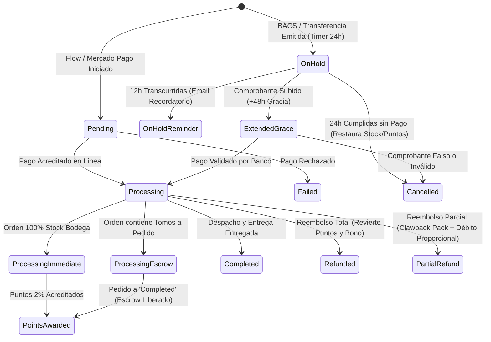

# REGLAS DE NEGOCIO FINANCIERAS, PROMOCIONALES Y TRANSACCIONALES DE AKIBARA
**Documento Maestro y Autoridad Única del Sistema de Precios, Descuentos, Cupones, Puntos y Transacciones**  
*Akibara (akibara.cl) · Versión 1.1 Definitiva y Homologada con el Código · Octubre 2026*

---

## ÍNDICE GENERAL

1. [Filosofía Financiera y Principios Rectores](#1-filosofía-financiera-y-principios-rectores)
2. [Módulo «Arma tu Pack» (SeriesBundles / BYP)](#2-módulo-arma-tu-pack-seriesbundles--byp)
   - 2.1. Arquitectura de Lista Blanca Estricta (Strict Whitelist by Owner)
   - 2.2. Tramos Comerciales Oficiales y Topes de Formato (Special Cap)
   - 2.3. Reglas Algorítmicas de Conteo y Deduplicación
   - 2.4. Matemática Best-Wins y los 3 Modos de Reserva (A Pedido)
   - 2.5. Guardia Logística: Despacho Único Consolidado en Carritos Mixtos
   - 2.6. Clawback Financiero por Cancelación o Reembolso Parcial de Tomos
3. [Descuentos de Catálogo: Reserva (A Pedido) y Editoriales](#3-descuentos-de-catálogo-reserva-a-pedido-y-editoriales)
   - 3.1. Descuento de Reserva / A Pedido (5% Obligatorio)
   - 3.2. Descuentos por Taxonomía / Editorial (`TaxonomyDiscount`)
4. [Módulo de Cupones y Promociones (WelcomeCoupon & Referrals)](#4-módulo-de-cupones-y-promociones-welcomecoupon--referrals)
   - 4.1. Cupón Único de Bienvenida (Primera Compra)
   - 4.2. Algoritmo Best-Wins y Protección de Cupones No Quemados
   - 4.3. Anti-Abuso y «Welcome Pivot» de Suscripción
   - 4.4. Cupones Virtuales de Referidos («Invita a un Amigo») v1.1
5. [Programa de Lealtad «Akibara Rewards» (Puntos & Cashback)](#5-programa-de-lealtad-akibara-rewards-puntos--cashback)
   - 5.1. Reglas de Acumulación (Earn) y Escrow Híbrido en Preventa
   - 5.2. Reglas de Canje (Redeem) y Parámetros Desacoplados
   - 5.3. Bonificaciones del Programa
   - 5.4. Vencimiento y Auditoría FIFO
6. [Políticas de Despacho y Envío Gratis](#6-políticas-de-despacho-y-envío-gratis)
   - 6.1. Umbral Oficial y Transportista
   - 6.2. Comportamiento frente a Descuentos, Puntos y Cupones
7. [Matriz de Coexistencia, Conflictos y Apilamiento (Stacking Matrix)](#7-matriz-de-coexistencia-conflictos-y-apilamiento-stacking-matrix)
   - 7.1. Tabla General de Coexistencia
   - 7.5. Anatomía Técnica y Casuística de la Colisión Cuádruple Simultánea
8. [Ciclo Transaccional, Pasarelas de Pago y Automatización BACS](#8-ciclo-transaccional-pasarelas-de-pago-y-automatización-bacs)
   - 8.1. Pasarelas de Pago y Automatización del Ciclo BACS (Transferencia 24h)
   - 8.2. Estados del Pedido y Ciclo de Vida del Dinero
   - 8.3. Política Contable de Cancelaciones y Reembolsos
9. [Glosario Maestro de Parámetros Técnicos y Opciones de Base de Datos](#9-glosario-maestro-de-parámetros-técnicos-y-opciones-de-base-de-datos)

---

## 1. FILOSOFÍA FINANCIERA Y PRINCIPIOS RECTORES

La arquitectura comercial y transaccional de Akibara está diseñada bajo cinco pilares inquebrantables:

1. **Protección Ciega del Margen Comercial (Anti-Stacking & Best-Wins):**
   Ningún descuento, cupón o beneficio promocional puede acumularse indiscriminadamente sobre otro. Siempre rige el principio **Best-Wins** (el cliente recibe la mejor oferta individual disponible) sin degradar el precio por debajo del costo de adquisición (COGS) más el flete logístico.
2. **Anti Double-Dipping (Cero Beneficio Duplicado):**
   Los programas de recompensa (Akibara Rewards) acumulan puntos **estrictamente sobre el desembolso neto real en dinero**, deduciendo cupones, promociones y puntos canjeados.
3. **Moneda Canónica sin Fracciones (CLP estricto):**
   Toda transacción se realiza en Pesos Chilenos (CLP). WooCommerce maneja cero decimales (`wc_get_price_decimals() = 0`). Todo redondeo financiero se ejecuta con `round(..., 0)` al final del cálculo en neto, protegiendo la paridad tributaria frente al SII (IVA 19% incluido en precios de lista).
4. **Techo Comercial Global de la Tienda (`DiscountCeiling`):**
   Existe una compuerta maestra de negocio en base de datos (`akb_discount_max_pct`), fijada por defecto en **15%**. Ningún tramo de pack por volumen ni campaña editorial puede superar este techo en runtime sin intervención explícita del dueño en el panel.
5. **Cero Hardcoding y Soberanía Total desde wp-admin:**
   Absolutamente todos los parámetros de negocio (umbrales, porcentajes, horas de vencimiento, pisos mínimos y modos operativos) leen de `wp_options` mediante la capa tipada `BusinessOptions`, garantizando control total sin despliegues de código.

---

## 2. MÓDULO «ARMA TU PACK» (SERIESBUNDLES / BYP)

El módulo «Arma tu Pack» fomenta la adquisición de series completas mediante descuentos automáticos escalonados por volumen dentro de la misma franquicia (`pa_serie`).

### 2.1. Arquitectura de Lista Blanca Estricta (Strict Whitelist by Owner)
- **Activación Puntual y Selectiva:**
  El sistema opera bajo una **lista blanca estricta gobernada por el dueño de la tienda**. No existe auto-activación global ni masiva de series. Solo las series que el administrador añade explícitamente a `akb_series_bundles_byp` a través de la pestaña *Arma tu Pack* en el panel administrativo son elegibles para promociones por volumen.
- **Protección de Editoriales de Bajo Margen:**
  Obras publicadas por sellos con márgenes reducidos (ej. Planeta Cómic con 20-25% de margen bruto) o novelas ligeras de alto costo de importación **NO entran por defecto** al pack. Quedan excluidas a menos que el dueño las agregue a mano y configure tramos personalizados si el margen lo tolera.
- **Formato Canónico en Base de Datos:**
  La opción `akb_series_bundles_byp` almacena un mapa JSON tipado con soporte dual (retrocompatible con el array de tramos clásico y con el esquema extendido de configuración por serie):
  ```json
  {
    "128": {
      "series_term_id": 128,
      "enabled": true,
      "is_special_edition": false,
      "tiers": [
        { "min": 5, "discount_pct": 8 },
        { "min": 7, "discount_pct": 10 }
      ]
    }
  }
  ```

### 2.2. Tramos Comerciales Oficiales y Topes de Formato (Special Cap)
Los tramos de descuento se resuelven mediante `PromotionPolicy`:

| Tipo de Serie | Tramos Oficiales | Porcentaje | Justificación Financiera |
|---|---|---:|---|
| **Series Estándar (Tankobon / B6 común)** | Desde 5 tomos | **8% OFF** | Primer umbral comercial accesible sin erosionar margen. |
| | Desde 7 tomos | **10% OFF** | Premio por volumen alto para incentivar colecciones completas. |
| **Ediciones Especiales** *(Omnibus, Maximum, Deluxe, Kanzenban, 3-en-1, Integrales)* | Desde 5 tomos | **8% OFF** | **Tope único en 8% (sin segundo tramo al 10%)**. Obras como *Berserk Maximum*, *Monster*, *20th Century Boys* o *Gantz Deluxe* tienen alto valor unitario ($16.000 – $24.000 CLP) y superan el umbral de envío gratis rápidamente. |

- **Tope Paramétrico de Ediciones Especiales (`akb_series_bundles_special_edition_max_pct`):**
  Por defecto en **8%**. Si una serie está marcada como especial o sus productos superan el peso/precio de tankobon estándar, `DiscountEngine` aplica `min(tier_pct, special_cap)`, impidiendo que un tramo de 10% degrade el margen en tomos de gran formato.
- **Guard Anti-Canibalización:**
  Está estrictamente prohibido asignar descuentos para menos de 3 tomos (`DISCOUNT_MIN_QUANTITY = 3`). Los tramos arrancan obligatoriamente desde 3 o más unidades distintas.

### 2.3. Reglas Algorítmicas de Conteo y Deduplicación
- **Conteo estricto por tomos distintos (`product_id`):** Para alcanzar un tramo de 5 tomos, el carrito debe contener al menos 5 tomos diferentes de la misma serie. Si un cliente añade 5 copias del Tomo 1, el motor deduplica y cuenta exactamente 1 tomo.
- **Beneficio unitario acotado:** El descuento aplica a **una sola unidad por tomo distinto**. Si el cliente lleva 3 unidades del Tomo 1 y 1 unidad de los tomos 2, 3, 4 y 5 (total 7 unidades, 5 distintas), el tramo de 5 tomos se alcanza, pero solo descuenta 1 unidad de cada tomo; las 2 copias adicionales del Tomo 1 se cobran a precio normal.

### 2.4. Matemática Best-Wins y los 3 Modos de Reserva (A Pedido)
El motor `DiscountEngine` calcula el descuento proyectando el precio objetivo en moneda entera antes del redondeo final de moneda:
$$\text{target\_price} = \text{round}\left(\text{regular\_price} \times \left(1 - \frac{\text{pct}}{100}\right), \; 0\right)$$
$$\text{aporte\_unitario} = \max(0, \; \text{current\_price} - \text{target\_price})$$

En un tomo estándar de $9.990 CLP, para el tramo del 8% OFF el precio objetivo unitario es exactamente $\text{round}(9990 \times 0.92, 0) = \$9.191 \text{ CLP}$. Esto genera:
- Para un tomo en stock a $9.990 CLP: aporte unitario de $\$9.990 - \$9.191 = \$799 \text{ CLP}$.
- Para un tomo en reserva a $9.491 CLP: aporte unitario de $\$9.491 - \$9.191 = \$300 \text{ CLP}$.
En un pack de 5 tomos (3 stock + 2 reserva), el cupón de pack inyecta exactamente $3 \times 799 + 2 \times 300 = \$2.997 \text{ CLP}$, dejando el total final en $\$48.952 - \$2.997 = \$45.955 \text{ CLP}$ (ahorro total de $\$3.995 \text{ CLP}$ / 8,0% sobre el precio de lista).

El comportamiento ante tomos en preventa/reserva (`onbackorder`, con 5% de descuento en catálogo) está gobernado por `akb_series_bundles_backorder_mode`:


1. **`best_wins_topup` (Por defecto — Opción 1):**
   Los tomos a pedido participan en el conteo y reciben el diferencial necesario (+3% o +5%) para completar la tasa del tramo (8% o 10%). En un tomo de $9.990 CLP con $9.491 CLP de reserva, el pack descuenta $300 CLP (al 8%) o $500 CLP (al 10%).
2. **`count_only_bridge` (Opción 3):**
   Los tomos a pedido cuentan como unidades válidas para desbloquear el tramo de 5 o 7 tomos para los tomos en stock, pero su aporte unitario al cupón de pack es estrictamente **$0 CLP**, conservando su 5% base ($9.491 CLP) y protegiendo margen en reposición.
3. **`exclude_backorder` (Opción 2):**
   Los tomos a pedido quedan excluidos totalmente de la promoción. No cuentan para alcanzar el tramo ni reciben descuento de pack.

### 2.5. Guardia Logística: Despacho Único Consolidado en Carritos Mixtos
- **Módulo Responsable:** `MixedCartShipmentGuard`.
- **Regla de Negocio:**
  En carritos que combinan productos con entrega inmediata (`instock`) y productos a pedido (`onbackorder`), la orden completa se despacha en **un único envío consolidado** una vez que la totalidad de los tomos arriba a bodega.
- **Mecánica en Checkout:**
  El sistema detecta automáticamente la condición mixta y renderiza una advertencia visual prominente en el checkout junto con un checkbox de aceptación obligatoria:
  *«Entiendo y acepto que mi pedido contiene tomos a pedido y se enviará en un único paquete consolidado cuando todos los tomos estén disponibles en bodega.»*
  Si el cliente no marca la casilla, el procesamiento del checkout se bloquea con aviso amigable.

### 2.6. Clawback Financiero por Cancelación o Reembolso Parcial de Tomos
- **Módulo Responsable:** `PartialRefundBundleGuard`.
- **Blindaje del Descuento por Volumen y Recalculación de Tramo:**
  Si un cliente compra tomos bajo «Arma tu Pack» y posteriormente solicita cancelar o reembolsar tomos a pedido (o una parte de la orden), el motor recalcula el tramo correspondiente a la cantidad de tomos efectivamente conservados:
  1. **Caso 1 — Caída bajo el umbral mínimo (< 5 tomos):**  
     Si la orden original tenía 5 tomos (8% OFF) y devuelve 2 tomos quedando con 3 tomos conservados, los tomos conservados ya no cumplen con el mínimo para pack. Pierden el descuento íntegro del pack ($799 CLP por unidad).  
     $$\text{Clawback} = \text{Tomos Conservados} \times \$799 = 3 \times \$799 = \$2.397 \text{ CLP}$$  
     El monto a reembolsar se reduce en $2.397 CLP.
  2. **Caso 2 — Degradación de Tramo (de 7+ tomos a 5–6 tomos):**  
     Si la orden original tenía 7 tomos (10% OFF, ahorro de $999 CLP por tomo) y devuelve 2 tomos a pedido quedando con 5 tomos, los 5 tomos conservados sí cumplen con el tramo de 5 tomos (8% OFF, ahorro de $799 CLP por tomo), pero ya no con el tramo de 10%.  
     La diferencia entre tramos es de $\$999 - \$799 = \$200 \text{ CLP}$ por tomo conservado.  
     $$\text{Clawback} = \text{Tomos Conservados} \times (\$999 - \$799) = 5 \times \$200 = \$1.000 \text{ CLP}$$  
     En lugar de devolver los $17.982 CLP nominales de los 2 tomos devueltos ($2 \times \$8.991), el reembolso neto ajustado es de **$16.982 CLP**, garantizando que los 5 tomos que el cliente retiene queden exactamente al precio del 8% ($9.191 CLP c/u).


---

## 3. DESCUENTOS DE CATÁLOGO: RESERVA (A PEDIDO) Y EDITORIALES

### 3.1. Descuento de Reserva / A Pedido (5% Obligatorio)
- **Alcance:** Exclusivo para tomos en estado `onbackorder` («A pedido» con distribuidora confirmada).
- **Fórmula Obligatoria (Regla 8 de Catálogo):**
  $$\text{\_sale\_price} = \text{\_price} = \text{round}(\text{\_regular\_price} \times 0.95)$$
- **Aviso Comercial en Ficha:** Activa la promesa de valor:  
  *«Precio de reserva: $X. Al llegar el stock sube a $Y»*.
- **Tachado Comercial:** Estilo estandarizado con pseudo-elemento `del::after` centrado al 50% con altura de 1.5px (suprimiendo `text-decoration: line-through` nativo).

### 3.2. Descuentos por Taxonomía / Editorial (`TaxonomyDiscount`)
- Permite campañas por editorial (ej. Panini 10% OFF, Ivrea España 5% OFF) vinculadas a `wp_termmeta` (`_akb_taxonomy_discount_pct`).
- **Política de Cupones (`stacks_with_coupons` / `akibara_taxonomy_discount_coupon_mode`):**
  Operando bajo el modo **`best_wins`** (por defecto), los cupones legítimos del sistema (`akb_sb_`, `ref-`, `hola`) no son rechazados con errores bloqueantes en el carrito, sino que coexisten mediante evaluación de mayor beneficio en cada línea.

---

## 4. MÓDULO DE CUPONES Y PROMOCIONES (WELCOMECOUPON & REFERRALS)

### 4.1. Cupón Único de Bienvenida (Primera Compra)
- **Prefijo y Formato:** `HOLA` + prefijo alfanumérico único (ej. `holajuan7k2p`).
- **Beneficio:** 10% de descuento (`akb_welcome_coupon_pct = 10`).
- **Piso Mínimo de Compra:** $25.000 CLP en productos (`akb_welcome_coupon_min_amount = 25000`).
- **Vigencia:** 3 días corridos hasta las 23:59:59 del tercer día (`akb_welcome_coupon_validity_days = 3`).
- **Restricciones de Uso:** `usage_limit = 1`, `individual_use = true`, restringido al correo registrado.

### 4.2. Algoritmo Best-Wins y Protección de Cupones No Quemados
Cuando el cliente introduce su cupón de bienvenida:
1. Si los productos ya gozan de un descuento igual o superior al 10%, el cupón aporta $0 CLP en esa línea.
2. Si el descuento de Arma tu Pack iguala o supera al cupón de bienvenida, la aplicación se bloquea amigablemente:
   *«Por la cantidad de tomos que llevas, tu descuento automático de Arma tu Pack ya iguala o supera el beneficio de bienvenida. Mantenemos el descuento mayor que más te conviene y tu cupón sigue disponible.»*
3. **El cupón conserva `usage_count = 0`** y sigue intacto para una compra futura.

### 4.3. Anti-Abuso y «Welcome Pivot» de Suscripción
- Si un usuario ya posee compras previas en la tienda e ingresa su correo en el pop-up, el sistema ejecuta el **Welcome Pivot**: lo registra en la newsletter sin emitir cupón de primera compra e invitándolo a acumular Puntos Akibara.

### 4.4. Cupones Virtuales de Referidos («Invita a un Amigo») v1.1
- **Mapeo a Base de Datos:**
  * Descuento al invitado: `akb_rewards_referral_coupon_amount = 2000` ($2.000 CLP).
  * Piso mínimo de compra: `akb_rewards_referral_min_order = 30000` ($30.000 CLP).
  * Premio al padrino: `akb_rewards_referral_points = 1000` ($1.000 CLP en puntos).
- **Control de Fuga y Subsidio Saludable:**
  Elevar el piso mínimo a **$30.000 CLP** reduce el subsidio máximo de adquisición del 15,8% al **13,53%**, preservando el margen de Akibara en órdenes de entrada.
- **Compatibilidad con Tomos en Reserva:**
  Se configura `exclude_sale_items = false` con validación granular de línea, permitiendo que el cupón de referido descuente sobre tomos a pedido con 5% de reserva, mientras continúa protegiendo productos con liquidaciones mayores al 10%.
- **Precedencia y Reemplazo Dinámico (Prioridad 1100):**
  La auto-aplicación del referido corre en prioridad `1100` (`woocommerce_before_calculate_totals`). Si el carrito califica para un pack de serie con descuento superior a $2.000 CLP, el sistema reemplaza pacíficamente el cupón de referido por el pack e informa al cliente en pantalla.
- **Validación Antifraude Cruzada:**
  Bloqueo instantáneo si el invitado comparte correo, teléfono, RUT o dirección con el padrino.

---

## 5. PROGRAMA DE LEALTAD «AKIBARA REWARDS» (PUNTOS & CASHBACK)

### 5.1. Reglas de Acumulación (Earn) y Escrow Híbrido en Preventa
- **Tasa de Acumulación:** **2 puntos por cada $100 CLP** gastados (`akb_rewards_earn_points = 2`, `akb_rewards_earn_amount = 100`), equivalente a un **2% de cashback neto**.
- **Base de Acreditación Honesta:**
  $$\text{Base} = \max\Big(0, \; (\text{Total Ítems con IVA tras Descuentos}) - \text{Canje Neto en Puntos}\Big)$$
  El flete logístico y los montos pagados con cupones o puntos NO generan puntos (Anti Double-Dipping).
- **Escrow Híbrido para Tomos a Pedido (`akb_rewards_award_backorder_mode = 'escrow_to_completed'`):**
  En compras que contienen tomos en reserva, los puntos acumulados se ponen en custodia temporal (*escrow*) durante el estado `processing` y se acreditan definitivamente al saldo del cliente cuando el pedido pasa a `completed` (tras el despacho físico), impidiendo retiros de cashback sobre compras no consolidadas.

### 5.2. Reglas de Canje (Redeem) y Parámetros Desacoplados
- **Valor Facial:** **1 punto = $1 CLP** (`akb_rewards_redeem_value = 1`).
- **Inyección en Carrito:** Fee negativo con neutralidad fiscal SII (IVA 19% deducido en neto).
- **Límites Paramétricos en Base de Datos:**

| Parámetro | Opción en BD | Valor por Defecto | Descripción |
|---|---|---:|---|
| **Piso Mínimo de Carrito** | `akb_rewards_redeem_min_cart` | **$25.000 CLP** | Mínimo para habilitar selector de puntos. |
| **Mínimo de Puntos por Canje** | `akb_rewards_redeem_min_points` | **100 pts** | Mínimo $100 CLP de canje. |
| **Tope Escalonado Tramo 1** | `akb_rewards_redeem_tier1_max_amount` | **2.000 pts** | Máximo canjeable entre $25.000 y $49.999. |
| **Umbral del Tramo 2** | `akb_rewards_redeem_tier2_min_cart` | **$50.000 CLP** | Subtotal requerido para saltar al tope superior. |
| **Tope Escalonado Tramo 2** | `akb_rewards_redeem_max_amount` | **5.000 pts** | Máximo canjeable desde $50.000 CLP. |
| **Tope Porcentual** | `akb_rewards_redeem_max_pct` | **50%** | Nunca cubre más del 50% de la mercadería. |

- **Conmutación Voluntaria en Checkout de Bloques (`akb_rewards_allow_manual_switch_below_bundle = 'yes'`):**
  El cliente puede activar voluntariamente sus puntos mediante el switch interactivo incluso si el monto en puntos es menor que el descuento del pack, permitiéndole elegir deliberadamente conservar el subtotal sobre los $60.000 CLP para asegurar el envío gratis.

### 5.3. Bonificaciones del Programa
- **Bono de Bienvenida:** **500 puntos ($500 CLP)** acreditados automáticamente en la primera compra pagada con dinero real.
- **Cumpleaños:** **1.000 puntos ($1.000 CLP)** otorgados una vez al año al cliente registrado.
- **Programa de Referidos («Invita a un amigo»):** **1.000 puntos ($1.000 CLP)** para el padrino cuando el invitado completa su primer pedido (`completed`).
- **Reseñas con Foto Aprobadas:** **500 puntos ($500 CLP)** por reseña verificada con fotografía, tras aprobación editorial.

### 5.4. Vencimiento y Auditoría FIFO
- **Caducidad:** Los puntos expiran a los **12 meses** (`akb_rewards_expiry_months = 12`) evaluados mediante algoritmo FIFO estricto sobre el ledger.

---

## 6. POLÍTICAS DE DESPACHO Y ENVÍO GRATIS

### 6.1. Umbral Oficial y Transportista
- **Umbral de Envío Gratis:** **$60.000 CLP** a domicilio en todo Chile continental mediante Blue Express (`akibara_fsp_carrier_threshold = 60000`).
- **Exclusión Expresa:** La modalidad de **Retiro en Punto Blue (PUDO)** se cotiza con tarifa preferencial independiente y no califica para gratuidad por monto.

### 6.2. Comportamiento frente a Descuentos, Puntos y Cupones
- **Cupones de Descuento (Welcome / Promocionales / Pack):**
  Reducen la base imponible del envío gratis (`ignore_discounts = no`). Si un carro de $64.000 CLP recibe un descuento de cupón de -$5.000 CLP, la base cae a $59.000 CLP y pierde el envío gratis.
- **Puntos Akibara Rewards:**
  Se aplican como un **FEE NEGATIVO**, manteniendo intacto el subtotal de productos. Un carrito de $62.000 CLP que canjea $3.000 en puntos paga $59.000 CLP pero **CONSERVA EL ENVÍO GRATIS**.

---

## 7. MATRIZ DE COEXISTENCIA, CONFLICTOS Y APILAMIENTO (STACKING MATRIX)

### 7.1. Tabla General de Coexistencia

| Escenario Combinado | ¿Se Pueden Combinar? | Comportamiento del Sistema y Resolución de Conflictos |
|---|:---:|---|
| **Arma tu Pack + Cupón de Bienvenida** | **NO** | **Arma tu Pack cede ante cupones externos.** Si el cupón de bienvenida beneficia más, se aplica el cupón y el pack se retira. Si el pack beneficiaba más, el cupón de bienvenida se bloquea amigablemente y no se quema. |
| **Arma tu Pack + Cupón Referido** | **NO (Dinámico)** | Si el descuento del pack supera a los $2.000 CLP del referido, el pack reemplaza automáticamente al referido. |
| **Puntos Akibara + Cupones (Cualquiera)** | **NO** | **Exclusión mutua absoluta.** Canjear puntos desactiva la aplicación de cupones; ingresar un cupón suprime el fee de puntos. |
| **Arma tu Pack + Puntos Akibara** | **NO (Conmutativo)** | Exclusión resuelta vía switch interactivo (Shortcode o Store API de Bloques). |
| **Arma tu Pack + Descuento Reserva (5%)** | **SÍ (Best-Wins)** | El tomo en reserva mantiene su 5% base y el pack suma la diferencia para llegar al 8% o 10%. |
| **Puntos Akibara + Envío Gratis** | **SÍ** | El canje de puntos no degrada el subtotal de mercadería, conviviendo armoniosamente con el envío gratis. |

---

### 7.5. ANATOMÍA TÉCNICA Y CASUÍSTICA DE LA COLISIÓN CUÁDRUPLE SIMULTÁNEA

#### A. Traza Técnica de Ejecución (Orden de Hooks de WooCommerce)
```
[1. Request / Renderizado de Carrito]
  └─► woocommerce_product_get_price (Prio 10/20)
        └─► _sale_price nativo y TaxonomyDiscount resuelven precios rebajados de lista.

[2. Cálculo de Totales: woocommerce_before_calculate_totals]
  └─► Prio 1000: SeriesBundles\BundleCouponEngine::manage_cart_coupons
        ├─► Si hay intención de puntos o switch activo ──► Pack cede ($expected = []).
        └─► Si hay cupones externos legítimos ──► Pack evalúa coexistencia o cede.
  └─► Prio 1100: Referrals::auto_apply_referral_coupon
        └─► Si pack > $2.000 CLP ──► Pack reemplaza al referido dinámicamente.

[3. Validación de Cupones: woocommerce_coupon_is_valid]
  ├─► Prio 10: TaxonomyDiscount\CouponInteraction::maybe_invalidate
  │     Bajo modo 'best_wins', autoriza cupones akb_sb_, ref- y hola.
  ├─► Prio 10: Redemption::disallow_coupon_with_points
  │     Bloquea cupones si existen puntos canjeados activos.
  └─► Prio 20: WelcomeCoupon\CouponService::validate_coupon_is_valid
        └─► Compara bienvenida vs pack; bloquea amigablemente si pack >= bienvenida.

[4. Cálculo de Fees: woocommerce_cart_calculate_fees]
  └─► Prio 20: Redemption::apply_fee
        Si no hay cupones en el carrito, inyecta fee negativo con neutralidad IVA 19%.

[5. Evaluación Logística y Checkout]
  ├─► FreeShippingThreshold evalúa $60.000 CLP.
  └─► MixedCartShipmentGuard exige aceptación de envío consolidado si hay reservas.
```

---

## 8. CICLO TRANSACCIONAL, PASARELAS DE PAGO Y AUTOMATIZACIÓN BACS

### 8.1. Pasarelas de Pago y Automatización del Ciclo BACS (Transferencia 24h)
Akibara opera con tres pasarelas oficiales:
1. **Flow (Webpay Plus, Mach, Servipag, Multicaja):** Pasarela primaria automatizada en CLP.
2. **Mercado Pago:** Pasarela secundaria con tarjeta de crédito/débito.
3. **Transferencia Bancaria Directa (BACS) con Ciclo Automatizado (`BacsLifecycleManager`):**
   - **Ventana de Pago Estándar:** **24 horas** corridas (`akb_bacs_expiration_hours = 24`).
   - **Recordatorio Amigable a las 12h:** A las 12 horas de emitida la orden (`akb_bacs_reminder_hours = 12`), se despacha un correo automatizado de aviso antes de la caducidad.
   - **Expiración Automatizada:** Cumplidas las 24 horas sin confirmación, Action Scheduler cancela el pedido (`cancelled`), restituyendo stock físico, liberando cupones y reponiendo puntos canjeados al cliente.
   - **Portal de Informe de Pago y Extensión de Gracia (+48h):**
     En la pantalla de agradecimiento (`order-received`) y en el detalle de la cuenta (`view-order`), el cliente dispone de un portal directo para **informar el N.º de operación o comprobante de transferencia bancaria** mediante un campo de texto validado en frontend.  
     *Decisión de Seguridad y Arquitectura:* Se privilegia el informe por texto del N.º de Operación / RUT sobre la subida de archivos físicos en el servidor compartido de Hostinger, eliminando vectores de seguridad (cargas no autenticadas, malware y saturación de disco) y permitiendo al equipo administrativo contrastar el pago en segundos en la cartola del Banco de Chile.  
     Al informar el número de operación, el pedido entra en revisión administrativa y **recibe automáticamente 48 horas adicionales de gracia** (`akb_bacs_receipt_grace_hours = 48`), impidiendo la cancelación mientras el equipo contable valida la acreditación bancaria.


### 8.2. Estados del Pedido y Ciclo de Vida del Dinero


### 8.3. Política Contable de Cancelaciones y Reembolsos
1. **Cancelación o Reembolso Total (`cancelled`, `refunded`):**
   - Puntos ganados: débito íntegro `order_reversal`.
   - Puntos canjeados: restitución íntegra al cliente `redemption_reversal`.
   - Bono de primera compra: elegibilidad reestablecida para compras genuinas posteriores.
2. **Reembolso Parcial:**
   - Si causa que la serie baje del umbral mínimo del pack (< 5 tomos), se aplica el **Clawback de Pack** (`PartialRefundBundleGuard`).
   - Puntos canjeados se devuelven de forma estrictamente proporcional a la mercadería devuelta.
   - Puntos ganados se ajustan mediante `order_refund` conservando la base neta de mercadería retenida.

---

## 9. GLOSARIO MAESTRO DE PARÁMETROS TÉCNICOS Y OPCIONES DE BASE DE DATOS

A continuación se listan las 50 opciones canónicas registradas en `wp_options` y administrables desde el panel central de Akibara:

| Opción de Base de Datos | Tipo | Default | Módulo Responsable | Descripción de Negocio |
|---|---|---:|---|---|
| `akb_discount_max_pct` | entero | `15` | `DiscountCeiling` | Techo absoluto de descuento promocional en toda la tienda. |
| `akb_series_bundles_enabled` | bool | `yes` | `SeriesBundles` | Interruptor maestro del módulo «Arma tu Pack». |
| `akb_series_bundles_byp` | JSON | `{}` | `SeriesBundles` | Lista blanca estricta de series y sus tramos de descuento. |
| `akb_series_bundles_allow_backorder` | bool | `yes` | `SeriesBundles` | Habilita o deshabilita participación de tomos a pedido. |
| `akb_series_bundles_backorder_mode` | enum | `best_wins_topup` | `SeriesBundles` | Modo de reserva: `best_wins_topup`, `count_only_bridge`, `exclude_backorder`. |
| `akb_series_bundles_special_edition_max_pct` | entero | `8` | `SeriesBundles` | Tope máximo de descuento para tomos de gran formato/ediciones especiales. |
| `akb_series_bundles_allow_split_shipment` | bool | `no` | `Logistics` | Permite o prohíbe despachos parciales sin costo en carritos mixtos. |
| `akb_series_bundles_require_mixed_cart_acceptance` | bool | `yes` | `Logistics` | Exige checkbox obligatorio de despacho consolidado en checkout. |
| `akb_series_bundles_exclude_cats` | array | `[]` | `SeriesBundles` | Categorías de producto excluidas de promociones por pack. |
| `akb_welcome_coupon_enabled` | bool | `no` | `WelcomeCoupon` | Interruptor del popup y cupón dinámico de bienvenida. |
| `akb_welcome_coupon_pct` | entero | `10` | `WelcomeCoupon` | Porcentaje de descuento del cupón de bienvenida. |
| `akb_welcome_coupon_min_amount` | entero | `25000` | `WelcomeCoupon` | Subtotal mínimo en CLP para activar el cupón de bienvenida. |
| `akb_welcome_coupon_validity_days` | entero | `3` | `WelcomeCoupon` | Días corridos de validez del cupón antes de caducar. |
| `akb_welcome_promo_enabled` | bool | `no` | `WelcomeCoupon` | Interruptor del popup estático de campañas especiales. |
| `akb_rewards_referral_min_order` | entero | `30000` | `Rewards\Referrals` | Compra mínima para cupón de referido ($30.000 CLP / subsidio saludable). |
| `akb_rewards_referral_coupon_amount` | entero | `2000` | `Rewards\Referrals` | Descuento en pesos del cupón de referido para el invitado ($2.000 CLP). |
| `akb_rewards_referral_points` | entero | `1000` | `Rewards\Referrals` | Puntos otorgados al padrino tras la entrega de la orden ($1.000 CLP). |
| `akb_rewards_referral_cookie_days` | entero | `30` | `Rewards\Referrals` | Días de persistencia de la cookie de referido en el navegador. |
| `akb_rewards_referral_auto_apply` | bool | `yes` | `Rewards\Referrals` | Auto-aplicación del cupón al superar el monto mínimo en sesión. |
| `akb_rewards_referral_allow_backorder_items` | bool | `yes` | `Rewards\Referrals` | Permite aplicar el cupón de referido sobre tomos en reserva 5%. |
| `akb_rewards_earn_enabled` | bool | `yes` | `Rewards\Accrual` | Interruptor del carril de acumulación de puntos. |
| `akb_rewards_earn_points` | entero | `2` | `Rewards\Accrual` | Puntos otorgados por cada tramo de dinero gastado. |
| `akb_rewards_earn_amount` | entero | `100` | `Rewards\Accrual` | Monto base en CLP por tramo de acumulación ($100 CLP = 2%). |
| `akb_rewards_award_status` | texto | `processing` | `Rewards\Accrual` | Estado que dispara la acreditación de compras con stock regular. |
| `akb_rewards_award_backorder_mode` | enum | `escrow_to_completed` | `Rewards\Accrual` | Modo de custodia temporal de puntos para tomos en preventa. |
| `akb_rewards_redeem_value` | entero | `1` | `Rewards\Redemption` | Valor facial de cada punto canjeado en pesos ($1 CLP). |
| `akb_rewards_redeem_min_cart` | entero | `25000` | `Rewards\Redemption` | Subtotal mínimo en productos para habilitar el canje de puntos. |
| `akb_rewards_redeem_min_points` | entero | `100` | `Rewards\Redemption` | Cantidad mínima de puntos requerida para realizar un canje. |
| `akb_rewards_redeem_tier1_max_amount` | entero | `2000` | `Rewards\Redemption` | Tope máximo en pesos para canje en compras de $25.000 a $49.999. |
| `akb_rewards_redeem_tier2_min_cart` | entero | `50000` | `Rewards\Redemption` | Subtotal requerido para acceder al tope superior de canje ($5.000). |
| `akb_rewards_redeem_max_amount` | entero | `5000` | `Rewards\Redemption` | Tope máximo en pesos para canje en compras $\ge \$50.000$. |
| `akb_rewards_redeem_max_pct` | entero | `50` | `Rewards\Redemption` | Porcentaje máximo del carrito que puede cubrirse con puntos. |
| `akb_rewards_allow_manual_switch_below_bundle` | bool | `yes` | `Rewards\Blocks` | Permite conmutar a puntos incluso si el pack ofrecía más descuento. |
| `akb_rewards_welcome_bonus` | entero | `500` | `Rewards\Bonuses` | Bono de puntos acreditado tras la primera compra genuina. |
| `akb_rewards_birthday_points` | entero | `1000` | `Rewards\Bonuses` | Puntos de regalo de cumpleaños otorgados anualmente. |
| `akb_rewards_review_points` | entero | `500` | `Rewards\Bonuses` | Puntos otorgados por reseña fotográfica aprobada. |
| `akb_rewards_expiry_months` | entero | `12` | `Rewards\Ledger` | Meses de vigencia de los puntos antes de caducar por FIFO. |
| `akibara_taxonomy_discount_enabled` | bool | `no` | `TaxonomyDiscount` | Interruptor general de promociones por editorial/taxonomía. |
| `akibara_taxonomy_discount_stacks_coupons` | bool | `no` | `TaxonomyDiscount` | Permite apilamiento de descuentos editoriales con cupones externos. |
| `akibara_taxonomy_discount_coupon_mode` | enum | `best_wins` | `TaxonomyDiscount` | Política de coexistencia: `strict_reject` o `best_wins`. |
| `akibara_fsp_enabled` | bool | `yes` | `FreeShipping` | Interruptor de la barra de progreso de envío gratis. |
| `akibara_fsp_carrier_threshold` | entero | `60000` | `FreeShipping` | Umbral en CLP para envío gratis a domicilio con Blue Express. |
| `akb_bacs_expiration_hours` | entero | `24` | `BacsLifecycle` | Horas de vigencia para pagar transferencia antes de anular el pedido. |
| `akb_bacs_reminder_hours` | entero | `12` | `BacsLifecycle` | Horas transcurridas para enviar correo recordatorio de pago BACS. |
| `akb_bacs_receipt_grace_hours` | entero | `48` | `BacsLifecycle` | Horas adicionales de gracia concedidas tras subir comprobante. |
| `akb_bacs_allow_receipt_upload` | bool | `yes` | `BacsLifecycle` | Habilita portal en frontend para informar el N.º de operación o transferencia. |

| `akb_bacs_notify_admin_on_receipt` | bool | `yes` | `BacsLifecycle` | Notifica al equipo de soporte al recibir un comprobante BACS. |
| `akb_bacs_restore_stock_on_cancel` | bool | `yes` | `BacsLifecycle` | Repone automáticamente el stock físico al expirar las 24 horas. |
| `akb_bacs_restore_points_on_cancel` | bool | `yes` | `BacsLifecycle` | Restituye automáticamente los puntos canjeados al expirar el pedido. |
| `akb_bacs_restore_coupons_on_cancel` | bool | `yes` | `BacsLifecycle` | Restaura los cupones consumidos al expirar el pedido por BACS. |

---
*Documento homologado y certificado con el código fuente ejecutable en Akibara (akibara.cl).*
