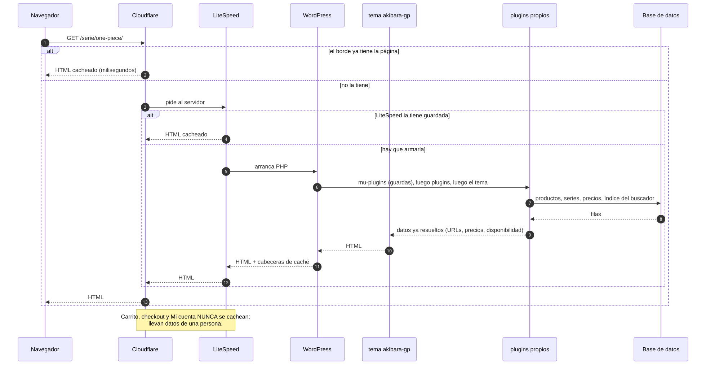
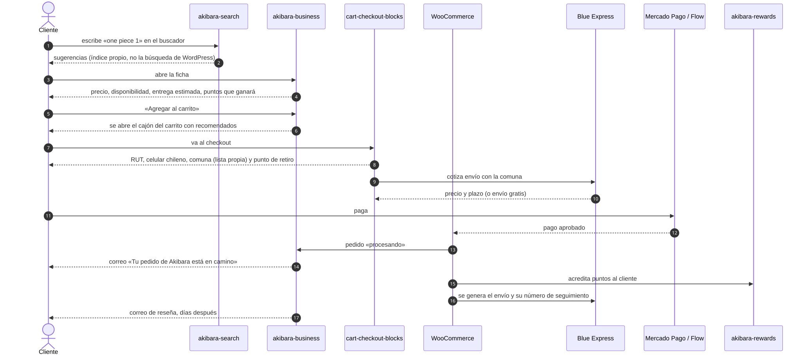
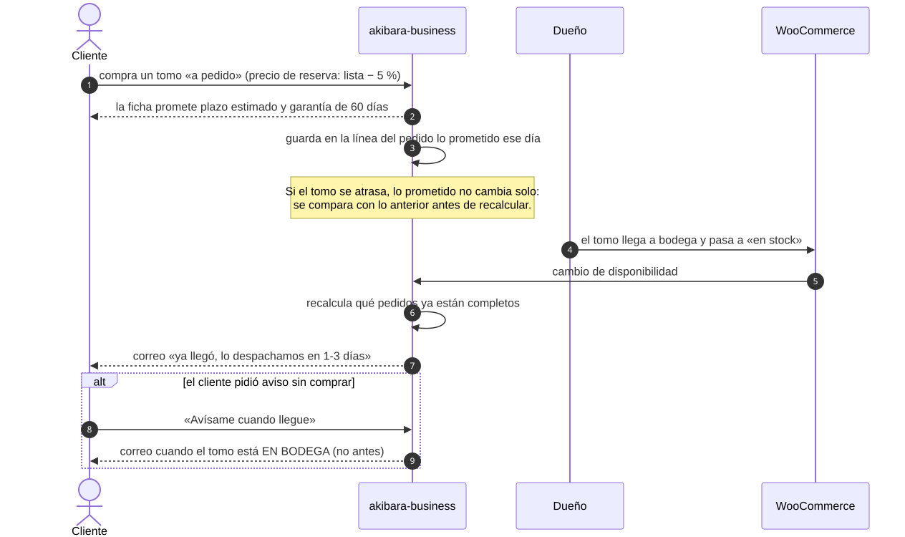

# Visión general: qué es Akibara por dentro

> Documenta el código publicado el 2026-09-13: akibara-business 1.116.5 · akibara-search 0.1.60 · akibara-cart-checkout-blocks 2.2.17 · akibara-rewards 0.3.14 · tema akibara-gp 2.1.119 · 18 mu-plugins.

Este capítulo está escrito para alguien que llega hoy y **no conoce nada**: ni WordPress, ni WooCommerce, ni la tienda. Al terminarlo deberías poder decir, sin ayuda, qué pieza hace qué, por dónde pasa una compra y dónde mirar cuando algo falla. Las palabras técnicas se explican la primera vez que aparecen y todas están en el [glosario](glosario.md).

---

## 1. Qué es Akibara y qué vende

Akibara (akibara.cl) es una tienda chilena de manga y cómic. Vende **tomos**: un tomo es un libro concreto de una **serie** (One Piece 45, Berserk 12). Cada tomo lo publica una **editorial** —Ivrea Argentina, Panini, OVNI Press, editoriales españolas— y eso importa más de lo que parece: dos editoriales pueden publicar la misma serie con numeración y precio distintos, así que «Jujutsu Kaisen» no es una cosa sola, sino una por edición.

Un tomo se vende en uno de tres estados, y casi todo lo que verás después existe por esta distinción:

| estado | qué significa | qué se le promete al cliente |
| --- | --- | --- |
| **En bodega** | Está en la tienda, se despacha ya | Plazo de envío normal |
| **A pedido** | No está en bodega, pero la editorial lo puede mandar | Precio de reserva (la lista menos 5 %), plazo estimado en semanas y garantía de 60 días |
| **Preventa** | Todavía no sale a la venta; se reserva con fecha anunciada | Fecha de salida y aviso una semana antes |

Hoy el catálogo **no tiene ninguna preventa configurada de verdad**: los ~422 tomos marcados «Preventa» son en realidad importación **a pedido**. El código distingue los dos casos aunque el catálogo todavía no los use.

El dueño opera la tienda entero desde un panel propio dentro de WordPress, sin tocar código. Esa es una regla de la casa, no una casualidad: **todo lo que cambia con la operación tiene que ser editable desde una pantalla**.

---

## 2. De qué está hecha

Akibara corre sobre **WordPress** (el programa que sirve el sitio) con **WooCommerce** (el módulo que le añade tienda: productos, carrito, pedidos, correos). Los dos son de terceros y **nunca se editan**: se les habla por *hooks*, que son avisos que WordPress lanza en momentos concretos («se guardó un pedido», «voy a pintar el precio») para que otro código haga algo o modifique un valor.

Encima de eso vive el **código propio**, que es lo único que se modifica:

| pieza | en una frase | tamaño |
| --- | --- | --- |
| **akibara-business** | El plugin principal: catálogo y series, disponibilidad y preventa, carrito y checkout, cuenta del cliente, panel del dueño, SEO y correo | ~74 módulos, 88 mil líneas |
| **akibara-search** | El buscador propio: índice en tablas propias, facetas, sugerencias, y la «foto» de descuentos que business adopta | 32 mil líneas |
| **akibara-cart-checkout-blocks** | Lo chileno del checkout: RUT, celular, comuna y punto de retiro Blue Express | 4 mil líneas |
| **akibara-rewards** | Akibara Puntos y las reseñas con foto | 10 mil líneas |
| **tema akibara-gp** | Todo lo que se ve: cabecera, ficha, pie, correos de marca. Es un *tema hijo* de GeneratePress | 4 mil líneas |
| **18 mu-plugins** | Guardas y parches sobre terceros: correo SMTP y su centinela, LiteSpeed, Blue Express, Brevo, Clarity, claves de proveedores | 5 mil líneas |

Un **mu-plugin** («must use») es un fichero que WordPress carga siempre, antes que los plugins normales, y que no se puede desactivar desde el escritorio. Ahí vive el pegamento: lo que arregla el comportamiento de un tercero sin tocar su código.

Alrededor hay servicios externos: **Cloudflare** (acelera y protege el sitio en el borde de internet), **LiteSpeed** (guarda las páginas ya armadas en el servidor), **Blue Express** (cotiza envíos, puntos de retiro y seguimiento), **Mercado Pago** y **Flow** (cobran), **Brevo** (correo de carrito abandonado), **Rank Math** (SEO), **Google** (catálogo en Merchant Center, login, direcciones) y **Microsoft Clarity** (grabaciones de sesión).

---

## 3. Qué pasa cuando alguien abre una página

Lo importante para depurar: **una página puede venir de tres sitios distintos**. De Cloudflare (el borde, milisegundos), de LiteSpeed (el servidor, sin ejecutar PHP) o recién armada. Por eso, cuando cambias algo y «no se ve», la pregunta correcta no es «¿se guardó?» sino «¿qué copia está viendo el cliente?». Carrito, checkout y Mi cuenta nunca se cachean, porque llevan datos de una persona.

El orden de carga también importa: primero los mu-plugins, después los plugins (business antes que el resto, porque él resuelve URLs y datos que los demás usan), y al final el tema.

---

## 4. Los cinco viajes que explican la tienda

### 4.1 Comprar un tomo que está en bodega

El cliente busca, y quien contesta **no es la búsqueda de WordPress** sino el buscador propio, que mantiene su propio índice: por eso puede ordenar por relevancia real, corregir errores de tipeo y entender que «jujutsu kaisen ivrea» es una serie más una editorial. Abre la ficha, donde business pinta precio, disponibilidad, entrega estimada y cuántos puntos ganará. Al agregar, se abre un cajón lateral propio (no la página de carrito de WooCommerce) con recomendaciones de la misma serie.

En el checkout entran los campos chilenos: RUT con su dígito verificador, celular, y **comuna elegida de una lista propia** (la de Blue Express no sirve: llega incompleta). Con la comuna, Blue cotiza el envío o concede envío gratis. Paga con Mercado Pago o Flow, WooCommerce marca el pedido, y a partir de ahí salen los correos de marca, se acreditan los puntos y, días después, la invitación a dejar una reseña.

### 4.2 Comprar un tomo «a pedido»

Aquí la tienda promete algo a futuro, así que **lo prometido se congela en la línea del pedido** el día de la compra. Si después la fecha cambia, no se recalcula a ciegas: se compara con lo anterior. Esa disciplina existe porque una vez un recálculo diario corrió la promesa un día cada día, y el aviso al cliente nunca llegaba.

Cuando el tomo llega a bodega, business recalcula qué pedidos quedaron completos y manda el correo «ya llegó». Y si alguien pidió aviso sin comprar («Avísame cuando llegue»), el correo sale **sólo cuando el tomo está físicamente en bodega**: es una decisión del dueño, no una limitación.

### 4.3 Seguir una serie

El cliente pulsa «Seguir» en una serie. Cuando se publica un tomo nuevo de esa serie, una cola de trabajos le manda un correo a las 06:30 de la mañana, agrupando los tomos si salieron varios, con un tope de un correo por semana y por cliente.

### 4.4 Ganar y canjear puntos, y dejar una reseña

Cada compra acredita puntos en un **ledger** (un libro de movimientos: cada fila suma o resta, y el saldo es la suma). Se canjean en el checkout como descuento, caducan si pasan meses sin actividad, hay bono de bienvenida, referidos y saludo de cumpleaños. Las reseñas piden foto y pagan 500 puntos; hoy la tienda tiene **cero reseñas publicadas**, y ese hueco está documentado en el capítulo 11.

### 4.5 El dueño pone una campaña de descuento

Es el viaje más delicado del sistema, porque cruza dos plugins. El dueño enciende una campaña por editorial y fechas. El buscador **sella una «foto»** de esa configuración —una copia congelada con su huella— y business la **adopta**: si la foto no cuadra exactamente con lo que hay, se rechaza entera y el precio vuelve al normal. Suena drástico y es deliberado: **mejor sin descuento que con un precio inventado**. Después hay que purgar las cachés, o el cliente seguiría viendo el precio viejo.

---

## 5. El reloj de la tienda

Nada de lo anterior pasa solo: hay trabajos programados. En producción WordPress no depende de las visitas para dispararlos (eso sería impredecible): el servidor los empuja **cada 5 minutos**.

Los trabajos propios son diecisiete, repartidos entre dos mecanismos: los eventos de WordPress (cosas simples y diarias) y **Action Scheduler**, la cola de WooCommerce, que guarda cada trabajo en su tabla con estado y argumentos, y es donde va todo lo que no puede perderse. El capítulo 16 los lista uno a uno con su hora, qué leen, qué escriben, qué correo mandan y qué pasa si corren dos veces seguidas.

---

## 6. Dónde vive cada dato

Tres sitios, y conviene no confundirlos:

- **Options**: ajustes globales del sitio (el interruptor de una campaña, un texto editable). El panel del dueño escribe options.
- **Metas**: datos pegados a una cosa concreta —un producto (`postmeta`), una serie o editorial (`termmeta`), un cliente (`usermeta`), un pedido—. El precio de reserva de un tomo, la fecha de preventa o el saldo de puntos son metas.
- **Tablas propias**: diez, para lo que no cabe en lo anterior: el índice del buscador y sus tablas sombra, la lista de espera, los favoritos, la cola de avisos de serie, el ledger de puntos, el registro de búsquedas.

El capítulo 17 es el catálogo completo: quién escribe cada dato, quién lo lee y **qué pantalla lo expone al dueño** (o si no la tiene, que es un defecto por la regla de la casa).

---

## 7. Qué se rompe si falta una pieza

El tema depende **a propósito** de business: si business no está, el sitio falla ruidosamente en vez de servir páginas a medias. Business y search se necesitan mutuamente y se validan por versión: desplegar uno solo puede dejar al otro pidiendo una versión que ya no existe, y eso tumbó la tienda una vez. Rewards, en cambio, se puede caer sin que la tienda deje de vender.

---

## 8. Cómo se prueba y cómo se despliega

1. **Primero en el espejo**: una copia completa del sitio en Docker (`http://localhost:8080`), con su propio correo capturado. Ahí se descubre y se deja en verde.
2. **Después en producción**: el espejo miente en lo que se mide —el cron real, Cloudflare, LiteSpeed, los datos de verdad—, así que **lo desplegado se vuelve a medir arriba**. Hasta que no está medido en producción, no está aprobado.
3. **La verdad de lo publicado es el ZIP** de `dist/`, no el árbol local: el árbol suele mezclar trabajo sin terminar.
4. El despliegue va por dos carriles que suben, comprueban fichero a fichero y corren un chequeo de salud del correo.
5. Quien escribe un arreglo **no lo cierra**: lo cierra quien lo vuelve a medir.

---

## 9. Mapa de lectura

| Si tu pregunta es… | Abre |
| --- | --- |
| ¿Cómo arranca todo y qué enciende cada módulo? | [02](02-business-nucleo.md) |
| ¿Cómo se organizan series, tomos y editoriales? | [03](03-business-catalogo-y-series.md) |
| ¿Por qué este tomo dice «a pedido» y qué se le promete? | [04](04-business-disponibilidad-preventa-y-avisos.md) |
| ¿Qué pasa entre el carrito y el correo de confirmación? | [05](05-business-carrito-checkout-y-cuenta.md) |
| ¿Dónde cambia el dueño precios, textos y portada? | [06](06-business-panel-descuentos-textos-y-portada.md) |
| ¿Cómo nos encuentra Google y qué correos salen? | [07](07-business-seo-ia-blog-y-correo.md) |
| ¿Por qué el buscador se cayó / cómo se reconstruye? | [08](08-search-indice-y-rebuild.md) |
| ¿Por qué esta búsqueda devuelve esto? | [09](09-search-consulta-facetas-y-sugerencias.md) |
| ¿Cómo se ganan y se gastan los puntos? | [10](10-rewards-akibara-puntos.md) |
| ¿Cómo funcionan las reseñas con foto? | [11](11-rewards-resenas.md) |
| ¿Por qué el checkout pide RUT y comuna así? | [12](12-checkout-blocks-campos-chilenos-y-pudo.md) |
| ¿Dónde se cambia lo que se ve? | [13](13-tema-akibara-gp.md) |
| ¿Qué parches hay sobre terceros? | [14](14-mu-plugins-abilities-bluex-brevo-clarity.md) y [15](15-mu-plugins-correo-litespeed-claves-y-guardas.md) |
| ¿Qué corre solo y a qué hora? | [16](16-todo-lo-programado.md) |
| ¿Dónde se guarda este dato? | [17](17-catalogo-de-datos.md) |
| ¿Cómo hablamos con Blue Express, Brevo, Rank Math…? | [18](18-fronteras-con-terceros.md) |
| ¿Qué pasa si desactivo esto? | [19](19-como-se-hablan-los-plugins.md) |
| ¿Qué está roto hoy y qué se arregló? | [20](20-hallazgos-qa.md) |
| ¿Qué espera una decisión del dueño? | [21](21-decisiones-del-dueno.md) |
| ¿Qué significa esta palabra? | [glosario](glosario.md) |

---

## 10. Las cinco cosas que más sorprenden al llegar

1. **La búsqueda de la tienda no es la de WordPress.** Hay un índice propio con sus tablas, su reconstrucción y su vigilante.
2. **El precio con descuento no se calcula al vuelo**: se publica como una foto sellada que el otro plugin adopta, y si no cuadra se apaga el descuento entero.
3. **«A pedido» y «preventa» comparten el mismo estado de stock de WooCommerce** (`onbackorder`); lo que los distingue es una meta propia.
4. **El tema falla a propósito si el plugin principal no está.** No es un descuido: sin business, el sitio no tiene ni URLs ni catálogo.
5. **Casi todo texto que lee el cliente es editable desde el panel.** Cuando encuentres uno que no lo es, es un defecto pendiente, no una decisión.
