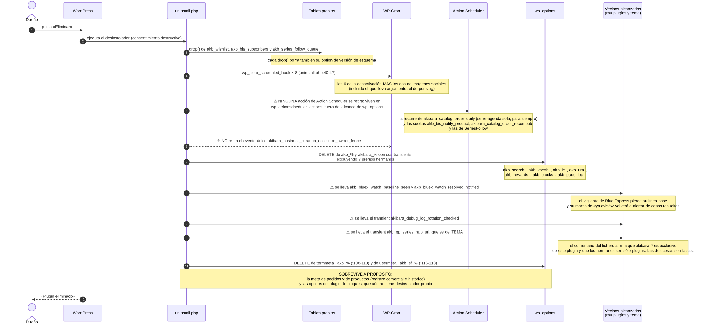
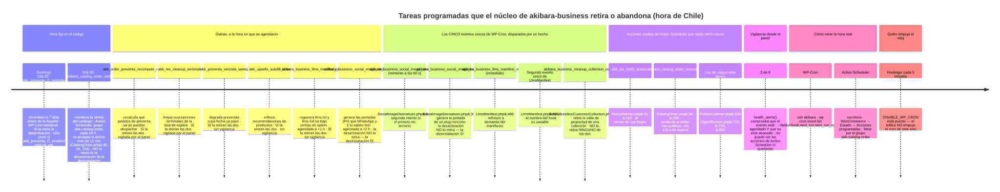
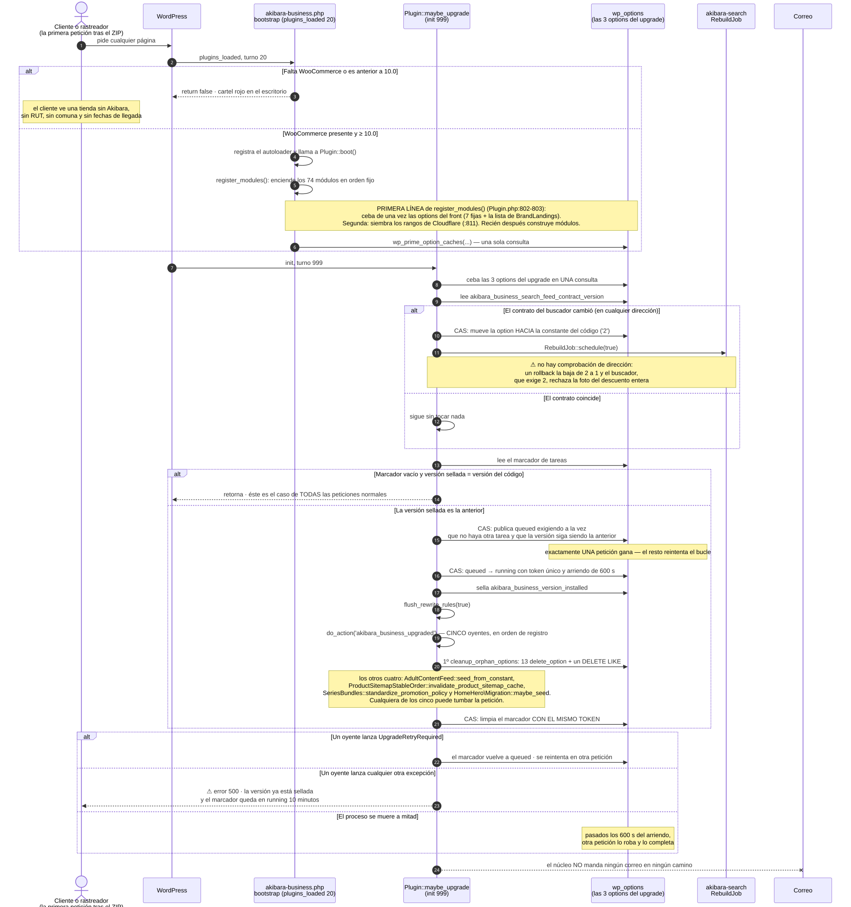
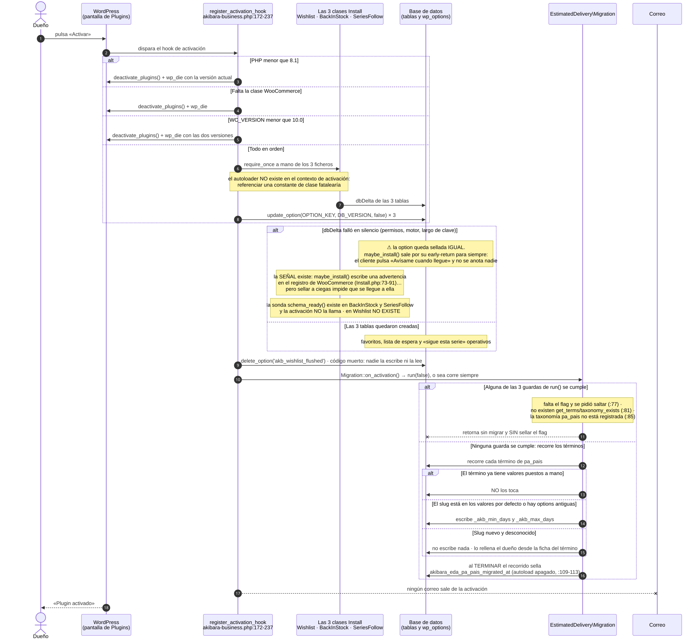
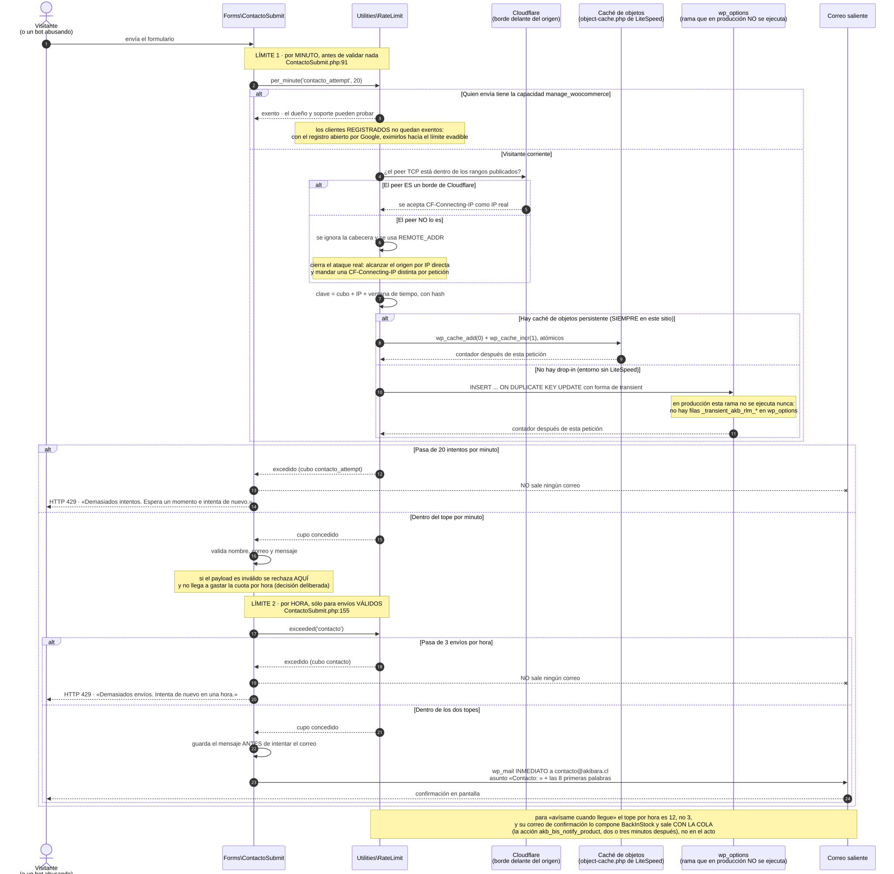

# akibara-business · el núcleo: cómo arranca y cómo se enciende cada módulo

> Fuente de verdad de este capítulo: el *snapshot* congelado de lo publicado en
> producción — `akibara-business` **1.116.4** (más `akibara-search` 0.1.60,
> `akibara-cart-checkout-blocks` 2.2.17, `akibara-rewards` 0.3.13 y el tema
> `akibara-gp` 2.1.118 para las fronteras). No se describe el árbol de trabajo
> local, que mezcla trabajo a medias de otras sesiones. Cada afirmación técnica
> lleva su fichero y su línea.
>
> Las rutas de este capítulo son relativas a
> `public_html/wp-content/plugins/akibara-business/` salvo que se diga otra cosa.
>
> **Leído, no medido.** Todo lo que sigue está comprobado contra el código. Nada
> está comprobado contra producción en vivo. Los ocho hallazgos (🔴 y ⚠️) llevan
> la etiqueta «leído, sin medir» y su comprobación; la regla del dueño es que
> **hasta que no está medido en producción, no está aprobado**. La verificación
> del área se declara con **88 % de cobertura**; lo que quedó fuera está al final,
> en «Qué no se pudo cerrar leyendo».

---

## Dónde estoy: el mapa de capítulos

Este capítulo es el **02** de dieciocho. **No existe un capítulo 01**: la
numeración empieza aquí porque el 01 estaba reservado a un índice que todavía no
se escribió. Mientras tanto, éste es el índice:

| Nº | De qué va |
| --- | --- |
| **02** (éste) | `akibara-business` · el núcleo: arranque, orden de encendido, motor de upgrade, utilidades |
| 03 | `akibara-business` · catálogo, series, tomos, editoriales y packs |
| 04 | `akibara-business` · disponible, a pedido y preventa; entrega estimada; «avísame cuando llegue» |
| 05 | `akibara-business` · carrito, checkout, retiro, cuenta del cliente y seguridad |
| 06 | `akibara-business` · el panel del dueño: descuentos, textos, portada, ficha y formularios |
| 07 | `akibara-business` · SEO, descubribilidad por IA, blog y todo el correo |
| 08 | `akibara-search` · el índice: cómo se construye y se reconstruye |
| 09 | `akibara-search` · lo que pasa cuando el cliente busca |
| 10 | `akibara-rewards` · Akibara Puntos |
| 11 | `akibara-rewards` · reseñas con foto |
| 12 | `akibara-cart-checkout-blocks` · RUT, celular, comuna y puntos Blue Express |
| 13 | Tema `akibara-gp` · todo lo que el cliente ve |
| 14 | mu-plugins (A) · abilities/MCP, Blue Express, Brevo, Clarity |
| 15 | mu-plugins (B) · correo SMTP, LiteSpeed, claves, redirecciones, logs |
| 16 | Transversal · todo lo programado, con horas de Chile |
| 17 | Transversal · catálogo de datos: options, tablas, metas y transients |
| 18 | Transversal · fronteras con terceros |
| 19 | Transversal · cómo se hablan entre sí los plugins, el tema y los mu-plugins |

Este capítulo nombra de paso módulos que **no** explica. Dónde vive cada uno:

- `estimated_delivery`, `order_preventa`, `BackInStock` («avísame cuando
  llegue») → **capítulo 04**.
- `series_bundles`, `series_follow`, `series_facts`, `series_schema`,
  `series_catalog_eligibility`, `customer_collection`, `CollectionResolver` →
  **capítulo 03**.
- `native_cart`, `CheckoutDataService`, `PudoCheckoutService`, `Wishlist`
  (favoritos), `account_collection` → **capítulos 05 y 12**.
- `AdminPanel`, `AdminDashboard`, `CopyManager`, `TaxonomyDiscount`,
  `BrandLandings` → **capítulo 06**.
- `SeoIndexing`, `RelatedGuides`, `LlmsManifest`, `SocialImageDerivatives`,
  `Forms\ContactoSubmit` → **capítulo 07**.
- `SeriesIndex`, `RebuildJob` y todo lo del buscador → **capítulos 08 y 09**.
- `CatalogOrder` y el inventario completo de tareas programadas del sitio →
  **capítulo 16**.

**El plugin no tiene un README.** No hay ningún `.md` en la raíz de
`akibara-business/`: quien abra la carpeta no encuentra nada que leer. Este
capítulo hace de README hasta que exista uno.

---

## Para qué existe (en dos párrafos que entienda un novato)

Akibara.cl es una tienda hecha con **WordPress** (el programa que arma y sirve las
páginas) y **WooCommerce** (el añadido que le da carrito, pedidos y pagos). Encima de
esos dos hay código escrito a medida para esta tienda, y la pieza más grande de ese
código se llama **Akibara Business**. Este capítulo no describe lo que Akibara Business
*hace* de cara al cliente —eso está repartido en los capítulos 03 a 07—, sino su **sala
de máquinas**: el trozo de código que se enciende primero, comprueba que el terreno sea
firme, enciende los **74 módulos** en un orden escrito a mano, se entera de que se
desplegó una versión nueva y hace la limpieza que toca, y ofrece las **trece utilidades**
que todos los demás usan para que la misma pregunta se conteste igual en todas partes
(¿este RUT es válido?, ¿qué hora es *en la tienda* y no en el servidor?, ¿qué número de
versión lleva este fichero CSS para que el navegador del cliente no se quede con la copia
vieja?).

El núcleo existe porque, sin él, los módulos serían 74 trozos sueltos sin manera de
prestarse objetos ni de ponerse de acuerdo en el orden. Hace tres promesas concretas. La
primera: **no arrancar en terreno hostil** — si WooCommerce falta o es demasiado viejo, el
plugin entero se apaga y deja un cartel rojo en el escritorio del administrador en vez de
fallar a pedazos (`akibara-business.php:86-120`). La segunda: **encender los módulos
siempre en el mismo orden**, porque varios se prestan objetos entre sí y mover una línea
deja al de abajo sin su colaborador (`src/Plugin.php:801-1417`). La tercera: **ponerse al
día solo después de un despliegue**, sin que nadie pulse un botón y sin que dos visitantes
simultáneos hagan el mismo trabajo dos veces (`src/Plugin.php:290-337`). Lo que el núcleo
**no** hace: **no pinta pantallas propias en la web del cliente** —lo único suyo que el
cliente ve son los cuatro filtros de catálogo de la pieza 4 (pieza 4) y la línea de la
sección «Un hallazgo que no es del núcleo» del final—, no manda ni un solo correo, no toca
pedidos ni productos. Si el núcleo falla no falla una pantalla: falla la tienda entera.

---

## Cómo encaja con el resto (con quién habla: plugins, tema, terceros; qué pasa si se apaga)



*Fuente: [`02-business-nucleo-piezas-arranque.mmd`](diagramas/02-business-nucleo-piezas-arranque.mmd).*



*Fuente: [`02-business-nucleo-piezas-nucleo.mmd`](diagramas/02-business-nucleo-piezas-nucleo.mmd).*

El núcleo está en el centro de cinco relaciones, y conviene entenderlas antes de leer el
inventario de piezas.

**Con WordPress.** El **arranque** se cuelga de dos avisos de WordPress y de ninguno más.
El primero es `plugins_loaded` en el **turno 20** (`akibara-business.php:159`): ahí se
comprueban las dependencias, se enseña a PHP dónde están las clases y se encienden los
módulos. El segundo es `init` en el **turno 999** (`src/Plugin.php:255`): ahí, y sólo
ahí, corre el motor de upgrade. Las **demás piezas de la raíz** tienen cada una su propio
enganche —`before_woocommerce_init` (`:54`), dos `admin_notices` (`:88` y `:106`), los
cuatro filtros de catálogo (`:277`, `:320`, `:369`, `:424`) y los hooks de activación y
desactivación (`:172` y `:239`)— y están todas en la tabla de la pieza 4 y en las piezas 11
y 12. El comentario de `:242-254` explica por qué el upgrade usa `init` y no otro hook:
WordPress dispara `init` sin condición en **toda** petición —web, escritorio,
`admin-ajax.php`, la API REST y la línea de comandos— así que un único enganche cubre
todos los casos. Hasta la versión 1.108.21 había además un `admin_init:999` redundante;
se midió en Docker el 2026-08-23 y la segunda pasada gastaba 0,012-0,022 ms haciendo
exactamente nada, así que se quitó.

**Con WooCommerce.** La relación es de dependencia dura y de declaración. La dependencia:
sin la clase `WooCommerce` presente, o con una versión anterior a la **10.0**, el arranque
retorna `false` y no se registra ni el autoloader (`akibara-business.php:87-119`). La
declaración: en `before_woocommerce_init` el plugin declara que es compatible con
`custom_order_tables` —el almacenamiento moderno de pedidos, conocido como **HPOS**— y con
`cart_checkout_blocks` (`akibara-business.php:54-70`). Sin esas dos declaraciones,
WooCommerce avisaría de incompatibilidad y podría negarse a activar HPOS.

**Con los otros tres plugins propios.** El núcleo le entrega al plugin de carrito y pago
dos objetos —`checkout_data()` y `pudo_checkout()` (`src/Plugin.php:1482-1495`)— y ese
plugin arranca en `plugins_loaded` **turno 30**, diez turnos después, precisamente para
encontrarlos ya construidos; si Business no arrancó, se va en silencio. Al buscador le
entrega el precio efectivo con descuento por el filtro `akb_search_effective_price`
(`src/Plugin.php:1221-1223`) y le agenda una reconstrucción completa del índice cuando
cambia el **contrato de alimentación** —el acuerdo sobre qué significa el precio que
Business le entrega al buscador para que éste lo guarde; ver pieza 9—
(`src/Plugin.php:762-771`). Y le siembra al buscador la lista de rangos de Cloudflare por
el filtro `akibara_trusted_proxy_ranges`, para que los dos limitadores de tasa confíen
exactamente en la misma lista (`src/Plugin.php:811`).

**Con el tema.** Una sola dirección, y con rama de repuesto. La utilidad
`ThemeAssetVersion::for_path()` delega en la función `akibara_gp_asset_ver()` del tema
**si esa función existe** (`src/Utilities/ThemeAssetVersion.php:50-56`; la función vive en
`themes/akibara-gp/inc/enqueue.php:37`), porque los ficheros del tema viajan en otro riel
de despliegue y su versión la decide el tema, no el plugin. **Si no existe** —tema de un
tercero, otro tema hijo, o Business activo sin `akibara-gp`— resuelve por su cuenta
(`:58-72`): toma la versión del tema activo con `wp_get_theme()`, cae a `'1'` si no la
encuentra, y le pega detrás el `filemtime` del fichero. El docblock del propio fichero
nombra los tres módulos que encolan ficheros del tema: `Forms`, `BrandsDirectory` y
`HomeHero\AdminUI` (`:8-10`).

**Con terceros.** Tres contactos, todos por hooks y ninguno editando código ajeno:
`OrderStorage` le pregunta a WooCommerce si los pedidos están en HPOS; `SchemaGraph` y
`RobotsMeta` hablan con **Rank Math** (el plugin de SEO) por su filtro `rank_math/json_ld`
y por la meta `rank_math_robots`; y `RateLimit` acepta la cabecera `CF-Connecting-IP` de
**Cloudflare** sólo si quien se conecta es de verdad un borde de Cloudflare
(`src/Utilities/RateLimit.php:307`).

**Qué pasa si se apaga.** No hay interruptor para apagar el núcleo por separado: apagar el
núcleo es desactivar el plugin. Y desactivar el plugin apaga de golpe el RUT en el pago,
la comuna, las fechas de llegada, el carrito propio, el panel «Akibara» entero, la lista
de espera, los favoritos y el descuento por editorial. El cliente no ve un error: ve una
tienda de WooCommerce corriente, sin nada de lo que hace que ésta sea Akibara. Y el
buscador, que vive en otro plugin, se queda **sin proveedor de precio**: el filtro
`akb_search_effective_price` deja de tener quien lo conteste.

---

## Cómo mirar todo esto sin adivinar

El núcleo tiene tres options sin pantalla, ocho tareas programadas y un contrato que puede
quedar en un valor equivocado. Éstas son las órdenes para leerlo. Todas empiezan por
entrar al servidor:

```bash
ssh akibara
```

```bash
# Qué versión sirve producción HOY (la constante del código vive en akibara-business.php:42).
wp plugin get akibara-business --field=version

# Las tres options del motor de upgrade (ninguna tiene pantalla).
wp option get akibara_business_version_installed
wp option get akibara_business_upgrade_tasks_pending          # vacío = no hay trabajo
wp option get akibara_business_search_feed_contract_version   # debe valer 2

# El interruptor sin pantalla del módulo de scripts de terceros.
wp option get akb_crossorigin_scripts_enabled                 # 'yes' implícito; 'no' lo apaga

# Las tareas de WP-Cron y cuándo les toca.
wp cron event list --fields=hook,next_run_relative
```

La tarea de **Action Scheduler** (`akibara_catalog_order_daily`) **no sale ahí**: se mira
en el escritorio, en *WooCommerce → Estado → Acciones programadas*, filtrando por el grupo
`akb-catalog-order`.

**Regla del proyecto sobre versiones:** este repositorio no es git, así que «qué está
desplegado» **no se decide por la fecha del fichero**, sino comparando el *hash* del
fichero contra producción. El número que devuelve `wp plugin get` es lo que WordPress leyó
de la cabecera; el ZIP publicado en `dist/` es la verdad de lo publicado.

**Dónde están las pantallas.** El panel propio vive en
`/wp-admin/admin.php?page=akibara-panel` (`src/Modules/AdminPanel/AdminPanel.php:183`) y
cada pestaña se abre añadiendo `&tab=<id>` (`:723`). Las que nombra este capítulo:

| Pantalla | URL | Dónde se registra |
| --- | --- | --- |
| *Akibara → Textos* (y dentro, el bloque «Ordenamiento del catálogo») | `…?page=akibara-panel&tab=copys` | `CopyManager.php:147-149`, bloque en `:450` |
| *Akibara → Descuentos* | `…?page=akibara-panel&tab=taxonomy_discount` | `TaxonomyDiscount.php:54` |
| *Ajustes → Generales → Zona horaria* | `/wp-admin/options-general.php` | Pantalla de WordPress |
| *Ajustes → Enlaces permanentes* | `/wp-admin/options-permalink.php` | Pantalla de WordPress |

⚠️ El *slug* corto `akibara` **no existe**: escribirlo devuelve un 403 que parece un
problema de permisos y no lo es. El slug correcto es `akibara-panel`.

---

## Piezas

El núcleo son **quince** piezas. **Siete** viven en los dos ficheros de la raíz
(`akibara-business.php` y `uninstall.php`) — las piezas 1, 2, 3, 4, 11, 12 y 13 — y
**ocho** dentro de `src/` — las piezas 5, 6, 7, 8, 9, 10, 14 y 15.

### 1. El fichero de arranque y su cabecera — `akibara-business.php`

**Qué hace en una frase:** es lo primero que WordPress lee del plugin, y declara quién es,
qué necesita y cómo se llama a sí mismo.

- **Ficheros:** `akibara-business.php:1-48`.
- **Cuándo actúa:** WordPress lee la cabecera al listar plugins; el resto del fichero se
  ejecuta al cargarlo, antes de cualquier hook.
- **Qué declara:** versión **1.116.4**, requiere WordPress 6.8, PHP 8.1 y WooCommerce 10.0
  (`WC tested up to: 11.0`), `Update URI: false` —nadie debe ir a buscar actualizaciones a
  un servidor externo— y `Requires Plugins: woocommerce`.
- **Qué escribe:** siete constantes globales, entre ellas `AKIBARA_BUSINESS_VERSION`
  (la que el motor de upgrade compara contra la base), `AKIBARA_BUSINESS_MIN_WC = '10.0'`
  y `AKIBARA_BUSINESS_MIN_PHP = '8.1'` (`:42-48`).
- **Dónde lo opera el dueño:** en ningún sitio. Cambiar cualquiera de estos valores exige
  desplegar.
- **Qué ve el cliente:** nada.

Hay una decisión escrita en la propia cabecera que conviene conocer porque explica el
estilo de todo el código: **no hay traducciones, y es a propósito** (`:17-31`). Hasta la
versión 1.111.0 el plugin arrastraba 97 llamadas de traducción repartidas en 18 ficheros
que no traducían nada —sin un dominio de idioma cargado, la función `__()` devuelve su
argumento tal cual—. La decisión del dueño del 2026-08-31, la misma para las cuatro
unidades propias, es que la tienda es monolingüe en español de Chile y no hay plan de
traducirla; se retiraron las envolturas y se escapa directo con `esc_html()` y
`esc_attr()`, que era lo único que aportaban de verdad. La prueba `tests/I18nPolicyTest.php`
mantiene la decisión.

**Qué más viaja en el ZIP.** Además de los dos ficheros de la raíz y de `src/`, el
paquete publicado trae `assets/` (26 hojas de estilo y 17 scripts) y `templates/` (14
ficheros): `templates/myaccount/` son las pantallas de *Mi cuenta* con las que el plugin
reemplaza las de WooCommerce, y `templates/emails/` (con su carpeta `plain/` de versiones
en texto sin formato) son las plantillas de los correos propios. Ninguna de las dos
carpetas es del núcleo: se documentan en los **capítulos 05 y 07**. El ZIP **no** lleva
`tests/` ni `vendor/`.

### 2. El gate de dependencias

**Qué hace en una frase:** decide si el plugin puede arrancar, y si no puede, lo dice en
castellano en el escritorio del administrador.

- **Ficheros:** `akibara-business.php:86-120` (función `akibara_business_check_dependencies()`).
- **Cuándo actúa:** primera línea de `akibara_business_bootstrap()`, en `plugins_loaded`
  turno 20.
- **Qué lee:** la existencia de la clase `WooCommerce` (`:87`) y la constante `WC_VERSION`
  (`:105`).
- **Qué escribe:** nada persistente. Engancha un aviso de administración y devuelve `false`.
- **Dónde lo opera el dueño:** en ningún sitio; el mínimo es una constante.
- **Qué ve el cliente:** nada — el cartel es sólo para el escritorio. El cliente lo que ve
  es una tienda sin nada de Akibara, en silencio.

El comentario de `:100-104` explica por qué existe un gate propio pudiendo confiar en
WordPress: la cabecera `Requires Plugins` de WordPress no admite número de versión, y la
cabecera `WC requires at least` sólo produce un aviso desde el comprobador de
WooCommerce, no impide que el código corra.

Los dos carteles rojos y los tres `wp_die()` de la activación son los **cinco** sitios
donde el núcleo imprime algo. **Tres de ellos interpolan variables, y esos tres pasan por
`esc_html()`**: el segundo cartel (`:109-114`) y los dos `wp_die()` construidos con
`sprintf` (`:177-185` y `:196-204`). Los otros dos son literales sin variables y no
escapan nada, porque no hay nada que escapar: el primer cartel imprime cadenas sueltas
(`:91-94`) y el segundo `wp_die()` es una cadena pelada (`:189`).

### 3. El autoloader

**Qué hace en una frase:** le enseña a PHP que cualquier clase que empiece por
`Akibara\Business\` vive dentro de `src/`.

- **Ficheros:** `akibara-business.php:138-154`.
- **Cuándo actúa:** en `plugins_loaded` turno 20, justo después del gate y justo antes de
  `Plugin::boot()`.
- **Detalle que importa:** **no hay** una rama `vendor/autoload.php`. El plugin no tiene
  dependencias externas de ejecución y el empaquetador excluye `/vendor/` del ZIP. Esto
  también explica una rareza del hook de activación (pieza 11): ahí el autoloader todavía
  no existe, así que las clases se cargan a mano con `require_once`.

### 4. Los cuatro filtros de catálogo de la raíz

**Qué hace en una frase:** cuatro ajustes al catálogo de WooCommerce que no pertenecen a
ningún módulo y viven sueltos en el fichero de arranque.

- **Ficheros:** `akibara-business.php:277-303`, `:320-367`, `:369-387`, `:424-447`.
- **Cuándo actúa:** cada uno en su filtro de WooCommerce o de WordPress, prioridad 10.
- **Qué ve el cliente:** los cuatro son visibles. **Son lo único del núcleo que toca la
  web del cliente.**

**(a) «Recién llegados» sólo con stock** (`:277-303`, filtro
`woocommerce_shortcode_products_query`, 2 argumentos). El atajo `[products]` de WooCommerce
no sabe filtrar por estado de stock, así que se le añade la condición a mano. Pero sólo en
la portada, sólo cuando el orden es por fecha y sólo cuando el atajo **no** trae categoría
(`:292`). Las secciones con categoría —Preventas— quedan fuera a propósito: sus productos
están en `onbackorder` y el filtro las dejaría vacías. Ese fue un bug real, encontrado el
2026-05-06 después de purgar la caché; la regresión llevaba meses viva sin que nadie la
viera porque la página cacheada seguía mostrando lo correcto.

**(b) Las etiquetas del selector de orden** (`:320-367`, filtro `woocommerce_catalog_orderby`).
Se quita el criterio «valoración» porque el catálogo no tiene reseñas (`:326`) y se
reescriben las seis etiquetas restantes. Los textos son **editables sin código** desde
*Akibara → Textos → Ordenamiento del catálogo*: cada uno se resuelve con
`akibara_business_catalog_order_label()` (`:315-318`), que pasa la option por
`sanitize_text_field()` y cae al literal si está vacía. Nunca por `sprintf`, así que un
`%` escrito por el dueño en un texto no puede provocar un error fatal —lo vigila
`tests/CopyNeverUsedAsFormatTest.php`.

**(c) Orden por título** (`:369-387`, filtro `woocommerce_get_catalog_ordering_args`).
Cuando el criterio es `title`, fija orden alfabético ascendente y vacía la clave meta.
⚠️ **Leído, sin medir.** El verificador encontró que esto **duplica lo que WooCommerce ya
hace**, y encima peor: el core resuelve el mismo caso respetando la dirección
(`class-wc-query.php:735-738` devuelve `DESC` si se lo piden), y este filtro la ignora. El
`meta_key = ''` es un no-op: el core no fija clave meta en esa rama. Consecuencia práctica:
`?orderby=title&order=desc` se sirve ascendente en silencio. Es un candidato a **código
muerto** y hay que decidirlo antes de que alguien lo tome por la fuente del criterio.
*Cómo comprobarlo:* en el espejo Docker, pedir
`curl -s -A AkibaraQA 'http://localhost:8080/tienda/?orderby=title&order=desc'`, extraer
los títulos del listado y compararlos con los del mismo listado sin `order=desc`; si salen
idénticos, la dirección se está ignorando.

**(d) El relleno de ceros del número de tomo** (`:424-447`, filtro `wp_insert_post_data`,
2 argumentos). «Gannibal 1» pasa a «Gannibal 01» **al guardar**, para que el orden
alfabético del catálogo sea lineal: sin esto, al llegar al tomo 10 el listado sale
«Naruto Gaiden 1, Naruto Gaiden 10, Naruto Gaiden 2…». El slug (la parte de la URL) **no**
se toca, así que la URL sigue siendo `gannibal-1` mientras el título dice «Gannibal 01»:
es cosmético y está decidido así para no romper el SEO. La expresión regular está
construida con un *lookbehind* de espacio para no tocar `1.5`, `1+2+3`, `Ranma 1/2`,
`1 Expansion Pass`, los tomos ya rellenados, `Mob Psycho 100` ni `One Piece nº 01 (3 en 1)`.

### 5. El singleton `Plugin` y `boot()`

**Qué hace en una frase:** es el objeto único que enciende todo y el que guarda la
referencia a cada módulo encendido.

- **Ficheros:** `src/Plugin.php:147-286`.
- **Cuándo actúa:** `plugins_loaded` turno 20, llamado desde
  `akibara_business_bootstrap()`.
- **Qué hace, en orden** (`:229-273`): marca la bandera `$booted` para no repetirse nunca
  —`boot()` es idempotente—, llama a `register_modules()`, engancha `maybe_upgrade` a
  `init:999` (`:255`), engancha `cleanup_orphan_options` al hook
  `akibara_business_upgraded` (`:261`), y dispara el hook público
  `akibara_business_booted` pasándose a sí mismo (`:272`).
- **Qué ofrece hacia afuera:** `module( $slug )` devuelve un módulo por su clave interna
  (`:1471`), `checkout_data()` devuelve el contrato de checkout (`:1482`) y
  `pudo_checkout()` el servicio de puntos de retiro (`:1493`).

**Quién escucha `akibara_business_booted`, hoy: exactamente uno.**
`LlmsManifest::register_admin_section` (`src/Modules/LlmsManifest/LlmsManifest.php:174`).
Y ése es justamente el ejemplo de para qué sirve el patrón: ese módulo añade su sección al
panel del dueño **sin editar el panel**, esperando a que todo esté encendido y pidiéndole
al singleton el módulo del panel por su clave. Cualquier integración tardía que necesite
otro módulo ya construido tiene aquí su punto de enganche; el comentario del propio
fichero lo dice (`:171`).

### 6. `register_modules()` — los 74 módulos y el orden que no se puede mover

**Qué hace en una frase:** construye y registra, uno tras otro y siempre en el mismo orden
escrito a mano, los 74 módulos del plugin.

- **Ficheros:** `src/Plugin.php:801-1417` (**617 líneas**, la mitad de ellas comentarios
  que explican por qué cada bloque va donde va). El método cierra en `:1417`; lo que
  sigue (`:1419-1433`) ya es el docblock de `cleanup_orphan_options()`, que es la pieza 10.
- **Cuándo actúa:** dentro de `boot()`, en `plugins_loaded` turno 20.
- **Qué escribe:** el array interno `$this->modules`, con **74** entradas —contadas a
  máquina sobre el snapshot— más tres colaboradores que quedan fuera de ese array.
- **Dónde lo opera el dueño:** en ningún sitio. No hay pantalla de módulos ni interruptor
  por módulo; encender o apagar uno exige desplegar.

**Dónde está la lista de los 74.** No hay inventario escrito: la lista *es* el fichero.
Para sacarla, desde la raíz del plugin:

```bash
grep -o "modules\['[a-z_0-9]*'\]" src/Plugin.php | sort -u
```

Devuelve 74 claves. Ojo con contar carpetas: `src/Modules/` tiene **61** directorios,
porque varias carpetas registran más de un módulo (una carpeta puede traer el módulo, su
panel de administración y su migración, y cada uno entra en el array con su propia clave).

Lo primero que hace `register_modules()`, antes de construir nada, son dos cosas baratas y
una vez por petición: **cebar** de golpe las options que el front lee en cada visita
(pieza 7, líneas `:802-803`) y **sembrar los rangos de Cloudflare** en el filtro compartido
con el buscador (`:811`).

El orden no es decorativo: **varios módulos se prestan objetos**, y mover una línea deja al
de abajo sin su colaborador. Las **seis** dependencias de construcción que lo fijan son:



*Fuente: [`02-business-nucleo-dependencias-modulos.mmd`](diagramas/02-business-nucleo-dependencias-modulos.mmd).*

| Quien lo construye | Qué presta | Quién lo consume |
| --- | --- | --- |
| `estimated_delivery` | `calculator()` — el calculador de fechas de llegada | `order_preventa` (`:1044`), `series_bundles`, `series_follow`, `CollectionResolver` |
| `estimated_delivery` | `renderer()` — cómo se pinta esa fecha | `native_cart`, `CheckoutDataService` (`:1202-1208`) |
| `taxonomy_discount` | `settings()` y `resolver()` | `series_facts` y el proveedor de precio del buscador (`:1221-1223`) |
| `series_catalog_eligibility` | es un colaborador sin `register()` propio | `series_pagination_policy`, `seo_enhancements`, `llms_manifest`, `series_editions`, `SeriesIndex` |
| `series_facts` | **la misma instancia**, no una copia | `series_schema`, para que el bloque visible y el JSON-LD digan lo mismo y compartan el transient |
| `customer_collection` | la colección del cliente | `series_bundles`, `account_collection`, `series_follow` (`:1252-1260`) |

**Tres cosas que el inventario de módulos no muestra y conviene saber** (correcciones del
verificador aplicadas aquí):

1. Fuera del array de módulos, `register_modules()` construye **tres** colaboradores, no
   dos. Los conocidos son `CheckoutDataService` (`:1202-1208`) y `PudoCheckoutService`. El
   tercero es `EstimatedDelivery\CortesPanel`, instanciado y registrado en la misma línea
   (`:1317`), que engancha pantallas del escritorio y no aparece en ninguna lista. En esa
   misma zona se engancha también el filtro `akibara_panel_section_is_action` con los
   ajustes de `order_preventa` (`:1316`) y se le pasa el módulo de fechas con
   `set_eda_module()` (`:1315`).
2. **El orden de registro no es el orden de construcción en un caso**: `marca_term_fields`
   se **instancia** en la posición 43 (`:1020`) pero su `register()` se llama al final del
   bloque (`:1034`), después de `crossorigin_scripts` (`:1025-1026`) y de
   `markdown_negotiation` (`:1032-1033`). Es el único módulo del fichero con la
   construcción y el registro separados, así que el orden real en que entran los hooks es
   `crossorigin_scripts` → `markdown_negotiation` → `marca_term_fields`.
3. El módulo `guest_order_linking` **no está inerte**, aunque dos comentarios del código
   digan que sí. Ver «Un hallazgo que no es del núcleo», al final de las piezas.

El comentario del bloque de `markdown_negotiation` (`:1029-1031`) deja escrita la lección
que explica por qué el registro es tan verboso: *«instanciar sin registrar deja el módulo
como código muerto y ya pasó una vez con `CrossOriginScripts`»*.

⚠️ **Leído, sin medir.** Una nota de higiene: `Plugin.php` contiene **cuatro punteros de
comentario rotos**. Cita «L913» para localizar `estimated_delivery`, que está en `:1002`;
«L378» para el `DateCalculator`; y «L1134» y «L1139» (`:1252-1253`) para la colección del
cliente y el calculador, que están en `:1175` y `:1180`. Este fichero es el mapa de
arranque del plugin y sus comentarios son la única documentación del orden. *Cómo
comprobarlo:* abrir cada línea citada y ver qué hay ahí; no hace falta entorno.

### 7. El cebado de options del front

**Qué hace en una frase:** lee de una sola vez todas las options que el plugin va a
consultar durante una visita, para no pagar una consulta SQL por cada una.

- **Ficheros:** `src/Plugin.php:790-799` (la constante `FRONT_READ_OPTIONS`) y `:802-804`
  (la llamada a `wp_prime_option_caches()`).
- **Cuándo actúa:** primerísima línea de `register_modules()`, antes de construir el primer
  módulo.
- **Qué lee:** siete claves fijas —`akb_bis_db_version`, `akb_sf_db_version`,
  `akb_bis_capture_enabled`, `akb_preventa_t7_enabled`, `akb_brand_color_primary`,
  `akb_brand_color_surface` y `akb_crossorigin_scripts_enabled`— **más** una lista dinámica
  que devuelve `BrandLandings::front_read_options()` (`:803`), que crece con cada familia
  editorial configurada (una entrada por familia y por campo).
- **Qué escribe:** nada. Sólo calienta la caché de options.

Las siete claves **no** son autoload a propósito, y el docblock lo razona (`:783-786`):
tres de ellas son interruptores que el dueño mueve desde el panel y tienen que surtir
efecto en la petición siguiente, y ninguna necesita viajar dentro del blob `alloptions`.
⚠️ Ese mismo docblock dice que `alloptions` se carga «en todas las páginas **del admin**»,
y eso es **inexacto**: WordPress carga `alloptions` en **todas las peticiones**, también
las del cliente, que es justamente por qué engordarlo cuesta caro en la web pública. La
definición correcta es la del glosario de este capítulo.

⚠️ **Leído, sin medir.** El docblock también afirma que esas options *«son las únicas
consultas SQL que Business mete en un request de visitante»* (`:776-777`), y eso **no es
cierto**: en `:1040` se llama `EdaMigration::maybe_run_lazy()`, que lee
`akibara_eda_pa_pais_migrated_at`, una option escrita con autoload apagado
(`src/Modules/EstimatedDelivery/Migration.php:109-113`) y ausente de las dos listas de
cebado. Es una consulta extra por petición de visitante. El agravante lo encontró el
verificador: esa consulta paga por una rama que, en el momento del ciclo en que se la
llama, **no puede completarse nunca** (ver Caso 5). Y el candado `FrontOptionPrimingTest`
sólo comprueba la dirección contraria —que cada option cebada tenga lector—, nunca que cada
lector esté cebado. La corrección del verificador se aplica aquí: la lista real es la
constante **más** la lista dinámica de `BrandLandings`, así que ni siquiera es de tamaño
fijo. *Cómo comprobarlo:* en el espejo Docker, con `SAVEQUERIES` activado, pedir la portada
con `curl -A AkibaraQA` y buscar en el registro de consultas un `SELECT` por
`akibara_eda_pa_pais_migrated_at`.

### 8. El motor de upgrade

**Qué hace en una frase:** detecta que se desplegó una versión nueva del plugin y ejecuta
la limpieza que toca, exactamente una vez, aunque lleguen mil visitantes a la vez.

- **Ficheros:** `src/Plugin.php:290-337` (`maybe_upgrade`), `:350-369` (`run_upgrade_tasks`),
  `:390-451` (`maybe_resume_upgrade_tasks`), `:468-492` (`seal_upgrade_version`),
  `:494-565` (codificar y decodificar el marcador), `:583-623` (`claim_upgrade_queue`),
  `:660-699` (`claim_version_option`), `:701-713` (`purge_option_cache`).
- **Cuándo actúa:** `init` prioridad 999, **un solo enganche**. La prueba
  `tests/PluginUpgradeHookTest.php` barre el plugin completo para impedir que aparezca un
  segundo.
- **Qué lee y escribe:** tres options, las tres con autoload apagado a propósito.

| Option | Para qué | ¿Autoload? |
| --- | --- | --- |
| `akibara_business_version_installed` | La versión ya sellada en la base | no |
| `akibara_business_upgrade_tasks_pending` | El marcador de trabajo (`queued` / `running`, en JSON) | no |
| `akibara_business_search_feed_contract_version` | La versión del contrato con el buscador | no |



*Fuente: [`02-business-nucleo-estados-upgrade.mmd`](diagramas/02-business-nucleo-estados-upgrade.mmd).*

El baile completo, en orden:

1. **Cebar las tres options en una sola consulta** (`:300-308`). Medido en Docker con
   `SAVEQUERIES` y la caché vacía sobre `/tienda/`: eran tres SELECT sueltos por petición.
2. **Reconciliar el contrato del buscador** (pieza 9).
3. **Un bucle de hasta cuatro intentos** (`:316-337`): leer el marcador; si hay uno,
   intentar consumirlo; si no lo hay y la versión guardada ya es la actual, terminar. El
   bucle existe para poder limpiar un marcador corrupto y publicar el bump actual en la
   misma petición sin quedar en un ciclo. **Si las cuatro vueltas se agotan**, el `for`
   termina y la función retorna **sin hacer nada y sin dejar rastro** (`:337-338`): el bump
   queda sin aplicar hasta la petición siguiente, que vuelve a intentarlo desde cero. Es
   aceptable porque el trabajo es idempotente y el sitio recibe peticiones todo el rato —
   pero significa que un marcador que se corrompe una y otra vez puede retrasar el upgrade
   indefinidamente sin que nada lo denuncie.
4. **Publicar `queued` con un CAS** (`:583-623`). *CAS* significa «compara y escribe»:
   escribir sólo si el valor guardado sigue siendo el que leí. Aquí hay que comprobar **dos
   filas distintas** de la misma tabla —la del marcador y la de la versión instalada— en
   una sola escritura, y eso se consigue juntando la tabla consigo misma:

   ```sql
   UPDATE wp_options AS pending
   LEFT JOIN wp_options AS installed ON installed.option_name = 'akibara_business_version_installed'
   SET pending.option_value = '<el JSON de queued>'
   WHERE pending.option_name = 'akibara_business_upgrade_tasks_pending'
     AND pending.option_value = ''                    -- no hay otra tarea
     AND ( installed.option_value = '<versión anterior>'   -- la versión sigue siendo la de antes
           OR ( '<versión anterior>' = '' AND installed.option_name IS NULL ) )
   ```

   El `LEFT JOIN` pega al lado de la fila del marcador la fila de la versión, de modo que
   las dos condiciones caben en el `WHERE` de un único `UPDATE`, que la base ejecuta de
   forma indivisible: o se cumplen las dos y se escribe, o no se escribe nada. Eso impide
   que una petición que leyó la versión vieja, se quedó dormida y despertó tarde vuelva a
   encolar el mismo bump. Si el `UPDATE` no encuentra fila —instalación recién nacida— hay
   una rama `INSERT IGNORE` con la misma junta, apoyada en el índice único del nombre de la
   option (`:601-616`).
5. **Reclamar `queued` → `running`** con un **token único** (un UUID) y un **arriendo de
   600 segundos** (`:416-425`).
6. **Sellar la versión instalada** bajo ese arriendo (`:429`).
7. **Comprobar que el marcador sigue siendo el suyo** y recién entonces ejecutar las tareas
   (`:433-443`): `flush_rewrite_rules( true )` —regenerar las reglas de URL— y disparar el
   hook público `akibara_business_upgraded`.
8. **Limpiar el marcador por CAS con el mismo token** (`:450`), para que un proceso antiguo
   que despierte tarde nunca pise al nuevo.

**Quiénes escuchan `akibara_business_upgraded`.** Son **cinco**, y el orden entre ellos es
el de registro (todos en prioridad 10, así que gana quien se enganchó antes; y quien se
engancha antes es quien se construyó antes en `register_modules()`). Cualquiera de los
cinco puede tumbar la petición: ver la bifurcación F del Caso 1.

| Oyente | Dónde se engancha | Qué hace |
| --- | --- | --- |
| `Plugin::cleanup_orphan_options` | `src/Plugin.php:261` | Borra trece options muertas y hace un `DELETE` por prefijo (pieza 10) |
| `AdultContentFeed::seed_from_constant` | `src/Modules/ProductSchemaShopping/AdultContentFeed.php:95` | Vuelve a sembrar, de forma idempotente, la marca de contenido adulto |
| `ProductSitemapStableOrder::invalidate_product_sitemap_cache` | `src/Modules/SeoIndexing/ProductSitemapStableOrder.php:59` | Invalida la caché del sitemap de productos |
| `SeriesBundles::standardize_promotion_policy` | `src/Modules/SeriesBundles/SeriesBundles.php:129` | Normaliza la política de promoción de los packs |
| `HomeHero\Migration::maybe_seed` | `src/Modules/HomeHero/HomeHero.php:55` | Siembra la portada si todavía no tiene datos |

Los casos de borde que el código contempla explícitamente (`:390-451`):

- **Arriendo vigente** → los demás se van sin tocar nada (`:412-414`).
- **Arriendo vencido** → otra petición lo roba y lo completa.
- **Marcador de una versión futura** (o sea, alguien hizo *rollback* del código) → se deja
  intacto: *«un marcador de una versión futura queda intacto para que un rollback de código
  no pueda consumir tareas que no conoce»* (`:403`).
- **Marcador corrupto** → se limpia con un CAS exacto y el bucle exterior republica un
  estado canónico (`:399-401`). «Corrupto» significa cualquier valor que no decodifique ni
  como JSON válido con sus cinco campos ni como el formato legado de abajo (`:519-565`); en
  la práctica sólo llega ahí una escritura hecha a mano con `wp option update` o un valor
  que quedó truncado.
- **Marcador antiguo, del formato anterior al JSON** → se acepta como `queued`. El estado
  canónico de hoy es un objeto JSON con cinco campos (`:501-511`); antes era una sola
  cadena con la forma `"versión_nueva|versión_anterior"`. El decodificador lo reconoce por
  tener **exactamente una barra vertical** y dos números de versión válidos a los lados
  (`:546-564`). Traducido: **un valor con una barra en medio es un marcador viejo, no una
  corrupción**, y el código lo trata como trabajo pendiente en vez de descartarlo. El
  código no registra desde qué versión del plugin el formato es JSON, así que no se puede
  afirmar si queda alguno vivo; para saberlo basta con
  `wp option get akibara_business_upgrade_tasks_pending` — lo normal es que devuelva vacío.
- **`UpgradeRetryRequired`** → el marcador vuelve a `queued` y se reintenta en otra
  petición (`:438-442`).

⚠️ **Dos huecos conocidos. Leídos, sin medir.** El primero: el `try` captura **únicamente**
`UpgradeRetryRequired` (`:437-442`). Cualquier otra excepción de cualquiera de los cinco
oyentes sube por `init:999` y mata la petición con un error 500 — y para entonces la
versión ya quedó sellada y el marcador se quedó en `running`, así que el fallo se repite
una vez cada diez minutos y no deja rastro en ninguna pantalla. El propio caso de prueba lo
asume por su nombre: `test_generic_listener_throwable_leaves_running_lease_and_rethrows`.
El segundo: **ninguna de las tres options tiene pantalla**. Un barrido por sus nombres
fuera de `Plugin.php` no devuelve nada, y `AdminDashboard::health_alerts()` sólo vigila
tareas programadas (WP-Cron y, desde 1.116.31, la cola de Action Scheduler vía
`Utilities\QueueHealth`), correos de contacto sin entregar y la purga de borde
(`src/Modules/AdminDashboard/AdminDashboard.php:86-145`). Choca de frente con la regla de
oro *todo operable sin código, cero options invisibles*. *Cómo comprobarlo:* las tres
órdenes `wp option get` del recuadro de arriba; si el marcador no está vacío en un sitio en
reposo, hay un arriendo colgado.

Y una consecuencia que se descubre al leer el código junto: ⚠️ **reactivar el plugin ya no
regenera las reglas de URL. Leído, sin medir.** El hook de activación no llama a
`flush_rewrite_rules()` en ninguna rama; lo más parecido es un
`delete_option( 'akb_wishlist_flushed' )` con el comentario *«force re-flush para registrar
/favoritos/»* (`akibara-business.php:225`), que es código muerto (piezas 10 y 11). El único
volcado vivo está dentro de `run_upgrade_tasks()` (`src/Plugin.php:351`), y
`maybe_upgrade()` sale antes de llegar ahí en cuanto la versión sellada coincide con la del
código (`:325-328`). Si algo borra las reglas mientras el plugin está desactivado —guardar
Enlaces permanentes, otro plugin, un `wp rewrite flush`—, al reactivarlo `/favoritos/`,
`/preventas/`, `/disponibles/` y los endpoints propios de *Mi cuenta* siguen en 404.

**Cómo se arregla ese 404** (y no hace falta saber nada de código): entrar al escritorio,
ir a *Ajustes → Enlaces permanentes* y pulsar **Guardar cambios** sin cambiar nada —el solo
hecho de guardar regenera las reglas—. Por SSH el equivalente es `wp rewrite flush`. Y se
comprueba así:

```bash
curl -s -o /dev/null -w '%{http_code}\n' -A AkibaraQA https://akibara.cl/favoritos/
```

Debe devolver `200`. Si devuelve `404`, faltaba el volcado.

### 9. El reconciliador del contrato con el buscador

**Qué hace en una frase:** comprueba si cambió la **semántica** de lo que Business le
entrega al buscador —el *contrato de alimentación*— y, sólo entonces, le pide reconstruir
el índice entero.

- **Ficheros:** `src/Plugin.php:715-741` (`maybe_upgrade_search_feed_contract`) y `:762-771`
  (`schedule_search_reindex`).
- **Cuándo actúa:** dentro de `maybe_upgrade()`, antes del bucle de tareas, en `init:999`.
- **Qué lee y escribe:** la option `akibara_business_search_feed_contract_version`.
- **Constantes:** `SEARCH_FEED_CONTRACT_VERSION = '2'` (`:196`) y
  `SEARCH_FEED_CONTRACT_ADOPTION_VERSION = '1'` (`:205`).

La idea es sencilla y vale la pena entenderla: el contrato tiene **su propio número de
versión**, separado del número de versión del plugin, para que un despliegue normal no
dispare una reconstrucción completa del índice del buscador. El docblock (`:167-195`)
explica el salto 1 → 2: el proveedor dejó de devolver el precio base cuando el descuento
editorial no se puede determinar con autoridad, y ahora **lanza** en vez de inventar un
precio. Eso obliga a recalcular todo lo ya sellado, porque nada en el índice permite
distinguir un precio base publicado por un fallo silencioso de uno legítimo.

⚠️ **Ese docblock está fechado y puede haber caducado.** Su último párrafo (`:187-194`) fue
escrito para la versión **1.99.15** y dice que el contrato **no** sube a 3 porque «la
semántica del valor publicado no cambió» y porque **«producción nunca llegó a adoptar el
contrato 2: 1.99.14 se empaquetó pero no se promovió»**. El plugin publicado hoy es el
**1.116.4**, ciento diecisiete versiones después: ese segundo motivo puede ser falso desde
hace mucho. **Este capítulo no sabe cuánto vale la option en producción hoy, porque no está
medido.** Se lee con una orden:

```bash
ssh akibara "wp option get akibara_business_search_feed_contract_version"
```

Si devuelve `2`, el docblock caducó y el hallazgo rojo de abajo aplica tal cual. Si
devuelve `1`, el docblock sigue vigente, no hay riesgo de rollback **todavía** y la
primera petición tras el próximo despliegue va a encolar una reconstrucción completa.

Cuando la versión cambia, exactamente una petición gana el CAS y llama a
`\Akibara\Search\RebuildJob::schedule( true )`. Con `force = true` reinicia una
reconstrucción **detenida** sin pisar una viva; si el plugin del buscador no está activo,
no pasa nada.

🔴 **Hallazgo de alta severidad del verificador. Leído, sin medir — y hay que tenerlo
delante antes de cualquier rollback.** El reconciliador **no compara direcciones**: el
código es `if ( $stored === $current ) { return; }` seguido del CAS (`:734-739`). Cualquier
diferencia entre la constante del código y la option mueve la option **hacia la
constante**, también hacia atrás. El motor de tareas del mismo fichero sí se protege del
rollback de forma explícita (`:403`); el reconciliador no tiene el equivalente. Y el valor
de esa option **no es interno**: lo exigen literal dos consumidores —
`AdoptedSnapshot::FEED_CONTRACT = '2'` de este mismo plugin
(`src/Modules/TaxonomyDiscount/AdoptedSnapshot.php:85`, rechazo en `:250-254`) y
`EditorialDiscountPublication::REQUIRED_FEED_CONTRACT = '2'` del plugin `akibara-search`.

Hay un agravante que se ve al mirar la otra punta: **esa misma option es, además, uno de
los diez valores de la «foto sellada» del descuento** (`AdoptedSnapshot.php:71-82`; la
option está en `:73`). O sea, no es sólo el literal que se compara: **es parte del
contenido fotografiado**, así que moverla cambia la foto entera y no únicamente la
comparación. Desplegar un Business anterior, cuya constante vale `1`, sobre una tienda cuya
option ya vale `2` la devuelve a `1` en el primer `init:999`, con `akibara-search` intacto
en su propio riel exigiendo `2`. El docblock de `AdoptedSnapshot:64-69` describe lo que
pasa entonces: la foto del descuento **se rechaza entera** y el buscador desaparece de la
superficie servida (pasó el 2026-09-01). De regalo, cada cruce en cualquier dirección
encola una reconstrucción completa que nadie pidió. Es exactamente el patrón «los
invariantes de riel caducan»: desplegar un riel deja al otro exigiendo un valor que ya no
está.

**Cómo comprobarlo (espejo Docker, primero):** leer la option, bajarla a mano a `1`, pedir
la portada con `curl -A AkibaraQA` y volver a leerla; si vuelve a `2`, el reconciliador la
arrastra hacia la constante. Repetir poniéndola en `3`: también vuelve a `2`, o sea baja
igual de bien que sube.

**Cómo salir de ahí si ya pasó, en producción:**

```bash
ssh akibara
wp option update akibara_business_search_feed_contract_version 2
# Si además el índice quedó atascado (suggest en 503, «ya hay un rebuild en curso»):
# desde el repo, NO a mano — el orden importa y el guion lo respeta:
bash ops/rescate-buscador.sh produccion
```

Y se comprueba que el buscador volvió pidiendo una búsqueda real y mirando que devuelva
resultados, no un 503:

```bash
curl -s -o /dev/null -w '%{http_code}\n' -A AkibaraQA 'https://akibara.cl/?_buscar=naruto'
```

### 10. La limpieza de options huérfanas

**Qué hace en una frase:** borra, una sola vez por versión nueva, las options del propio
plugin que ya no tiene quien las lea.

- **Ficheros:** `src/Plugin.php:1434-1463`.
- **Cuándo actúa:** enganchada a `akibara_business_upgraded` desde `boot()` (`:261`), o sea
  exactamente una vez por bump, garantizado por el CAS.
- **Qué borra:** **trece** claves nominales y un barrido SQL. Las trece son:
  `akibara_robots_policy_version`, `akibara_rank_math_product_schema_migration`,
  `akb_series_dispatch_enabled`, `akibara_announcement_speed`, las **seis del transporte
  SMTP propio retirado en 1.103.0** (`akibara_smtp_host`, `_port`, `_secure`, `_user`,
  `_pass` y `akibara_mail_failures` — incluida la contraseña, que es el motivo de que se
  borren), y los tres marcadores de auto-volcado por módulo (`akb_wishlist_flushed`,
  `akb_preventas_rewrite_version`, `akb_disponibles_rewrite_version`). El barrido es
  `DELETE … WHERE option_name LIKE 'akibara\_eda\_brand\_%'` (`:1459-1462`).
- **Qué NO borra a propósito:** `akb_rankmath_repoint_backup`, porque es un respaldo cuya
  eliminación decide el dueño.

⚠️ **Leído, sin medir.** El verificador señaló un detalle de higiene: ese `DELETE` directo
**no purga la caché de options** detrás, al contrario que `claim_version_option()`, que sí
lo hace a mano (`:701-713`) precisamente porque escribe con SQL directo. Como este sitio
tiene un *drop-in* de caché de objetos persistente —LiteSpeed dejó su `object-cache.php` en
`wp-content/`, lo documenta `src/Utilities/RateLimit.php:124-126`—, una option autocargada
borrada por esa vía puede seguir sirviéndose desde la caché hasta que algo más la invalide.
Hoy el daño es nulo (las `akibara_eda_brand_*` son legado sin lector), pero el patrón está
mal y es el único borrado directo del núcleo que rompe la regla que el propio fichero
aplica tres métodos más arriba. *Cómo comprobarlo:* en el espejo, crear
`akibara_eda_brand_test` con autoload encendido, forzar un bump bajando
`akibara_business_version_installed` y pidiendo la portada, y luego comparar lo que devuelve
`get_option()` con lo que devuelve una consulta directa a la tabla: la base puede decir que
no está y la caché que sí.

### 11. El hook de activación

**Qué hace en una frase:** lo que pasa la única vez que alguien pulsa «Activar».

- **Ficheros:** `akibara-business.php:172-237`.
- **Cuándo actúa:** una vez, al activar el plugin.

| Paso | Línea | Qué hace |
| --- | --- | --- |
| PHP ≥ 8.1 | `:175-186` | Si no, se desactiva solo y explica la versión actual |
| WooCommerce presente | `:187-190` | Si no, se desactiva solo |
| WooCommerce ≥ 10.0 | `:194-205` | Mismo contrato que el gate de ejecución |
| Carga manual de tres `Install` | `:210-218` | El autoloader **todavía no existe** en ese momento |
| Crea las tres tablas | `:219, :221, :223` | favoritos, lista de espera, sigue esta serie |
| Sella tres versiones de esquema | `:220, :222, :224` | ⚠️ sin comprobar que la tabla exista |
| `delete_option('akb_wishlist_flushed')` | `:225` | ⚠️ código muerto (pieza 8) |
| Migración de días por país | `:235` | `Migration::on_activation()` rellena `_akb_min_days` / `_akb_max_days` en cada término `pa_pais` |

🔴 **El fallo más caro del núcleo está en la penúltima fila. Leído, sin medir.** La
activación hace `Install::install()` seguido de
`update_option( OPTION_KEY, DB_VERSION, false )` para las tres tablas, **sin llamar a
`schema_ready()`**. Y `BackInStock\Install::schema_ready()` existe, es público y su docblock
lo dice con todas las letras (`Install.php:105-112`): *«Es `public` (no private) porque el
activation hook de akibara-business.php llama install() + update_option() por su cuenta,
fuera de maybe_install(): sin esta sonda sellaría la versión a ciegas y una activación con
dbDelta fallido volvería a envenenar el módulo para siempre»*. `dbDelta` falla en silencio
ante permisos insuficientes, error de motor de base de datos o colisión de largo de clave —
justo el riesgo del índice único `(product_id, email)`. Si eso pasa al activar, la option
dice «2.0.0 instalada», `maybe_install()` se va por su salida temprana (`:66-68`) en todas
las peticiones siguientes y el módulo queda muerto: el cliente pulsa «Avísame cuando llegue»
y no se anota nadie, y el dueño abre *Lista de espera* y la ve vacía sin entender por qué.

Dos correcciones del verificador sobre este punto:

- **No es cierto que no haya ninguna señal**: cuando `maybe_install()` llega a detectar que
  la tabla no existe, escribe una advertencia con contexto completo en el registro de
  WooCommerce vía `Log::warn('bis', …)` y cae a `error_log()` si WooCommerce no está
  cargada (`BackInStock/Install.php:73-91`). Lo que rompe el fallo de la activación no es
  la señal: es que sellar a ciegas hace que ese punto **nunca se alcance**.
- **Para favoritos es peor**: `Wishlist\Install` **no tiene** `schema_ready()` en ninguna
  parte (`Wishlist/Install.php:49-68`). No es que la activación se olvide de llamar a la
  sonda: es que la sonda no existe. Y además, si la activación selló la option con el
  autoload apagado, `maybe_install()` entra por su brazo de auto-reparación —
  `wp_set_option_autoload( OPTION_KEY, true )` y `return` (`:60-64`)— y **nunca vuelve a
  llamar a `install()`**. Ese brazo no es un salvavidas: es el mecanismo que desactiva el
  reintento.

*Cómo comprobarlo:* en el espejo, romper `dbDelta` a propósito (por ejemplo quitándole el
permiso `CREATE` al usuario de base de datos), activar el plugin, y luego mirar dos cosas:
que la option de versión quedó escrita, y que la tabla no existe.

### 12. El hook de desactivación

**Qué hace en una frase:** retira seis tareas programadas y borra dos ficheros, y **no
borra ningún dato**.

- **Ficheros:** `akibara-business.php:239-268`.
- **Cuándo actúa:** una vez, al desactivar el plugin.
- **Qué retira:** `akb_bis_cleanup_terminal`, `akb_order_preventa_recompute_ready`,
  `akb_order_preventa_t7_reminder_scan`, `akb_upsells_autofill_cron`,
  `akibara_business_llms_manifest_refresh` y `akb_preventa_vencida_sweep` (`:248-253`).
- **Qué borra:** los ficheros `/llms.txt` y `/llms-full.txt`, y **sólo si su hash coincide**
  con el que el módulo publicó: un fichero editado por una persona no se toca.
- **Qué conserva:** todo lo demás. Favoritos, suscripciones, fechas, ajustes y textos siguen
  ahí, y reactivar lo devuelve.

Los nombres de los hooks van como cadenas literales **a propósito**, y el comentario lo
explica (`:242-247`): si WooCommerce está inactivo, el arranque retorna antes de registrar
el autoloader, y referenciar `ReadyToShipCron::HOOK` sería un error fatal en el momento más
inoportuno.

⚠️ **Leído, sin medir.** El comentario dice que se retiran los crons *«para no dejar eventos
huérfanos disparando hooks sin callback»*, y ahí quedan tres cabos sueltos, uno de ellos
añadido por el verificador:

1. ~~La tarea diaria de imágenes sociales y los eventos por slug sobreviven.~~ **Cerrado en
   1.116.7:** la desactivación limpia `akibara_business_social_image_derivatives`, su
   continuación `akibara_business_social_image_derivatives_continue` y, con
   `wp_unschedule_hook()`, los eventos por slug `akibara_business_social_image_for_slug`
   (llevan el slug como argumento: `wp_clear_scheduled_hook()` sin argumentos no los
   retiraba, ni aquí ni en `uninstall.php`).
2. **Ninguna acción de Action Scheduler se retira**, ni aquí ni en la desinstalación. No
   viven en `wp_options` sino en `wp_actionscheduler_actions`, así que el barrido por
   prefijo del desinstalador tampoco las alcanza. La que más duele es la **recurrente**
   `akibara_catalog_order_daily`, porque una acción recurrente de Action Scheduler **se
   re-agenda al completarse**: tras desactivar Business queda disparando a diario, para
   siempre, un hook sin código detrás — que es exactamente lo que el comentario dice querer
   evitar (`src/Modules/CatalogOrder/CatalogOrder.php:39-40` y `:163`). El resto son
   acciones sueltas, que al menos se agotan solas. Están todas en «Lo programado».
3. Como se explicó en la pieza 8, la desactivación tampoco deja el sitio en condiciones de
   recuperar sus reglas de URL al reactivarse.

### 13. `uninstall.php` — la desinstalación

**Qué hace en una frase:** la acción «Eliminar» de WordPress es el consentimiento
destructivo, y este fichero es lo que ese consentimiento autoriza.

- **Ficheros:** `uninstall.php` (**118 líneas**).
- **Cuándo actúa:** sólo cuando alguien elimina el plugin desde el escritorio.
- **Qué borra:**
  - Las tres tablas propias (`:33-35`); cada `drop()` borra también su option de versión.
  - **Ocho** tareas programadas (`:40-47`): las seis de la desactivación más las dos de
    imágenes sociales.
  - Los manifiestos `/llms.txt` reconocidos por hash (`:50`).
  - De `wp_options`, todo lo que empiece por `akb_` o `akibara_` con sus transients
    (`:95-104`), **excluyendo** siete prefijos hermanos: `akb_search_`, `akb_vocab_`,
    `akb_lc_`, `akb_rlm_`, `akb_rewards_`, `akb_blocks_`, `akb_pudo_log_` (`:84`).
  - `termmeta` que empiece por `_akb_` (`:108-110`) y `usermeta` que empiece por `_akb_sf_`
    (`:116-118`).
- **Qué NO borra, a propósito:** meta de pedidos ni de productos. El comentario de cabecera
  lo razona (`:14-18`): son registro comercial e histórico, y borrarlos mutilaría pedidos
  pasados.

La frontera de nombres tiene su propio bloque de comentario en mayúsculas (`:57-83`) porque
el prefijo `akb_` **no es de este plugin**: lo comparten los cuatro plugins propios, y cada
línea de la lista de hermanos es un plugin al que este `DELETE` le borraría la
configuración entera si faltara. El plugin del buscador aplica la exclusión simétrica en su
propio desinstalador, y `tests/OptionNamespaceBoundaryTest.php` verifica el contrato por los
dos lados.

⚠️ **Leído, sin medir.** El verificador amplió el hueco conocido en dos direcciones:

- **(a)** El comentario de `:83` afirma que *«las opciones `akibara_*` son exclusivas de
  este plugin y no necesitan filtro»*. Es falso: el mu-plugin
  `akibara-debug-log-rotation.php` escribe el transient
  `akibara_debug_log_rotation_checked` (`:51` y `:54`), que cae dentro de `akibara\_%` y de
  `_transient_akibara\_%`.
- **(b)** La lista de hermanos nombra sólo plugins y **omite la quinta unidad propia: el
  tema**. `akibara-gp` escribe el transient `akb_gp_series_hub_url`
  (`themes/akibara-gp/inc/series-breadcrumb.php:61, 92, 110`), alcanzado por
  `_transient_akb\_%`.
- Y el hueco que ya estaba mapeado: dos options del mu-plugin de Blue Express,
  `akb_bluex_watch_baseline_seen` y `akb_bluex_watch_resolved_notified`
  (`mu-plugins/akibara-bluex-integrity-watch.php:89` y `:106`), caen dentro y no están
  excluidas. Borrárselas al vigilante de Blue Express le quita su línea base y su marca de
  «ya avisé», con lo que volvería a alertar de cosas ya resueltas.
- Y un tercero, que es del propio fichero: su **comentario de cabecera promete «los 3 crons
  recurrentes»** (`:10-12`) y el código llama a `wp_clear_scheduled_hook` **ocho** veces
  (`:40-47`). Es el mismo tipo de comentario que miente sobre su propio código que se
  denuncia al final de las piezas.

El daño de los dos transients es bajo —son cachés cortas— pero invalida la premisa con la
que se mantiene la lista, que es lo que importa. *Cómo comprobarlo:* ejecutar el `SELECT`
equivalente al `DELETE` del fichero contra una copia de la base y mirar qué filas ajenas
aparecen en el resultado. **Nunca** el `DELETE`.



*Fuente: [`02-business-nucleo-caso-desinstalacion.mmd`](diagramas/02-business-nucleo-caso-desinstalacion.mmd).
La flecha con una equis (`--x`) significa que ese mensaje **no** ocurre.*

### 14. Los contratos públicos

**Qué hace en una frase:** tres ficheros pequeños que definen, sin implementar nada, qué se
pueden pedir los plugins entre sí.

- **`Contracts\CheckoutDataProvider`** (`src/Contracts/CheckoutDataProvider.php`): promete
  seis métodos — `structured_cart_data()` (packs, envío gratis, preventa y señales de
  confianza, **sin una sola etiqueta HTML**, `:74`), `product_availability()` (`:90`),
  `is_valid_rut()` (`:100`), `format_rut()` (`:110`), `phone_validation_error()` (`:120`) y
  `address_autocomplete_config()` (`:129`). Lo implementa `Services\CheckoutDataService`.
- **`Contracts\EtaProvider`** (`src/Contracts/EtaProvider.php`): `calculate()` (`:40`),
  `resolve_country()` (`:49`) y `get_country_name()` (`:59`). Vive en `Contracts` y no
  dentro de `OrderPreventa` para romper el ciclo OrderPreventa ↔ EstimatedDelivery, y para
  poder simularlo en pruebas — el `DateCalculator` real es `final` y no se puede heredar.
- **`Internal\UpgradeRetryRequired`** (`src/Internal/UpgradeRetryRequired.php`): una
  excepción vacía cuyo único significado es «vuelve a encolar esta tarea».

### 15. Las trece utilidades

**Qué hace en una frase:** trozos pequeños de lógica compartida que existen para que la
misma pregunta se conteste igual en todas partes.

- **Ficheros:** `src/Utilities/` — trece ficheros. **Ninguno guarda estado en memoria entre
  llamadas**; son todos métodos estáticos sin objeto que recordar. Eso no quiere decir que
  ninguno toque el mundo exterior: **`RateLimit` escribe** (cuenta envíos en la caché de
  objetos) y **`DiscountCeiling` y `Text` leen** ajustes que el dueño guarda desde el panel.

| Utilidad | Qué contesta | Detalle que importa |
| --- | --- | --- |
| `RateLimit` | ¿Esta IP ya mandó demasiados formularios? | 3 por hora por defecto (`:30-31`), **12 para «avísame cuando llegue»** (`:47-50`); incremento atómico; `CF-Connecting-IP` sólo si el peer es Cloudflare (`:307`) |
| `RutValidator` | ¿Este RUT es real? | Cuerpo de 6 a 9 dígitos, módulo 11, rechaza cuerpos de dígitos repetidos (`:48`) |
| `ChileanPhone` | ¿Este celular es real? | Ocho dígitos (`:135`), no todos iguales (`:149`), no empieza por 0 ni por 1 (`:156`) |
| `DiscountCeiling` | ¿Cuál es el tope de descuento? | 15 % por defecto (`:36`), configurable de 1 a 90 (`:39-42`) en *Akibara → Descuentos*. ⚠️ **Guardar este campo no es como guardar un texto**: `akb_discount_max_pct` es una de las diez options de la foto sellada del descuento (`AdoptedSnapshot.php:72`), así que tocarlo reescribe la foto entera y el buscador se queda sin resultados hasta la siguiente reconstrucción |
| `StoreTime` | ¿Qué hora es en la tienda? | Usa `wp_timezone()`; el servidor corre en UTC y la tienda en America/Santiago |
| `Text` | ¿Cómo se normaliza un texto de una línea? | Sin HTML, espacios colapsados, 300 caracteres, vacío cae al literal; se sanea **al leer**, porque el valor puede haber llegado por línea de comandos |
| `PluginAssetVersion` | ¿Qué `?ver=` lleva este CSS o JS del plugin? | La **versión delante**, el `filemtime` detrás |
| `ThemeAssetVersion` | ¿Y si el fichero es del tema? | Delega en `akibara_gp_asset_ver()` si existe (`:50-56`); si no, resuelve por su cuenta con la versión del tema activo (`:58-72`) |
| `CatalogQueryGrammar` | ¿Este parámetro de la URL es un filtro del catálogo? | La lista blanca de WooCommerce está en `:46-56` y `_buscar` en `:36`; `utm_source`, `gclid` y `fbclid` quedan fuera **por ausencia**, no por una regla que los nombre. `_paged` sí está nombrado y excluido (`:41-42`, `:61`) |
| `SchemaGraph` | ¿En qué turno se toca el JSON-LD? | Seis etapas fijas: 90, 91, 92, 99, 100, 999 |
| `RobotsMeta` | ¿Esta página es indexable? | Una forma ilegible **falla cerrada**: no indexable |
| `OrderStorage` | ¿Los pedidos están en HPOS? | Ante la duda, la rama antigua (`wp_posts` existe siempre) |
| `Log` | ¿Dónde dejo constancia de un fallo silencioso? | `wc_get_logger()` con origen `akibara-{modulo}` |

**Las dos utilidades de versión de assets, y cuánto cubren.** El mismo fallo apareció **dos
veces en una jornada** (2026-07-30 y 31): el empaquetador congela todos los `mtime` a
1980-01-01 para que el ZIP sea reproducible byte a byte, así que en producción `filemtime()`
devuelve una **constante**. Un `?ver=<filemtime>` pelado no invalida nada, nunca, y en
silencio: el asset se sirve con `max-age` de 365 días y sin ETag, y al vencer el año el
navegador revalida con `If-Modified-Since: 1980`, recibe **304** y se lo queda otro año.

El dato que dice si el candado sirve, corregido por el verificador y contado a máquina sobre
el snapshot: el plugin trae **26 hojas de estilo y 17 scripts**, y hace **56 llamadas** de
encolado o registro (22 `wp_enqueue_script`, 32 `wp_enqueue_style`, 1 `wp_register_script`,
1 `wp_register_style`). De todas ellas, **sólo tres no resuelven versión, y ninguna es un
asset propio sin cubrir**: dos son re-encolados de un identificador ya registrado
(`wp_enqueue_style('akb-wishlist')` y `wp_enqueue_script('akb-wishlist')`, en
`src/Modules/Wishlist/Wishlist.php:118-119`) y la tercera es un identificador del propio
WordPress (`password-strength-meter`, en `src/Modules/MyAccountUx/MyAccountUx.php:115`).
Es decir: **la cobertura de las utilidades de cache-bust es del 100 % de los assets
propios**. El candado está en `tests/CacheBustContractTest.php`, que además exige que cada
exención apunte a un fichero que exista.

Dos correcciones más del verificador sobre esta tabla:

- La regla del celular no vive toda en la línea 135: `:135` es sólo el chequeo de largo,
  `:149` el de dígitos repetidos y `:156` el de no empezar por 0 ni 1. La tabla de reglas
  es el índice con el que alguien va a buscar dónde cambiar el criterio, así que las tres
  líneas importan.
- El docblock de `ChileanPhone::format()` (`:169-171`) trae **dos ejemplos y sólo el primero
  está mal**: dice que `11111111` sale como `+5611111111`, y el código hace
  `'+569' . $digits` (`:182`), o sea `+56911111111` — falta el 9. El segundo ejemplo,
  `01234567` → `+56901234567`, sí es correcto. Un ejemplo bueno al lado de uno malo es peor
  que dos malos: invita a creer que el primero es un caso especial.

⚠️ **Y un hallazgo sobre `CatalogQueryGrammar`. Leído, sin medir.** Su regla es un
*catch-all*: `if ( 0 === strpos( $key, '_' ) ) { return '_paged' !== $key; }` (`:60-62`).
O sea, **cualquier** parámetro que empiece por guion bajo se trata como faceta del catálogo.
Los parámetros de medición de Google que empiezan por guion bajo —`_gl`, `_ga`, `_gac`— y
los de otras herramientas —`_hsenc`, `_hsmi`— caen enteros ahí. Es justo el agujero que el
docblock del fichero (`:5-16`) dice haber cerrado para `utm_source`, `gclid` y `fbclid`, y
sobrevive precisamente porque esos tres quedan fuera **por no estar en la lista blanca**, no
por una regla que los nombre: la mitad del criterio que nadie enumeró sigue abierta.
Consecuencia: una landing de serie —la palanca SEO medida del sitio— alcanzada con un
enlace que arrastre `?_gl=…` se sirve `noindex,follow`
(`src/Modules/SeoIndexing/FilteredUrlsPolicy.php:209`) y pierde su bloque editorial
(`src/Modules/RelatedGuides/SeriesRelatedGuide.php:367`). **El agujero es cierto por
lectura; cuántas visitas lo atraviesan no está medido** — eso se mira en el registro de
consultas de producción (el *qlog*). *Cómo comprobarlo:* en el espejo, pedir la misma
landing con y sin `?_gl=1*abcd*_ga*MTIz` y contar en las dos respuestas si aparece
`noindex` y si aparece el bloque de guía editorial.

---

## Un hallazgo que no es del núcleo, pero se descubrió leyéndolo

`GuestOrderLinking` **no es una pieza del núcleo**: es uno de los 74 módulos, vive en
`src/Modules/GuestOrderLinking/` y su sitio natural es el capítulo 05, con el resto de la
cuenta del cliente. Está aquí por una razón concreta: **dos comentarios del código afirman
que este módulo no hace nada, y sí lo hace**, y los dos comentarios están en ficheros que
este capítulo inventaría. Es la corrección del verificador, y aparece en el mapa de
arranque de la pieza 6 punto 3.

**Qué hace de verdad:** apaga el aviso nativo de WooCommerce sobre verificación de correo y
pinta en su lugar una línea propia.

- **Ficheros:** `src/Modules/GuestOrderLinking/GuestOrderLinking.php`.
- **Cuándo actúa:** filtro `woocommerce_customer_email_verification_should_show_prompt`
  (prioridad 10, 2 argumentos) y acción `woocommerce_before_account_orders` en **prioridad
  20** (`:142-152`), deliberadamente después del `render_prompt()` de WooCommerce en la 10
  para ocupar su sitio.
- **Qué ve el cliente:** en *Mi cuenta → Pedidos*, en vez de la caja nativa de WooCommerce
  11, una línea: «¿Compraste antes sin tener cuenta? Confirma tu correo y esos pedidos
  aparecen aquí.» (`:196-198`). **Pero no la ve cualquier cuenta sin verificar**: la línea
  se pinta sólo si WooCommerce, a su juicio, **iba a mostrar** su propia caja —esa decisión
  es la que enciende la bandera interna `aviso_apagado` (`:165-167`), y sin ella
  `pintar_invitacion()` sale antes de imprimir nada (`:176-178`)— y **tampoco se pinta** en
  la pantalla inmediatamente posterior a pedir el enlace, porque ahí la URL trae
  `wc_verify_notice` y ya hay un aviso de WooCommerce en pantalla (`:187-189`).

**La contradicción.** `src/Plugin.php:944` dice «INERTE desde 1.108.14, y cableado a
propósito: su `register()` no engancha nada», y el propio docblock del módulo dice «La clase
se conserva vacía a propósito» (`:59`). El `register()` real engancha dos cosas, y
`silenciar_aviso()` devuelve **siempre** `false` (`:162-170`): apaga el aviso de
verificación para todos los no verificados, sin mirar pedidos ni metas. El cambio es
reciente, fechado el 2026-09-11 en su propio docblock, y está medido: 78 cuentas sin
verificar veían el aviso y sólo 4 tenían algo real que reclamar. Que la decisión sea
correcta no arregla el comentario: es el módulo de un incidente de fuga de datos personales,
y el primer sitio donde alguien va a mirar si vuelve a aparecer algo raro. Dos comentarios
que dicen «no hace nada» sobre código que modifica una superficie de seguridad de
WooCommerce es el tipo de contradicción que hace saltar una auditoría.

⚠️ **Leído, sin medir.** Además, esa frase que ve el cliente está **clavada en el código**
(`:196-198`), sin `Text::one_line_option()` y sin entrada en *Akibara → Textos*, a diferencia
del resto de los textos configurables del plugin. Cambiar una frase que ve todo cliente no
verificado exige desplegar. El escape está bien (`esc_html()` y `esc_url()`), así que el
riesgo es sólo de operación — pero choca con la regla de oro *todo operable sin código*.
*Cómo comprobarlo:* en el espejo, con una cuenta nueva sin correo verificado, abrir
*Mi cuenta → Pedidos* y ver que sale `<p class="akb-orders-claim">` y no la caja nativa.

---

## Piezas que sólo existen fuera del ZIP: los candados de prueba

El ZIP publicado no lleva `tests/`, así que las pruebas que este capítulo cita como garantía
viven únicamente en el árbol de trabajo. En la raíz de `tests/` hay **once** candados, que
son los que fijan contratos de esta área. Los cuatro que se citan a lo largo del capítulo:

| Candado | Qué invariante fija | Dobles de prueba que usa |
| --- | --- | --- |
| `PluginUpgradeHookTest` | `maybe_upgrade` se engancha **una sola vez** por petición | ninguno |
| `CacheBustContractTest` | ningún asset propio se versiona con `filemtime()` pelado | ninguno |
| `I18nPolicyTest` | nada de traducciones: la decisión de 2026-08-31 no vuelve de a una | ninguno |
| `OptionNamespaceBoundaryTest` | la frontera de nombres `akb_`/`akibara_` del desinstalador, por los dos lados | ninguno |

Los otros siete de la raíz son `FrontOptionPrimingTest`, `CopyNeverUsedAsFormatTest`,
`PluginSearchFeedContractTest`, `PluginVersionTest`, `AlloptionsEvictionBoundaryTest`,
`MailProviderBoundaryTest` y `SingleImageFormatContractTest`. **Ninguno de los once usa
ningún doble de prueba**: todos leen el código fuente y comprueban invariantes de texto o
de reflexión, sin montar un WordPress falso.

Los **siete dobles** de `tests/Support/` —`AuthorityWpdb`, `EditionsWpdb`,
`NullEtaProvider`, `PedidoConDatosDeCliente`, `SeriesFollowFixedEta`,
`SeriesFollowFollowersWpdb` y `SeriesFollowQueueWpdb`— existen, pero **sostienen pruebas de
otros capítulos**: `AuthorityWpdb` las siete de `TaxonomyDiscount` (capítulo 06),
`EditionsWpdb` las tres de `BrandsDirectory` (03), `NullEtaProvider` las nueve de
`OrderPreventa` y `PedidoConDatosDeCliente` sus dos de plantillas (04), y los tres de
`SeriesFollow` las suyas (03). El verificador los señaló como omisión del mapa y vale la
pena registrarlos con la pareja al lado, porque en este proyecto un doble que no modelaba
producción ya escondió un error fatal vivo: **un candado no es más fiable que el doble
sobre el que corre** — y la buena noticia de esta área es que sus candados no corren sobre
ninguno.

---

## Lo programado

El núcleo **no agenda ninguna tarea propia**. Lo que hace es al revés: es el único sitio
del plugin que las **retira** (al desactivar y al desinstalar). Por eso aquí vive el
inventario **de lo recurrente y de los eventos únicos de WP-Cron**; las **acciones sueltas
de Action Scheduler** se listan al final de esta sección y se explican en el **capítulo
16**. Son **ocho recurrentes** —siete de WP-Cron y una de Action Scheduler— más cinco
eventos únicos de WP-Cron.



*Fuente: [`02-business-nucleo-cron.mmd`](diagramas/02-business-nucleo-cron.mmd).*

| Trabajo | Mecanismo | Frecuencia y hora Chile | Quién lo programa | Qué hace | Si corre dos veces |
| --- | --- | --- | --- | --- | --- |
| `akb_order_preventa_t7_reminder_scan` | WP-Cron, `weekly` | **Domingo 03:00 Chile**, hora fija en el código (`RemindersCron.php:114-120`) | `OrderPreventa\RemindersCron::maybe_schedule()`, sólo si `akb_preventa_t7_enabled` está en `yes` | Barre pedidos que necesitan el recordatorio de 7 días antes de la llegada | Idempotente por meta de deduplicación en el pedido |
| `akb_order_preventa_recompute_ready` | WP-Cron, `daily` | A la hora en que se agendó por primera vez (`ReadyToShipCron.php:95` usa `now`) | `OrderPreventa\ReadyToShipCron` | Recalcula qué pedidos de preventa ya están listos para despachar | Recalcula lo mismo; sin efecto |
| `akb_bis_cleanup_terminal` | WP-Cron, `daily` | Una hora después de agendarse (`Retention.php:49`) | `BackInStock\Retention` | Borra suscripciones de la lista de espera en estado terminal pasada la retención | Borra lo ya borrado; sin efecto |
| `akb_preventa_vencida_sweep` | WP-Cron, `daily` | A la hora de agendarse (`PreventaVencidaCron.php:89`) | `Stock\PreventaVencidaCron` | Degrada preventas cuya fecha ya pasó | Idempotente: la segunda pasada no encuentra nada que degradar |
| `akb_upsells_autofill_cron` | WP-Cron, `daily` | A la hora de agendarse (`UpsellsAutofill.php:98`) | `UpsellsAutofill` | Rellena recomendaciones de productos | Reescribe los mismos valores |
| `akibara_business_llms_manifest_refresh` | WP-Cron, `daily` | Una hora después de agendarse (`LlmsManifest.php:203`) | `LlmsManifest` | Regenera `/llms.txt` y `/llms-full.txt` | Protegido por un cerrojo de option; la segunda sale sin trabajo |
| `akibara_business_social_image_derivatives` | WP-Cron, `daily` | **Dos horas** después de agendarse (`SocialImageDerivatives.php:90`) | `SeoSocial\SocialImageDerivatives` | Genera las variantes JPG de portada para vistas previas sociales (WhatsApp y X no leen AVIF) | Sólo genera las que faltan; la segunda pasada no hace nada |
| `akibara_catalog_order_daily` | **Action Scheduler**, recurrente cada 24 h, grupo `akb-catalog-order` | **05:00 Chile**, hora fija y re-anclada si deriva más de 15 minutos (`CatalogOrder.php:45, 54, 163`) | `CatalogOrder::maybe_schedule()` | Reordena la vitrina del catálogo y escribe `akb_catalog_order_last_run` | Recalcula el mismo orden; el coste es la purga de CDN que arrastra |

Eventos **únicos de WP-Cron**, agendados en respuesta a un hecho y no por reloj:

| Evento | Dónde se agenda | Para qué |
| --- | --- | --- |
| `akibara_business_social_image_derivatives_continue` | `SocialImageDerivatives.php` (`generate_missing()`) | Continuación del barrido troceado a los 60 segundos. Hook propio desde 1.116.7: con el mismo hook del diario nunca se encadenaba (S-761e5164) |
| `akibara_business_social_image_for_slug` (con argumento) | `SocialImageDerivatives.php:383` | Generar la portada de un slug concreto ya |
| `akibara_business_llms_manifest_refresh` (inmediato) | `LlmsManifest.php:496` | Refrescar el manifiesto ya |
| (hook variable) | `LlmsManifest.php:521` | Segundo evento único del mismo módulo |
| `akibara_business_cleanup_collection_owner_fence` | `SeriesBundles/CustomerCollection.php:850` | Retirar la valla de propiedad de una colección |

**Acciones sueltas de Action Scheduler** que el plugin agenda y que **nadie retira nunca**
—no viven en `wp_options`, así que ni la desactivación ni el barrido del desinstalador las
alcanzan; el inventario completo, con su ciclo de vida, está en el **capítulo 16**:

| Acción | Dónde se agenda | Para qué |
| --- | --- | --- |
| `akb_bis_notify_product` | `BackInStock/StockWatcher.php:41` y `:110` | El hook que manda el correo de «ya llegó» del Caso 8 |
| `akibara_catalog_order_recompute` | `CatalogOrder/CatalogOrder.php:38` y `:259` | Recalcular el orden de la vitrina tras publicar productos, con 120 s de espera |
| Las de «sigue esta serie» | `SeriesFollow/PublishListener.php:150`, `SeriesFollow/DigestRunner.php:722`, `:753`, `:809` | Encolar y repartir los avisos de tomo nuevo |

**Qué hace el núcleo con todo esto, y qué no:**

- La **desactivación** retira los recurrentes de WP-Cron propios, incluidos desde 1.116.7 los
  de imágenes sociales (`akibara-business.php`). Quedan vivos `akibara_catalog_order_daily`
  (es de Action Scheduler), los demás eventos únicos pendientes y todas las acciones de
  Action Scheduler.
- La **desinstalación** retira los mismos hooks más la continuación de imágenes sociales; los
  eventos por slug, con `wp_unschedule_hook()` desde 1.116.7 (antes no se retiraban). No
  retira ninguna acción de Action Scheduler —no viven en `wp_options`— ni el evento de la
  valla de propiedad de `CustomerCollection`.
- El **panel** vigila **tres de las ocho** recurrentes:
  `akb_order_preventa_recompute_ready`, `akb_bis_cleanup_terminal` y, sólo si el
  interruptor está encendido, `akb_order_preventa_t7_reminder_scan`
  (`AdminDashboard.php:88-96`). Y no puede vigilar la octava ni queriendo:
  `wp_next_scheduled()` no ve las acciones de Action Scheduler. La tarjeta comprueba dos
  cosas: que el evento esté agendado y, desde el 2026-08-23, que **no esté atrasado** — el
  fallo real que hay que vigilar no es que el evento desaparezca (cada módulo lo re-agenda
  en `init`), sino que WP-Cron deje de ejecutarse, en cuyo caso el evento sigue agendado
  con una fecha que se queda atrás.

---

## Casos de uso

### Caso 1 · Se despliega una versión nueva y la tienda se pone al día sola



*Fuente: [`02-business-nucleo-caso-despliegue.mmd`](diagramas/02-business-nucleo-caso-despliegue.mmd).
La flecha con una equis (`--x`) significa que ese mensaje **no** ocurre.*

Nadie pulsa nada. El ZIP queda en su sitio y la **primera petición que llegue** —un
cliente, un rastreador de Google o el dueño entrando al escritorio— hace el trabajo.

1. WordPress carga el plugin y dispara `plugins_loaded`. En el turno 20 corre
   `akibara_business_bootstrap()` (`akibara-business.php:127-159`).
2. **Bifurcación A — WooCommerce falta o es vieja.** El gate devuelve `false`
   (`:87-119`), el autoloader no se registra, `Plugin::boot()` no se llama y lo único que
   queda es un cartel rojo en el escritorio. El cliente pierde en silencio el RUT, la
   comuna, las fechas de llegada y el carrito propio. Fin del camino.
3. **Camino normal.** Se registra el autoloader (`:138-154`) y se llama a `Plugin::boot()`,
   que llama a `register_modules()`. En sus dos primerísimas líneas se ceban las options del
   front de un tirón (`src/Plugin.php:802-803`); después se siembran los rangos de
   Cloudflare (`:811`) y se encienden los 74 módulos en orden.
4. Más tarde, en `init` turno 999, corre `Plugin::maybe_upgrade()` (`:290`). Primero ceba
   sus tres options en una sola consulta. Después reconcilia el contrato del buscador.
5. **Bifurcación B — la tienda ya está al día.** El marcador está vacío y la versión
   guardada coincide con la del código: la función retorna sin hacer nada. **Éste es el
   caso de todas las peticiones normales** (`:325-328`).
6. **Bifurcación C — la versión guardada es la anterior.** Esta petición intenta publicar
   `queued` con una única sentencia SQL que exige a la vez que no haya otra tarea y que la
   versión instalada siga siendo la anterior (`:583-623`). Exactamente una petición gana.
7. La ganadora reclama `queued → running` con su token y un arriendo de 600 segundos
   (`:416-425`), sella la versión (`:429`), comprueba que el marcador sigue siendo el suyo
   (`:432`) y **entonces sí** ejecuta las tareas: regenera las reglas de URL y dispara
   `akibara_business_upgraded` (`:351-368`), al que responden los **cinco oyentes** de la
   tabla de la pieza 8 — el primero es `cleanup_orphan_options`, que borra las trece options
   muertas. Al terminar, el marcador se limpia por CAS con el mismo token (`:450`).
8. **Bifurcación D — el proceso se muere a mitad.** El marcador se queda en `running` y,
   pasados los diez minutos del arriendo, otra petición lo roba y lo completa (`:412-414`).
9. **Bifurcación E — un oyente pide reintento** lanzando `UpgradeRetryRequired`: el marcador
   vuelve a `queued` y se reintenta en otra petición (`:438-442`).
10. **Bifurcación F — un oyente lanza cualquier otra excepción**: sube por `init:999` y la
    petición muere con un **error 500**. La versión ya quedó sellada y el marcador en
    `running`, así que el fallo se repite una vez cada diez minutos sin dejar rastro en
    ninguna pantalla. Para depurarlo hay que saber quiénes son los cinco oyentes: están en
    la tabla de la pieza 8, con su fichero y su línea.
11. **Bifurcación G — alguien hizo *rollback* del código.** Si el marcador es de una versión
    futura, se deja intacto (`:403`). Pero el contrato del buscador **no** tiene esa
    protección: la option se mueve hacia la constante del código en el primer `init:999` y,
    si eso la saca del valor que `akibara-search` exige, la foto del descuento editorial
    puede quedar rechazada entera, con el buscador fuera de la superficie servida y sin
    ninguna señal en el panel. El remedio está en la pieza 9.

**Correos que salen:** ninguno, en ninguna bifurcación. El núcleo no manda correo por
ningún camino.

### Caso 2 · El dueño activa el plugin por primera vez



*Fuente: [`02-business-nucleo-caso-activacion.mmd`](diagramas/02-business-nucleo-caso-activacion.mmd).
La flecha con una equis (`--x`) significa que ese mensaje **no** ocurre.*

El dueño entra a *Plugins* y pulsa «Activar».

1. Se comprueba PHP ≥ 8.1 (`akibara-business.php:175-186`). **Bifurcación A:** si no, el
   plugin se desactiva solo y muestra un `wp_die` con la versión actual.
2. Se comprueba que WooCommerce exista (`:187-190`) y que sea ≥ 10.0 (`:194-205`).
   **Bifurcaciones B y C:** cualquiera de las dos desactiva el plugin y explica el motivo.
3. Se cargan **a mano**, con `require_once`, las tres clases `Install` (`:210-218`) — el
   autoloader todavía no existe en el contexto de activación.
4. Se crean o migran las tres tablas con `dbDelta` y se sella la versión de esquema de cada
   una (`:219-224`).
   **Bifurcación D — `dbDelta` falla en silencio.** La option queda sellada igual, y a
   partir de ahí `maybe_install()` se va por su salida temprana en todas las peticiones: el
   módulo queda muerto. **La señal existe y está escrita** —`maybe_install()` deja una
   advertencia con contexto en el registro de WooCommerce cuando detecta que la tabla no
   está (`BackInStock/Install.php:73-91`)— pero sellar a ciegas impide que se llegue a ella.
   Para la lista de espera y para «sigue esta serie» existe además la sonda `schema_ready()`
   que lo evitaría y que la activación no llama; **para favoritos la sonda no existe**.
5. Se borra `akb_wishlist_flushed`, que no lee ni escribe nadie (`:225`).
6. Corre la migración de fechas por país (`:235`), con `skip_if_flagged = false`, o sea
   corriendo siempre. Recorre cada término de `pa_pais` y, si no tiene ya valores válidos,
   escribe los días mínimo y máximo desde las options antiguas o desde los valores por
   defecto, y **al terminar el recorrido** sella `akibara_eda_pa_pais_migrated_at`
   (`Migration.php:102-113`).
   **Bifurcación E:** si el dueño ya había puesto valores a mano, **no se tocan**.
   **Bifurcación F:** si el slug es nuevo y no está en la tabla de valores por defecto, no
   se escribe nada y el dueño lo rellena desde la ficha del término.
   **Bifurcación G:** si alguna de las tres guardas de `run()` se cumple —falta el flag y se
   pidió saltar (`:77`), no existen las funciones de taxonomías (`:81`), o la taxonomía
   `pa_pais` todavía no está registrada (`:85`)— la función retorna **sin migrar y sin
   sellar el flag**.

**Correos que salen:** ninguno.

**Qué ve el cliente:** nada durante la activación. Después, todo: las fechas de llegada,
el RUT en el pago, `/favoritos/`, `/preventas/` y `/disponibles/`.

### Caso 3 · El dueño desactiva el plugin para diagnosticar algo

1. Se retiran seis tareas programadas (`akibara-business.php:248-253`).
2. Desaparecen `/llms.txt` y `/llms-full.txt`, **sólo si su hash coincide** con el que el
   módulo publicó (`:255-267`): un fichero editado por una persona no se toca.
   **Bifurcación:** si alguien editó el fichero a mano, sobrevive.
3. **Ningún dato se borra.** Favoritos, suscripciones, fechas y ajustes siguen ahí, y
   reactivar lo devuelve todo.
4. **Lo que queda vivo y no debería:** la tarea diaria de imágenes sociales, los eventos
   únicos por slug, **todas** las acciones de Action Scheduler y, la peor, la recurrente
   `akibara_catalog_order_daily`, que se re-agenda sola cada vez que termina y queda
   disparando a diario un hook sin código detrás.
5. **Lo que se pierde sin aviso:** las reglas de URL. Si algo las regenera mientras el
   plugin está apagado, al reactivarlo `/favoritos/`, `/preventas/`, `/disponibles/` y los
   endpoints propios de *Mi cuenta* devuelven 404 hasta que alguien abra *Ajustes → Enlaces
   permanentes* y pulse **Guardar cambios** (o corra `wp rewrite flush`).

**Correos que salen:** ninguno.

### Caso 4 · El dueño elimina el plugin


*Fuente: [`02-business-nucleo-caso-desinstalacion.mmd`](diagramas/02-business-nucleo-caso-desinstalacion.mmd).
La flecha con una equis (`--x`) significa que ese mensaje **no** ocurre.*

Aquí sí se borra, y esta vez el consentimiento es explícito.

1. Las tres tablas propias, con su option de versión cada una (`uninstall.php:33-35`).
2. Ocho tareas programadas (`:40-47`).
3. Los manifiestos reconocidos por hash (`:50`).
4. Todo `akb_%` y `akibara_%` de `wp_options` con sus transients, menos siete prefijos
   hermanos (`:84-104`).
   **Bifurcación — el daño colateral:** en ese barrido caen dos options del mu-plugin de
   Blue Express, el transient del mu-plugin de rotación de registros y un transient del
   tema. Ninguno de los cuatro está en la lista de exclusiones.
5. El `termmeta` `_akb_%` (`:108-110`) y el `usermeta` `_akb_sf_%` (`:116-118`).
6. **Sobrevive a propósito:** la meta de pedidos y de productos, porque es registro
   comercial. Y sobreviven las options del plugin de bloques, que todavía no tiene su propio
   desinstalador: dejarlas huérfanas es reversible, borrarle la configuración al carrito
   mientras sigue instalado no lo es.
7. **Sobrevive por descuido:** todas las acciones de Action Scheduler, que viven en
   `wp_actionscheduler_actions`.

**Correos que salen:** ninguno.

### Caso 5 · Un cliente abre la portada

1. Business arranca en `plugins_loaded:20`, ceba sus options de un tirón, siembra los
   rangos de Cloudflare y registra los 74 módulos.
2. En medio de ese registro corre `EdaMigration::maybe_run_lazy()` (`src/Plugin.php:1040`),
   que **paga una consulta SQL por petición** que no estaba cebada. Lo que pasa después
   depende de si el sitio tiene ya el flag `akibara_eda_pa_pais_migrated_at`, y son dos
   escenarios distintos:
   - **En producción, donde el flag existe:** la función retorna en su **primera** guarda
     (`Migration.php:63-65`). Una consulta y nada más. Ése es el coste real por visita.
   - **En una instalación sin flag** —carpeta restaurada, copia de un sitio, despliegue por
     `rsync` sobre un WordPress que ya tenía el plugin registrado— sigue hasta la **tercera**
     guarda, `if ( ! taxonomy_exists( 'pa_pais' ) ) return;` (`Migration.php:85-89`), y ahí
     se detiene: WooCommerce registra las taxonomías de atributo en `init`, no en
     `plugins_loaded`. En **cada** petición esa guarda se cumple, la función retorna sin
     migrar y sin escribir el flag, y el comentario que promete «volverá a intentar en el
     próximo boot» (`:87`) es falso, porque todos los arranques ocurren en el mismo momento
     demasiado temprano del ciclo. ⚠️ Consecuencia: ese sitio se queda **sin fechas de
     llegada** y sin ninguna señal. **Leído, sin medir.** *Cómo comprobarlo:* en el espejo,
     borrar el flag, pedir la portada y volver a leerlo — sigue sin existir.
3. En `init:999` el motor de upgrade se va sin trabajo en dos comprobaciones.
4. Al pintar «Recién llegados», el atajo `[products]` pasa por el filtro que le añade la
   condición de tener stock. Las secciones con categoría —Preventas— no se filtran.
5. Cada módulo encola su CSS y su JS con la versión que le dan `PluginAssetVersion` o
   `ThemeAssetVersion`.

**Correos que salen:** ninguno.

### Caso 6 · Un cliente busca «naruto» y cambia el orden

1. La búsqueda llega con `?_buscar=naruto` y sin `orderby`.
2. El selector se pinta sin «valoración» y su primera opción se llama **«Relevancia»**,
   porque hay texto de búsqueda y el visitante no eligió criterio
   (`akibara-business.php:335`).
3. **Bifurcación A — elige «Título: A-Z».** La página recarga con `?orderby=title` y se
   ordena alfabéticamente ascendente de verdad.
4. **Bifurcación B — elige la opción que dice «Relevancia».** El selector de WooCommerce es
   un formulario que envía siempre el valor elegido, así que la URL gana
   `?orderby=menu_order`, la condición de `:335` deja de cumplirse y **esa misma opción se
   rebautiza «Destacados»** (`:343-345`). El cliente ve que la opción que acaba de elegir
   desapareció de la lista. **Y el orden real también cambia**, lo que se puede comprobar al
   otro lado de la frontera: el buscador sólo impone el orden de su **puntuador** —la parte
   que decide qué resultado va primero— cuando el visitante **no** eligió criterio; lo
   decide `user_chose_orderby()`, que devuelve `true` en cuanto la URL trae un `orderby` no
   vacío, y entonces `orderby = post__in` no se fija
   (`akibara-search/src/FacetQueryIntegration.php:357`, `:367-369` y `:790-799`). Con
   `?orderby=menu_order` en la URL, el orden del puntuador se pierde y manda el `menu_order`
   de WooCommerce. Está marcado como **decisión de negocio**: arreglarlo exige decidir
   primero qué debe hacer esa opción.
5. **Bifurcación C — pide orden descendente por título** con `?orderby=title&order=desc`.
   Se sirve ascendente, en silencio, porque el filtro propio fija `ASC` y descarta la
   dirección que WooCommerce sí sabe respetar.

**Correos que salen:** ninguno.

### Caso 7 · El dueño guarda un tomo nuevo

1. El dueño guarda el producto, desde el escritorio, por edición rápida o desde el barrido
   de disponibilidad que corre en la nube por la API `wc/v3`.
2. WordPress dispara `wp_insert_post_data` y el filtro de la raíz mira el título
   (`akibara-business.php:424-447`).
3. **Bifurcación A — «Gannibal 1».** El número va precedido de espacio y seguido de final de
   cadena: pasa a «Gannibal 01». El slug **no** cambia, así que la URL sigue siendo
   `gannibal-1`.
4. **Bifurcación B — «Ghost in the Shell 1.5», «Vinland Saga 1+2+3», «Ranma 1/2»,
   «Mob Psycho 100», «One Piece nº 01 (3 en 1)».** Ninguno se toca: el *lookbehind* de
   espacio los descarta.
5. **Bifurcación C — «Dr. Stone 5 – Reboot 1».** ⚠️ Salen **los dos** números rellenados:
   «Dr. Stone 05 – Reboot 01». `preg_replace_callback` sin límite reemplaza cada
   coincidencia, y el docblock razona siempre sobre *un* número de tomo sin mencionarlo
   nunca. Es **decisión de negocio**: hay que decidir si un título así puede existir en el
   catálogo.

**Correos que salen:** ninguno.

### Caso 8 · Alguien abusa del formulario de contacto



*Fuente: [`02-business-nucleo-caso-limite-formularios.mmd`](diagramas/02-business-nucleo-caso-limite-formularios.mmd).
La flecha con una equis (`--x`) significa que ese mensaje **no** ocurre.*

Hay **dos límites encadenados**, en dos momentos distintos del mismo envío y con dos
mensajes de rechazo distintos. Saber cuál saltó es lo que permite contestarle a un cliente
que se queja.

| Límite | Cubo | Tope | Cuándo se cobra | Mensaje de rechazo |
| --- | --- | --- | --- | --- |
| Por **minuto** | `contacto_attempt` | **20** (`ContactoSubmit.php:31`) | Lo primero de todo, antes de validar nada (`:91`) | «Demasiados intentos. Espera un momento e intenta de nuevo.» (`:94`) |
| Por **hora** | `contacto` | **3** (`RateLimit.php:31`) | Sólo si el envío es **válido** (`:155`) | «Demasiados envíos. Intenta de nuevo en una hora.» (`:158`) |

El reparto es deliberado (`ContactoSubmit.php:86-90`): el tope por hora sólo cobra cuota a
los envíos que se van a notificar, así que un payload malformado podía repetirse sin techo y
quemar CPU del origen sin gastar jamás su cuota de 3 — el cubo por minuto cierra eso sin
tocar la semántica de la cuota de envíos.

1. Llega un envío. `Forms\ContactoSubmit` pide primero el cupo por minuto
   (`RateLimit::per_minute( 'contacto_attempt', 20 )`, la función está en
   `RateLimit.php:105-114`) y, mucho más abajo y sólo si el contenido es válido, el cupo por
   hora (`RateLimit::exceeded( 'contacto' )`, `:75-85`).
2. **Bifurcación A — quien envía tiene la capacidad `manage_woocommerce`** (el dueño, o
   soporte probando): queda exento en la primera línea de los dos límites (`:76-78` y
   `:106-108`). Los clientes registrados **no** quedan exentos: desde que el registro está
   abierto con Google, eximir a cualquier persona con sesión hacía el límite evadible.
3. El limitador resuelve la IP. **Bifurcación B — la cabecera `CF-Connecting-IP`**: se
   acepta **sólo** si el peer TCP está dentro de los rangos publicados de Cloudflare
   (`:307`). El comentario explica el ataque concreto que eso cierra (`:275-296`): quien
   alcanzara el origen por IP directa podía mandar una `CF-Connecting-IP` distinta por
   petición y saltarse el límite entero.
4. Se compone una clave con cubo + IP + ventana de tiempo y se incrementa con **una sola
   escritura atómica** (`:147-160`). **Bifurcación C:** el primer `if` de `bump()` pregunta
   si hay caché de objetos externa (`:148`); **en este sitio la respuesta es siempre sí**
   —LiteSpeed dejó su `object-cache.php` puesto— así que los contadores viven **sólo** en la
   caché de objetos. La rama de abajo, un `INSERT … ON DUPLICATE KEY UPDATE` sobre una fila
   con forma de transient, es la de un entorno **sin** ese fichero y en producción **no se
   ejecuta nunca**.
5. **Bifurcación D — supera alguno de los dos topes.** El módulo rechaza el envío con un
   HTTP 429 y su mensaje, y **no sale ningún correo**.
6. **Bifurcación E — no supera ninguno.** El mensaje se guarda **antes** de intentar el
   correo (`:163-165`, porque `wp_mail()` es la parte frágil de esta ruta: en agosto de 2026
   el sitio estuvo tres días sin poder enviar) y después sale **inmediato** por `wp_mail`
   (`:235-243`). El correo va **a `contacto@akibara.cl`** salvo que el dueño haya cambiado
   el destinatario en *Akibara → Textos → Formulario de contacto*
   (`Forms/Settings.php:23-32`), y su **asunto** es `Contacto: ` seguido de las primeras
   ocho palabras del mensaje (`:237`). El remitente lo pone el módulo global `MailFrom`
   (`Akibara <contacto@akibara.cl>`), y el `Reply-To` lleva el nombre de quien escribió, con
   las comas y los dos puntos quitados a mano para que nadie pueda colar un segundo
   destinatario (`:225-233`). Todo el correo del sitio se documenta en el **capítulo 07**.
   **Cómo comprobar que llegó**, que es lo que exige `AGENTS.md`: abrir la bandeja de
   `contacto@akibara.cl` y buscar el asunto `Contacto: ` con las palabras que se escribieron
   en la prueba; el correo tiene que estar ahí, no basta con que la pantalla diga que se
   envió.
7. Para «avísame cuando llegue» el tope por hora no es 3 sino **12** (`RateLimit.php:48-50`),
   y el correo de confirmación lo compone `BackInStock` y sale **con la cola** de tareas
   (la acción `akb_bis_notify_product`), no en el acto: dos o tres minutos después. El 12
   tiene un caso real detrás, fechado el 2026-09-02: un cliente se anotó a Jujutsu Kaisen
   26, 28 y 29 en el mismo segundo y ahí se paró; el tomo 27 existe, está agotado y se quedó
   sin avisar.

---

## Reglas de negocio

| Regla | Dónde está escrita | ¿Configurable? | Dónde se configura |
| --- | --- | --- | --- |
| Exige WooCommerce ≥ 10.0; por debajo el plugin no arranca | `akibara-business.php:105` | No | Constante `AKIBARA_BUSINESS_MIN_WC` |
| Activar sobre PHP < 8.1 desactiva el plugin | `akibara-business.php:175` | No | Constante `AKIBARA_BUSINESS_MIN_PHP` |
| Compatible con HPOS y con los bloques de carrito y pago | `akibara-business.php:57` | No | — |
| Tienda monolingüe es-CL, sin infraestructura de traducción | `akibara-business.php:17-31` | No | Decisión del dueño 2026-08-31; candado en `I18nPolicyTest` |
| Desactivar **no** borra datos; sólo retira crons y manifiestos | `akibara-business.php:242` | No | — |
| Eliminar borra tablas, options propias, termmeta y usermeta | `uninstall.php:95` | No | — |
| Nunca se borra meta de pedidos ni de productos | `uninstall.php:14-18` | No | — |
| El prefijo `akb_` es compartido: siete prefijos hermanos quedan fuera del barrido | `uninstall.php:84` | No | Lista literal + `OptionNamespaceBoundaryTest` |
| «Recién llegados» sólo con stock; las secciones con categoría quedan exentas | `akibara-business.php:292` | No | — |
| El criterio «valoración» no se ofrece en el selector de orden | `akibara-business.php:326` | No | — |
| Con búsqueda y sin criterio elegido, la primera opción se llama «Relevancia» | `akibara-business.php:335, 343` | **Sí** (el texto) | *Akibara → Textos → Ordenamiento del catálogo* (`&tab=copys`) |
| Las seis etiquetas del selector de orden son textos editables | `akibara-business.php:315-355` | **Sí** | *Akibara → Textos* (`&tab=copys`) |
| «Título: A-Z» se ofrece siempre, aunque WooCommerce no lo incluya | `akibara-business.php:356` | No | — |
| Orden por título = ascendente; la dirección pedida se ignora | `akibara-business.php:380-383` | No | ⚠️ duplica `class-wc-query.php:735-738` y le quita el `DESC` |
| Tomo de un dígito → dos dígitos al guardar; el slug no se toca | `akibara-business.php:434` | No | — |
| El relleno de ceros se aplica a **todas** las apariciones del título | `akibara-business.php:434-438` | No | Decisión de negocio pendiente |
| El upgrade se engancha exactamente una vez, a un hook universal | `src/Plugin.php:255` | No | Candado en `PluginUpgradeHookTest` |
| El arriendo del upgrade dura 600 segundos | `src/Plugin.php:222` | No | Constante `UPGRADE_TASK_LEASE_TTL` |
| El bucle del upgrade intenta cuatro veces y luego se rinde en silencio | `src/Plugin.php:316-338` | No | — |
| Un marcador de versión futura no se consume (protege el rollback) | `src/Plugin.php:403` | No | — |
| Un marcador con una barra vertical es formato legado, no corrupción | `src/Plugin.php:546-564` | No | — |
| Los oyentes de `akibara_business_upgraded` deben ser idempotentes | `src/Plugin.php:361-363` | No | Contrato del docblock; son cinco (tabla de la pieza 8) |
| El índice del buscador se reconstruye por **contrato**, no por versión de plugin | `src/Plugin.php:167-196` | No | Constante `SEARCH_FEED_CONTRACT_VERSION = '2'` |
| El reconciliador del contrato mueve la option en **las dos direcciones** | `src/Plugin.php:734-739` | No | ⚠️ sin protección de rollback |
| El precio que se le da al buscador es estricto: si no es autoritativo, lanza | `src/Plugin.php:1221-1223` y `src/Plugin.php:167-195` | No | — |
| El buscador **no** es una pestaña de este panel: tiene su propia página | `src/Plugin.php:1403-1404` | No | — |
| Tope de descuento: 15 % por defecto, rango 1-90 | `src/Utilities/DiscountCeiling.php:36, 39, 42` | **Sí** ⚠️ | *Akibara → Descuentos* (`&tab=taxonomy_discount`) — guardar reescribe la foto sellada |
| 3 envíos por hora y por IP; **12** para «avísame cuando llegue» | `src/Utilities/RateLimit.php:31, 48-50` | No | — |
| 20 intentos por minuto y por IP en el formulario de contacto | `src/Modules/Forms/ContactoSubmit.php:31, 91` | No | — |
| Sólo `manage_woocommerce` queda exento de los dos límites | `src/Utilities/RateLimit.php:76, 106` | No | — |
| `CF-Connecting-IP` sólo se cree si el peer es Cloudflare | `src/Utilities/RateLimit.php:307` | **Sí** (la lista) | Filtro `akibara_trusted_proxy_ranges`; Business la siembra en prioridad 5 |
| Celular: 8 dígitos, no todos iguales, no empieza por 0 ni por 1 | `src/Utilities/ChileanPhone.php:135, 149, 156` | No | — |
| RUT: cuerpo de 6 a 9 dígitos, módulo 11, no todos iguales | `src/Utilities/RutValidator.php:48` | No | — |
| Texto de una línea: sin HTML, 300 caracteres, vacío cae al literal | `src/Utilities/Text.php:37` | No | — |
| Las fechas se calculan en la zona de la tienda, no en la del servidor | `src/Utilities/StoreTime.php:36-38` | **Sí** | *Ajustes → Generales → Zona horaria* (`/wp-admin/options-general.php`) |
| Un `robots` ilegible **no** es indexable (falla cerrada) | `src/Utilities/RobotsMeta.php:27-29` | No | — |
| Sin poder determinar HPOS, se asume la tabla antigua `wp_posts` | `src/Utilities/OrderStorage.php:36-42` | No | — |
| Seis etapas fijas para tocar el JSON-LD (90/91/92/99/100/999) | `src/Utilities/SchemaGraph.php:48-63` | No | — |
| Paginar no crea una variante filtrada del catálogo | `src/Utilities/CatalogQueryGrammar.php:41-42, 61` | No | ⚠️ pero **cualquier** otro parámetro con guion bajo sí la crea (`:60-62`) |
| La versión del asset va delante y el `filemtime` detrás | `src/Utilities/PluginAssetVersion.php:50-58` | No | Candado en `CacheBustContractTest` |
| El aviso nativo de verificación de correo de WooCommerce se apaga siempre | `src/Modules/GuestOrderLinking/GuestOrderLinking.php:162-170` | No | Decisión del dueño 2026-09-11 |
| La frase que lo reemplaza está clavada en el código | `src/Modules/GuestOrderLinking/GuestOrderLinking.php:196-198` | **No** ⚠️ | Choca con *todo operable sin código* |

---

## Datos que deja

| Dato | Tipo | Dónde | Quién lo escribe | ¿Autoload? | Qué pasa si falta |
| --- | --- | --- | --- | --- | --- |
| `akibara_business_version_installed` | option | `wp_options` | `Plugin::seal_upgrade_version()` (`:468-492`) | no | El siguiente `init:999` lo trata como instalación nueva y ejecuta las tareas del upgrade |
| `akibara_business_upgrade_tasks_pending` | option (JSON) | `wp_options` | `Plugin::claim_upgrade_queue()` y `claim_version_option()` | no | Estado normal: vacío significa «no hay trabajo pendiente» |
| `akibara_business_search_feed_contract_version` | option | `wp_options` | `Plugin::maybe_upgrade_search_feed_contract()` (`:715-741`) | no | Se inicializa en `1` y, al cruzar a `2`, encola una reconstrucción del índice. ⚠️ **No es sólo del motor de upgrade**: es también uno de los diez valores de la foto sellada del descuento (`AdoptedSnapshot.php:71-82`, la option en `:73`) y `akibara-search` la exige literal, así que moverla cambia la foto entera |
| `akb_wishlist_db_version` | option | `wp_options` | Activación con autoload **apagado** (`akibara-business.php:220`); el módulo lo quiere **encendido** (`Wishlist/Install.php:67`) | contradicción viva | El módulo se auto-repara el autoload en la primera petición — y con eso desactiva el reintento de `install()` |
| `akb_bis_db_version` | option | `wp_options` | Activación (`:222`) y `BackInStock\Install::maybe_install()` (`:92`) | no | Si se sella sin tabla, la lista de espera queda muerta (con advertencia en el registro de WooCommerce, que nadie alcanza) |
| `akb_sf_db_version` | option | `wp_options` | Activación (`:224`) y `SeriesFollow\Install` | no | Igual que la anterior, para «sigue esta serie» |
| `akibara_eda_pa_pais_migrated_at` | option | `wp_options` | `EstimatedDelivery\Migration::run()` (`:109-113`) | no | ⚠️ Se lee en cada petición de visitante sin estar cebada. En producción existe, así que la lectura retorna en la primera guarda; en un sitio sin el flag la rama perezosa no puede completarse nunca |
| `akb_copy_order_relevance`, `_featured`, `_title`, `_popularity`, `_date`, `_price`, `_price_desc` | options | `wp_options` | El dueño desde *Akibara → Textos* | — | Cada una cae a su literal por defecto |
| `akibara_forms_notify_email` | option | `wp_options` | El dueño desde *Akibara → Textos → Formulario de contacto* | — | Cae a `contacto@akibara.cl` (`Forms/Settings.php:24`) |
| `akb_discount_max_pct` | option | `wp_options` | El dueño desde *Akibara → Descuentos* | — | Cae a 15 %. ⚠️ Es una de las diez options de la foto sellada del descuento (`AdoptedSnapshot.php:72`) |
| `akb_crossorigin_scripts_enabled` | option | `wp_options` | ⚠️ Nadie desde ninguna pantalla: sólo se lee (`CrossOriginScripts.php:91`, con la clave declarada en `:70`) y se ceba (`Plugin.php:797`) | no | Sin la option el módulo queda **encendido** (el valor por defecto es `'yes'`). Apagarlo exige SSH: `wp option update akb_crossorigin_scripts_enabled no` — sólo el literal `no` lo apaga |
| `{prefijo}akb_wishlist` | tabla | base de datos | `Wishlist\Install::install()` | — | Los favoritos dejan de guardarse |
| `{prefijo}akb_bis_subscribers` | tabla | base de datos | `BackInStock\Install::install()` | — | Nadie se anota a la lista de espera |
| `{prefijo}akb_series_follow_queue` | tabla | base de datos | `SeriesFollow\Install::install()` | — | «Sigue esta serie» deja de encolar avisos |
| `_akb_min_days`, `_akb_max_days` | termmeta de `pa_pais` | `wp_termmeta` | `EstimatedDelivery\Migration::migrate_term()` | — | Sin fechas de llegada para preventa ni para «a pedido» |
| `akb_rl_<hash>` | contador de límite por hora | **caché de objetos** (`RateLimit::bump()` toma siempre esa rama en este sitio, `:148`) | `RateLimit::exceeded()` (`:82`) | — | El contador arranca de cero, que es la dirección segura |
| `akb_rlm_<hash>` | contador de límite por minuto | ídem | `RateLimit::per_minute()` (`:111`) | — | Ídem. ⚠️ El desinstalador atribuye este prefijo al buscador y **también es de este plugin**; el daño es nulo porque en producción **no hay filas** `_transient_akb_rlm_*` en `wp_options`: la rama SQL sólo corre en un entorno sin *drop-in* de caché |
| Trece options borradas en cada bump | — | `wp_options` | `Plugin::cleanup_orphan_options()` (`:1434-1462`) | — | Son huérfanas: no hay quien las eche de menos |

---

## Qué no se pudo cerrar leyendo

La verificación del área se declara con **88 % de cobertura**. El 12 % que falta son dos
cosas concretas que no se pueden decidir mirando el código, y este capítulo las deja
escritas como lo que son:

1. **Cómo se comporta de verdad `wp_cache_incr()` en el *drop-in* de LiteSpeed.** De eso
   depende que la rama de `RateLimit::bump()` que usa este sitio cuente bien. El código
   contempla un *drop-in* que implemente `add()` pero no `incr()` (`:162-165`); si el de
   LiteSpeed fuera uno de ésos, el límite se comportaría distinto. No está medido.
2. **Si el parámetro `?_gl=` llega de verdad a las landings.** El agujero de
   `CatalogQueryGrammar` es cierto por lectura: cualquier parámetro con guion bajo convierte
   una landing en variante filtrada. Cuántas visitas reales lo atraviesan no se puede saber
   sin mirar el registro de consultas de producción.

Y la regla que gobierna todo lo anterior, del `CLAUDE.md` del proyecto: **primero se prueba
en el espejo local, y cuando el cambio está en producción, también allá**. Hasta que no está
medido en producción, no está aprobado.

---

## Glosario del capítulo

- **Action Scheduler**: una cola de trabajos que trae WooCommerce, con su propia tabla
  (`wp_actionscheduler_actions`). Es más robusta que WP-Cron, pero sus tareas **no** se ven
  con las herramientas de cron de WordPress.
- **`alloptions`**: el paquete de options marcadas como autoload que WordPress carga de un
  golpe **en todas las peticiones**, no sólo en las del escritorio. Por eso engordarlo
  cuesta caro en la web pública.
- **Arriendo** (*lease*): un permiso con fecha de caducidad. Aquí, el derecho exclusivo a
  ejecutar las tareas del upgrade durante 600 segundos; si quien lo tiene se muere, al
  vencer otro puede robarlo.
- **Autoload**: la marca de una option que indica si WordPress la carga en **todas** las
  peticiones junto con las demás. Encendida ahorra una consulta pero engorda cada petición;
  apagada hace falta una consulta aparte para leerla.
- **Autoloader**: el mecanismo que le dice a PHP en qué fichero buscar una clase que aún no
  ha cargado, para no tener que escribir un `require` por cada una.
- **CAS** (*compare-and-swap*, «compara y escribe»): escribir un valor **sólo si** el valor
  guardado sigue siendo el que leí, resuelto en una única sentencia SQL para que sea
  indivisible. Es lo que impide que dos visitantes simultáneos hagan el mismo trabajo.
- **Cebar** (una option): pedirle a WordPress que traiga de la base varios ajustes **en una
  sola consulta**, antes de que alguien los pida uno a uno. No cambia ningún valor: sólo
  evita pagar una consulta por cada lectura. Es el único verbo que este capítulo usa para
  eso.
- **Contrato de alimentación**: el acuerdo entre Business y el buscador sobre **qué
  significa** el dato que el primero le entrega al segundo para que lo guarde en su índice —
  en concreto, qué es el precio efectivo y cuándo no hay precio que publicar. Tiene su
  propio número de versión, separado del número de versión del plugin, y sólo sube cuando
  cambia ese significado; cuando sube, hay que reconstruir el índice entero porque lo ya
  guardado se interpretaba con el significado anterior. Ver pieza 9.
- **Cron**: una tarea programada. En este sitio el cron de WordPress no lo empuja el
  tráfico: lo dispara el servidor cada 5 minutos.
- **`dbDelta`**: la función de WordPress que crea o modifica una tabla comparándola con el
  SQL que se le pasa. **Falla en silencio**: no lanza ninguna excepción.
- **Drop-in**: un fichero especial en `wp-content/` que reemplaza una pieza interna de
  WordPress. Aquí importa `object-cache.php`, que LiteSpeed deja puesto y que convierte la
  caché de objetos en persistente.
- **Flecha con una equis** (`--x` en los diagramas): significa que ese mensaje **no**
  ocurre. No es un fallo ni una cancelación: es la ausencia, dibujada a propósito para poder
  afirmar «por aquí no sale ningún correo».
- **HPOS** (*High-Performance Order Storage*): el almacenamiento moderno de pedidos de
  WooCommerce, en tablas propias en vez de dentro de `wp_posts`.
- **Hook** (gancho): WordPress va avisando en voz alta de lo que hace («ya cargué los
  plugins», «voy a pintar la cabecera»). Un hook es uno de esos avisos, y engancharse a él
  significa pedir que te llamen cuando ocurra. Los hay de dos tipos: **acciones** (te avisan
  para que hagas algo) y **filtros** (te pasan un valor para que lo devuelvas cambiado).
- **Idempotente**: que se puede ejecutar dos veces con el mismo resultado que una. Es el
  contrato que se le exige a todo oyente de `akibara_business_upgraded`.
- **`init`**: el aviso que WordPress dispara en toda petición una vez que ya está cargado
  todo. El núcleo se engancha en su turno 999, el último.
- **`LEFT JOIN` de una tabla consigo misma**: una forma de mirar **dos filas distintas de la
  misma tabla a la vez** poniéndolas una al lado de la otra, para poder exigir condiciones
  sobre las dos en una sola sentencia. Aquí junta la fila del marcador con la fila de la
  versión instalada.
- **Meta**: un dato pegado a otra cosa. `termmeta` es un dato pegado a un término de una
  taxonomía (una editorial, un país); `usermeta`, a una persona.
- **Option**: una fila de la tabla `wp_options`, donde WordPress guarda un ajuste como un
  par nombre → valor.
- **`plugins_loaded`**: el aviso de «ya cargué todos los plugins». El núcleo se engancha en
  el turno 20; el plugin de carrito y pago, en el 30.
- **Prioridad** (o turno): el número que decide en qué orden se llama a quienes se
  engancharon al mismo hook. Menor número, más temprano.
- **Puntuador** (*scorer*): la parte del buscador que decide qué resultado va primero, dando
  a cada producto una nota según lo bien que encaja con lo que se escribió. Su orden manda
  sólo mientras el visitante no elija un criterio propio.
- **Rollback**: volver a desplegar una versión anterior del código. Es el remedio estándar
  ante un despliegue malo, y aquí tiene un riesgo documentado con el contrato del buscador.
- **Singleton**: un objeto del que sólo puede existir una instancia en toda la petición.
  `Plugin` lo es.
- **Slug**: la parte legible de una URL (`gannibal-1`). El relleno de ceros toca el título y
  **no** el slug, a propósito.
- **Taxonomía**: una forma de clasificar contenidos. `pa_pais` es la taxonomía de atributo
  «país» que crea WooCommerce y donde viven los días de llegada.
- **Transient**: un dato de usar y tirar con fecha de caducidad; si se borra, se vuelve a
  calcular.
- **WP-Cron**: el sistema de tareas programadas del propio WordPress, cuyas entradas viven
  en `wp_options` y se consultan con `wp_next_scheduled()`.
