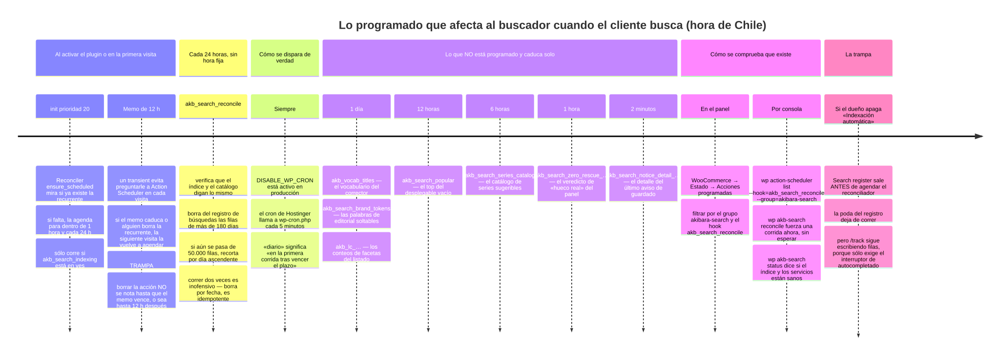
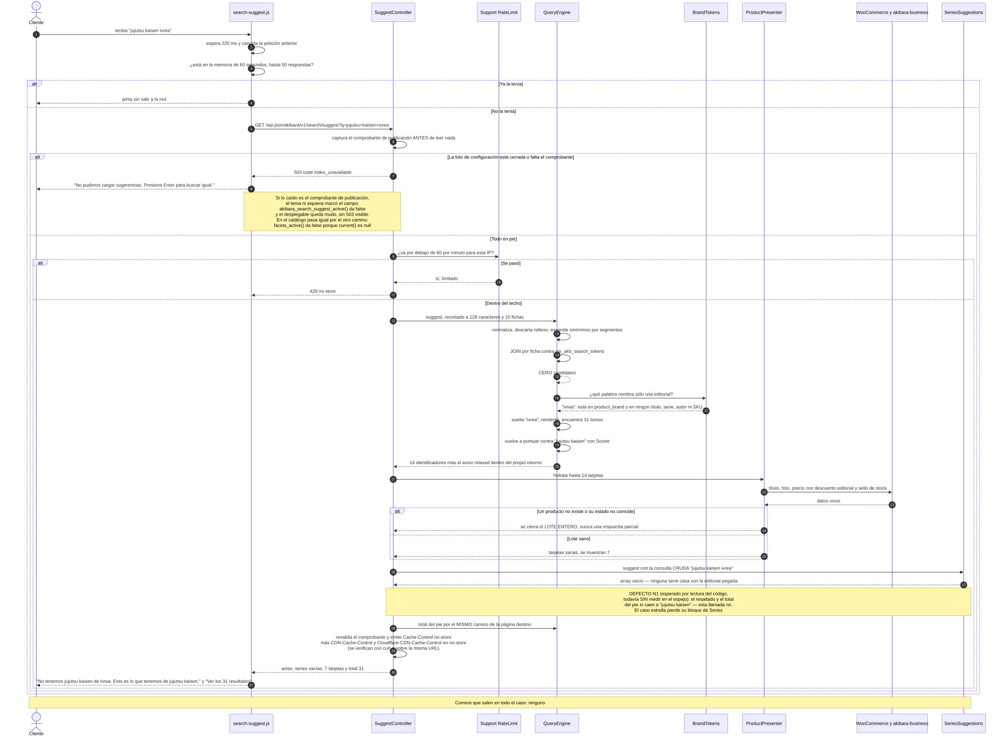
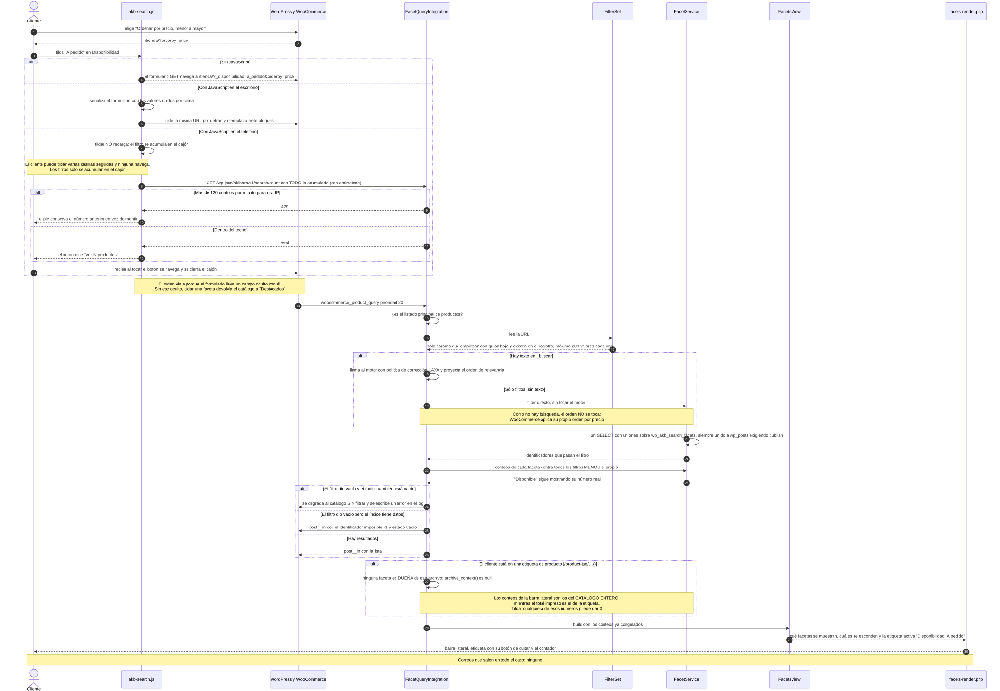
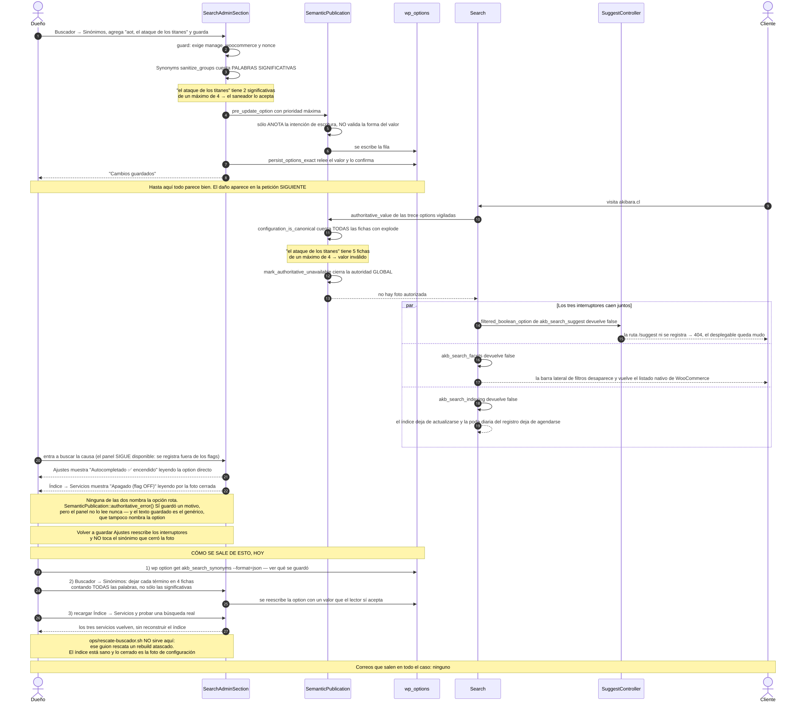

# akibara-search · lo que pasa cuando el cliente busca: motor, facetas, sugerencias y panel

> Verdad del código: el snapshot congelado de producción — `akibara-search` 0.1.60, `akibara-business` 1.116.4, tema `akibara-gp` 2.1.118.
> Todas las citas `fichero:línea` de este capítulo apuntan a ese snapshot, dentro de `public_html/wp-content/plugins/akibara-search/` salvo cuando se dice otra cosa.
>
> **Sobre los nombres de tabla.** En el texto las tablas se escriben `wp_akb_search_docs`, `wp_akb_search_qlog` y así, porque es el nombre real en akibara.cl. Pero ese `wp_` no está escrito en el código: es el **prefijo** que WordPress le pone a sus tablas y que cada instalación puede cambiar. El código las pide siempre por `Install::docs_table()`, `Install::qlog_table()`, etc. (`src/Install.php:475-512`), que devuelven `$wpdb->prefix` más el nombre. Si copias una consulta SQL de este capítulo a una instalación con otro prefijo, hay que cambiar el `wp_`.
>
> **Actualización 2026-09-26 — search 0.1.75 en producción** (desplegado el 2026-09-26 06:08 UTC, primero
> del lote de UX del tema: search → business → checkout → rewards → tema). Lo nuevo es la **búsqueda sin
> resultados con salida**: la clase `EmptyStateSuggestions` («Quizá buscabas» y «Lo más buscado»), el
> motivo «filtros» con su pista propia, el gancho `akibara_search_empty_after` para el tema, cinco
> ajustes nuevos en Buscador → Ajustes y el arreglo del PJAX que confundía la venta cruzada del aviso con
> la rejilla del catálogo. Todo lo marcado «(0.1.75)» se leyó contra `dist/akibara-search-0.1.75.zip`;
> el resto del capítulo sigue citando el snapshot 0.1.60. Diff 0.1.74 → 0.1.75: `akibara-search.php`,
> `frontend/facets-render.php`, `src/EmptyStateCopy.php`, `src/EmptyStateSuggestions.php` (nuevo),
> `src/FacetQueryIntegration.php`, `src/SearchAdminSection.php`, `assets/js/akb-search.js`,
> `assets/js/search-suggest.js` y sus CSS, con sus `.min`.
>
> **En el árbol, sin desplegar (seguimiento del 2026-09-26).** Lo marcado «(árbol)» se leyó en
> `public_html/wp-content/plugins/akibara-search/` el 2026-09-27 a las 00:45 y se releyó a las 03:30
> (`akb-search.js` con sha256 `75ede3a1…`, el mismo que declara la cabecera de su `.min` y que sirve el
> espejo; frente al `88267a53…` de las 00:45 sólo cambia la copia flotante del aviso —`flotar()`,
> `colocar()` y `loQueSeVe()`, del carril search: REV-D-S-1o-1, 1o-2 y 1f-1—; el carril search seguía
> abierto, así que el candado `verificar_docs_dd.py` del lote D-D compara estas citas con el código y se
> pone en rojo si cambia). Sale en una versión de
> search **posterior a 0.1.75**, que se despliega **después** de business 1.117.1 y del tema 2.1.144 (capítulo
> 21, `D26-1`). Toca `assets/js/akb-search.js`, `assets/js/search-suggest.js`, `assets/css/akb-search.css`
> (con sus `.min`), `frontend/facets-render.php`, `src/EmptyStateCopy.php` y `src/SearchAdminSection.php`.

---

## Para qué existe (en dos párrafos que entienda un novato)

Akibara es una tienda de manga por internet. El sitio funciona con **WordPress** (el programa que publica las páginas) y **WooCommerce** (el añadido que convierte WordPress en tienda). Un **plugin** es un paquete de código que se enchufa a WordPress para agregarle funciones. `akibara-search` es un plugin escrito a medida para esta tienda, y existe porque el buscador que trae WooCommerce de fábrica es pobre: busca palabras sueltas dentro del texto del producto y no entiende que «Jujutsu Kaisen 26» es el tomo 26 de una serie de 31. Medido en producción el 2026-09-06, quien escribía «one piece 1» veía los tomos 100 a 107 y nunca el 1 — porque «One Piece 100» *empieza* con «one piece 1» y eso valía más puntos que el tomo que el cliente estaba pidiendo (`src/Scorer.php:60-72`).

El plugin tiene dos mitades. Una **escribe**: recorre el catálogo y guarda una copia resumida de cada producto en tablas propias (el *índice*). Este capítulo describe la otra mitad, la que **lee** ese índice para contestar tres preguntas del cliente y una del dueño. Las del cliente: *¿qué le muestro mientras escribe?* (el desplegable bajo la cajita de búsqueda), *¿qué le muestro cuando aprieta Enter?* (la página de resultados de la tienda) y *¿qué le muestro cuando toca un filtro?* (el catálogo acotado por Editorial, Precio, Disponibilidad…). La del dueño: *¿qué está buscando la gente, y qué de eso no tenemos?* — que es literalmente su lista de compra. Nada de esto envía correos: el área no tiene ni una llamada a `wp_mail` (el único del plugin entero vive en `src/RebuildJob.php:835`, que pertenece a la mitad que escribe).

---

## Cómo encaja con el resto (con quién habla y qué pasa si se apaga)


*Fuente: [`09-search-consulta-facetas-y-sugerencias-piezas.mmd`](diagramas/09-search-consulta-facetas-y-sugerencias-piezas.mmd).*

**Con el tema `akibara-gp`.** El plugin expone **ocho funciones puente**, todas globales y todas llamadas envueltas en `function_exists()`, de modo que si el plugin no está quien las use degrada a mudo en vez de tirar un error fatal (`akibara-search.php:113-249`). Son `akibara_search_facets_active()` (`:118`), `akibara_search_facets_fail_open()` (`:131`), `akibara_search_facets_view()` (`:141`), `akibara_search_facets_context()` (`:152`), `akibara_search_suggest_active()` (`:163`), `akibara_search_correction()` (`:175`), `akibara_search_relaxed_notice()` (`:197`) y `akibara_search_demand_gaps()` (`:227`).

**Y quién llama a cada una, que no es lo que parece.** El **tema sólo llama a dos**: `facets_active()` (`woocommerce/loop/pagination.php:25`, `inc/flyout-button.php:52`) y `suggest_active()` (`template-parts/header/shell.php:103`, `template-parts/header/mobile-drawer.php:63`). Las cinco de facetas y avisos —incluida `facets_fail_open()`, cuyo único consumidor en todo el árbol es `frontend/facets-render.php:1250`, donde marca el `<meta>` del fail-open— las consume ese mismo `frontend/facets-render.php`, que vive **dentro del propio plugin**; y `demand_gaps()` la consume akibara-business (`src/Modules/AdminDashboard/AdminDashboard.php:475`). Son globales igual porque el render server-first se enganchó como si fuera del tema y porque business no puede hacer `use` de clases del buscador. Esa lista importa porque es el contrato que evita que un despliegue descoordinado del par Business/Search vuelva a provocar un 500 global. Hasta search 0.1.73 el docblock del fichero decía «estas 4 funciones puente» y «los 6 consumidores del theme», y este capítulo decía «siete» y se dejaba fuera justo `facets_fail_open()`: ninguna de las tres cifras era cierta (corregido 2026-09-20, ronda 10).

**En 0.1.75 son nueve.** Se suma `akibara_search_empty_suggestions( $q )` (`akibara-search.php`, bloque
`if ( ! function_exists( 'akibara_search_empty_suggestions' ) )`), que devuelve la serie parecida y lo más
buscado para el aviso de «sin resultados»; su único consumidor es, otra vez, `frontend/facets-render.php`
(`akibara_gp_akb_empty_suggestions_html()`). El tema sigue llamando a dos. Y hay una **costura nueva en
sentido contrario**: el buscador dispara `do_action( 'akibara_search_empty_after', $q, $motivo )`
**dentro** del nodo `[data-akb-empty]` para que el tema pinte ahí su venta cruzada sin que el plugin
dependa de sus plantillas (ficha de `frontend/facets-render.php` y capítulo 13, §4.46).

Dos de esas ocho exigen algo más que el interruptor encendido, y conviene saberlo antes de hacer QA, porque por dos caminos distintos las dos se apagan cuando falla el **comprobante de publicación** (el recibo interno que se explica cuatro párrafos más abajo):

- **`akibara_search_suggest_active()`** es la única que llama al predicado *efectivo* del interruptor, `Search::suggest_enabled()` (`src/Search.php:322`), mientras que el registro de la ruta REST usa el *configurado*, `Search::suggest_configured()` (`src/Search.php:158`). El tema la consulta para decidir si marca el campo de búsqueda con `data-akb-suggest` (`themes/akibara-gp/template-parts/header/shell.php:97` y `template-parts/header/mobile-drawer.php:64`).
- **`akibara_search_facets_active()`** no llama a ningún predicado efectivo, pero termina en el mismo sitio: devuelve `FacetQueryIntegration::current() !== null` (`akibara-search.php:118-121`), y `current()` sólo es distinto de `null` si además del interruptor configurado hay comprobante vivo — `self::$current = null !== $this->request_publication_token && Search::facets_configured() ? $this : null` (`src/FacetQueryIntegration.php:175`), con el comprobante capturado por `EditorialDiscountPublication::capture_serving_token()` (`:174` y `:861-870`).

Consecuencia práctica en las dos: si lo que falla es el comprobante, el cliente no ve un error 503 — ve un desplegable que sencillamente no aparece, porque el JavaScript ni siquiera se encoló (`src/Search.php:259`), y una barra lateral de filtros que tampoco se imprime. Quien salga a buscar el 503 no va a encontrar la superficie.

**Con `akibara-business`.** Tres filtros de ida y una función puente de vuelta. De ida: `akb_search_effective_price` (el precio con descuento editorial, consultado por `ProductPresenter` justo antes de pintarlo), `akb_stock_status_label` (el vocabulario Disponible / Preventa / Agotado, único punto de override para toda la tienda) y `akb_search_availability_value` (si un tomo reservable es preventa o «a pedido»). Más `akb_search_query_vars`, con el que una ruta curada de business — por ejemplo `/preventas/` — puede preseleccionar una faceta. De vuelta: `akibara_search_demand_gaps()`, que alimenta el ranking «Lo más solicitado» del Centro de Mando de business. Sin proveedor, cada filtro cae a su valor base sin romper nada.

**En 0.1.75 (con business 1.117.0) hay un filtro más de ida:** `akb_search_result_count_extra`. Es HTML que
otro plugin quiere en la **misma línea** que «N productos»; hoy lo usa business en las landings de serie
para el atajo «Último tomo: N →» (`SeriesFacts::result_count_extra()`). El total va en su propio
`<span class="akb-result-count__total">`, que es lo único que el PJAX anuncia a los lectores de pantalla,
y el extra pasa por `wp_kses_post()`. Es un filtro y no una llamada a una clase de business a propósito:
con cualquiera de los dos desactualizado, simplemente no sale nada.

**Con terceros, siempre por hooks y nunca editando su código.** WooCommerce: `woocommerce_product_query` (prioridad 20), `woocommerce_before_shop_loop`, `woocommerce_no_products_found`, `woocommerce_page_title` y la lectura de `woocommerce_catalog_orderby`. GeneratePress: `is_active_sidebar` y `dynamic_sidebar_before` (prioridad 4), que es donde se monta la barra lateral de filtros. Rank Math: se **lee** su termmeta `rank_math_robots` para no ofrecer landings de serie que el dueño sacó del índice de Google, y se filtran `rank_math/frontend/title` y `rank_math/json_ld` (prioridad 20). LiteSpeed: `litespeed_control_set_nocache` y `litespeed_purge_all`. Cloudflare: las cabeceras `CDN-Cache-Control` y `Cloudflare-CDN-Cache-Control`, porque el borde ignora el `Cache-Control` común — medido el 2026-08-23, `/suggest?q=naruto` volvía con `cf-cache-status: HIT` pese al `no-store` (`src/Support/RestCache.php:105-118`).

**Qué pasa si se apaga.** Hay tres interruptores independientes y todos viven en Buscador → Ajustes:

| Interruptor | Si se apaga |
|---|---|
| `akb_search_suggest` | La ruta REST ni se registra: `/suggest` responde 404 y el desplegable muestra su error recuperable. La tienda **sigue buscando** al enviar el formulario. También deja de registrarse qué busca la gente. |
| `akb_search_facets` | La barra lateral de filtros desaparece y el catálogo vuelve al listado nativo de WooCommerce, con su propio contador. |
| `akb_search_indexing` | El índice deja de actualizarse: la tienda sigue buscando, pero sobre un catálogo cada vez más viejo. La **poda** diaria del registro de búsquedas **sigue corriendo**: la revisión diaria se agenda siempre, encendida o apagada la indexación (`src/Search.php:184`, antes del gate de `:186`), y con la indexación apagada la corrida se limita justamente a esa poda (`src/Reconciler.php:163-172`). *Podar* aquí significa borrar del registro de búsquedas las filas viejas para que la tabla no crezca sin fin; no borra nada del catálogo ni de la tienda. Hasta search 0.1.68 (2026-09-19) las dos palancas sí se apagaban juntas, porque el `add_action` vivía detrás del `return` del gate; lo separaron S-d62426cd y S-d7206eef (corregido 2026-09-20, ronda 10). |

Apagar **no borra el índice**. Y el panel sigue estando disponible con los tres apagados, a propósito: «el panel existe justamente para operar con flags OFF» (`src/Search.php:145-153`). Esto vale también para el caso peor de este capítulo, el de la foto autorizada cerrada: la pantalla de administración y la ruta de estado que la refresca se registran **antes** y **fuera** de cualquier interruptor, así que el dueño siempre puede entrar a mirar y a operar.

Hay una tercera vía de apagado que no es ninguno de los tres interruptores y que conviene tener presente: si la instalación de las tablas propias no quedó sellada, `Search::register()` **sale antes** de cablear la purga de caché y la indexación (`if ( ! Install::runtime_schema_ready() ) { return; }`, `src/Search.php:171-174`). Las rutas ya registradas siguen en pie y responden 503; lo que no ocurre es el reindexado ni la poda. No se parece a las otras dos causas: aquí las options dicen `yes` y la foto autorizada está abierta.

Por encima de los tres interruptores hay una segunda llave que el dueño no ve: el **comprobante de publicación**, un recibo interno que afirma que los precios y las facetas publicados corresponden al catálogo de *ahora*. Sin él, un servicio configurado como `yes` no es efectivo. **Un solo nombre para una sola cosa**: en este capítulo se le dice siempre «comprobante de publicación». Lo emite `src/EditorialDiscountPublication.php` y se consulta de dos maneras, que son la misma: `EditorialDiscountPublication::serving_ready()` (`:421-428`), que es lo que llaman `Search::suggest_enabled()` (`src/Search.php:327`) y `Search::facets_enabled()` (`:352`); y `EditorialDiscountPublication::capture_serving_token()` (`:437`), que devuelve el comprobante mismo y es lo que capturan `FacetQueryIntegration` (`src/FacetQueryIntegration.php:174`) y `SuggestController` (`src/SuggestController.php:566`). Si en algún lado se lee «comprobante de servido», es este mismo.

Y por encima de todo está la **foto autorizada** (`SemanticPublication`), que lee de una sola vez las trece options que cambian lo que el buscador sirve y valida la forma de cada una: si un solo byte no cuadra, cierra la autoridad global y **los tres interruptores caen juntos**. Las trece, tal como las lista `SemanticPublication::options()` (`src/SemanticPublication.php:65-79`), son:

`akb_search_synonyms` · `akb_search_stopwords` · `akb_search_fuzzy` · `akb_search_sku_fastpath` · `akb_search_facets_config` · `akb_search_precio_buckets` · `akb_search_precio_mode` · `akb_search_novedad` · `akb_search_popular_enabled` · **`default_product_cat`** · `akb_search_indexing` · `akb_search_suggest` · `akb_search_facets`.

Esa lista tiene una sorpresa que vale la pena decir en voz alta: **`default_product_cat` no es una option del buscador, es de WooCommerce** — la categoría de producto por defecto, que se cambia en WooCommerce → Ajustes → Productos. Está vigilada porque el buscador la usa para resolver la faceta Tipo, y eso significa que **una escritura hecha desde una pantalla que no es del buscador puede cerrar la foto autorizada y apagar los tres servicios**.


*Fuente: [`09-search-consulta-facetas-y-sugerencias-estados-autoridad.mmd`](diagramas/09-search-consulta-facetas-y-sugerencias-estados-autoridad.mmd).*

La regla que gobierna todo el módulo está escrita en `src/Support/FailsClosed.php:5`: *«un cero inventado es peor que un servicio apagado — se cachea, se publica y se convierte en el catálogo no tiene nada»*. La única excepción deliberada es el índice **vacío**: ahí el catálogo se degrada a WooCommerce sin filtrar y se escribe un error en el log, porque un índice muerto no puede convertir la tienda entera en cero productos (`src/FacetQueryIntegration.php:336`).

---

## Piezas

Treinta y nueve componentes. Se agrupan por dominio, pero cada uno lleva su propia ficha.

Hay un fichero del plugin que este capítulo **no** cubre y conviene decirlo para que no parezca olvidado: `src/Arrival.php`. `Search::register()` lo engancha incondicionalmente, fuera de los tres interruptores (`src/Search.php:143`), pero sólo **escribe** dos metas de historia —cuándo un tomo se vio por primera vez en preventa y cuándo llegó de verdad— y **ningún consumidor las lee todavía**: son datos-fuente para una versión futura del filtro Novedades (decisión del dueño, 2026-07-10). Cero superficie del cliente, cero pantalla. Su sitio es el capítulo 08, el de la mitad que escribe.

### Las llaves

#### `Search` — el interruptor general

- **Qué hace.** Decide, en cada visita, si el autocompletado y los filtros propios existen para ese cliente, y arma las piezas que hagan falta.
- **Ficheros.** `akibara-search.php`, `src/Search.php`.
- **Cuándo actúa.** `plugins_loaded` prioridad 15 (`akibara_search_bootstrap`, sale si WooCommerce no está activo); `init` prioridad 20 para consumir la señal de reconstrucción pendiente y para agendar el reconciliador; `rest_api_init` prioridad 10 para publicar `/search/admin-status`; `wp_enqueue_scripts` prioridad 10 para encolar el JavaScript del desplegable; `update_option_akb_search_index_gen` y `add_option_akb_search_index_gen` prioridad 10 para despachar la purga de LiteSpeed; `plugins_loaded` prioridad 30 para registrar la publicación editorial *después* de que business conecte su proveedor de precio.
- **Qué lee.** Las options `akb_search_indexing`, `akb_search_suggest` y `akb_search_facets`, siempre a través de la foto autorizada y siempre exigiendo un **booleano exacto** del hook de override; cualquier otra cosa apaga (`src/Search.php:370`).
- **Qué escribe.** Nada por sí mismo.
- **Dónde lo opera el dueño.** Buscador → Ajustes (los tres servicios) y Buscador → Índice → Servicios (estado configurado y efectivo, con su causa).
- **Qué ve el cliente.** De estos interruptores depende que exista el desplegable y el panel de filtros.
- **Detalle que cuesta caro.** Distingue **configurado** (la option dice `yes`) de **efectivo** (además existe el comprobante de publicación vigente). Las rutas REST se registran con el configurado, para que con el comprobante caído respondan 503 y no un 404 ambiguo; los assets y el listado usan el efectivo.
- **La palanca de QA.** Cada interruptor tiene un hook que permite forzarlo sin tocar la base de datos, útil para probar un servicio encendido o apagado en una sola petición. Son `akb_search_indexing_enabled`, `akb_search_suggest_enabled` y `akb_search_facets_enabled` (`src/Search.php:376-385`). La regla es dura: el hook tiene que devolver un **booleano exacto**; si devuelve `1`, `'yes'` o cualquier otra cosa que «parezca» verdadera, el servicio se apaga.
- **Sale antes si el esquema no está sellado.** Si `Install::runtime_schema_ready()` es falso, `register()` retorna en `:171-174` sin cablear la purga de caché, sin registrar los oyentes de indexación y sin agendar el reconciliador. Es la tercera causa de «todo apagado», distinta de las otras dos (interruptor en `no`, foto autorizada cerrada) y la única en que las options dicen `yes` y la foto está sana.

#### `SemanticPublication` — la foto autorizada

- **Qué hace.** Lee de una sola vez por petición las **trece options vigiladas** y valida la forma de cada una; si algo no cuadra, cierra el buscador entero en vez de servir datos dudosos.
- **Ficheros.** `src/SemanticPublication.php`.
- **Cuándo actúa.** `pre_update_option` con prioridad `PHP_INT_MAX` (anota la intención de escritura); `add_option` y `delete_option` con prioridad 1; `updated_option` / `added_option` / `deleted_option` con prioridad `PHP_INT_MAX` (sella la publicación y rota la generación); `init` prioridad 23 para reconciliar la huella cuando alguien escribió por SQL directo.
- **Qué lee.** `yes`/`no`, `auto`/`manual`, la forma canónica de los sinónimos, las palabras ignoradas de hasta 64 caracteres (`src/SemanticPublication.php:670`), los tramos de precio, la configuración de facetas con etiquetas de hasta 100 caracteres (`:745`).
- **Qué escribe.** `akb_search_semantic_fingerprint` (recibo interno, sin pantalla).
- **Dónde lo opera el dueño.** No se opera directamente; se ve su efecto en Buscador → Índice → Servicios y en Diagnóstico técnico.
- **Qué ve el cliente.** Indirecta y total: si esta foto se cierra, el buscador y los filtros desaparecen.
- **El agujero.** `filter_pre_update` (`:255`) **sólo anota la intención**; no valida la forma del valor. La fila se escribe igual. El rechazo llega en la petición *siguiente*, cuando ya es tarde. Es el hallazgo principal de este capítulo y tiene su propio caso de uso más abajo.
- **Hay un diagnóstico escrito que nadie muestra.** Cuando la foto se cierra, `mark_authoritative_unavailable()` guarda el motivo y `SemanticPublication::authoritative_error()` (`:128-130`) lo devuelve. Lo consumen `QueryEngine`, `FacetService`, `FacetRegistry` y `PopularQueries` para marcarse no disponibles… y **`SearchAdminSection` no lo lee nunca** (verificado con `grep authoritative_error` sobre todo `src/`). O sea: el motivo existe, viaja por el código y no llega a ninguna pantalla. Y hay un segundo problema encima: en el caso del sinónimo el motivo que se guarda es el genérico de `:106`, *«Semantic option snapshot contains invalid bytes or values.»*, que **no nombra la option rota**, porque la validación de conjunto (`valid_raw_snapshot()`) corta antes de llegar a la rama de `:116`, que sí la nombraría (*«Semantic option has invalid serialized bytes: `<nombre>`»*). Imprimir ese texto en Diagnóstico técnico —y hacer que sea siempre el que nombra la option— cierra el incidente del Caso 10 en un minuto en vez de en horas.

#### `EditorialDiscountPublication` — el comprobante de publicación

- **Qué hace.** Emite y guarda el recibo que afirma que los precios con descuento y los valores de faceta que hoy se sirven corresponden al catálogo de ahora. Es la pieza que convierte «configurado» en «efectivo».
- **Ficheros.** `src/EditorialDiscountPublication.php` (162 KB, el fichero más grande del plugin después de los de indexación).
- **Qué es un «descuento editorial».** El dueño puede colgar un porcentaje de descuento de un término completo —una editorial, una serie— en vez de producto por producto; el porcentaje vive en la termmeta `_akb_taxonomy_discount_pct` (`:34`). Ese descuento no se recalcula en cada visita: se **materializa**, es decir, se deja ya calculado dentro del índice y de la tabla espejo de facetas. Publicar esa materialización es lo que esta clase vigila. De ahí viene el nombre «gate editorial» que usa el panel: la puerta que decide si la materialización de descuentos está publicada y vigente. **No** tiene que ver con equivocarse de editorial al buscar, que es otra cosa completamente distinta de este mismo capítulo.
- **Qué lee y escribe.** Las options `akb_search_editorial_discount_state`, `..._receipt` y `..._history` (`:29-31`), ninguna con pantalla: son recibos de máquina.
- **Cómo se consulta.** `serving_ready()` (`:421-428`) devuelve sí/no y es lo que llaman `Search::suggest_enabled()` y `Search::facets_enabled()`. `capture_serving_token()` (`:437-460`) devuelve el comprobante mismo, memoizado una sola vez por petición, y es lo que capturan `SuggestController` y `FacetQueryIntegration` para poder **revalidarlo** justo antes de responder con `serving_token_matches()` (`:464`): así una option que cambie entre el inicio y el final de la petición no mezcla dos configuraciones dentro de la misma respuesta.
- **Dónde lo opera el dueño.** No se opera. Se ve su veredicto en Buscador → Índice → Servicios, en naranja y **con la causa escrita en castellano** (`SearchAdminSection::editorial_gate_reason()`, `:722-739`): cuatro causas posibles —la publicación quedó atrás del catálogo, falta el registro, falta el comprobante, no se pudo leer la configuración de descuentos— cada una con su instrucción y un enlace a Mantenimiento.
- **Qué ve el cliente.** Nada directamente; si el comprobante falta, deja de ver el desplegable y los filtros.

#### Las funciones puente (ocho hasta 0.1.74, nueve desde 0.1.75)

- **Qué hacen.** Exponen el estado y el modelo de vista del buscador para que quien pinta lo imprima sin tocar clases internas ni la base de datos. **El tema sólo usa dos**; las otras las consumen `frontend/facets-render.php` (del propio plugin) y business.
- **La novena (0.1.75).** `akibara_search_empty_suggestions( string $query )`: devuelve `{series, popular}` con `EmptyStateSuggestions::from_runtime( $wpdb )->for_query()`; vacía si la clase no existe, si el interruptor está apagado o ante cualquier fallo de lectura. El aviso de «sin resultados» nunca depende de ella.
- **Ficheros.** `akibara-search.php:113-249` en 0.1.60 (ocho bloques `if ( ! function_exists( … ) )`); en 0.1.75 son **nueve** bloques, `:114-272` (el de `akibara_search_empty_suggestions` en `:211`).
- **Cuándo actúan.** En el render, siempre bajo `function_exists()`.
- **Qué leen.** `FacetQueryIntegration::current()`, `Search::suggest_enabled()`, `Fuzzy::last_correction()`, `BrandRelax::last()`, `DemandGaps::rows()`.
- **Qué escriben.** Nada.
- **Dónde lo opera el dueño.** No se opera.
- **Qué ve el cliente.** El desplegable instrumentado, la barra lateral, los avisos de corrección y de editorial.

### El motor

#### `QueryEngine` — el corazón

- **Qué hace.** Convierte lo que escribió el cliente en una lista de productos ordenada por relevancia, y decide cuándo hay que rescatar una búsqueda que no encontró nada.
- **Ficheros.** `src/QueryEngine.php`.
- **Cuándo actúa.** No se engancha a hooks: lo llaman `SuggestController` y `FacetQueryIntegration`.
- **Qué lee.** `wp_akb_search_docs` y `wp_akb_search_tokens`; el transient `akb_vocab_titles` (vocabulario del corrector, TTL 1 día, `:715`); la option `akb_search_sku_fastpath`.
- **Qué escribe.** El transient del vocabulario y un **canal estático** hacia `BrandRelax`.
- **Dónde lo opera el dueño.** Buscador → Ajustes, interruptor «Búsqueda por código (SKU / ISBN)».
- **Qué ve el cliente.** Todo lo que ve como resultado sale de aquí.
- **Tres decisiones finas.** (1) Recorta la consulta a 128 caracteres y 10 fichas *antes* de tocar la base (`:44` y `:47`), porque sin ese tope una sola petición armaba un JOIN por ficha sin límite. (2) Tiene un **atajo por código**: si lo escrito parece un SKU o un ISBN, devuelve el producto exacto sin pasar por el ranking (`:779`). (3) En **modo desplegable** la *última* ficha casa por prefijo aunque sea un número (`:541` y `:642`): sin eso, quien iba camino de «jujutsu kaisen 26» colapsaba al tomo 2 al pasar por «jujutsu kaisen 2».

**Dos palabras que se repiten en todo el capítulo y que conviene entender aquí, la primera vez que aparecen:**

> **Canal estático.** Una variable que vive **sólo durante esa visita** y que cualquier parte del código puede leer sin que nadie se la pase de mano en mano. Es el camino por el que un aviso viaja desde el motor —que lo descubre— hasta la plantilla que lo imprime, que está muy lejos y no recibe ningún valor de retorno del motor. Se escribe con `BrandRelax::note()` y se lee con `BrandRelax::last()`. Termina cuando termina la petición: el visitante siguiente arranca con el canal vacío.
>
> **Sello de generación dentro del valor.** Cada vez que el índice se reconstruye, su «generación» avanza un número (la option `akb_search_index_gen`). Un dato guardado en caché tiene que saber a qué generación pertenece, o serviría resultados de un catálogo viejo. Hay dos formas de hacerlo, y la elección está medida: poniendo la generación **en la clave** del caché (`vocabulario_gen7`, `vocabulario_gen8`…) o **dentro del valor** guardado, junto al dato, en una clave fija. Este plugin lo hace siempre dentro del valor, porque con el sello en la clave **cada reconstrucción estrenaba una fila nueva sin borrar la anterior** — se llegaron a medir 23 copias vivas del mismo contenido, que con caché de objetos persistente el recolector de WordPress no barre nunca. Al leer se compara el sello guardado con la generación actual: si no coinciden, se recalcula.

- **Un contrato mal documentado que hoy no rompe nada.** El bloque de documentación de `QueryEngine::suggest()` promete devolver dos claves —`array{ids, corrected}` (`:115`)— y el `return` entrega **tres**: `ids`, `corrected` y `relaxed` (`:120-125`). La tercera no es un detalle: `relaxed` es precisamente el aviso de editorial equivocada viajando **dentro del propio retorno** en vez de por el canal estático, que es lo que protege al desplegable de que un intermediario lo pise. O sea, la clave más delicada de las tres es la que la documentación no menciona. Es deuda de contrato, no un defecto vivo: los consumidores la leen igual.

#### `Normalizer`

- **Qué hace.** Deja todo texto en una forma única y comparable: minúsculas, sin tildes, sin signos. `Haikyu!! Nº 01 – Ivrea` se convierte en `haikyu n 01 ivrea`, y la ñ pasa a n.
- **Ficheros.** `src/Normalizer.php`. Puro y determinista: sin hooks, sin options, sin base de datos.
- **Decisión menos obvia.** La **forma canónica doble** de los números: el `1` indexa también `01` y viceversa (`:126`, `:142`, `:156-158`), porque los títulos del catálogo van rellenos a dos dígitos y `haikyu 1` fallaba en silencio contra `Haikyu!! 01`.
- **Qué ve el cliente.** Nada directo; sin esto no encontraría casi nada.

#### `Stopwords` — las palabras ignoradas

- **Qué hace.** La lista de relleno (el, la, de, the, of) que el buscador no toma en cuenta.
- **Ficheros.** `src/Stopwords.php`.
- **Qué lee.** La option `akb_search_stopwords`. Si **no existe** (o no es una lista), rige la de fábrica. Si existe y está **vacía, se respeta** (R3-4199bd7c, 0.1.70): el dueño puede querer que no se ignore ninguna palabra. Hasta la 0.1.69 «vacía» se trataba como «corrupta» y el panel decía «Cambios guardados» mientras revivía las de fábrica en la búsqueda siguiente y en el propio cuadro. Es el mismo criterio que `Synonyms::groups()`. Con la lista vacía el panel lo dice y muestra la de fábrica para pegarla de vuelta. En producción la option no existe, así que hoy rigen las de fábrica.
- **Dónde lo opera el dueño.** Buscador → Palabras ignoradas.
- **Detalle defensivo revelador.** Filtra los elementos que no sean texto, porque una option corrupta con elementos anidados hacía fatal toda búsqueda en la conversión a cadena.
- **Regla que no se toca.** Los **números nunca** son palabras de relleno (`:66`): el número de tomo es la señal más fuerte del catálogo.

#### `Synonyms` — los sinónimos

- **Qué hace.** Guarda grupos de términos equivalentes (`aot, attack on titan, shingeki no kyojin, ataque a los titanes`).
- **Ficheros.** `src/Synonyms.php`.
- **Qué lee y escribe.** La option `akb_search_synonyms`; hasta 64 grupos, 8 términos por grupo, 128 caracteres por término.
- **Dónde lo opera el dueño.** Buscador → Sinónimos, un grupo por línea con los términos separados por coma.
- **Qué ve el cliente.** Indirecta: amplía lo que encuentra una búsqueda.
- **Los grupos son clases de equivalencia (R2-741f74eb, 0.1.69).** Dos líneas que comparten un término quedan unidas para el motor —quien busca cualquier término de una también busca los de la otra—, y las palabras de relleno no cuentan: «la espada» y «espada» son el mismo término. Es la conducta correcta cuando se hace a propósito y una sorpresa cuando no, así que desde la 0.1.69 la pestaña lo **dice**, con los números de línea (`Synonyms::shared_terms()`), y los dos grupos de fábrica de *Attack on Titan* —que se repetían a propósito— quedaron escritos como uno. La regla de búsqueda no cambió.
- **Lo importante.** Cada término conserva sus **límites de frase**: `opm` equivale a la *secuencia* `one punch man`, nunca a las palabras sueltas. La expansión es en tiempo de consulta, así que cambiar los grupos **no exige reconstruir el índice**.
- **La trampa.** El saneador de escritura cuenta *palabras significativas* (`:126`, descartando stopwords y fichas de un carácter) y el validador de lectura cuenta *todas* las fichas con `explode( ' ', … )` contra un máximo de 4 (`:182-183`). «el ataque de los titanes» pasa el primero con 2 y muere en el segundo con 5. Ver el caso de uso «El dueño guarda un sinónimo y la tienda se apaga».

#### `Scorer` — el ranking

- **Qué hace.** Le pone nota a cada candidato según **dónde** calzó la búsqueda y si el número escrito es **su** número de tomo, y después desempata. Clase pura, sin base de datos.
- **Ficheros.** `src/Scorer.php`.

La nota se arma en tres pasos, en este orden (`:90-103`), y la diferencia importa:

**Paso 1 — el nivel.** Se elige **uno solo** de estos seis, el más alto que calce:

| Situación | Puntos | Fuente |
|---|---|---|
| El título **empieza** con la frase exacta | 1000 | `:42` |
| El título **contiene** la frase exacta | 800 | `:43` |
| Todas las fichas están en el título | 600 | `:44` |
| Todas las fichas están en la serie | 400 | `:45` |
| Calza vía autor | 250 | `:46` |
| Sólo por descripción u otros | 100 | `:47` |

**Paso 2 — el piso del documento nombrado.** Si todas las palabras están en título o serie **y** el número escrito es su número de tomo, la nota **sube a 1200 si estaba por debajo** — no se suma: es un `max( $score, 1200 )` (`:96-97`). Un título que ya valía 1000 por prefijo pasa a 1200; uno que valía 1200 no pasa a 2200.

**Paso 3 — bonus y penalizaciones, éstos sí se suman y se restan sobre lo anterior:**

| Ajuste | Puntos | Fuente |
|---|---|---|
| **Bonus**: una ficha numérica coincide exacto con el tomo | **+300** | `:49`, sumado en `:99` |
| **Penalización**: todo `onbackorder` — tanto «a pedido» como **preventa** | −40 | `:76-80`, restado en `:100` |
| **Penalización**: agotado | −250 | `:76-80`, restado en `:100` |

De ahí sale el número que no aparece en ninguna constante y que conviene tener en la cabeza: **el documento que el cliente nombró y está disponible puntúa 1500**, porque el piso de 1200 y el bonus de 300 conviven (el mismo hecho —el tomo coincide— activa los dos). Ésa es la distancia real que lo separa de un prefijo de título, que se queda en 1000.

El Scorer **no distingue a pedido de preventa**: la constante está etiquetada `1 => 40, // onbackorder (preventa)` y cubre las dos. Esa distinción comercial vive en `DocumentBuilder` y `StockLabels`, no aquí. El desempate, a igual puntaje: tomo ascendente → un tomo numerado antes que un ómnibus sin número → `menu_order` → orden natural del título (01, 02… 10, 11; no 1, 10, 11, 2) (`:113`).

#### `Highlighter` — el resaltado

- **Qué hace.** Envuelve en `<mark>` los trozos del título que coinciden con lo buscado, ya escapados.
- **Ficheros.** `src/Highlighter.php`.
- **Qué ve el cliente.** El resaltado en las tarjetas del desplegable.
- **Lo que sí funciona.** Filtra las fichas de menos de 2 caracteres (`:47`), pero como `Normalizer::tokenize()` añade la variante canónica doble, «1» genera también «01», que mide 2 y pasa el filtro. Como los títulos del catálogo van rellenos a dos dígitos, «one piece 1» **sí** marca el número. El hueco es estrecho: sólo títulos con número de un dígito sin rellenar.
- **Lo que no funciona.** `mark()` recibe fichas ya normalizadas —sin tildes— y las busca en el título **crudo** aplicando sólo `mb_strtolower()`, sin plegar diacríticos (`:60-70` contra `src/Normalizer.php:86-100`). `mb_strpos('nausicaä del valle del viento', 'nausicaa')` es `false`. El cliente busca «nausicaa», el motor le devuelve el tomo correcto, y la tarjeta no marca ni una letra. Afecta a todos los títulos con tilde, ñ o macrón.

### Los dos rescates

Cuando el camino normal da cero, el motor no se rinde. Prueba dos cosas **en este orden** —primero soltar la editorial, después corregir el tipeo— y las dos **se le cuentan al cliente**.

#### `BrandTokens` — qué palabra es sólo el nombre de una editorial

- **Qué hace.** Decide qué palabras de una búsqueda son sólo el nombre de una editorial y por lo tanto se pueden soltar.
- **Ficheros.** `src/BrandTokens.php`.
- **Qué lee.** La taxonomía `product_brand` con `hide_empty` (incluido el país: «Ivrea Argentina» aporta `ivrea` y `argentina`), y `wp_akb_search_tokens` para saber qué fichas de editorial son además contenido.
- **Qué escribe.** El transient `akb_search_brand_tokens`, con el sello de generación dentro del valor, TTL 1 día.
- **Las dos condiciones** (`:210-259`). (1) La palabra nombra a una editorial del catálogo. (2) **No** aparece en ningún título, serie, autor ni SKU del índice. La segunda es la que evita el desastre: si mañana entra una serie llamada «Milky Way», su palabra deja de ser soltable sola, sin tocar código. Lo mismo protege a «manga» y «cómic». Las palabras de menos de 3 caracteres nunca se sueltan (`:50`).
- **Por qué importa.** Medido en producción el 2026-09-05: `jujutsu kaisen ivrea` devolvía 0 con 31 tomos en catálogo (son de Panini Argentina), `dandadan panini` devolvía 0 con 22 (son de Ivrea), `naruto ivrea` devolvía 0 con 14 (son de Planeta). Ninguna de las 106 series del catálogo existe en dos ediciones a la vez, **así que equivocarse de editorial es lo normal, no un error del cliente**.
- **El orden también está medido.** Primero se suelta **una sola** palabra, de la última escrita hacia atrás (que suele ser el país); sólo si ninguna basta, todas juntas (`QueryEngine::relax_attempts()`, `src/QueryEngine.php:142-157`). Con `jujutsu kaisen panini españa` bastaba con soltar «españa», y soltar las dos decía «no tenemos jujutsu kaisen de Panini España», que es **falso**.

#### `BrandRelax` — el aviso de editorial equivocada

- **Qué hace.** Escribe la frase que le explica al cliente qué se soltó: «No tenemos **jujutsu kaisen** de **Ivrea**. Esto es lo que tenemos de **jujutsu kaisen**.»
- **Ficheros.** `src/BrandRelax.php`.
- **Qué lee.** La option `akb_search_relaxed_notice` — texto plano con los marcadores `{editorial}` y `{busqueda}`.
- **Qué escribe.** Un canal estático por petición (`BrandRelax::note()` / `::last()`) — la variable que vive sólo durante esa visita y que explicamos en la ficha de `QueryEngine`. Es como el aviso viaja desde el motor hasta el render del catálogo, que están demasiado lejos para pasárselo de mano en mano. **En el desplegable no se usa este camino**: ahí el aviso viaja dentro del propio retorno de `QueryEngine::suggest()`, en la clave `relaxed`, porque en esa ruta un intermediario podría pisar el canal.
- **Dónde lo opera el dueño.** Buscador → Ajustes → Mensajes al cliente → «Cuando la editorial pedida no tiene esa serie».
- **Qué ve el cliente.** Un párrafo con `role="status"` sobre los resultados, y una línea dentro del desplegable.
- **Dos detalles que valen oro.** **Nunca pasa por `sprintf`** (`:92`): usa `str_replace` con marcadores, porque un `%` escrito por el dueño dentro de un `sprintf` sería un error fatal en la página de resultados — el proyecto ya pagó ese precio. Y el dueño escribe **texto plano**: el sistema decide el énfasis, escapa y después envuelve en negritas.
- **El defecto vivo.** El panel sanea el texto con `EmptyStateCopy::sanitize()`, que mide **caracteres** (`mb_strlen(...) > 300`, `src/EmptyStateCopy.php:119-125`). `BrandRelax::template()` lo rechaza midiendo **bytes** (`strlen( $limpio ) > 300`, `:146`) y cae al literal de fábrica. En español cada `á í ó ñ « »` son 2 bytes: un aviso de 280 caracteres con 21 tildes ya supera los 300 bytes. El panel dice «Cambios guardados», la fila de `wp_options` contiene el texto del dueño, y el cliente lee el literal de fábrica. Peor: el campo del formulario se pinta con `BrandRelax::template()` (`src/SearchAdminSection.php:2021`), así que al recargar Ajustes el dueño ve **su texto reemplazado por el default** sin explicación, y `settings_current_values()` (`:2084`) lee lo mismo, de modo que el registro de cambios tampoco lo delata.
- **Una deuda que NO es un defecto vivo, y por qué.** Cuando el filtrado del catálogo se cae a mitad de petición, `forget_derived_state()` limpia sus memorias pero **no** limpia este canal estático: puede quedar un aviso de editorial huérfano, escrito por un motor cuyo resultado ya nadie va a usar. Hoy eso no llega a ninguna pantalla, y la razón importa para no «arreglarlo» mal: todo lo que imprime el catálogo pasa antes por `akibara_search_facets_active()` → `FacetQueryIntegration::current()`, y la propia caída ejecuta `deactivate()`, que pone `self::$current = null` (`src/FacetQueryIntegration.php:917-925`) **antes** de cualquier render. Con la integración caída no se imprime ni el contador ni el aviso, así que el `BrandRelax::last()` huérfano muere sin superficie. Es deuda de contrato —el que lea la ficha no puede saberlo por su cuenta—, no un bug a desplegar.

#### `Fuzzy` — el corrector de tipeo

- **Qué hace.** Cuando una búsqueda no encuentra nada, compara lo escrito contra las palabras de los títulos del catálogo y propone la más parecida: `jujustu` pasa a `jujutsu`. Es el **segundo** rescate: corre después del de editorial.
- **Ficheros.** `src/Fuzzy.php`.
- **Cuándo actúa.** Sólo con cero candidatos y **después** del rescate de editorial (`src/QueryEngine.php:327`). Nunca en el camino caliente.
- **Qué lee.** La option `akb_search_fuzzy` y el vocabulario de títulos cacheado.
- **Dónde lo opera el dueño.** Buscador → Ajustes, «Corrección de errores de tipeo». Y lo ve medido en Buscador → Búsquedas, columna «¿La resuelve hoy el buscador?».
- **Qué ve el cliente.** La frase «Sin resultados para «X». Mostrando lo más parecido a «Y».», arriba de los resultados y dentro del desplegable.
- **Dos políticas.** **Laxa** en la página de resultados: el vecino más cercano dentro del umbral (1 error hasta 5 caracteres, 2 más allá; `nearest()` y `nearest_strict()`). Las dos miden con la misma distancia OSA (cambiar dos letras adyacentes cuesta 1): hasta 0.1.72 la laxa medía con `levenshtein()`, que cobra 2, y «balck clover» se rescataba en el desplegable y daba cero en la página (R9-corrector-asimetrico, 2026-09-20). **Estricta** en el desplegable: cuatro guardias encadenadas y, **ante ambigüedad, calla** (`:150`), porque ahí la interfaz *afirma* la corrección y el pie navega a ella.

### El desplegable

#### `SuggestController` — la ventanilla pública

- **Qué hace.** Es por donde el navegador pregunta mientras el cliente escribe.
- **Ficheros.** `src/SuggestController.php`.
- **Cuándo actúa.** `rest_api_init` prioridad 10, y **sólo si el autocompletado está configurado**.

**Las cinco rutas REST del área, en un solo lugar.** Tres las publica esta clase; `/count` la publica `FacetQueryIntegration` y `/search/admin-status` la publica `Search`. No hay más.

| Ruta | Método | Quién la registra | Autenticación | Techo por IP | Para qué |
|---|---|---|---|---|---|
| `/wp-json/akibara/v1/search/suggest?q=…` | GET | `SuggestController` | pública, sin nonce | 60/min | Tarjetas, grupo de series, total del pie, corrección y aviso de editorial |
| `/wp-json/akibara/v1/search/popular` | GET | `SuggestController` | pública, sin nonce | 60/min | Top de búsquedas para el desplegable vacío |
| `/wp-json/akibara/v1/search/track` | POST | `SuggestController` | pública, sin nonce | 20/min | Registrar la búsqueda asentada; siempre responde 204 |
| `/wp-json/akibara/v1/search/count?_facet=valor` | GET | `FacetQueryIntegration` (`:218`) | pública, sin nonce | 120/min | El número del pie del cajón móvil: «Ver N productos» |
| `/wp-json/akibara/v1/search/admin-status` | GET | `Search` (`:152`) | **operadores**: exige `manage_woocommerce` y nonce `X-WP-Nonce` (`src/Search.php:195-200`) | — | Es lo que el panel del dueño pide cada pocos segundos para refrescar salud y progreso del rebuild sin recargar. Se registra **incondicionalmente**, aunque los tres interruptores estén apagados |

Hay además una **sexta superficie pública** que no es una ruta REST y que por eso no aparece en ningún inventario: el fragmento de faceta que se sirve sobre la URL normal del catálogo con la cabecera `X-Requested-With: akb-facet-options`. Está descrito en la ficha de `frontend/facets-render.php`.

- **Qué escribe.** Filas agregadas en `wp_akb_search_qlog`, a través de `QueryLogger`.
- **Dónde lo opera el dueño.** Ninguna pantalla directa; lo que escribe alimenta Buscador → Búsquedas.
- **Públicas y sin nonce a propósito.** Un *nonce* es un código de un solo uso que verifica que una petición viene de tu propia página; la portada y las fichas se sirven cacheadas, así que un nonce incrustado nace muerto para un visitante sin sesión.
- **Tres decisiones pagadas con medición.**
  1. **Pide 14 para mostrar 7** (`SUGGEST_LIMIT = 7`, `SUGGEST_FETCH = SUGGEST_LIMIT * 2`, `:50` y `:61`). El porqué, en una frase larga: el índice es una **foto** del catálogo, tomada la última vez que se reconstruyó; entre foto y foto un producto puede haberse despublicado o agotado. El motor sólo sabe lo que dice la foto (la columna `visible`); quien descubre la verdad de hoy es el paso siguiente, `ProductPresenter`, cuando va a buscar cada producto a WooCommerce vivo y descarta los que ya no corresponden. Pidiendo exactamente 7, cada producto descartado dejaba un **hueco** que nadie rellenaba, y el panel mostraba 5 ó 6 tarjetas sin motivo visible. Se piden 14, se descartan los que haga falta y se recortan a 7 al final.
  2. **Bajo contexto de archivo pide el ranking completo**, sin techo (`$scoped ? QueryEngine::MAX_RESULTS : self::SUGGEST_FETCH`, `:245`): un tope de 400 recortaba el ranking global antes de conocer la faceta y `/serie/chainsaw-man/` daba total 0 con 23 productos en la página destino.
  3. **El total del pie se calcula por el mismo camino que la página destino** (`:364`): el pie nunca puede prometer un número que la página siguiente contradiga.
- **Dos contratos de honestidad.** Sin tarjetas a la vista **no se afirma** ni la corrección ni el aviso de editorial (`:302`). Y el número de resultados de `/track` lo **deriva el servidor** (`:513`), porque el valor del cliente es falsificable y alimenta el panel del dueño.
- **Una incoherencia interna.** Tres de los cuatro consumidores de la consulta caen a la versión rescatada: el resaltado (`:313`), el total del pie (`:368`) y el enlace «Ver los N» del JavaScript (`assets/js/search-suggest.js:307`). El cuarto no: `$series = $this->series->suggest( $corrected['fix'] ?? $query );` (`:334`) pasa la consulta **cruda**. **Efecto esperado por lectura del código, todavía sin medir**: en «jujutsu kaisen ivrea» —el caso que justifica el módulo entero— no saldría ningún grupo Serie. Lo dice así, y no «efecto medido», porque la verificación de esta área fue íntegramente lectura de código: nada se corrió en el espejo. La forma de medirlo está al final del capítulo, en «Lo que falta medir».

#### `ProductPresenter` — de identificadores a tarjetas vivas

- **Qué hace.** El índice sólo dice **qué** producto y en qué orden; esta clase va a buscar a WooCommerce el título, la foto, el precio y el sello de stock de verdad, en el mismo instante.
- **Ficheros.** `src/ProductPresenter.php`.
- **Qué lee.** WooCommerce vivo, más el filtro `akb_search_effective_price` hacia `akibara-business`.
- **Qué ve el cliente.** Cada tarjeta del desplegable: foto, título, precio y sello.
- **Falla cerrado con dureza.** Si WooCommerce devuelve un producto que no existe, un estado que no coincide con la fuente autorizada, o un precio inválido, se cierra el **lote entero**. Nunca una respuesta parcial.
- **Rendimiento.** Las portadas son posts **aparte** del producto, así que el calentamiento que hace `ProductSourceAuthority` (la ficha siguiente) no las alcanza: hay que calentarlas por separado, y se hace en un solo viaje (`:165-190`). Si no, eran dos viajes a la base por tarjeta × catorce tarjetas, en la ruta más caliente del buscador.
- **Trampa armada para el siguiente.** `ProductPresenter::MAX_PRODUCTS = 14` (`:34`) es un **segundo tope**, en otra clase, sin referencia cruzada ni comentario que lo ate a `SUGGEST_FETCH`. Subir `SUGGEST_LIMIT` a 10 —un cambio de interfaz, no de arquitectura— haría `SUGGEST_FETCH = 20`, el presentador seguiría cortando en 14, y volvería el defecto que el over-fetch vino a matar.

#### `ProductSourceAuthority` — que leer un producto no falle en silencio

- **Qué hace.** Es el guardia que se asegura de que, cuando el buscador pide un producto a WooCommerce, o llega el producto de verdad o llega un error **visible**. Suena obvio y no lo es: WordPress y WooCommerce esconden algunos fallos de lectura detrás de una caché vacía o de un `false` (`wc_get_product()`, `update_object_term_cache()`), que se confunden con «ese producto no existe». Esta clase borra primero cualquier foto previa, vuelve a poblar cada fuente por un camino cuyo error sí se nota, y **verifica que la caché quedó realmente poblada** antes de dejar que se construya un producto.
- **Ficheros.** `src/ProductSourceAuthority.php` (55 KB).
- **Cuándo actúa.** No se engancha a hooks: una misma instancia se comparte durante la petición entre el presentador del desplegable, el indexador y el reconciliador (`src/ProductPresenter.php:47` y `:53-56`).
- **La regla.** La autoridad es **pegajosa**: el primer fallo cierra todas las lecturas posteriores y conserva su diagnóstico original, para que una segunda ruta no parezca haberlo recuperado a mitad de petición. Es la misma familia de decisiones que `FailsClosed`.
- **Qué ve el cliente.** Nada directo. Es la razón por la que el desplegable prefiere no mostrar nada antes que mostrar una tarjeta con datos de un producto que ya no está.
- **Por qué aparece en este capítulo.** Porque es lo que se calienta antes de hidratar las catorce tarjetas, y porque su límite explica el párrafo de rendimiento de arriba: calienta las **identidades de producto**, no las imágenes.

#### `SeriesSuggestions` — las series arriba

- **Qué hace.** Cuando lo que se escribe es el nombre de una serie, ofrece la página de la serie completa antes que los tomos sueltos.
- **Ficheros.** `src/SeriesSuggestions.php`.
- **Cuándo actúa.** Invalidación por hooks de término: `created_pa_serie`, `edited_pa_serie`, `delete_pa_serie` (prioridad 10, `flush`), `edited_term_taxonomy` (`flush_taxonomy`), y `added_term_meta` / `updated_term_meta` / `deleted_term_meta` (`flush_term_meta`, sólo si la meta escrita es `rank_math_robots`).
- **Qué lee.** La termmeta `rank_math_robots` de Rank Math y el conteo de productos de `pa_serie`.
- **Qué escribe.** El transient `akb_search_series_catalog` (nombre normalizado, URL y cantidad de tomos), TTL 6 horas.
- **Qué ve el cliente.** El grupo *Series* del desplegable y la banda «Ver la serie» sobre los resultados del catálogo.
- **Por qué existe.** Medido con Search Console a 90 días, las landings `/serie/*` acumulan 4.044 impresiones y 128 clics; `/serie/the-climber/` sola recibe 1.685 impresiones. Quien teclea «the climber» ya declaró que quiere **la serie**.
- **Cuatro filtros, los cuatro medidos.** Sólo series con productos publicados (en producción hay 24 términos con cero productos); sin `noindex` de Rank Math (son exactamente 2); sin los slugs de QA; y mínimo **2 tomos** — una serie de un tomo no agrupa nada y su etiqueta «1 tomo» dice lo contrario de lo que el grupo viene a comunicar.
- **El tope es dos, no tres.** Medido a 375 px con tres, el contenido medía 704 px contra 488 visibles y quedaban ocultas tras scroll interno tres tarjetas **y** el pie «Ver los N resultados», que es la salida del panel.
- **Degradación acotada.** Es el único bloque con este privilegio: un fallo apaga sólo las series; los productos, que son los que venden, siguen viajando.

#### `assets/js/search-suggest.js` — el cliente del desplegable

- **Qué hace.** Abre el desplegable mientras el cliente escribe, dibuja las tarjetas y recuerda sus búsquedas recientes.
- **Ficheros.** `assets/js/search-suggest.js`, `assets/css/search-suggest.css` (más sus `.min` generados con esbuild; producción sirve el minificado).
- **Cuándo actúa.** Se encola en `wp_enqueue_scripts` prioridad 10 y sólo con el autocompletado **efectivo** (`src/Search.php:259`).
- **Qué lee y escribe.** `localStorage` con la clave `akb_search_history_v3`: hasta 10 entradas con su fecha, migrando y borrando tres claves antiguas.
- **Qué ve el cliente.** El desplegable entero.
- **Detalles.** Vanilla, cero jQuery. Espera 220 ms desde la última tecla, cancela lo anterior, y **recuerda hasta 50 respuestas por 60 segundos** dentro de la página: borrar la última letra es el gesto más común al corregir un tipeo, y el origen manda `no-store`, así que el navegador no puede reusar nada por su cuenta. El historial caduca a 45 días y descarta lo que parezca RUT, celular chileno, correo, URL o número de pedido — el filtro se aplica **al escribir y al leer**, porque una sesión que sólo navegaba seguía pintando «Recientes» vencidos hace meses. Implementa el patrón accesible completo de caja combinada: flechas, Escape (que funciona también con el panel en «Buscando…»), estado anunciado y cierre al salir con Tab. Los avisos de corrección y de editorial son nodos **inertes** (`role="status"`, fuera del recorrido con flechas), porque anunciarlos como opciones prometía algo seleccionable que Enter jamás activa.
- **En 0.1.75.** El campo deja de declarar `aria-haspopup="listbox"` (en un combobox ya es el valor por defecto, y declararlo hacía que axe dejara `aria-controls` en revisión manual en todas las páginas; QA-ESC-TECLADO-12). El primer Escape lo consume el combobox (cierra la lista) y el tema lo respeta con `e.defaultPrevented`, así que en la hoja móvil el segundo Escape cierra la hoja (capítulo 13, §4.23).
- **Defecto conocido, abierto (PROD-COMP-1, baja, previo al lote; medido en producción el 2026-09-26 en Chromium y WebKit, 1440 y 390):** `close()` no llama a `cancelPending()`. Si se pulsa Escape dentro de los 220 ms de espera o con la petición en vuelo, la lista se cierra y a los ~300 ms **vuelve a abrirse** con `aria-expanded="true"`, porque el campo sigue enfocado con el mismo texto; en la hoja móvil hace falta un tercer Escape. Arreglo propuesto: `cancelPending()` dentro de `close()` y una e2e con Escape a 0 y 300 ms. Capítulo 20.

### Las facetas

Las *facetas* son los filtros de la izquierda del catálogo. La semántica, heredada del sistema que reemplazaron: **dentro** de una faceta los valores suman (`?_categoria=shonen,seinen` es shonen **o** seinen); **entre** facetas se cruzan (`?_categoria=shonen&_editorial=ivrea` es ambas); y los **conteos** de una faceta se calculan contra todos los filtros **menos el propio** (`src/FacetService.php:8` y `:219`), que es lo que evita que «Disponible» salga en cero sólo porque hoy está tildado «A pedido».

**La gramática completa de la URL**, porque quien quiera reproducir un problema necesita poder armarla a mano. Todos los parámetros son `_` + el nombre de la faceta, con los valores separados por coma, y hay dos familias:

| Familia | Facetas | Qué se escribe | Ejemplo |
|---|---|---|---|
| **Por valor** | `categoria`, `demografia`, `sello`, `editorial`, `pais`, `genero`, `autor`, `serie`, `disponibilidad`, `oferta` | El *slug* del término | `?_editorial=ivrea,panini` · `?_disponibilidad=a_pedido` |
| **Por índice** | `precio`, `novedad` | Un **número de posición**, contando desde cero, dentro de la lista de tramos vigente. No es un precio ni una cantidad de días | `?_novedad=0` · `?_precio=1` |

La familia por índice es la que sorprende. `novedad_join_condition()` exige que el valor case con `/^(?:0|[1-9][0-9]*)$/` y después resuelve `$buckets[(int) $idx]` (`src/FacetService.php:1025-1040`); los tramos van en el orden 7 / 30 / 90 días (`src/Novedad.php:43-56`), así que **`?_novedad=0` significa «últimos 7 días»**, `1` es «último mes» y `2` es «últimos 3 meses». `precio_join_condition()` hace exactamente lo mismo (`:867-890`) contra los tramos que el dueño tenga configurados en Buscador → Precios, así que **qué significa `?_precio=1` depende de la configuración de hoy**: es el segundo tramo de la lista, sea cual sea. Por eso un enlace viejo con un índice que ya no existe no se puede interpretar, y el código elige ignorar ese filtro en vez de devolver cero (ver la bifurcación del Caso 3).

Y un término que aparece de aquí en adelante: la **faceta dueña** de una página es la que corresponde a la taxonomía de esa página. En `/serie/one-piece/` la faceta dueña es *Serie*; en `/editorial/ivrea-argentina/`, *Editorial*. Importa por dos cosas que se cuentan más abajo: una faceta dueña **no se ofrece dentro de su propio archivo** (sería ofrecer filtrar por lo que ya filtra la página), y hay un tipo de archivo —`product_tag`— que **no tiene** faceta dueña, con consecuencias.

#### `FilterSet` — leer la URL

- **Qué hace.** Traduce la dirección del navegador a selecciones: `?_editorial=ivrea,panini` se convierte en la faceta editorial con dos valores.
- **Ficheros.** `src/FilterSet.php`.
- **Qué lee.** Sólo parámetros que empiezan con guion bajo y que existen en el registro: un `?_loquesea` no crea una faceta fantasma (`:107`). Más los dos reservados `_buscar` (`:27`) y `_paged` (`:30`).
- **Topes.** Máximo 200 valores por faceta, cortados **antes** de sanear (`:44`): cada valor cuesta un marcador en el SQL y una consulta de término, y el listado del catálogo es la superficie más barata de atacar y la única sin límite por IP.
- **La cicatriz.** Devuelve los valores **siempre como texto**, porque PHP convierte a número toda clave de array que sea una cadena numérica. Con `_precio=1` la lista salía como entero, la validación exigía cadena, y **las tres facetas con valores numéricos —precio, novedad y oferta— hacían desaparecer el panel entero de la página**.
- **Código muerto declarado.** `_paged` existe y no gobierna nada: el único consumidor de `FilterSet::paged()` (`:167`) en todo el plugin es la reconstrucción del propio objeto en `src/FacetQueryIntegration.php:722`. Ni `apply()`, ni `FacetService`, ni `FacetsView` lo miran.

#### `FacetRegistry` — el catálogo de filtros

- **Qué hace.** Define cada filtro —cómo se llama, de dónde saca sus valores, con qué control se muestra— y mezcla por encima lo que el dueño cambió en el panel.
- **Ficheros.** `src/FacetRegistry.php`.
- **Las doce facetas base** (`:575-652`): `categoria` (Tipo, `product_cat`, sólo raíces), `demografia` (hijos de Manga), `sello` (hijos de Cómics), `editorial` (`product_brand`), `pais` (`pa_pais`, radio), `genero` (`pa_genero`), `autor` (`pa_autor`, control alfabético), `serie` (Serie o edición, `pa_serie`, alfabético), `disponibilidad` (stock), `oferta` (Promociones), `novedad` (Novedades, radio, porque los rangos son anidados) y `precio`.
- **Qué lee y escribe.** Las options `akb_search_facets_config` y `akb_search_precio_buckets`; lee `default_product_cat` de WooCommerce; y resuelve slug → término por SQL directo sobre `wp_terms` / `wp_term_taxonomy`.
- **Dónde lo opera el dueño.** Buscador → Facetas y Buscador → Precios.
- **Dos decisiones.** Los términos estructurales Manga y Cómics se resuelven **por slug**, no por número, con el número del censo sólo como red. Y la option de los cambios del dueño **no puede** llamarse `akb_search_facets` — ése es el nombre del interruptor: guardar el array de configuración ahí **apagaba todo el filtrado en silencio** al primer guardado del panel. Se llama `akb_search_facets_config`.
- **Una palanca que no existe.** `FacetsView::build()` (`src/FacetsView.php:198-200`) dice «Abierta si: el admin lo fuerza, o es default-open, o tiene una selección activa» y lee `$def['open']`. Pero `open` no está en el seed, `handle_save_facets()` nunca lo escribe, y la lista blanca del validador es `visible, order, label, ui, type, taxonomy, parent_term, hierarchical, root_only` (`src/SemanticPublication.php:719`): cualquier clave fuera de ahí invalida la option. Es código muerto que además documenta una capacidad de administración inexistente, y escribirla a mano por línea de comandos creyendo el comentario **cierra la foto autorizada** y apaga los tres servicios.

#### `FacetService` — el SQL

- **Qué hace.** El que de verdad cruza la base de datos: dice qué productos pasan los filtros y cuántos habría detrás de cada casilla.
- **Ficheros.** `src/FacetService.php`.
- **Qué lee.** `wp_akb_search_facet_index` (el espejo: una fila por producto y valor de faceta; el nombre real lo fija `Install::facets_table()`, `src/Install.php:495` — ojo, **no** es `wp_akb_search_facets`, que existe pero como *option*, el interruptor de filtros; corregido 2026-09-20, ronda 10), `wp_akb_search_docs` (para exigir `visible = 1`) y `wp_posts`.
- **Qué escribe.** Transients `akb_lc_<hash del contexto>`, TTL 1 día.
- **Rendimiento.** Un solo `SELECT` con uniones. La versión que expresaba el conjunto base como una lista `IN(1473)` medía **563 ms** en la portada del catálogo; con uniones vuelve a ~35 ms.
- **Guardarraíl que se repite en las cuatro consultas.** **Siempre** se une contra `wp_posts` exigiendo `post_status = 'publish'` (`:82`, `:493`, `:728`): la visibilidad del espejo depende de un reindexado asíncrono y puede quedar atrasada; sin esa unión, el endpoint público de conteo inflaba el total con borradores y papelera.
- **El caché es fino.** Sólo se cachea cuando **no** hay búsqueda ni selección explícita. La clave es estable por contexto y **el sello del estado del índice va dentro del valor, no en la clave** (`:315-364`) — el truco explicado en la ficha de `QueryEngine`: con el sello en la clave, cada reindexado estrenaba fila sin borrar la anterior, y se midieron 23 copias vivas del mismo contenido. Y si el índice se movió mientras se contaba, el guardado **se descarta**. El sello no incluye la huella semántica, pero no hace falta: `akb_search_facets_config`, `akb_search_precio_buckets` y `akb_search_novedad` son options **vigiladas**, así que toda escritura avanza la generación, que sí está en el sello.

#### `FacetQueryIntegration` — el enganche con WooCommerce

- **Qué hace.** Le dice al listado normal de la tienda qué productos puede mostrar y en qué orden, **sin reemplazar la página** de WooCommerce.
- **Ficheros.** `src/FacetQueryIntegration.php`.
- **Cuándo actúa.** `init` prioridad 24 (arma la integración; la captura del comprobante se difiere hasta que alguien la consuma); `woocommerce_product_query` prioridad 20 (`apply`); `rest_api_init` prioridad 10 (publica `/search/count`).
- **Por qué `woocommerce_product_query` y no `pre_get_posts`.** Para no pelear prioridades con WooCommerce. No reemplaza la página: le inyecta `post__in` y, si corresponde, el orden.
- **Hooks que emite.** `akb_search_query_vars` (filtro, para que una ruta curada preseleccione una faceta) y `akb_search_index_empty` (acción, para avisar que el índice quedó vacío con el filtrado activo).
- **Endpoint.** `GET /wp-json/akibara/v1/search/count?_facet=valor`, público, con techo propio de **120 por minuto por IP** (`:218`); al exceder responde 429 y el JavaScript conserva el número anterior.

La matriz de orden es la parte que más se malinterpreta:

| Situación | Qué manda | Fuente |
|---|---|---|
| Hay búsqueda y el cliente **no** eligió orden | La relevancia del motor (`orderby = post__in`) | `:356` |
| Hay búsqueda y el cliente **sí** eligió orden | El orden elegido | `:368` |
| Sólo filtros, sin búsqueda | El orden normal de WooCommerce | `:368` |
| Nada | No se toca la consulta | `:336` |

El orden elegido se detecta **mirando la URL**, no la variable de la consulta (`:790`), porque WooCommerce siempre fija `menu_order` por defecto y la variable nunca está vacía.

- **El fail-open documentado.** Si el filtro dio vacío **y** el índice está vacío, se degrada al catálogo sin filtrar y se escribe un error en el log de WooCommerce. Si el índice tiene datos, se fuerzan cero resultados con un identificador imposible (`-1`), porque un `post__in` vacío WooCommerce lo ignora.
- **El agujero del archivo sin faceta dueña.** Recordatorio: la *faceta dueña* de una página es la que corresponde a su taxonomía. `akibara_gp_akb_is_product_surface()` acepta `is_product_taxonomy()` (`frontend/facets-render.php:52`), que incluye `product_tag` —las etiquetas de producto, una taxonomía que WooCommerce registra siempre—. Pero `facet_for_term()` (`:502-546`) sólo devuelve faceta si alguna definición cubre esa taxonomía, y **el seed no define ninguna sobre `product_tag`**: esas páginas no tienen dueña. Resultado: `archive_context()` es `null`, `prepare_counts()` corre sin contexto y `counts()` cuenta el **catálogo entero**. El total impreso viene de `found_posts` (los productos de la etiqueta) pero la barra lateral dice «Editorial · Ivrea (412)» sobre una etiqueta de 3 productos. Peor: el resultado es cacheable y la clave sólo hashea los filtros unidos, que aquí están vacíos — la misma clave que la portada del catálogo.

- **`search_total` (0.1.75, QA-SRCH-4).** En `prepare_counts()`, si hay texto **y** chips, se cuenta cuántos
  productos trae quitar los chips: los ids que encontró el motor y, en un archivo con faceta dueña
  (categoría, serie, sello), **esos mismos dentro del archivo**, que no es un chip y no se quita
  (`/comics/?_buscar=frieren` con un filtro: el cero no es del filtro si no hay Frieren en Cómics;
  REV-FS1-1). En un archivo **sin** faceta dueña (el registro excluye «Sin categorizar») no hay contexto
  con que contarlo y queda en 0: el aviso habla de la búsqueda, como antes (REV-FS-1-1). Es la foto de
  `prepare_counts()`: no abre SQL después del chequeo final, y se reinicia con el resto del estado de la
  petición.

#### `FacetsView` — el modelo de la vista

- **Qué hace.** Recibe los conteos ya calculados y produce la estructura plana que el render imprime. Pura.
- **Ficheros.** `src/FacetsView.php`.
- **Qué decide.** Ordena por un canon basado en evidencia (transaccionales arriba: Disponibilidad, Precio, Promociones, Novedades); esconde las opciones en cero que nadie eligió y hace desaparecer la faceta vacía (`:163` y `:175`); no ofrece la **faceta dueña** del archivo dentro de su propio archivo (`:146`) —en `/serie/one-piece/` no aparece el filtro *Serie*, porque la página ya es eso—; y genera las **etiquetas activas desde las selecciones y no desde las facetas pintadas** — un filtro activo cuya faceta no se muestra en esa página perdía su etiqueta y dejaba una página filtrada, a veces con cero resultados, sin ninguna señal de qué la mató.

#### `PriceBuckets` — los tramos de precio

- **Qué hace.** Calcula los rangos del filtro Precio a partir de los precios reales del catálogo, y guarda si esos rangos los manda el cálculo o el dueño.
- **Ficheros.** `src/PriceBuckets.php`.
- **Cuándo actúa.** En la activación del plugin (`akibara_search_activate` → `maybe_refresh_auto`) y al terminar una reconstrucción, sólo en modo automático.
- **Qué escribe.** `akb_search_precio_buckets` y `akb_search_precio_mode`, en **una sola transacción con bloqueo de las dos filas**.
- **Dónde lo opera el dueño.** Buscador → Precios: editar mínimos y máximos, o Recalcular desde el catálogo.
- **El contrato duro.** Entre 2 y 8 tramos, **semiabiertos y contiguos** (`[min, max)`, el máximo de uno es el mínimo del siguiente), sin huecos ni solapes, con ancho mínimo de $1.000 (`src/FacetRegistry.php:203` y `:64`). La versión anterior usaba `>= min AND <= max` con máximos 9.990 / 14.990, y un producto con precio no terminado en 990 por descuento **no caía en ningún tramo**.
- **La etiqueta no es editable**: se deriva del rango (`:167`), así no puede mentir sobre el corte, ni por la interfaz ni por un POST fabricado.

#### `StockLabels` — la palabra de disponibilidad

- **Qué hace.** El único lugar donde se decide si un tomo se llama Disponible, A pedido, Preventa o Agotado, tanto en el sello del desplegable como en el filtro.
- **Ficheros.** `src/StockLabels.php`.
- **Hooks que emite.** `akb_stock_status_label` (único override del vocabulario para toda la tienda; lo provee `akibara-business`) y `akb_search_availability_value` (para que business diga si un tomo reservable es preventa; cualquier otra respuesta degrada a «a pedido»).
- **Regla.** Un stock desconocido se etiqueta **Agotado** (`:105`).

#### `Novedad` — el filtro Novedades

- **Qué hace.** El filtro de lo que llegó hace poco: últimos 7 días, último mes y últimos 3 meses, calculado en el momento de la consulta.
- **Ficheros.** `src/Novedad.php`.
- **Cuándo actúa.** `update_option_akb_search_novedad`, `add_option_akb_search_novedad` y `delete_option_akb_search_novedad`, prioridad 10, para olvidar el memo del interruptor.
- **Reglas.** Los rangos son **anidados y acumulativos** (7 ⊂ 30 ⊂ 90, `:43`) — por eso el control es radio y no casillas. Una **preventa no cuenta como novedad** (`src/DocumentBuilder.php:546`).
- **Dónde lo opera el dueño.** Buscador → Ajustes, «Filtro Novedades».

#### `frontend/facets-render.php` — lo que se imprime

- **Qué hace.** Imprime en la página de la tienda todo lo visible del filtrado: barra lateral, etiquetas activas, contador, estado vacío, avisos de corrección y de editorial, y la banda de serie.
- **Ficheros.** `frontend/facets-render.php`.
- **Cuándo actúa** (todos con su prioridad exacta): `dynamic_sidebar_before` 4 (el formulario de filtros); `woocommerce_before_shop_loop` 1 (quita el contador nativo de WooCommerce), 3 (`akibara_search_render_series_band`), 5 (aviso de corrección, aviso de editorial y contador), 36 (etiquetas de filtros aplicados) y 37 (estado vacío, oculto si hay resultados); `woocommerce_no_products_found` 5/12/16/17 (repite el mismo cromo cuando no hay grilla); `template_redirect` 0, dos veces —la canonicalización de `?s=…&post_type=product` y el fragmento de faceta—; `wp_enqueue_scripts` 20 (encola `akb-search.js/.css` y les pasa la URL de `/count`); `is_active_sidebar` 10 (fuerza activo `sidebar-2` en superficies de catálogo); `woocommerce_page_title` 10 y `document_title_parts` 10 (el `h1` y el título del navegador pasan a «Resultados para «X»»); `rank_math/frontend/title` 20 y `rank_math/json_ld` 20.
- **Qué lee.** Las termmeta `_akb_serie_estado_edicion` y `_akb_serie_tomos_edicion` para la línea de contexto de la banda de serie.
- **La barra lateral es un formulario GET con casillas, no enlaces.** Los rastreadores no expanden casillas, así que el espacio combinatorio de filtros sigue sin enlazarse. Sin JavaScript navega igual; con JavaScript `akb-search.js` intercepta y reemplaza siete bloques de la página.
- **Dos piezas que se cayeron y conviene no volver a romper.** El **campo oculto de orden**: el contrato es simétrico —el formulario de ordenar copia todos los `_*` al suyo y éste devuelve el favor—, y la lista de órdenes válidos se pide a WooCommerce con `woocommerce_catalog_orderby` pero **aplicándolo sobre la lista por defecto sembrada aquí**, porque WooCommerce no registra ese hook como oyente y aplicarlo sobre un array vacío devolvía vacío en producción (reproducido en akibara.cl: «Menor precio» → faceta → «Destacados»). Y el **formulario como ancla de recuperación**: en una búsqueda sin resultados y sin facetas seleccionadas el formulario entero desaparecía, dejando «Limpiar todo», las etiquetas y el estado vacío muertos al clic; ahora se imprime mientras haya facetas **o** una búsqueda que limpiar.
- **La banda de serie** (`:366-405`). Sobre los resultados, una sola línea con el nombre de la serie, su contexto y «Ver la serie». Medido en 375 px: la versión apilada ocupaba 115 px y empujaba la primera tarjeta de 301 a 504 px. Sólo aparece con **coincidencia fuerte**: `SeriesSuggestions::suggest()` ordena por nivel (0 nombre idéntico, 1 empieza por la consulta, 2 prefijo de palabra interior) y aquí se recalcula el nivel para descartar el 2, que es el que produce ruido («man» casaría con «Chainsaw Man»). **Hereda el mismo defecto que el desplegable**: `akibara_search_series_band_query()` (`:413`) devuelve `trim( $view['search'] )` —el `_buscar` crudo— y se lo pasa tal cual a `SeriesSuggestions`, así que con «jujutsu kaisen ivrea» tampoco sale la banda.
- **El tope de 12 opciones y `_akb_expand`** (`:186-211` y `:283-290`). Autor y Serie pueden superar los 100 términos. El primer render conserva las **12 opciones más relevantes** más cualquier selección activa, y pinta un botón `<button type="submit" name="_akb_expand" value="<faceta>">Ver las N opciones</button>`. Sin JavaScript, ese botón hace un GET normal y el servidor entrega la página entera con la lista ya expandida. `_akb_expand` es el **único** parámetro de URL del área que no sigue la gramática `_` + nombre de faceta.
- **El fragmento de faceta** (`:1098-1148`). Es la **quinta superficie pública** del área, y la que ningún inventario menciona. Se activa por la cabecera `X-Requested-With: akb-facet-options` sobre la **misma URL** que sin esa cabecera devuelve la página entera, y termina en `exit` tras emitir sólo `nocache_headers()` y `Content-Type`. **No emite `Vary: X-Requested-With`, no emite `CDN-Cache-Control` ni `Cloudflare-CDN-Cache-Control`, y no dispara `litespeed_control_set_nocache`** — al revés que todo el resto del plugin (contraste con `src/Support/RestCache.php:105-124`). Son dos respuestas distintas bajo una misma clave de caché, diferenciadas por una cabecera que ningún intermediario sabe que importa, y el fragmento lleva conteos vivos dentro.

- **El aviso de «sin resultados» en 0.1.75.** `akibara_gp_akb_render_empty_state()` conserva el guard de
  una-vez-por-petición y delega en `akibara_gp_akb_print_empty_state( $view )`, que se puede probar sola.
  Con resultados, el nodo `[data-akb-empty]` sale **vacío y `hidden`**, sin gancho. Sin resultados decide
  un **motivo**:

  | Motivo | Cuándo | Título | Pista | Qué más |
  |---|---|---|---|---|
  | `busqueda` | Hay texto y **el texto** no encuentra nada | «Sin resultados para «X».» | La del catálogo (`EmptyStateCopy::catalog_html()`), cuyo botón limpia filtros **y** búsqueda | «Quizá buscabas» + «Lo más buscado» (`akibara_gp_akb_empty_suggestions_html()`) y, por el gancho, «Lo más vendido» del tema |
  | `filtros` | Sin texto y los filtros dejan cero; **o** con un texto que **sí** encuentra productos donde está el cliente y algún chip que no es `buscar` lo vacía (`$filtros_vaciaron`, QA-SRCH-4) | «Ningún producto coincide con estos filtros.» | Con texto que sí encuentra: `EmptyStateCopy::filters_html()`, cuyo botón lleva `data-akb-clear="filtros"` y **conserva la búsqueda** (F-S-1); sin texto: la del catálogo | Nada más: la salida es quitar un chip |
  | `serie` | Landing de una serie sin un solo tomo, sin texto ni filtros | «Hoy no tenemos tomos de «X».» + «Ver todas las series» | — | Nada. Por delegación del dueño (2026-09-26, capítulo 21) se deja así: el 2026-09-20 se borraron las 13 series sin tomos que había en producción y quedaron 0 (`R8-series-huerfanas`) |

  Al final del nodo, siempre sin resultados, dispara `do_action( 'akibara_search_empty_after', $q, $motivo )`
  (`@since 0.1.75`). Todo lo que se imprima ahí queda **dentro** de `[data-akb-empty]` y entra y sale con
  el aviso en el PJAX (`.akb-empty-state` está en la lista de bloques que se intercambian). Los enlaces de
  «Lo más buscado» apuntan a la **tienda entera** (`/tienda/?_buscar=…`, con `rel="nofollow"`): dentro de
  `/comics/`, «jujutsu kaisen» daría otro cero.
- **El total que conoce el aviso (0.1.75).** Para distinguir `busqueda` de `filtros` el view-model trae
  `search_total`: cuántos productos trae **quitar los chips**, contado en `FacetQueryIntegration`
  (ver su ficha). En 0 cuando no se sabe.
- **«Ver N producto(s)» (0.1.75).** El botón del cajón móvil escribía «productos» fijo y con un resultado
  decía «Ver 1 productos» (QAM-7). La palabra va en su propio nodo (`data-akb-apply-noun`) y sus dos formas
  salen de una sola función, `akibara_gp_akb_products_noun()`, que usan la primera carga y el conteo en vivo
  (`AKB_FACETS.noun`).
- **La línea del total admite un extra (0.1.75).** `akibara_search_result_count_html()` pinta el total y, si
  el filtro `akb_search_result_count_extra` trae algo, lo pone al lado con la clase `--extra`, que le
  devuelve el salto de línea que el tema le quita con `nowrap` (si no cabe, baja en vez de empujar la
  página en horizontal).

#### `assets/js/akb-search.js` — el cliente de los filtros

- **Qué hace.** Que tildar un filtro cambie la grilla sin recargar la página, y que en el teléfono los filtros se acumulen en un cajón hasta que se toca «Ver N productos».
- **Ficheros.** `assets/js/akb-search.js`, `assets/css/akb-search.css`.
- **Qué lee y escribe.** `localStorage` con el estado de secciones colapsadas de ese visitante.
- **Qué consume.** `GET /wp-json/akibara/v1/search/count` para el pie del cajón móvil, con antirrebote por toque.
- **La rejilla del catálogo ya no es «la primera `ul.products`» (0.1.75).** Con la venta cruzada del tema
  dentro del aviso —que también es una `ul.products`—, pasar de 0 a N resultados dejaba la tienda **sin
  productos** (el PJAX sacaba la venta cruzada al sitio de la rejilla) y de N a 0 la barra de orden se
  insertaba dentro del aviso y moría con él (medido en Chromium con el bundle viejo: 0 tarjetas; con el
  nuevo, 24). `pick()` y `mainGrid()` toman la primera `ul.products` **fuera** de `[data-akb-empty]`, con un
  camino corto cuando la primera ya lo es; los usan `swap()`, `insertFresh()` y `focusGrid()`.
- **Quitar los filtros conservando la búsqueda (0.1.75, F-S-1).** Un botón con `data-akb-clear="filtros"`
  desmarca todo pero **no** retira `_buscar` (en el formulario) o lo conserva en la URL
  (`urlWithout( null, null, true )`). El «limpia todo» de siempre (`data-akb-clear` sin valor) sigue
  llevándose también la búsqueda.
- **El foco tras filtrar (0.1.75).** Con teclado (o lector de pantalla), el foco **se queda en el control
  que cambió** (`controlOrigin()` + `keepFocus()`): llevarlo a la rejilla era un cambio de contexto al
  introducir un dato (WCAG 3.2.2) y obligaba a cruzar todas las tarjetas para sumar otro filtro
  (QA-ESC-TECLADO-3). Con el ratón sigue subiendo la página al inicio de los resultados, ahora en el
  cuadro **siguiente** al aviso `akb:pjax` (`revealResults()`), porque el `ScrollTrigger.refresh()` del
  tema anulaba el desplazamiento; y con «reducir movimiento» salta en vez de deslizarse
  (`scrollBehavior()`). La modalidad del último gesto (`teclado` / `puntero`) se escucha una sola vez en
  captura y la comparten el cajón y el PJAX.
- **Defecto conocido, abierto en producción (PS-S-1, baja, sólo WebKit, previo al lote):** si el cliente
  pulsa un enlace normal mientras hay un PJAX en curso, WebKit cancela el `fetch` con `TypeError` («Load
  failed») y no con `AbortError`; el `catch` de `go()` de 0.1.75 hace `window.location.assign( url )` ante
  todo error que no sea `AbortError` y pisa la navegación del cliente (capítulo 20, fila PS-S-1).
- **`go()` ante un fallo (árbol, `akb-search.js` 75ede3a1…; sale con la versión de search posterior a
  0.1.75).** Un fallo de **red** ya no navega solo **en ningún navegador**, con o sin Navigation API: la
  página se queda como estaba y, pasado un plazo, lo dice con un aviso y su «Reintentar». Antes de llegar
  aquí hubo dos versiones intermedias que nunca salieron del árbol, y las dos perdían un Atrás: la
  `94eec0fd…` difería el `assign` 1 s en todos los navegadores y en un iPhone anterior a iOS 26.2 le ganaba
  al Atrás 26 de 26 veces, contra 2 de 26 con 0.1.75 (por eso la verificación del 2026-09-26 frenó el
  seguimiento); la `14d90e27…` sólo lo difería con Navigation API, y le ganaba al Atrás **hacia otro sitio**
  en Safari con esa API (REV-C-D-3o-1). El `catch` de `go()` (`:643-660`) separa:
  - Una petición que ya no es la vigente (`mine !== inflight`): nada; la nueva pinta.
  - `AbortError`, o la página ya se va (`saliendo`): `terminar()` (`:599`) quita el atenuado y los oyentes y
    no navega. Gana la navegación del cliente. `saliendo` lo ponen `beforeunload`, `pagehide` y el
    `navigate` de la Navigation API hacia otro documento (`alSalir()` `:353`, `alNavegar()` `:365`), oyentes
    que `vigilarSalida()` (`:453`) arma sólo mientras hay un PJAX en vuelo o su aviso esperando. La
    Navigation API ya no decide ningún respaldo: sólo es una señal más de salida.
  - `TypeError` —la red, o Safari cancelando el `fetch` porque la página se va antes de que llegue la
    señal—: `avisarTrasFallo()` (`:631-639`). Espera `esperaDelAviso()` (`:439-444`) con el atenuado y los
    oyentes vivos: **4 s** (`ESPERA_RED`, `:345`); **1 s** si `navigator.onLine` es `false`
    (`ESPERA_SIN_CONEXION`, `:348`); **8 s** si antes hubo un clic o un envío que abre otro documento en
    esta pestaña (`ESPERA_SALIDA`, `:351`; lo marca `alGesto()`, `:390`, en captura). Si en ese plazo llega
    la salida, `alSalir()` retira el aviso pendiente (`cancelInflight()`); un `go()` nuevo o un `popstate`,
    también (`soltarEspera()`, `:447`). Si vence, `terminar()` y `avisarFalloDeRed()`.
  - Un error propio (`pjax_http_*`, `pjax_ct`, `pjax_shape`: la respuesta no es catálogo):
    `respaldoNativo()` (`:615-618`), `location.assign( url )` en el acto, como 0.1.75.

  `avisarFalloDeRed()` (`:711-746`) pone `nativo = true` y guarda lo pedido en `urlFallida`. Si venía del
  «Ver N» del cajón móvil, la selección queda pendiente (`pendingApply`): «Ver N», o cerrar el cajón, la
  aplica. Si no, `volverALoPintado()` (`:954`) devuelve casillas, radios y orden a lo que pintó el servidor
  (`defaultChecked`, `defaultSelected`) y recupera la búsqueda que un chip o «Limpiar todo» habían apartado.
  Después clona el `<template data-akb-aviso-red>` en su sitio y lo anuncia en la región viva (`announce()`).
  Quién decide la vista:
  - Sin un control que conserve el foco (la paginación, un chip, «Limpiar todo», un Atrás dentro de la
    página) y con el cliente quieto —ni teclas nuevas ni el foco en otro sitio desde que lo pidió (`teclas`,
    `:68-72`, y `pedido`, `:493`)—, la página sube hasta el aviso y, sin puntero, el foco va a «Reintentar»
    (sin corchetes en el texto, al aviso mismo). Con el puntero la página sube igual y el foco no se toca.
  - Con un control que conserva el foco (una casilla marcada con Espacio, el orden), o si el cliente siguió
    con el teclado durante la espera, no se mueven ni el foco ni la página. Si desde ahí el aviso de la barra
    no se ve (`aLaVista()`, `:757`: su botón dentro de la ventana y sin nada encima, que la cabecera fija
    tapa), `flotar()` (`:792`) pone una copia junto al foco. Va en la capa superior (`popover="manual"`) justo
    después del control, para que «Reintentar» quede a un Tab, debajo del control si cabe y si no encima
    (`colocar()`, `:890`), junto a lo que se ve del control (`loQueSeVe()`, `:930`: su caja recortada por la
    lista que lo contiene). La sigue si se mueven la página o esa lista (el `scroll`, en captura) y al cambiar
    el tamaño de la ventana, y no se pinta —queda oculta y vuelve sola— mientras la lista esconde del todo el
    control o mientras el control es un buscador con sus sugerencias abiertas, salvo que el foco esté en ella
    (REV-D-S-1o-1, 1o-2 y 1f-1, del carril search). Se retira con el siguiente foco, toque o Escape fuera de
    ella y de su control, o al irse la página (Escape en «Reintentar» devuelve el foco al control). Sin `popover` va al final de `<body>`. Estilo: `.akb-aviso-flotante`,
    `assets/css/akb-search.css:333-354`. La copia no es otra región viva: el aviso ya se leyó una vez.

  A partir de ahí,
  «Reintentar» hace `location.assign( urlFallida )` (`:1837-1841`); el siguiente `go()` navega sin PJAX
  (`if ( nativo )`, `:484-487`; en un `popstate`, `url` es `location.href`), y `prefetch()` ya no precarga
  nada (`:1498`).

  El aviso lo pinta el servidor en la barra de resultados: `akibara_gp_akb_network_notice()`
  (`frontend/facets-render.php:805-807`, impresa en `:865`) mete en un `<template data-akb-aviso-red>` un
  `.woocommerce-notices-wrapper` con el `<p class="akb-aviso-red">` y el texto del panel
  (`EmptyStateCopy::network_html()`). Va en un `<template>` para que un «no pudimos cargar» no sea texto de
  la página para buscadores e IA; el estilo está en `assets/css/akb-search.css:307-320`.

  **Medido en el espejo** (sonda D-D, 2026-09-27, contra `88267a53…`, y repetida entera por D-D-c2 contra
  `75ede3a1…`, terminada a las 03:30; las cifras son las de esta segunda corrida; sólo GET; Chromium 1237 y
  WebKit 2342, 390×844 táctil y 1440×900, con y sin `window.navigation`: 8 combinaciones). Cortando sólo las
  peticiones `akb-pjax` y pulsando «2»: a 1,5 s la tienda sigue en `/tienda/`, «Página 1», atenuada y sin aviso;
  a 5,5 s, sin atenuado, con el aviso «No pudimos cargar los productos por un problema de conexión. Reintentar»
  a la vista y en la región viva, y sin ninguna navegación de documento a `/tienda/page/2/` (8 de 8).
  «Reintentar» lleva a `/tienda/page/2/` como documento (8 de 8), y el segundo toque en «2» también, sin PJAX (8
  de 8). Sin conexión, el aviso sale entre 1,1 y 1,6 s después del toque (8 de 8). Un Atrás entre páginas del
  propio PJAX con la red cortada deja la barra en `/tienda/` y la rejilla en «Página 2» hasta que sale el aviso,
  y «Reintentar» recarga `/tienda/` (8 de 8). Con un PJAX en vuelo frenado 3 s, el Atrás termina donde lo pidió
  el cliente: a una página de la tienda frenada 2 s, 12 de 12 con el árbol y 10 de 12 con 0.1.75 (dos veces
  WebKit acabó en `/tienda/page/2/`); a otro sitio (un Google falso frenado 2 s), 12 de 12 y 10 de 12 (las dos
  de 0.1.75, WebKit de escritorio sin `window.navigation`, acabaron en `/tienda/page/2/`, que es el defecto de
  producción; contra 88267a53 habían sido 12 de 12; WebKit 8 y Chromium 4 en cada caso; en móvil, sin
  `beforeunload`, como el Safari del iPhone). La misma sonda pone en rojo las dos versiones intermedias: la
  `94eec0fd…`, 3 de 3 en `/tienda/page/2/` en el modelo de un iPhone anterior a iOS 26.2; la `14d90e27…`, 4 de 4
  hacia otro sitio con Navigation API (capítulo 20, fila PS-S-1).

  **Frente a producción (0.1.75).** Su `catch` hace `location.assign( url )` ante todo lo que no es
  `AbortError`, sin aviso (`akb-search.js:364-374` del ZIP). La diferencia sólo se ve si falla **sólo** la
  petición del PJAX y la conexión ya volvió cuando el navegador pide la página: ahí 0.1.75 llega a
  `/tienda/page/2/` y el árbol se queda en «Página 1» con el aviso. Si el corte dura, el `assign` de 0.1.75
  también falla: en WebKit sin `window.navigation` el cliente se queda en `/tienda/`, «Página 1», sin aviso,
  y así sigue al volver la red (2 de 2); en Safari de verdad, además, ve la página de error del navegador
  (Playwright no la muestra). El árbol, en el mismo guion, se queda igual pero con el aviso (4 de 4). En
  Chromium esta medida no vale para 0.1.75: el espejo imprime `<script type="speculationrules">` y la
  página 2 llega desde la precarga del navegador aunque no haya red (REV-C-D-3o-4 / 3f-3).
- **Lo que el carril search tenía abierto sobre este código (C-S, capítulo 20, fila PS-S-1).** La copia
  flotante de arriba es su respuesta, en el código, a REV-C-S-3o-1 (con el cliente tabulando durante la
  espera la página subía al aviso y el foco se quedaba abajo) y a REV-C-S-3o-2 / 3f-1 (con una casilla
  marcada con el teclado, el aviso quedaba fuera de la pantalla y sólo se veía la casilla desmarcarse); al
  escribir esto el carril seguía en curso y le faltaba su verificación. Siguen abiertos, bajos, REV-C-S-3o-3
  (con la corrección de búsqueda en la barra, el lector lee el aviso después y en pantalla sale antes:
  `frontend/facets-render.php` no cambió) y REV-C-S-3o-4 (el comentario de `search-suggest.js:809-813` sigue
  diciendo que el PJAX no depende del clic, y `alGesto()` sí depende de él).

### El registro y el radar del dueño

#### `QueryLogger` — el registro de búsquedas (qlog)

- **Qué hace.** Anota qué se busca, pero de forma **agregada**: una fila por día, búsqueda y origen, con un contador. Mil búsquedas de «naruto» en un día son **una** fila con `searches = 1000`, no mil filas.
- **Ficheros.** `src/QueryLogger.php`.
- **Qué escribe.** `wp_akb_search_qlog`, clave primaria `(day, query_norm, source)`, columnas `hits` y `searches`.
- **Por qué agregado.** Un bot generó el 96% del historial de clics del sistema anterior; un registro por evento es un vector de inflado de disco.
- **Qué se borra antes de guardar** (`:114`). Correos, RUT formateado —cuyas corridas de 2/3/3/1 dígitos no cazaba el patrón genérico—, celulares `+56 9`, referencias de pedido y toda corrida de 7 dígitos o más. Los ISBN legítimos caen también, y está aceptado: *el valor analítico de «qué series busca la gente» no vive en los ISBN*.
- **Qué se descarta, y esto arruina las pruebas si no se sabe.** El patrón completo (`:141-144`) descarta robots conocidos (`bot`, `crawl`, `spider`, `slurp`, `bing`, `google`, `yandex`, `baidu`, `duckduck`, `semrush`, `ahrefs`, `mj12`, `python-requests`), las sondas propias marcadas con `akibara[-_ ]?qa`… **y también `curl`, `wget`, `headless` y `phantom`**. La razón de la marca propia está escrita: *«el dueño lee "Los más buscados" y "sin resultado" como voz del cliente: una prueba que se cuele ahí se confunde con una demanda real»*. La consecuencia operativa de los otros cuatro no está escrita en ninguna parte y hay que tenerla presente: **una prueba con `curl`, o con Playwright en modo sin ventana, jamás va a aparecer en Buscador → Búsquedas**. Quien pruebe el radar del dueño con esas herramientas va a concluir que está roto. Para que una búsqueda de prueba se registre hay que hacerla desde un navegador de verdad, con su identificador normal. Y no se registran búsquedas de menos de 2 caracteres (`:42`).
- **El día se calcula en UTC** (`gmdate( 'Y-m-d' )`, `:91`), no en hora de Chile. Chile está a UTC−3 o −4 según la época, así que todo lo que se busca entre las 20:00/21:00 y la medianoche queda anotado en el día siguiente. La columna «Última vez» se muestra con `date_i18n`, que sí respeta la zona del sitio, sobre un día que ya venía corrido.

#### `PopularQueries` — el bloque Populares

- **Qué hace.** Las cinco búsquedas más frecuentes de los últimos 30 días, que el desplegable ofrece antes de que el cliente escriba nada.
- **Ficheros.** `src/PopularQueries.php`.
- **Qué lee y escribe.** `wp_akb_search_qlog` y el transient `akb_search_popular`, TTL 12 horas.
- **Dónde lo opera el dueño.** Buscador → Ajustes, interruptor «Bloque Populares del desplegable» (`akb_search_popular_enabled`, default `yes`).
- **Reglas.** Se alimenta **sólo** de envíos reales del formulario (origen `search`, `:117`), porque los avisos del desplegable son prefijos a medio escribir y envenenaban el top («narut» y «juju» superaban a las consultas completas). Mínimo 2 apariciones en 30 días y haber dado resultados alguna vez (`:119`). Máximo 5, colapsando prefijos hacia la forma larga incluso en empate (`:49` y `:175`).
- **Riesgo residual declarado.** El parámetro de origen lo controla el cliente y no hay garantía estructural; la defensa es curación en capas y está aceptado explícitamente.
- **Aviso operativo.** El pool arranca casi vacío tras un despliegue y puede estarlo semanas: **no es un fallo**.

#### `DemandGaps` — los más buscados que no tienes

- **Qué hace.** La lista corta de compra del dueño: títulos que la gente buscó en 90 días y que no devolvieron **nada**, ya descontados los tipeos que el corrector rescata y los que el dueño descartó.
- **Ficheros.** `src/DemandGaps.php`.
- **Qué lee.** Las filas con `hits = 0` de `wp_akb_search_qlog` en la ventana pedida (`:57`), excluyendo en el SQL los descartes.
- **El orden de las operaciones era el defecto.** Con el `LIMIT` delante de los filtros, un puñado de rescates o descartes en la cabeza del ranking borraba huecos reales que venían más abajo, y la lista se vaciaba sola a medida que el dueño la usaba. Ahora el SQL trae un pool con holgura, se filtra, y recién ahí se recorta.
- **El corte no es el mismo en las dos superficies.** `DemandGaps::rows( $wpdb, $days, $limit )` recibe el tope de quien la llama, y los dos que la llaman piden distinto: la pestaña Búsquedas del panel pide **8** (`src/SearchAdminSection.php:1176`), y la función puente que alimenta el ranking «Lo más solicitado» del Centro de Mando de business pide **10** por defecto (`akibara-search.php:189-196`). Es la misma consulta con el mismo criterio; lo que cambia es cuántas filas sobreviven al corte final. Si las dos listas no coinciden del todo, eso no es un fallo.
- **Aviso operativo.** Esta lista se alimenta de filas con `hits = 0` acumuladas durante 90 días. En un espejo recién sembrado, o en las semanas siguientes a un despliegue, la pestaña Búsquedas puede salir **completamente vacía**: no es un fallo, es que todavía no hay historia. Vale el mismo aviso que para el bloque Populares.
- **El defecto que queda.** `SearchAdminSection::zero_result_rescues()` corta con `return $out; // Sin veredicto inventado y sin cachear una foto rota.` (`src/SearchAdminSection.php:1284`) cuando el motor deja de ser autoritativo a mitad del bucle, devolviendo un mapa **parcial**. `DemandGaps::rows()` lo consume así: `if ( (int) ( $rescues[ … ]['hits'] ?? 0 ) > 0 ) { continue; }` (`:91-104`) — la ausencia de veredicto se lee como `0`, o sea «hueco real». El comentario promete no inventar veredicto y el consumidor inventa el peor. En la tabla del panel el caso se pinta honesto («—»), pero «Los más buscados que no tienes» y el ranking «Lo más solicitado» del Centro de Mando listan títulos que la tienda **sí** resuelve. Es la lista con la que el dueño compra.

#### `GapDismissals` — búsquedas descartadas del radar

- **Qué hace.** Permite al dueño esconder del radar una búsqueda sobre la que ya decidió, sin borrar el historial.
- **Ficheros.** `src/GapDismissals.php`.
- **Qué escribe.** La option `akb_search_gap_descartadas`: mapa de búsqueda normalizada a marca de tiempo, con tope de **200** (`:36` y `:83`) — al llegar al 201 se cae el más antiguo, así que por construcción el propio mecanismo no puede crecer sin límite.
- **Dónde lo opera el dueño.** Buscador → Búsquedas, enlaces «Descartar» y «Restaurar», ambos con nonce.
- **El diseño.** **No borra el log**: si mañana cambia de opinión, los datos siguen. Sólo oculta, en las dos superficies, con vuelta atrás.
- **Dos pestañas a la vez (R3-558b3ea7, 0.1.70).** `dismiss()` y `restore()` leían la option, la cambiaban en memoria y escribían el mapa entero: dos descartes casi simultáneos —dos pestañas, dos operadores— y el segundo pisaba al primero, con «Cambios guardados» en las dos pantallas. Ahora cada operación relee de la base (`wp_cache_delete`) dentro de un candado corto de MySQL. El candado es `OptionLock` (`src/OptionLock.php`), extraído de `AuditLog` para que los dos compartan UNA implementación; cada uno con su nombre, así que no se cruzan. Es de mejor esfuerzo: si no se toma en 2 s, se escribe igual.

#### `EmptyStateCopy` — las frases de «sin resultados»

- **Qué hace.** Guarda las dos frases que lee el cliente cuando no encontramos nada. **Desde 0.1.75 son cinco textos**: tres pistas (catálogo, filtros sobre una búsqueda, desplegable) y los dos rótulos de la salida («Quizá buscabas», «Lo más buscado»).
- **Ficheros.** `src/EmptyStateCopy.php`.
- **Qué lee y escribe.** Las options `akb_search_empty_hint_catalog` (default `Prueba con menos filtros, el nombre de la serie, o [limpia todo].`) y `akb_search_empty_hint_suggest` (default `Prueba con el nombre de la serie.`). Se sanea **también al leer**, porque la option puede llegar por `wp option update` sin pasar por el formulario.
- **Dónde lo opera el dueño.** Buscador → Ajustes → Mensajes al cliente.
- **Por qué existe.** La frase que puede recuperar la venta estaba escrita a mano en dos archivos, uno de ellos **un bundle JavaScript que producción sirve minificado**: cambiarla exigía tocar código y regenerar el `.min`. Son dos campos distintos a propósito (el catálogo tiene filtros que limpiar; el desplegable no), y lo que el dueño pone **entre corchetes** se convierte en el botón que limpia los filtros.

- **En 0.1.75.** Nuevas options `akb_search_empty_hint_filters` (de fábrica «Tu búsqueda sí tiene resultados:
  [quita los filtros] para verlos.»; su botón lleva `data-akb-clear="filtros"` y conserva la búsqueda),
  `akb_search_empty_series_label` (de fábrica «Quizá buscabas») y `akb_search_empty_popular_label` (de
  fábrica «Lo más buscado»). Las tres se leen con el mismo saneado que las otras dos, con tope de 300
  caracteres; el primer par de corchetes se convierte en el botón (`hint_html()`), con el escape de cada
  tramo. `sanitize()` ahora informa si recortó o si quitó etiquetas, para que el panel lo diga
  (QA2-PANEL-5). Los títulos (el hecho) siguen sin ser editables.
- **(árbol) El aviso de conexión del catálogo.** Option `akb_search_network_notice`
  (`EmptyStateCopy::OPTION_NETWORK`, `src/EmptyStateCopy.php:99`), de fábrica «No pudimos cargar los
  productos por un problema de conexión. [Reintentar]» (`DEFAULT_NETWORK`, `:105`). Se lee con el mismo
  saneado que las pistas (`network()`, `:136-138`: sin etiquetas, en una línea, tope de 300 caracteres,
  vacía vuelve a la de fábrica) y el primer par de corchetes es el botón, que aquí lleva
  `data-akb-reintentar` (`network_html()`, `:169-171`). Sin corchetes el aviso queda sin botón y
  `akb-search.js` lleva el foco al aviso mismo; volver a tocar el filtro también lo aplica, sin PJAX. En el
  panel es la fila «Cuando un filtro no carga por la conexión» de Buscador → Ajustes → Mensajes al cliente
  (`src/SearchAdminSection.php:82` la etiqueta, `:2261-2266` la fila, `:2527` el guardado). Está entre los
  textos que sólo purgan el origen (`SETTINGS_TEXT_ONLY`, `:100-110`), avisa si se guardó recortado o sin
  etiquetas (`posted_settings_text()`, `:2671-2691`) y el registro de cambios lo nombra «Aviso de conexión
  del catálogo» (`:2720`). Lo pinta `akibara_gp_akb_network_notice()` y lo muestra `avisarFalloDeRed()`
  (más arriba, en `akb-search.js`).

#### `EmptyStateSuggestions` — la salida de una búsqueda que dio cero (0.1.75)

- **Qué hace.** Cuando lo que el cliente **escribió** no encuentra nada, ofrece dentro del aviso **la serie
  que más se parece a lo escrito** («Quizá buscabas») y **lo más buscado**. Medido en producción el
  2026-09-23: de 173 búsquedas enviadas en 30 días, 50 terminaron en cero, y muchas fallaban por la
  **cola** («frieren preludio», «mushoku tensei novela», «jujutsu kaisen60») aunque la serie nombrada al
  principio tiene landing.
- **Ficheros.** `src/EmptyStateSuggestions.php`, pintado por `frontend/facets-render.php`
  (`akibara_gp_akb_empty_suggestions_html()`), estilos en `assets/css/akb-search.css`
  (`.akb-empty-suggest*`: la serie con borde rojo porque lleva a su landing, lo más buscado en neutro;
  44 px de alto táctil en ≤768 px).
- **Qué lee.** Sólo datos que el motor ya tiene y ya sirve en el desplegable, **sin consultas nuevas al
  índice**: el catálogo de `SeriesSuggestions` (transient de ~110 series, match en memoria; pide 12
  candidatas por prefijo y pinta como mucho **2**) y el top de `PopularQueries` (como mucho **5**, sin la
  propia búsqueda que falló). Si el dueño apagó el bloque «Populares» del desplegable, aquí tampoco sale:
  es la misma lista y el mismo interruptor.
- **Cómo elige la serie.** Prueba la consulta entera y después sus prefijos, palabra a palabra (hasta 8
  palabras; un prefijo de menos de 4 letras no se prueba). Al recortar valen dos casos y el primero manda:
  (1) el **nombre entero** de la serie encabeza lo escrito, con su última palabra entera (o con el tomo
  pegado, o en plural): «frieren 3» → Frieren, «jujutsu kaisen60» → Jujutsu Kaisen; si el nombre tiene
  **una sola** palabra que cuenta (Kingdom, Monster, Akira), lo que sigue sólo puede ser cola de formato;
  (2) el nombre **sigue** más allá de lo que quedó —subtítulo o edición—, lo que quedó conserva al menos
  **dos** palabras que cuentan (`MIN_CONTENT_WORDS`) y lo recortado son sólo números, palabras de formato o
  palabras ignoradas: «kaguya sama novela» → Kaguya Sama Love Is War. Las «palabras que cuentan» son las
  que no están en Buscador → Palabras ignoradas.
- **Lo que NO ofrece, a propósito (costes fijados en pruebas):** otra obra que comparte la primera
  palabra («tokyo ghoul» no ofrece Tokyo Revengers; «kingdom hearts», «monster high» y «akira kurosawa»
  no ofrecen su homónima); una serie de una palabra ante una cola que no es de formato («frieren
  preludio» y «naruto shippuden 72» ya no ofrecen su serie: el dueño las recupera agregando «preludio» o
  «shippuden» a las palabras de formato); una serie cuya última palabra no está entera («love
  hinamatsuri» no es Love Hina); y una cola con una errata («kaguya sama novla»), que no se distingue
  del nombre de otra obra. **No hay «¿quisiste decir…?»:** el corrector y la relajación de editorial ya
  corren antes de dar cero; un cero es lo que quedó sin rescate.
- **Palabras de formato** (`akb_search_empty_tail_words`, editable en Buscador → Ajustes; sin fila, la
  lista de fábrica de `default_tail_words()`): formato, edición e idioma («novela», «tapa dura», «en
  inglés», «edición mexicana»), el tomo en palabras hasta el veinte, en ordinal hasta el décimo o en
  romano hasta el xx, y cómo se compra («a pedido», «preventa», «precio», «usado»). Cada palabra cubre su
  plural y su otro género (`format_forms()`: «manga» → «mangas», «nuevo» → «nueva», «español» →
  «española»); la cifra y el ordinal con cifra («3ra», «2do») valen siempre. Se leen con el mismo
  validador con que se guardan (`Stopwords::word_is_valid()`).
- **Interruptor.** `akb_search_empty_suggestions`; **sin fila = encendido**; el lector acepta sólo `yes`,
  igual que escribe el formulario, así que un valor raro se lee y se pinta apagado.
- **Frontera.** Es un bloque **aditivo**: cualquier excepción devuelve listas vacías y el aviso de «sin
  resultados» se sirve igual.
- **Dónde lo opera el dueño.** Buscador → Ajustes → «Salidas en «sin resultados»», «Palabras de formato» y
  los dos rótulos.
- **Qué ve el cliente.** Bajo «Sin resultados para «X».»: «Quizá buscabas» con hasta dos series (nombre y
  tomos) y «Lo más buscado» con hasta cinco búsquedas; más abajo, «Lo más vendido» del tema.

### El panel y sus apoyos

#### `SearchAdminSection` — el panel del buscador

- **Qué hace.** La pantalla que el dueño usa para operar el buscador sin tocar código.
- **Ficheros.** `src/SearchAdminSection.php`, `assets/js/admin-search.js`, `assets/css/admin-search.css`.
- **Cuándo actúa.** `admin_menu` prioridad 20 (registra la página); `admin_enqueue_scripts` prioridad 10 (sólo en su pantalla); y **nueve** handlers `admin_post_akb_search_*` prioridad 10 (`:84-92`): `rebuild`, `save_facets`, `reconcile_run`, `save_synonyms`, `save_stopwords`, `save_settings`, `save_precios`, `gap_dismiss`, `gap_restore`.
- **Siempre registrado**, aunque todos los interruptores estén apagados.

**Dónde está cada pantalla.** El panel es una página propia del buscador, no una pestaña de business, y todas sus secciones cuelgan de la misma dirección con un parámetro `sub` (`:512-520`). La página vive dentro del menú **Akibara → Buscador**; si `akibara-business` no llegó a registrar su menú, se registra como menú de primer nivel para que el buscador nunca quede inalcanzable (`:110-140`). La dirección no cambia en ninguno de los dos casos:

| Pestaña | Dirección | Qué opera | Options que escribe |
|---|---|---|---|
| **Índice** | `admin.php?page=akibara-search&sub=indice` | Veredicto de salud, servicios (configurado vs efectivo, con causa), cobertura, mantenimiento (reconstruir / reintentar / verificar consistencia), diagnóstico técnico | — (lee `akb_search_audit_log`) |
| **Búsquedas** | `…&sub=busquedas` | «Los más buscados que no tienes», Top de 30 días, Sin resultados con veredicto del corrector, Descartar / Restaurar | `akb_search_gap_descartadas` |
| **Facetas** | `…&sub=facetas` | Activar, renombrar, reordenar, cambiar el control, fijar contexto padre, dar de alta facetas nuevas | `akb_search_facets_config` |
| **Precios** | `…&sub=precios` | Editar tramos con vista previa del corte y del número de productos, o Recalcular | `akb_search_precio_buckets`, `akb_search_precio_mode` |
| **Sinónimos** | `…&sub=sinonimos` | Un grupo por línea, términos separados por coma | `akb_search_synonyms` |
| **Palabras ignoradas** | `…&sub=stopwords` | Una por línea o separadas por coma | `akb_search_stopwords` |
| **Ajustes** | `…&sub=ajustes` | Siete interruptores + tres textos que lee el cliente. **Desde 0.1.75:** ocho interruptores (entra «Salidas en «sin resultados»»), seis textos (entran la pista de los filtros y los dos rótulos) y la lista «Palabras de formato». **En el árbol, sin desplegar:** siete textos (entra «Cuando un filtro no carga por la conexión») | `akb_search_fuzzy`, `akb_search_sku_fastpath`, `akb_search_novedad`, `akb_search_popular_enabled`, `akb_search_indexing`, `akb_search_suggest`, `akb_search_facets`, `akb_search_empty_hint_catalog`, `akb_search_empty_hint_suggest`, `akb_search_relaxed_notice`; desde 0.1.75 también `akb_search_empty_hint_filters`, `akb_search_empty_suggestions`, `akb_search_empty_series_label`, `akb_search_empty_popular_label`, `akb_search_empty_tail_words`; en el árbol, `akb_search_network_notice` |

(El slug de la página es `akibara-search`, con guion. El del panel de business es `akibara-panel`: pedir `admin.php?page=akibara` devuelve 403 y parece un problema de permisos cuando no lo es.)

- **Sobre la regla de oro «cero options invisibles»: el área la cumple.** (Desde 0.1.75 son **veinte**: las cinco nuevas de «sin resultados» también tienen pantalla, en Ajustes.) Las **quince** options de configuración tienen pantalla —las siete de Ajustes, los dos textos de estado vacío, el aviso de editorial, sinónimos, palabras ignoradas, configuración de facetas, tramos de precio y modo de precio—, y las otras dos que el área escribe también: los descartes del radar se operan en Buscador → Búsquedas y el registro de cambios se lee en Diagnóstico técnico. Las únicas sin interfaz son dos recibos internos (`akb_search_rest_purge_receipt` y `akb_search_semantic_fingerprint`), que no son palancas sino acuses de máquina.
- **Tres hábitos que vale la pena nombrar.** (1) **Toda escritura exige `manage_woocommerce` y nonce** (`guard()`, `:1778`), sin excepciones, incluidos los enlaces de Descartar y Restaurar. (2) **Un guardado no se da por bueno hasta releer el valor exacto** (`:2540`), porque `update_option()` devuelve `false` tanto cuando no hubo cambios como cuando un hook conservó el valor anterior; si falla, se intenta restaurar el grupo entero en orden inverso. (3) **Los checkboxes pintan el valor GUARDADO, no el efectivo**, y cada lectura usa el default del consumidor real: `akb_search_sku_fastpath` se leía con default `no` mientras el motor lo lee con `yes`, y el primer «Guardar ajustes» sin tocar nada registraba el cambio falso `sku_fastpath: no→yes`.
- **Cómo guarda Ajustes desde 0.1.75.** (1) **Lo que tiene valor de fábrica no deja fila:** las pistas, los
  rótulos, el aviso de editorial, el interruptor de las salidas y las palabras de formato se escriben
  sólo si cambian respecto de lo vigente, y si valen lo de fábrica **se suelta la fila** (así una mejora
  futura del texto de fábrica llega a todos; QA-PANEL-6, REV-QFS-1). Hasta 0.1.74 las dos pistas se
  escribían siempre y en producción tienen fila con el texto de fábrica (leído el 2026-09-26): el primer
  guardado las suelta sin cambiar lo que ve el cliente. La lista se compara por su **huella**
  (`tail_words_key()`: sin orden ni tildes), y hay una casilla «Volver a la lista de fábrica» que dice en
  qué difiere la vigente. (2) **Un campo ausente conserva el valor**: un formulario de una versión
  anterior no devuelve nada a fábrica ni apaga nada; la casilla de las salidas lleva un marcador de
  presencia (`presente_empty_suggestions`) porque una casilla desmarcada no viaja en el POST (REV-QFS-2).
  (3) **Avisos honestos:** si un texto quedó recortado a 300 o sin sus etiquetas, la pantalla lo dice con
  el nombre de la fila (`settings_saved_altered`). (4) **Purga graduada (QA-SRCH-3):** si sólo cambiaron
  textos o la lista (`SETTINGS_TEXT_ONLY`), se purga el origen con `litespeed_purge` `*` y el borde se
  renueva solo en ≤10 min; si cambió un interruptor del motor, `litespeed_purge_all` como antes. (5) El
  registro de cambios decide la frase por la **clave**, no por el valor (un texto «no» ya no se anota
  «se apagó»; REV-FS2-1o-1), y la lista se anota como diferencia, no como la huella entera (F-S-2).
- **Los tres estados de Servicios** (`:683-702`). Verde **«Activo»** cuando es efectivo; naranja **«No disponible»** cuando está configurado pero falta el comprobante de publicación — y ahí **sí** nombra la causa, con una frase en castellano sacada de `editorial_gate_reason()` (`:722-739`), que traduce los cuatro códigos posibles del «gate editorial» (la puerta que vigila la publicación de los descuentos por editorial; ver la ficha de `EditorialDiscountPublication`); y gris **«Apagado (flag OFF)»** cuando ni siquiera está configurado. La trampa es que con la foto autorizada cerrada, `Search::suggest_configured()` devuelve `false` y el panel cae al **gris**, que es el único de los tres que no explica nada.
- **Indexación automática es la excepción ciega**, por cómo se la entrega `HealthReport` (`src/HealthReport.php:121-125`): para ese interruptor el panel nunca pinta «No disponible» ni la causa, aunque pueda apagarse por una option corrupta igual que los otros dos. El detalle está en la ficha de `HealthReport`.
- **Dos cachés propios del panel.** El veredicto de «hueco real» se guarda en `akb_search_zero_rescue_<md5 de la lista>` durante una hora (`:1267` y `:1304`), y **la clave no incluye la generación del índice**, a diferencia de los otros dos cachés del plugin: el dueño crea la ficha de un título que el radar marcaba como hueco, se reconstruye el índice, la tienda ya lo encuentra, y durante hasta una hora la columna sigue diciendo «No — hueco real». Y `akb_search_notice_detail_<id de usuario>`, con el detalle del último aviso de guardado de facetas, que vive 120 segundos.
- **Dos superficies que no fallan cerrado.** La vista previa de Precios (`:2404-2410`) no limpia ni consulta `last_error` y resuelve con `(int) ( $row['b'.$i] ?? 0 )`: con la tabla espejo caída el editor dice «0 productos» en cada tramo, y el dueño puede concluir que los tramos están mal y reescribirlos. Y el mapa de etiquetas del registro de cambios (`:2231-2241`) tiene nueve entradas y **no incluye `relaxed_notice`**, que sí se compara (`:2213`): al cambiar la frase de editorial equivocada, el historial escribe el slug crudo en vez del nombre que el dueño ve en pantalla.

#### `HealthReport` — el veredicto de salud que pinta el panel

- **Qué hace.** Junta en un solo sitio todo lo que hace falta para responder «¿el buscador está sano?» y da un veredicto de tres valores: **sano**, **atención** o **reconstruyendo**. Es lo que se ve en Buscador → Índice, y lo que devuelve la ruta `/search/admin-status` que el panel pide cada pocos segundos.
- **Ficheros.** `src/HealthReport.php` (27 KB).
- **Cómo está partido.** En dos mitades a propósito: `collect()` sale a buscar los insumos a WordPress y a la base, y `verdict()` es lógica **pura** —insumos entran, veredicto sale— que se puede probar con tests unitarios. La tabla de veredictos vive ahí y no en la pantalla, para que el color no dependa de quién lo dibuja.
- **Dos reglas del veredicto que no son obvias.** Un catálogo que no cambia **no** es sospechoso: el latido que se mira es la última corrida del reconciliador, y si no hay latido en 48 horas (`HEARTBEAT_SECONDS`, `:32`) eso sí es «atención». Y un rebuild «en curso» que no avanza en 30 minutos (`QUEUE_DEAD_SECONDS`, `:35`) se lee como cola muerta, no como trabajo en progreso. Está escrito en su cabecera: *verde NUNCA significa sólo «flag prendido»*.
- **La excepción ciega.** Al informar los interruptores (`:121-125`), devuelve para suggest y facets un par `array('configured' => …, 'effective' => …)`, pero para **indexación un booleano pelado**. Como `render_services()` hace `is_array( $flag ) ? … : (bool) $flag`, para indexación configurado y efectivo son lo mismo **por construcción**: nunca pinta el naranja «No disponible», nunca pinta la sublínea ni la causa. Y `indexing_enabled()` también pasa por la foto autorizada, así que puede apagarse por una option corrupta exactamente igual que las otras dos — sólo que el panel no lo va a decir.
- **Dónde lo opera el dueño.** No se opera; es lo que **muestra** Buscador → Índice.

#### `Cli` — las cuatro órdenes de línea de comandos

- **Qué hace.** Registra cuatro comandos de WP-CLI para operar y diagnosticar el buscador desde una terminal. Es la única vía cuando el panel está gris y no explica nada, que es justamente el escenario del Caso 10.
- **Ficheros.** `src/Cli.php`. Sólo se registra si WP-CLI está presente (`:48-55`).

| Orden | Para qué |
|---|---|
| `wp akb-search status` | Imprime el estado del índice y de los servicios. Es lo primero que hay que correr cuando algo está raro |
| `wp akb-search rebuild` | Reconstrucción completa del índice. Un rebuild pedido a mano se construye en tablas sombra: medido en producción, 1.631 productos en 30 segundos sin un solo 503 |
| `wp akb-search reindex <id>` | Vuelve a indexar **un** producto por su identificador |
| `wp akb-search reconcile` | Corre a mano la verificación diaria: compara índice y catálogo, repara lo que falte o sobre, y poda el registro de búsquedas |

- **El panel las publica, pero no todas.** El bloque plegable de Buscador → Índice se llama literalmente **«Diagnóstico técnico y comandos CLI»** (`src/SearchAdminSection.php:1008`) y al pie imprime tres de las cuatro: `rebuild`, `status` y `reconcile` (`:1079`). `reindex` no aparece en ninguna pantalla.
- **Reconciliar no es reconstruir, y la diferencia importa de madrugada.** *Reconstruir* (`rebuild`, o el botón «Reconstruir» del panel) rehace el índice entero desde cero, en tablas nuevas que se intercambian al final. *Reconciliar* (`reconcile`, o el botón «Verificar consistencia», o la corrida diaria automática) no rehace nada: **compara** el índice con el catálogo, arregla hasta 100 diferencias por corrida y poda el registro de búsquedas. Cuál usar: si el buscador encuentra cosas pero alguna está desactualizada, reconciliar; si el índice está roto, vacío o se cambió algo estructural, reconstruir. Reconciliar no dispara una reconstrucción.

#### `AuditLog` — el registro de cambios del operador

- **Qué hace.** Anota quién cambió qué y cuándo en el panel del buscador.
- **Ficheros.** `src/AuditLog.php`.
- **Qué escribe.** La option `akb_search_audit_log`, un anillo de hasta 50 entradas.
- **Candado.** El ciclo leer-modificar-escribir va dentro de `OptionLock::acquire('akb-search-audit')` (mismo nombre de candado que antes de extraerlo; ver `GapDismissals`).
- **Dónde lo opera el dueño.** Buscador → Índice → Diagnóstico técnico, sólo lectura.

#### `Support\RateLimit` — el límite por IP

- **Qué hace.** Cuenta cuántas veces por minuto pide cada visitante, para que nadie pueda martillar los endpoints públicos.
- **Ficheros.** `src/Support/RateLimit.php`.
- **Qué escribe.** Transients `akb_rlm_<hash>` por IP, bucket y minuto; con caché de objetos persistente ni siquiera llegan a la base.
- **Hooks que emite.** `akibara_trusted_proxy_ranges`, para corregir los rangos de Cloudflare sin desplegar; un hook roto apaga la confianza.
- **Techos.** 60 lecturas/min (`/suggest`, `/popular`), 20 escrituras/min (`/track`) y 120/min (`/count`).
- **Dos reglas.** Sólo se eximen del límite los **operadores**, no cualquier cliente logueado (`:57`). Y la cabecera de IP de Cloudflare sólo se cree si el peer pertenece a un rango de Cloudflare (`:250`).

#### `Support\RestCache` — la política de caché de las respuestas

- **Qué hace.** Se asegura de que ninguna respuesta del buscador quede guardada en ningún lado, porque lleva precio y sello de stock dentro.
- **Ficheros.** `src/Support/RestCache.php`.
- **Qué escribe.** La option `akb_search_rest_purge_receipt`, una vez por generación del índice.
- **Cuándo actúa.** `purge()` cuelga de `update_option_akb_search_index_gen` y `add_option_akb_search_index_gen`.
- **Qué emite.** `Cache-Control: no-store, max-age=0` más `CDN-Cache-Control` y `Cloudflare-CDN-Cache-Control` en `no-store`, porque medido el 2026-08-23 la zona de Cloudflare almacenaba igual pese al `Cache-Control` común. Más `litespeed_control_set_nocache`.
- **Un carril muerto con coste.** `RestCache::TAG = 'akb_search_rest'` y la cabecera del fichero dice «add en respuesta, purge en escritura del índice». Pero **no existe una sola llamada a `litespeed_tag_add` en todo el plugin**, y `apply()` es un alias de `no_store()` (`:95-97`): ninguna respuesta se almacena ni se etiqueta, así que la purga no puede invalidar nada. Aun así se dispara `do_action( 'litespeed_purge', 'akb_search_rest' )` y se escribe una fila de `wp_options` en cada cambio de generación —o sea en cada venta o cambio de stock—. Y no es un carril que se pueda borrar en dos líneas: `SemanticPublication::current_fingerprint_is_published()` (`:525`) exige ese recibo, así que el carril muerto es además parte de una condición de publicación.

---

## Lo programado

El área **lectora no agenda nada por sí misma**. Hereda una sola recurrente de la mitad que escribe, y esa recurrente es la que toca el registro de búsquedas. Todo lo demás caduca solo, por tiempo de vida de transient.


*Fuente: [`09-search-consulta-facetas-y-sugerencias-cron.mmd`](diagramas/09-search-consulta-facetas-y-sugerencias-cron.mmd).*

| Trabajo | Mecanismo | Frecuencia y hora Chile | Quién lo programa | Qué hace | Qué pasa si corre dos veces |
|---|---|---|---|---|---|
| `akb_search_reconcile` | Action Scheduler, grupo `akibara-search` | Diaria, **sin hora fija**: se agenda a `time() + 1 h` desde la primera visita que la encuentre ausente, y después cada 24 h. El disparo real depende del cron de Hostinger, que llama a `wp-cron.php` cada 5 minutos con `DISABLE_WP_CRON` activo | `Reconciler::ensure_scheduled()` en `init` prioridad 20 — **siempre**, con la indexación encendida o apagada (`src/Search.php:184`, por delante del gate de `:186`). Lo único que la deja sin agendar es el esquema sin sellar, que hace salir a `register()` antes (`:172`) | Verifica que el índice y el catálogo digan lo mismo, repara hasta 100 faltantes/sobrantes, re-verifica 10 productos al azar, y **poda el registro de búsquedas**: borra las filas de más de 180 días y, si aún se pasa de 50.000, recorta por día ascendente (`src/Reconciler.php:63-66` y `:109-120`) | Inofensivo: la poda borra por fecha y por tope, es idempotente. La reparación está acotada a 100 por corrida |

**Cómo se comprueba que la recurrente existe de verdad.** El capítulo dice «diaria, sin hora fija», y eso deja abierta la pregunta operativa. Se mira en Action Scheduler, en el grupo `akibara-search` (`Indexer::AS_GROUP`, `src/Indexer.php:50`): en el panel, WooCommerce → Estado → Acciones programadas, filtrando por ese grupo y por el hook `akb_search_reconcile`; o por línea de comandos, `wp action-scheduler list --hook=akb_search_reconcile --group=akibara-search`. Corriendo `wp akb-search reconcile` se fuerza una corrida ahora mismo, sin esperar.

**Y la trampa de esa comprobación.** Para no preguntarle a Action Scheduler en cada visita, `Reconciler::ensure_scheduled()` deja un memo (`akb_search_reconciler_scheduled`) que dice «ya está agendado» y **dura 12 horas** (`src/Reconciler.php:120`). Mientras ese memo esté vigente, nadie vuelve a mirar: si la acción recurrente desaparece —porque alguien la borró, o porque se limpió la cola—, **el sistema no se entera hasta 12 horas después**, que es cuando la primera visita posterior al vencimiento del memo la vuelve a agendar. Para acortar la espera basta con borrar el transient. El código sí se cuida de no mentir al revés: si el intento de agendar no devuelve una acción válida, **no** escribe el memo positivo (`:116-120`).

**La trampa que hubo aquí, y cómo quedó.** Hasta search 0.1.68 (2026-09-19) el `return` temprano de `Search::register()` acoplaba dos palancas que el panel presenta como independientes: al apagar «Indexación automática» la recurrente dejaba de agendarse, y con ella la poda del qlog — mientras `/track`, que sólo exige `Search::suggest_configured()`, seguía escribiendo filas. Desde 0.1.68 el `add_action( 'init', … 'ensure_scheduled' )` está **antes** del gate (`src/Search.php:184` contra `:186`) y `ensure_scheduled()` no consulta ninguna option de indexación (`src/Reconciler.php:117-131`): la recurrente se agenda igual, y con la indexación apagada a propósito `run()` se limita a podar y devuelve `skipped = indexing_off` sin reparar el índice (`src/Reconciler.php:163-172`, hallazgos S-d62426cd y S-d7206eef). Lo que queda en pie es sólo un detalle de copia: el texto del interruptor sigue hablando únicamente del índice y no menciona la poda, que ya no se apaga con él (corregido 2026-09-20, ronda 10).

**Lo que caduca solo, sin cron.** `akb_vocab_titles`, `akb_search_brand_tokens` y los `akb_lc_…` a un día; `akb_search_popular` a doce horas; `akb_search_series_catalog` a seis horas; `akb_search_zero_rescue_…` a una hora; `akb_search_notice_detail_…` a dos minutos; y el memo de «ya está agendado» del reconciliador, a doce horas.

---

## Casos de uso

### Caso 1 — «jujutsu kaisen ivrea» en el desplegable


*Fuente: [`09-search-consulta-facetas-y-sugerencias-caso-editorial-equivocada.mmd`](diagramas/09-search-consulta-facetas-y-sugerencias-caso-editorial-equivocada.mmd).*

Camila abre akibara.cl en el teléfono y escribe en la cajita del encabezado. Sabe que quiere Jujutsu Kaisen y cree que es de Ivrea.

Al soltar la última tecla, el JavaScript espera 220 ms y cancela la petición que venía en camino (`assets/js/search-suggest.js`). Antes de salir a la red mira su memoria de 60 segundos; como es la primera vez, pide `GET /wp-json/akibara/v1/search/suggest?q=jujutsu%20kaisen%20ivrea`, y si estuviera dentro de un archivo le agregaría el contexto (por ejemplo `_serie=one-piece`).

En el servidor, `SuggestController::handle_suggest` **captura el comprobante de publicación antes de leer nada**. Comprueba que el autocompletado esté configurado y que el registro de facetas sea autoritativo. Cuenta la petición contra el techo de 60 por minuto para esa IP (`src/Support/RateLimit.php`). Recorta la consulta a 128 caracteres.

El motor normaliza a `jujutsu kaisen ivrea`, descarta las palabras de relleno (aquí no hay) y arma tres fichas. `Synonyms::query_segments` las agrupa en cláusulas: si el dueño configuró `jjk = jujutsu kaisen`, ese segmento lleva dos alternativas. `QueryEngine::candidates` arma un JOIN por ficha contra la tabla de fichas, y en modo desplegable la última ficha casa por prefijo.

**Cero.** Jujutsu Kaisen en Akibara es de Panini Argentina; ningún tomo tiene la ficha `ivrea`.

Aquí entra el primer rescate (`src/QueryEngine.php:269`). Con cero candidatos y dos o más fichas, pregunta a `BrandTokens::found_in()` qué palabras nombran editorial. `ivrea` aparece en `product_brand` y no aparece en ningún título, serie, autor ni SKU: es soltable. `relax_attempts()` propone un solo intento. Suelta `ivrea`, reintenta y encuentra los 31 tomos. El motor **vuelve a puntuar contra `jujutsu kaisen`**, no contra la editorial soltada, y guarda el aviso **dentro de su propio retorno** —no en el canal estático—, porque en el desplegable un intermediario podría pisarlo.

El controlador pidió 14 tarjetas para mostrar 7. `ProductPresenter` hidrata cada una desde WooCommerce: título, foto (calentadas en un solo viaje), precio con descuento editorial —sondeando el proveedor **antes** de pintarlo— y sello de disponibilidad resuelto por `StockLabels`. `Highlighter` resalta en cada título las palabras de lo que de verdad se buscó.

`SeriesSuggestions` recibe la consulta **cruda** (`src/SuggestController.php:334`) y devolvería vacío: `match_rank('jujutsu kaisen', 'jujutsu kaisen ivrea')` falla en sus cuatro ramas —ni igualdad, ni igualdad sin espacios, ni prefijo, ni prefijo de palabra interior (`src/SeriesSuggestions.php:261-285`)—. **No saldría ningún grupo Serie**, justo en el caso que justifica el módulo entero. (Este paso es lectura de código, no medición: ver «Lo que falta medir» al final.)

Como hubo más de 7 tarjetas, el total del pie se recalcula por el mismo camino que la página destino, **sobre `jujutsu kaisen`** (`:368`) — contar `jujutsu kaisen ivrea` daría 0 y el panel mostraría tarjetas bajo un pie que dice cero. `BrandRelax` escribe la frase en texto y en HTML con las dos piezas en negrita. Se revalida el comprobante y se responde con `no-store` y las dos cabeceras de CDN.

**Camila ve**, de arriba abajo: «No tenemos **jujutsu kaisen** de **Ivrea**. Esto es lo que tenemos de **jujutsu kaisen**.» → siete tarjetas con precio y sello → «Ver los 31 resultados».

**Bifurcaciones:**
- Si el panel quedara sin tarjetas, ni el aviso ni la corrección se mandan: sin nada a la vista no señalarían nada.
- Si superó el límite por IP: **429**, y el desplegable muestra «No pudimos cargar sugerencias. Presiona Enter para buscar igual.» — es un aviso, no un callejón.
- Si la foto de configuración o el comprobante no son autoritativos: **503** con `code: index_unavailable`, mismo mensaje recuperable.
- **Si lo caído es sólo el comprobante de publicación**, Camila no ve el 503: el tema consultó `akibara_search_suggest_active()`, que da `false`, no marcó el campo con `data-akb-suggest` y el JavaScript ni se encoló. Desplegable mudo, sin error. En el catálogo pasa lo mismo por el otro camino: `akibara_search_facets_active()` da `false` porque `FacetQueryIntegration::current()` es `null` sin comprobante, y la barra lateral de filtros tampoco se imprime.
- Si mañana entra una serie con la palabra `ivrea` en el título, esa palabra deja de ser soltable y esta búsqueda vuelve a dar cero. Es el precio deliberado de la segunda condición de `BrandTokens`.

**Correos: ninguno.**

### Caso 2 — la misma búsqueda, con Enter

Camila aprieta Enter. Antes de navegar, el JavaScript avisa la búsqueda asentada por `sendBeacon` con origen `search` — el único origen que alimenta Populares.

`POST /track`: comprobante, techo de 20 por minuto, recorte a 128 caracteres, mínimo 2 caracteres. El servidor **deriva** el número de resultados llamando al motor **con el corrector apagado a propósito** (`src/SuggestController.php:513`), porque la métrica quiere el cero real de lo que la clienta tipeó. Es una petición barata para el cliente y una búsqueda completa del catálogo para el servidor —`QueryEngine::MAX_RESULTS` vale 0, o sea sin techo, y el SELECT de candidatos no lleva LIMIT por diseño—. `QueryLogger` limpia datos personales, descarta robots y suma en la fila `(día UTC, búsqueda, origen)`.

Ya en `/tienda/?_buscar=jujutsu+kaisen+ivrea`, `FacetQueryIntegration::apply` corre en `woocommerce_product_query` prioridad 20. Comprueba que sea el listado principal de productos. Lee los filtros de la URL. Llama al motor en modo catálogo —política de corrección **laxa**— y el aviso de editorial se anota en el canal estático (`BrandRelax::note`). Cruza con las facetas activas (ninguna) y **vuelve a proyectar sobre el orden del motor**, porque el cruce desordena. Congela los conteos de todas las facetas y el contexto del archivo **antes** del único chequeo final del comprobante. Inyecta `post__in` y, como hay búsqueda y Camila no eligió otro orden, fija `orderby = post__in`.

El tema imprime: el `h1` dice «Resultados para «jujutsu kaisen ivrea»», y en `woocommerce_before_shop_loop` prioridad 3 se evalúa la banda de serie —que tampoco sale, por el mismo defecto del caso 1— y en prioridad 5 salen el aviso de corrección (aquí vacío y oculto, pero presente como ancla estable del reemplazo sin recarga), el aviso de editorial con `role="status"` y el contador «31 productos».

**Bifurcaciones:**
- Si el filtro quedó vacío **y** el índice está vacío: se degrada al catálogo sin filtrar y se escribe un error en el log. Un índice muerto no puede convertir la tienda en cero productos.
- Si el filtro quedó vacío pero el índice tiene datos: `post__in = [-1]` y estado vacío.
- Si hubiera llegado por `?s=…&post_type=product`: un **302** previo a `/tienda/?_buscar=…`, conservando los filtros ya elegidos (`frontend/facets-render.php:870`). Se usa 302 y no 301 a propósito: el destino sólo entiende `_buscar` mientras el filtrado propio esté encendido, y un 301 cacheado sobreviviría al apagado del interruptor.
- Si Camila llegara con una consulta larga de puro nombre de editorial —`/tienda/?_buscar=ivrea+argentina+panini+espana+planeta+ovni`— la cascada de relajación corre entera en cada petición, y el listado del catálogo **es la única superficie pública sin límite por IP**: `apply()` no llama a `RateLimit` en ningún punto. El techo de intentos no es fijo: es `min(10, número de fichas que son palabra de editorial soltable) + 1`, porque `relax_attempts()` sólo recibe lo que `BrandTokens::found_in()` aprueba —una palabra que nombra una editorial con productos publicados **y** que no aparece en ningún título, serie, autor ni SKU—. Con las editoriales reales del catálogo son 6 ó 7 consultas, no once.

**Correos: ninguno.**

### Caso 3 — filtrar por «A pedido» y ordenar por precio


*Fuente: [`09-search-consulta-facetas-y-sugerencias-caso-filtrar-catalogo.mmd`](diagramas/09-search-consulta-facetas-y-sugerencias-caso-filtrar-catalogo.mmd).*

Rodrigo está en `/tienda/`, quiere ver qué se puede encargar y ordenarlo de más barato a más caro.

Elige «Ordenar por: precio, menor a mayor». La página recarga con `?orderby=price`. Después tilda **A pedido** en Disponibilidad. Sin JavaScript, el formulario GET navega a `/tienda/?_disponibilidad=a_pedido&orderby=price`. Con JavaScript, `akb-search.js` serializa el formulario a esa misma URL —con los valores unidos por coma— y la pide por detrás.

**El `orderby` viaja porque el formulario lleva un campo oculto con él.** Sin ese oculto, tildar una faceta tiraba el orden y el catálogo volvía a «Destacados» sin avisar, con JavaScript y sin él.

`FacetQueryIntegration::apply` valida los filtros contra el registro. `a_pedido` es uno de los valores que la faceta de stock lleva ya calculados y guardados en la tabla espejo: `DocumentBuilder` parte `onbackorder` en `a_pedido` (el default del catálogo) y `preventa`, preguntando por ficha a `akibara-business`. No hay texto de búsqueda, así que **no se llama al motor**: se va directo a `FacetService::filter`. El SQL une la tabla espejo y **siempre** une contra `wp_posts` exigiendo `publish`. Se inyecta `post__in`. Como no hay búsqueda, **el orden no se toca**: WooCommerce aplica su propio orden por precio sobre ese conjunto.

En paralelo se calculan los conteos. Disponibilidad se cuenta **contra todos los filtros menos ella misma**, así que «Disponible (1.342)» sigue mostrando su número real y Rodrigo puede cambiar de opinión. Los tramos de Precio se cuentan en la misma consulta con un `COUNT` por tramo (antes eran cuatro consultas). `FacetsView` ordena, esconde las opciones en cero que nadie eligió y crea la etiqueta activa «Disponibilidad: A pedido» con su botón ×.

**En el teléfono es distinto**: tildar la casilla **no** recarga. Los cambios se acumulan en el cajón y el pie pide `GET /search/count` con antirrebote para decir «Ver **N** productos»; recién al tocarlo se navega y se cierra el cajón.

**Bifurcaciones:**
- Si la faceta Autor o Serie tiene más de 12 opciones, la lista llega recortada a las 12 más relevantes (más lo que ya esté tildado) con un botón «Ver las N opciones». Con JavaScript, ese botón pide el fragmento por la cabecera `X-Requested-With: akb-facet-options`; sin JavaScript hace un GET normal con `?_akb_expand=<faceta>` y el servidor entrega la página entera expandida. El fragmento es la única respuesta del área que no emite `Vary` ni cabeceras de CDN, sobre la misma URL que devuelve la página completa.
- Si Rodrigo llegó con un enlace viejo cuyo tramo de precio ya no existe, esa unión **no se agrega**: el índice muerto se ignora limpio. Emitir `1=0` habría dado cero productos por el cruce entre facetas, en un callejón **sin etiqueta visible que lo explique**.
- Si la faceta Precio no tiene tramos utilizables, se oculta entera y un `_precio` en la URL no filtra por la constante de respaldo.
- Si `/count` supera 120 por minuto: **429**, y el pie conserva el número anterior en vez de mentir.
- **Si Rodrigo está en una etiqueta de producto** (`/product-tag/<slug>/`), el panel se imprime igual pero ninguna faceta es dueña de ese archivo: el total viene de los productos de la etiqueta y los conteos de la barra lateral son los del **catálogo entero**. Al tildar cualquiera de esos números, `post__in` se intersecta con la consulta de la etiqueta y puede dar 0.
- **Si filtra desde la página 2**, el `action` del formulario conserva la página: `akibara_gp_akb_form_action()` devuelve `home_url( user_trailingslashit( $wp->request ) )` (`frontend/facets-render.php:921-927`), y en `/tienda/page/2/` eso vale `tienda/page/2`. Si el conjunto filtrado cabe en una página, WordPress responde una paginada sin entradas, que en un archivo se convierte en 404. Nada en `apply()` ni en `FilterSet` resetea la paginación, y `_paged` —que parecería existir para eso— no gobierna nada. **Qué debe pasar aquí lo decide el dueño**; lo que está claro es que hoy no hay código que lo resuelva.

**Correos: ninguno.**

### Caso 4 — el cliente abre el buscador sin escribir nada

Al enfocar el campo vacío, el JavaScript lee el historial de ese navegador y descarta lo vencido (45 días) y lo que parezca dato personal. Pide una sola vez por carga `GET /search/popular`, memoizado y compartido entre los dos campos de búsqueda de la página (el del encabezado y el del cajón móvil).

El servidor comprueba comprobante, interruptor de autocompletado y límite por IP; después `PopularQueries` lee el qlog de 30 días con origen `search`, exige 2 búsquedas mínimas y que alguna vez hayan dado resultados, colapsa familias de prefijos y devuelve como máximo cinco, cacheadas 12 horas. El desplegable pinta *Recientes* (hasta cinco, con «Borrar historial») y *Populares* (hasta cinco). Tocar una de ellas rellena el campo y dispara la búsqueda; **no se registra nada todavía** — sólo el envío real del formulario alimenta Populares.

**Bifurcaciones:** si no hay ni recientes ni populares, el desplegable no se abre. Si el dueño apagó el bloque Populares, sólo se ven los Recientes. Y el pool de Populares **arranca casi vacío tras un despliegue y puede estarlo semanas: no es un fallo**.

**Correos: ninguno.**

### Caso 5 — el cliente escribe un título con un error de tipeo

«jujustu kaisen» → cero candidatos. Antes del corrector se prueba la relajación de editorial; aquí ninguna ficha nombra editorial, así que no hay nada que soltar. Con el interruptor de corrección encendido, se carga el vocabulario de fichas de títulos —cacheado en un transient sellado con la generación del índice— y se corrige `jujustu` a `jujutsu`. En el desplegable la política es **estricta** y ante empate o ambigüedad **calla**; en la página es **laxa**. Se reintenta **una** vez y se vuelve a puntuar contra el término real.

En el desplegable la corrección viaja dentro de la respuesta; en la página viaja por el canal estático y la lee `akibara_search_correction()`. Se pinta «Sin resultados para «jujustu kaisen». Mostrando lo más parecido a «jujutsu kaisen».» con la consulta **completa**, incluidas las palabras de relleno que el cliente sí escribió: sin eso, «code geass leloush el de la rebelion» se mostraba truncada. El enlace «Ver los N resultados» apunta a la consulta **corregida**, y el total se calcula sobre ella con el corrector explícitamente apagado para no corregir dos veces.

**Bifurcaciones:** si la corrección es ambigua, el desplegable no corrige nada y muestra el estado vacío con la pista del dueño. Si el interruptor está apagado, no hay segundo intento. Si después de corregir el panel queda sin tarjetas, la corrección **no se afirma**. Y si el título correcto lleva tilde —«Nausicaä»— el resultado sale bien pero el `<mark>` no marca nada, porque el resaltado no pliega diacríticos.

**Correos: ninguno.**

### Caso 6 — una búsqueda no encuentra nada de verdad

El motor da cero, la relajación no aplica y el corrector no encuentra nada suficientemente parecido. En el desplegable se pinta «Sin resultados para «X».» seguido de la pista que el dueño escribió en Ajustes → Pista en el desplegable. Si el cliente envía el formulario, se registra la búsqueda con origen `search` y el servidor anota `hits = 0` en el qlog — así es como el hueco llega al radar del dueño.

En la página, el estado vacío dice «Sin resultados para «X».» y debajo la pista del catálogo, donde lo que el dueño puso **entre corchetes** es el botón que limpia todos los filtros. El aviso genérico de WooCommerce se retira para no mostrar dos mensajes. La barra lateral se imprime igual mientras haya facetas **o** una búsqueda que limpiar: es el ancla de recuperación.

**Desde 0.1.75** el aviso no termina ahí. Debajo de la pista aparecen **«Quizá buscabas»** —la serie que más se parece a lo escrito, si la hay: con «frieren novela» (cero resultados: no hay novelas de Frieren, y «novela» es palabra de formato), Frieren y sus tomos— y **«Lo más buscado»**, hasta cinco búsquedas frecuentes que llevan a `/tienda/?_buscar=…`. Y como el motivo es `busqueda`, el gancho `akibara_search_empty_after` deja al tema pintar **«Lo más vendido»** (cuatro portadas, una por serie) dentro del mismo aviso. Si el cliente toca una salida y la nueva búsqueda trae resultados, el PJAX retira el aviso entero, venta cruzada incluida, y la rejilla vuelve a su sitio (`mainGrid()`). **Ojo al elegir el ejemplo:** «frieren tomo 3» **no** sirve, porque encuentra «Frieren 03» y el aviso ni se pinta (medido el 2026-09-26 en el espejo y en producción, sólo GET).

**Variante — «frieren» con el género «terror» marcado.** El texto sí encuentra tomos; el cero lo causa el filtro. El título dice «Ningún producto coincide con estos filtros.», la pista es la de filtros («Tu búsqueda sí tiene resultados: [quita los filtros] para verlos.») y su botón **quita los filtros y conserva «frieren»**. No hay «Quizá buscabas» ni venta cruzada: la salida es quitar el chip. Hasta 0.1.74 este caso decía «Sin resultados para «frieren».», ofrecía Frieren como si hubiera una errata, y su «limpia todo» llevaba al cliente a la tienda entera sin lo que había escrito.

*Cómo reproducirla.* Con «frieren» **no se llega desde los botones**: tras buscarla, el filtro Género sólo ofrece los géneros que la búsqueda tiene (aventura, drama, fantasía), y buscar desde la cabecera con «terror» ya marcado lleva a `/tienda/?_buscar=frieren` sin el filtro. Se llega pegando la URL `/tienda/?_buscar=frieren&_genero=terror`. Esa respuesta sale con **código 404 y `noindex` a propósito** —colección filtrada vacía, business `SeoIndexing\FilteredUrlsPolicy::handle_template_redirect()`—, pero la página pinta el aviso igual; que `curl` devuelva 404 ahí no es una avería. Medido el 2026-09-26 en el espejo (Chromium y WebKit, escritorio y móvil táctil) y en producción (sólo GET).

**Correos: ninguno.**

### Caso 7 — el dueño revisa el radar y descarta un título

`DemandGaps` lee el qlog de 90 días, agrupa las búsquedas con cero resultados y trae un pool con holgura. Excluye en el SQL las que el dueño ya descartó. **Mide con el buscador real**, con el corrector encendido, cuáles de esas ya se resuelven hoy, y las descarta —un typo de Ranma no es un tomo que falte—. Recién entonces recorta a ocho y pinta «Los más buscados que no tienes», con las veces en 90 días y en el último mes.

Cada fila ofrece cuatro acciones: *Crear ficha* (abre el alta de producto con el título ya escrito), *Probar en la tienda*, *Crear sinónimo* (abre la pestaña Sinónimos con la línea precargada, sin guardar nada) y *Descartar*. Descartar es un enlace con nonce que guarda la búsqueda y su fecha en la option de descartes y vuelve a la pantalla de origen. Más abajo, la tabla «Sin resultados (oportunidades)» ordena primero los huecos reales y atenúa las filas que el corrector ya resuelve, diciendo a qué término corrige.

**Bifurcaciones:**
- Al llegar al descarte número 201 se cae el más antiguo. El registro **no** se borra: descartar sólo oculta, y se puede restaurar.
- Si la lectura del índice falla mientras se mide, `zero_result_rescues()` no inventa veredicto ni cachea una foto rota — pero devuelve un mapa **parcial**, y `DemandGaps::rows()` lee la ausencia como «0 resultados», o sea «hueco real». En la tabla del panel el caso se pinta honesto («—»); en la lista de compra y en el ranking «Lo más solicitado» del Centro de Mando aparecen títulos que la tienda sí resuelve.
- El veredicto se cachea una hora sin sellar la generación del índice, así que tras crear una ficha el radar puede seguir listándola hasta 60 minutos.

**Correos: ninguno.**

### Caso 8 — el dueño cambia los tramos del filtro Precio

La pantalla muestra los tramos vigentes con su insignia **Automático** o **Manual**, el corte efectivo de cada uno y cuántos productos caen dentro, contados con la **misma base que ve el comprador**. La etiqueta no es editable: se deriva del rango.

Al guardar, los montos se leen como enteros no negativos de hasta ocho dígitos; cualquier otra cosa se deja como texto para que el validador la rechace. El validador exige entre 2 y 8 tramos contiguos y semiabiertos, sin huecos ni solapes, con ancho mínimo de mil pesos; **si falla, no se guarda nada**. `PriceBuckets` guarda tramos y modo en **una** transacción con bloqueo de las dos filas, y sólo pasa a Manual si los límites cambiaron de verdad. Todo aplica al instante: los tramos se resuelven en tiempo de consulta, así que **no hace falta reconstruir el índice**. «Recalcular desde el catálogo» vuelve a derivar los cortes por cuantiles y devuelve el modo a Automático.

**Bifurcaciones:** si no hay suficientes precios distintos, se persiste una lista vacía y la faceta Precio queda **oculta** en la tienda, en vez de inventar tramos. En modo Manual, la reconstrucción del índice ya no pisa la curaduría del dueño. Si el modo pasó a Manual mientras se calculaban los cuantiles, el refresco automático aborta. Y si la tabla espejo está caída o en pleno intercambio, la vista previa dice «0 productos» en cada tramo sin avisar de nada, porque esa lectura no falla cerrado.

**Correos: ninguno.**

### Caso 9 — el dueño apaga el autocompletado

El formulario exige `manage_woocommerce` y nonce. Se leen los valores **anteriores** con el mismo default que usa cada consumidor, para que el registro de cambios no invente cambios que nadie hizo. Se persisten las diez options y se relee cada una para confirmar el valor exacto; si algo falla, se intenta restaurar el grupo entero y se avisa. `SemanticPublication` anota la intención antes de escribir y sella la publicación después, rotando la generación. Se anota en el registro de cambios «Autocompletado: se apagó».

Si cambió alguno de los tres textos que lee el cliente, se dispara la purga **total** de LiteSpeed en `shutdown` (`src/SearchAdminSection.php:2199-2208`), porque esos textos viajan dentro del HTML cacheado y dentro del JavaScript en línea. Es una compensación necesaria: esos tres textos **no** son options vigiladas (`src/SemanticPublication.php:66-79` lista trece nombres y no los incluye), así que cambiarlos no rota la generación ni invalida los cachés sellados por ella. La purga sólo corre si el diff detectó cambios — y el diff de `relaxed_notice` está roto cuando el texto pasa de 300 bytes.

En la visita siguiente la ruta REST ni se registra: `/suggest` da 404 y el desplegable muestra su error recuperable. **Apagar no borra el índice.** Y con el autocompletado apagado también deja de registrarse qué busca la gente.

**Correos: ninguno.**

### Caso 10 — el dueño guarda un sinónimo válido y la tienda se apaga


*Fuente: [`09-search-consulta-facetas-y-sugerencias-caso-panel-apaga-la-tienda.mmd`](diagramas/09-search-consulta-facetas-y-sugerencias-caso-panel-apaga-la-tienda.mmd).*

Este es el hallazgo principal del capítulo, y su disparador es banal.

El dueño entra a Buscador → Sinónimos y agrega la línea `aot, el ataque de los titanes`. El panel promete literalmente «4 palabras significativas por término» (`src/SearchAdminSection.php:1815-1819`) y el saneador cuenta exactamente eso: `Synonyms::sanitize_groups()` mide con `significant_tokens()` (`src/Synonyms.php:126`), que descarta stopwords y fichas de un carácter. «el ataque de los titanes» tiene **dos** palabras significativas. Pasa. El panel dice **«Cambios guardados»** y la fila se escribe de verdad, porque `SemanticPublication::filter_pre_update` (`:255`) sólo anota la intención y no valida la forma.

En la petición siguiente, cualquier visitante hace que `authoritative_value()` lea la foto. `configuration_is_canonical()` mide con `explode( ' ', $normalized )` (`src/Synonyms.php:182-183`) contra `MAX_TERM_TOKENS = 4` y cuenta **cinco** fichas. Valor inválido. `mark_authoritative_unavailable()` cierra la autoridad **global**, y `Search::filtered_boolean_option()` devuelve `false` para los tres interruptores: `/suggest` ni se registra (404), el filtrado del catálogo desaparece, la tienda vuelve al listado nativo de WooCommerce y la poda del registro deja de agendarse.

**Nadie avisa.** El dueño entra a buscar la causa y lee, en la misma pantalla, **Ajustes: Autocompletado ✅ encendido** (`settings_current_values()` lee con `get_option()` directo, `:2066-2077`) e **Índice → Servicios: Apagado (flag OFF)** (`HealthReport` lee por la foto cerrada, `src/HealthReport.php:123`). Ninguna de las dos nombra la opción rota. El diagnóstico natural es «alguien apagó el interruptor» y el arreglo natural —volver a guardar Ajustes— reescribe los interruptores pero **no toca el sinónimo**.

Y sin embargo el motivo existe escrito. `SemanticPublication::authoritative_error()` (`src/SemanticPublication.php:128`) lo guarda; lo leen el motor, el servicio de facetas, el registro de facetas y el bloque Populares para marcarse no disponibles, y **el panel no lo lee nunca**. Peor: en este caso el texto guardado es el genérico de `:106` —*«Semantic option snapshot contains invalid bytes or values.»*—, que no nombra la option, porque la validación de conjunto corta antes de llegar a la rama de `:116` que sí diría cuál. O sea: hay un mensaje, es mudo, y bastaría imprimirlo (y hacerlo específico) en Diagnóstico técnico para cerrar este incidente en un minuto.

**Cómo se sale de esto, hoy, con lo que hay.** Tres pasos y una advertencia:

1. **Ver qué se guardó.** `wp option get akb_search_synonyms --format=json`, o `wp akb-search status` para confirmar que el problema es la foto autorizada y no otra cosa. El comando funciona con los tres interruptores caídos: la parte de línea de comandos no depende de ellos.
2. **Acortar la línea contando *todas* las palabras.** Volver a Buscador → Sinónimos y dejar cada término en **4 fichas o menos contando absolutamente todo**, artículos y preposiciones incluidos. No es lo que promete la pantalla —que habla de «palabras significativas»—, pero es lo que exige el lector. `el ataque de los titanes` (5) no pasa; `ataque a los titanes` (4) sí. Lo mismo vale para las otras dos puertas: ninguna palabra ignorada de más de 64 caracteres y ninguna etiqueta de faceta de más de 100. Guardar el valor corregido reabre la foto en la petición siguiente, sin reconstruir nada.
3. **Confirmar.** Recargar Buscador → Índice → Servicios: los tres deben volver a verde (o a naranja con causa, si además falta el comprobante). Y probar una búsqueda real en la tienda.

**La advertencia: `ops/rescate-buscador.sh` NO sirve para esto.** Ese guion rescata un *rebuild atascado* —suelta las tablas sombra `_new` y retira `akb_search_rebuild_state`, en ese orden—. Aquí el índice está perfectamente sano: lo que está cerrado es la foto de configuración, que vive en `wp_options` y no tiene nada que ver con las tablas del índice. Correr el guion no arregla nada y añade ruido a un incidente que ya es confuso.

Hay tres puertas iguales a ésta, y todas terminan en el mismo sitio:

| # | Option | Qué acepta el panel | Qué exige el lector |
|---|---|---|---|
| S1 | `akb_search_synonyms` | Palabras significativas, sin stopwords ni fichas de 1 carácter (`Synonyms.php:126`) | Todas las fichas con `explode(' ')` (`Synonyms.php:183`) — y rechaza cualquier `>`, que `sanitize_text_field()` no quita cuando va suelto (`:178`) |
| S2 | `akb_search_stopwords` | Sin tope de longitud (`SearchAdminSection.php:1897-1913`) | `mb_strlen($word) > 64` → inválido (`SemanticPublication.php:670`) |
| S3 | `akb_search_facets_config` | Etiqueta sin tope (`SearchAdminSection.php:317-320`) | `mb_strlen($label) > 100` → inválido (`SemanticPublication.php:745`) |

Los grupos de sinónimos que vienen de fábrica están justo en el límite: `guardianes de la noche` y `ataque a los titanes` tienen exactamente cuatro fichas. **La primera línea que el dueño escriba un poco más larga apaga el buscador.** Y hay una cuarta puerta que el propio código sugiere: escribir a mano la clave `open` en `akb_search_facets_config` creyendo el comentario de `FacetsView::build()` la invalida entera, con el mismo resultado.

**¿Y por qué hay dos validadores?** Es la pregunta natural: si el panel llamara a `configuration_is_canonical()` antes de guardar, esto no pasaría. La razón está escrita en el código y no es un descuido — el bloque de documentación de `Synonyms::configuration_is_canonical()` (`src/Synonyms.php:151-154`) dice para qué existe: *«Valida que los bytes persistidos sean ya la forma exacta que consumirá el motor. Evita autorizar un recibo cuyo lector luego omita, normalice o trunque términos silenciosamente»*. O sea: el validador de lectura no es un segundo saneador, es un **contrato sobre los bytes ya guardados**. Su trabajo es garantizar que lo que está en la base es exactamente lo que el motor va a usar, sin transformaciones a medio camino. Tiene que ser estricto, porque su alternativa —«acepto y normalizo»— es precisamente el fallo silencioso que vino a impedir.

De ahí se sigue **cuál de los dos debe ceder**: el que está mal es el saneador de escritura, que cuenta con una regla más laxa que la del lector y promete en pantalla algo que no se va a cumplir. El arreglo natural no es relajar el lector, sino que el panel mida con el mismo criterio —llamando a `configuration_is_canonical()` sobre el valor ya saneado antes de persistirlo— y rechace el guardado con un mensaje que nombre la línea culpable. El mismo razonamiento vale para las puertas S2 y S3.

Es la misma familia de incidente que el proyecto ya pagó con tres horas sin buscador, con el gatillo invertido: allá faltaba una rama en el validador; aquí el validador es **más estricto** que el saneador que le entrega los datos.

**Correos: ninguno.**

---

## Reglas de negocio

> Sólo las que están **escritas en el código**, con fichero y línea.

### Motor y consulta

| Regla | Dónde está escrita | ¿Configurable? | Dónde se configura |
|---|---|---|---|
| Una búsqueda exige TODAS sus palabras (una unión por ficha) | `src/QueryEngine.php:651` | no | — |
| Tope de 128 caracteres y 10 fichas por consulta | `src/QueryEngine.php:44` y `:47` | no | — |
| Mínimo 2 caracteres para buscar; un dígito suelto sí vale | `src/QueryEngine.php:50` y `:424` | no | — |
| Los números nunca son palabras de relleno | `src/QueryEngine.php:430`, `src/Stopwords.php:66` | no | — |
| Si toda la consulta eran palabras de relleno, se busca con ellas igual | `src/QueryEngine.php:439` | no | — |
| El `1` indexa también `01` y viceversa | `src/Normalizer.php:142` | no | — |
| En el desplegable la última ficha casa por prefijo aunque sea número | `src/QueryEngine.php:541` y `:642` | no | — |
| Un código (SKU / ISBN ≥ 6 dígitos) devuelve el producto exacto | `src/QueryEngine.php:779` | **sí** | Buscador → Ajustes |
| Los términos de sinónimo conservan sus límites de frase | `src/Synonyms.php` | **sí** (los grupos) | Buscador → Sinónimos |
| Cambiar sinónimos o palabras ignoradas NO exige reconstruir el índice | `src/Synonyms.php` | — | — |

### Los dos rescates

| Regla | Dónde está escrita | ¿Configurable? | Dónde se configura |
|---|---|---|---|
| Con cero resultados se suelta la editorial y se reintenta, **antes** del corrector | `src/QueryEngine.php:269` | no | — |
| Se suelta primero UNA palabra, de la última hacia atrás; sólo si ninguna basta, todas | `src/QueryEngine.php:142-157` | no | — |
| Una palabra de editorial no se suelta si aparece en título, serie, autor o SKU | `src/BrandTokens.php:210-259` | no | — |
| Palabras de editorial de menos de 3 caracteres nunca se sueltan | `src/BrandTokens.php:50` | no | — |
| El techo de intentos es `min(10, palabras de editorial soltables) + 1` | `src/QueryEngine.php:142-157` y `:268-273` | no | — |
| Soltar una editorial hay que contárselo al cliente | `src/BrandRelax.php:5`, `src/SuggestController.php:393` | **sí** (el texto) | Buscador → Ajustes → Mensajes al cliente |
| El aviso de editorial nunca pasa por `sprintf` | `src/BrandRelax.php:92` | no | — |
| El aviso de editorial se corta a 300 **bytes** al leer y a 300 **caracteres** al guardar | `src/BrandRelax.php:42` y `:146` · `src/EmptyStateCopy.php:119-125` | no | — |
| El corrector corre sólo con cero resultados | `src/Fuzzy.php:4`, `src/QueryEngine.php:327` | **sí** | Buscador → Ajustes |
| En el desplegable el corrector es estricto: ante ambigüedad calla | `src/Fuzzy.php` `nearest_strict()` (`$ties > 1` → null) | no | — |
| El corrector sólo toca palabras de ≥ 4 caracteres sin dígitos | `src/Fuzzy.php` `nearest_strict()` (primera guarda) | no | — |
| Umbral: 1 error hasta 5 caracteres, 2 más allá | `src/Fuzzy.php` `nearest()` y `nearest_strict()` (`$max = $len <= 5 ? 1 : 2`) | no | — |
| Las dos políticas miden con OSA (transposición adyacente = 1); la laxa no puede ser menos capaz que la estricta (0.1.73) | `src/Fuzzy.php` `nearest()` y `nearest_strict()` | no | — |

### Ranking

| Regla | Dónde está escrita | ¿Configurable? | Dónde se configura |
|---|---|---|---|
| El documento que el cliente **nombró** sube la nota a 1200 con un `max()`, no con una suma | `src/Scorer.php:73` y `:96-97` | no | — |
| Con el bonus de tomo encima, ese documento puntúa **1500**; un prefijo de título se queda en 1000 | `src/Scorer.php:96-99` | no | — |
| Niveles 1000 / 800 / 600 / 400 / 250 / 100 | `src/Scorer.php:42-47` | no | — |
| Coincidir el tomo suma 300 | `src/Scorer.php:49` y `:99` | no | — |
| Disponibilidad penaliza pero no excluye: 0 / 40 (todo `onbackorder`) / 250 | `src/Scorer.php:76-80` | no | — |
| Desempate: tomo asc → con tomo antes que sin tomo → `menu_order` → orden natural | `src/Scorer.php:113` | no | — |

### Desplegable, límites y caché

| Regla | Dónde está escrita | ¿Configurable? | Dónde se configura |
|---|---|---|---|
| 7 tarjetas visibles, 14 pedidas al motor | `src/SuggestController.php:50` y `:61` | no | — |
| El presentador tiene su propio tope de 14, en otra clase y sin atar al anterior | `src/ProductPresenter.php:34` | no | — |
| Bajo contexto de archivo se pide el ranking completo, sin techo | `src/SuggestController.php:245` (el porqué, en el comentario de `:63-70`) | no | — |
| El total del pie se calcula por el mismo camino que la página destino | `src/SuggestController.php:364-368` | no | — |
| Sin tarjetas no se afirma corrección ni aviso de editorial | `src/SuggestController.php:302` | no | — |
| El grupo de series se pide con la consulta CRUDA, no con la rescatada | `src/SuggestController.php:334` | no | — |
| Máximo 2 series en el desplegable, y sólo con 2 tomos o más | `src/SeriesSuggestions.php` | no | — |
| Sólo se sugieren series con productos publicados y sin `noindex` de Rank Math | `src/SeriesSuggestions.php` | **sí**, desde Rank Math | Rank Math, en el término de serie (termmeta `rank_math_robots`) |
| 60 lecturas/min y 20 escrituras/min por IP | `src/SuggestController.php:84` y `:92` | no | — |
| `/count` tiene su propio techo de 120/min | `src/FacetQueryIntegration.php:218` | no | — |
| Sólo se eximen del límite los **operadores**, no cualquier cliente logueado | `src/Support/RateLimit.php:57` | no | — |
| La cabecera de IP de Cloudflare sólo se cree si el peer es de Cloudflare | `src/Support/RateLimit.php:250` | **sí**, por el hook `akibara_trusted_proxy_ranges` | sólo por código (hook `akibara_trusted_proxy_ranges`) |
| Ninguna respuesta REST del buscador es almacenable, ni en el borde | `src/Support/RestCache.php:105-124` | no | — |
| El fragmento de faceta NO emite `Vary` ni cabeceras de CDN | `frontend/facets-render.php:1137-1148` | no | — |
| El número de resultados del registro lo deriva el **servidor** | `src/SuggestController.php:513` | no | — |

### Registro, populares y radar

| Regla | Dónde está escrita | ¿Configurable? | Dónde se configura |
|---|---|---|---|
| Registro agregado por día/búsqueda/origen, nunca por evento | `src/QueryLogger.php:85` | no | — |
| El día se calcula en UTC, no en hora de Chile | `src/QueryLogger.php:91` | no | — |
| No se registran búsquedas de menos de 2 caracteres | `src/QueryLogger.php:42` | no | — |
| Se descartan robots y las sondas propias `akibara-qa` | `src/QueryLogger.php:141` | no | — |
| El registro descarta además `curl`, `wget`, `headless` y `phantom`: una sonda con esas herramientas nunca aparece en el panel | `src/QueryLogger.php:141-144` | no | — |
| Se borran correos, RUT, celulares, pedidos y corridas de ≥ 7 dígitos | `src/QueryLogger.php:114` | no | — |
| Poda a 180 días y tope de 50.000 filas, en la verificación diaria | `src/Reconciler.php:63-66` | no (se apaga con «Indexación automática») | Buscador → Ajustes → Servicios de la tienda, «Indexación automática» |
| Populares sólo de envíos reales del formulario | `src/PopularQueries.php:117` | **sí** (el bloque entero) | Buscador → Ajustes, «Bloque Populares del desplegable» |
| Mínimo 2 apariciones en 30 días y haber dado resultados alguna vez | `src/PopularQueries.php:119` | no | — |
| Máximo 5, colapsando prefijos hacia la forma larga incluso en empate | `src/PopularQueries.php:49` y `:175` | no | — |
| El radar mira 90 días, descuenta typos rescatados y descartes, y recién recorta | `src/DemandGaps.php:57` | no | — |
| El corte del radar es 8 en el panel y 10 en la función puente de business | `src/SearchAdminSection.php:1176` · `akibara-search.php:189-196` | no | — |
| La ausencia de veredicto se lee como «hueco real» | `src/DemandGaps.php:91-104` | no | — |
| Descartes acotados a 200; el log nunca se borra | `src/GapDismissals.php:36` y `:83` | **sí** (qué se descarta) | Buscador → Búsquedas, enlaces «Descartar» / «Restaurar» |

### Facetas y catálogo

| Regla | Dónde está escrita | ¿Configurable? | Dónde se configura |
|---|---|---|---|
| O dentro de una faceta, Y entre facetas | `src/FacetService.php:4` | no | — |
| Conteos contra todos los filtros menos el propio | `src/FacetService.php:8` y `:219` | no | — |
| Todo filtrado y conteo exige `post_status = publish` | `src/FacetService.php:82`, `:493`, `:728` | no | — |
| Máximo 200 valores por faceta en la URL | `src/FilterSet.php:44` | no | — |
| Un `_x` que no es faceta conocida se ignora | `src/FilterSet.php:107` | no | — |
| `_precio` y `_novedad` no llevan un valor: llevan el **índice** del tramo, contando desde cero | `src/FacetService.php:1025-1040` y `:867-890` · `src/Novedad.php:43-56` | no | — |
| `_akb_expand` es el único parámetro que no sigue esa gramática | `frontend/facets-render.php:186` y `:283-290` | no | — |
| Las facetas alfabéticas muestran 12 opciones más lo seleccionado | `frontend/facets-render.php:186-211` | no | — |
| Una faceta de selección única se colapsa a un valor | `src/FilterSet.php:112` | no | — |
| Un valor no-raíz de Tipo se remapea a su faceta dueña, en los tres puntos de entrada | `src/FacetQueryIntegration.php:640` | no | — |
| En un archivo sin faceta dueña (`product_tag`) los conteos son los del catálogo entero | `src/FacetQueryIntegration.php:457-491` y `:502-546` | no | — |
| Un tramo muerto de precio o novedad se ignora limpio, no da cero | `src/FacetService.php:821` y `:841` | no | — |
| Tramos de precio: 2 a 8, contiguos, semiabiertos, ancho ≥ $1.000 | `src/FacetRegistry.php:203` y `:64` | **sí** | Buscador → Precios |
| La etiqueta del tramo se deriva del rango, nunca del formulario | `src/PriceBuckets.php:167`, `src/SearchAdminSection.php:2447` | no | — |
| Sin tramos utilizables, la faceta Precio se **oculta** | `src/FacetRegistry.php:175`, `src/FacetService.php:186` | no | — |
| Un producto con precio efectivo 0 no cae en ningún tramo | `src/DocumentBuilder.php:533` | no | — |
| Una preventa **no** cuenta como novedad | `src/DocumentBuilder.php:546` | no | — |
| Novedades: 7 / 30 / 90 días, anidados y acumulativos | `src/Novedad.php:43` | **sí** (encender el filtro) | Buscador → Ajustes, «Filtro Novedades» |
| Disponibilidad: `onbackorder` → a pedido \| preventa | `src/StockLabels.php:148`, `src/DocumentBuilder.php:514` | **sí**, por `akb_search_availability_value` |
| Un stock desconocido se etiqueta Agotado | `src/StockLabels.php:105` | no | — |
| Con búsqueda y sin orden elegido manda la relevancia; si eligió, manda su orden | `src/FacetQueryIntegration.php:356` y `:368` | no | — |
| El orden elegido se detecta por la URL, no por la variable de consulta | `src/FacetQueryIntegration.php:790` | no | — |
| Un índice vacío degrada al catálogo sin filtrar, no a cero productos | `src/FacetQueryIntegration.php:336` | no | — |
| Las opciones en cero no seleccionadas se esconden; la faceta vacía desaparece | `src/FacetsView.php:163` y `:175` | no | — |
| La faceta dueña del archivo no se ofrece dentro de su propio archivo | `src/FacetsView.php:146` | no | — |
| La clave `open` de una faceta no existe: escribirla invalida la option entera | `src/FacetsView.php:198-200`, `src/SemanticPublication.php:719` | no | — |
| Filtrar desde la página 2 conserva la página en el `action` del formulario | `frontend/facets-render.php:921-927` | no | — |

### Búsqueda sin resultados (0.1.75)

| Regla | Dónde está escrita | ¿Configurable? | Dónde se configura |
|---|---|---|---|
| El aviso distingue tres motivos: `busqueda`, `filtros` y `serie` | `frontend/facets-render.php`, `akibara_gp_akb_print_empty_state()` | no | — |
| Con un texto que sí encuentra productos y un chip que lo vacía, el motivo es `filtros` y el botón conserva la búsqueda | `frontend/facets-render.php` (`$filtros_vaciaron`) · `assets/js/akb-search.js` (`data-akb-clear="filtros"`) | **sí** (el texto) | Buscador → Ajustes → «Pista cuando los filtros vacían una búsqueda» |
| «Quizá buscabas» y «Lo más buscado» salen sólo con el motivo `busqueda`, como mucho 2 series y 5 búsquedas | `src/EmptyStateSuggestions.php` (`SERIES_LIMIT`, `POPULAR_LIMIT`) | **sí** (encender/apagar y rótulos) | Buscador → Ajustes → «Salidas en «sin resultados»» y los dos rótulos |
| Lo más buscado es la misma lista del bloque «Populares» y se apaga con él | `src/EmptyStateSuggestions.php` (`from_runtime()` usa `PopularQueries::top()`) | **sí** | Buscador → Ajustes → «Bloque «Populares» del desplegable» |
| Una serie de una sola palabra sólo se ofrece si lo que sigue son números, palabras ignoradas o de formato | `src/EmptyStateSuggestions.php` (`name_heads_query()`, `MIN_CONTENT_WORDS` = 2) | **sí**, por la lista | Buscador → Ajustes → «Palabras de formato» |
| Al recortar, lo que sobra sólo puede ser números, palabras ignoradas o de formato; cada palabra cubre su plural y su otro género | `src/EmptyStateSuggestions.php` (`tail_is_format()`, `format_forms()`) | **sí** | Buscador → Ajustes → «Palabras de formato» (con «Volver a la lista de fábrica») |
| El tema pinta «Lo más vendido» dentro del aviso sólo con el motivo `busqueda` | acción `akibara_search_empty_after` (buscador) + `inc/woocommerce.php` (tema) | **sí** | Akibara → Recomendaciones → «Lo más vendido» en la búsqueda sin resultados |
| Cambiar sólo textos de Ajustes purga el origen; cambiar un interruptor del motor purga todo | `src/SearchAdminSection.php` (`SETTINGS_TEXT_ONLY`) | no | — |
| Un texto de Ajustes que vale lo de fábrica no deja fila | `src/SearchAdminSection.php` (`$factory_backed`) | no | — |

### Plataforma y panel

| Regla | Dónde está escrita | ¿Configurable? | Dónde se configura |
|---|---|---|---|
| Una lectura no autorizable cierra el servicio para el resto de la petición | `src/Support/FailsClosed.php:5` | no | — |
| Los interruptores exigen un booleano exacto del hook; otra cosa apaga | `src/Search.php:370` | no | — |
| Configurado ≠ efectivo: hace falta además el comprobante de publicación | `src/Search.php:322` y `:347` | no | — |
| Un solo byte inválido en una de las trece options vigiladas apaga los tres servicios | `src/SemanticPublication.php:663-745` | no | — |
| Una de esas trece es `default_product_cat`, de **WooCommerce**: se puede apagar el buscador desde una pantalla que no es suya | `src/SemanticPublication.php:75` | — | WooCommerce → Ajustes → Productos |
| Los tres interruptores tienen hook de override para QA: `akb_search_indexing_enabled`, `akb_search_suggest_enabled`, `akb_search_facets_enabled` | `src/Search.php:376-385` | **sí**, sólo por código | hooks |
| Sin esquema sellado, `Search::register()` sale antes de cablear purga, indexación y reconciliador | `src/Search.php:171-174` | no | — |
| El motivo de la foto cerrada se guarda pero ninguna pantalla lo imprime | `src/SemanticPublication.php:106`, `:116` y `:128` | no | — |
| `akb_search_relaxed_notice` y los dos `empty_hint` NO son options vigiladas | `src/SemanticPublication.php:66-79` | no | — |
| Toda escritura del panel exige `manage_woocommerce` y nonce | `src/SearchAdminSection.php:1778` | no | — |
| Un guardado se da por bueno sólo tras releer el valor exacto | `src/SearchAdminSection.php:2540` | no | — |
| Los checkboxes pintan el valor guardado, no el efectivo | `src/SearchAdminSection.php:2066-2077` | no | — |
| «Indexación automática» no distingue configurado de efectivo en el panel | `src/HealthReport.php:122` | no | — |
| Apagar «Indexación automática» **no** apaga la poda del registro: la recurrente se agenda antes del gate y la corrida se limita a podar (lo contrario era cierto hasta search 0.1.68, 2026-09-19 — S-d62426cd / S-d7206eef; corregido 2026-09-20, ronda 10) | `src/Search.php:184` y `src/Reconciler.php:163-172` | no | — |
| `?s=…&post_type=product` se canonicaliza con 302 a `/tienda/?_buscar=` | `frontend/facets-render.php:870` | no | — |
| El filtrado sólo actúa en catálogo de **productos** | `frontend/facets-render.php:52` | no | — |
| El historial del desplegable vive sólo en el navegador y caduca a 45 días | `assets/js/search-suggest.js` | no | — |
| El tag `akb_search_rest` de LiteSpeed nunca se añade a ninguna respuesta | `src/Support/RestCache.php:77` y `:95-97` | no | — |

---

## Datos que deja

### Options

| Clave | Qué guarda | ¿Vigilada? | Dónde se opera |
|---|---|---|---|
| `akb_search_indexing` | `yes` / `no`, default `no` | sí | Buscador → Ajustes |
| `akb_search_suggest` | `yes` / `no`, default `no` | sí | Buscador → Ajustes |
| `akb_search_facets` | `yes` / `no`, default `no` | sí | Buscador → Ajustes |
| `akb_search_fuzzy` | `yes` / `no`, default `no` | sí | Buscador → Ajustes |
| `akb_search_sku_fastpath` | `yes` / `no`, default **`yes`** | sí | Buscador → Ajustes |
| `akb_search_novedad` | `yes` / `no`, default `no` | sí | Buscador → Ajustes |
| `akb_search_popular_enabled` | `yes` / `no`, default `yes` | sí | Buscador → Ajustes |
| `akb_search_synonyms` | Grupos de 2 a 8 términos, hasta 64 grupos | sí | Buscador → Sinónimos |
| `akb_search_stopwords` | Lista de palabras; vacía cae al default | sí | Buscador → Palabras ignoradas |
| `akb_search_facets_config` | Mapa faceta → ajustes (`visible, order, label, ui, type, taxonomy, parent_term, hierarchical, root_only`) | sí | Buscador → Facetas |
| `akb_search_precio_buckets` | 2 a 8 tramos `{min, max, label}` | sí | Buscador → Precios |
| `akb_search_precio_mode` | `auto` / `manual`; ausente = auto | sí | Buscador → Precios |
| `akb_search_relaxed_notice` | Texto plano con `{editorial}` y `{busqueda}` | **no** | Buscador → Ajustes → Mensajes al cliente |
| `akb_search_empty_hint_catalog` | Texto plano, con un par de corchetes opcional | **no** | Buscador → Ajustes → Mensajes al cliente |
| `akb_search_empty_hint_suggest` | Texto plano | **no** | Buscador → Ajustes → Mensajes al cliente |
| `akb_search_empty_hint_filters` (0.1.75) | Texto plano con un par de corchetes opcional; **sin fila = fábrica** | **no** | Buscador → Ajustes → Mensajes al cliente |
| `akb_search_empty_suggestions` (0.1.75) | `yes` / `no`; **sin fila = `yes`** (sólo `yes` enciende) | **no** | Buscador → Ajustes → «Salidas en «sin resultados»» |
| `akb_search_empty_series_label` (0.1.75) | Texto plano; sin fila = «Quizá buscabas» | **no** | Buscador → Ajustes → Mensajes al cliente |
| `akb_search_empty_popular_label` (0.1.75) | Texto plano; sin fila = «Lo más buscado» | **no** | Buscador → Ajustes → Mensajes al cliente |
| `akb_search_empty_tail_words` (0.1.75) | Lista de palabras de formato; sin fila = la de fábrica; una lista vacía es válida (sólo números y palabras ignoradas) | **no** | Buscador → Ajustes → «Palabras de formato» |
| `akb_search_network_notice` (árbol, sin desplegar) | Texto plano con un par de corchetes opcional (el botón «Reintentar»); sin fila = «No pudimos cargar los productos por un problema de conexión. [Reintentar]» | **no** | Buscador → Ajustes → Mensajes al cliente → «Cuando un filtro no carga por la conexión» |
| `akb_search_gap_descartadas` | Mapa búsqueda normalizada → marca de tiempo, tope 200 | no | Buscador → Búsquedas |
| `akb_search_audit_log` | Anillo de hasta 50 entradas | no | Buscador → Índice → Diagnóstico (lectura) |
| `akb_search_semantic_fingerprint` | Huella y generación de la última publicación | — | **Sin pantalla** (recibo de máquina) |
| `akb_search_rest_purge_receipt` | Protocolo, generación objetivo, etiqueta y marca de tiempo | — | **Sin pantalla** (recibo de máquina) |
| `akb_search_index_gen` | Generación del índice; el área sólo la **lee** y se engancha a su cambio | — | La escribe la mitad que indexa |
| `default_product_cat` | Option de WooCommerce; el buscador la **lee** para resolver la categoría por defecto, y **la vigila** | **sí** | WooCommerce → Ajustes → Productos — **no** es una pantalla del buscador |

### Tablas propias

| Tabla | Qué guarda | Notas |
|---|---|---|
| `wp_akb_search_docs` | Una fila por producto indexado: título, serie, autores, tomo, SKU, rango de stock, orden y visibilidad | Participa del intercambio atómico del reindexado |
| `wp_akb_search_tokens` | Una fila por ficha y campo; es la que se cruza para armar candidatos | Idem |
| `wp_akb_search_facet_index` | Espejo: una fila por producto y valor de faceta, con etiqueta y valor numérico para precio y novedad. **No se llama `wp_akb_search_facets`**: ese literal es el nombre de la *option* del interruptor de filtros (corregido 2026-09-20, ronda 10) | Idem |
| `wp_akb_search_qlog` | El registro de búsquedas: clave primaria `(day, query_norm, source)`, columnas `hits` y `searches` | **Log vivo: no participa del intercambio.** Lo poda el reconciliador |

### Tablas de terceros que se leen

`wp_posts` (siempre unida para exigir `post_status = 'publish'`), `wp_terms` y `wp_term_taxonomy` (por SQL directo, para resolver slug → término con validación de forma y unicidad).

### Metas

| Meta | Tipo | Uso |
|---|---|---|
| `rank_math_robots` | termmeta | Se **lee** para no sugerir landings de serie que el dueño sacó del índice de Google |
| `_akb_serie_estado_edicion` | termmeta | Se **lee** para la línea de contexto de la banda de serie |
| `_akb_serie_tomos_edicion` | termmeta | Se **lee** para los tomos previstos de la edición |

### Transients

| Clave | Qué guarda | Tiempo de vida |
|---|---|---|
| `akb_vocab_titles` | Vocabulario de fichas de título para el corrector; sello de generación **dentro del valor** | 1 día |
| `akb_search_brand_tokens` | Fichas de editorial soltables; sello dentro del valor | 1 día |
| `akb_search_series_catalog` | Catálogo elegible de series con nombre normalizado, URL y cantidad de tomos | 6 horas |
| `akb_search_popular` | El top ya calculado del desplegable vacío | 12 horas |
| `akb_lc_<hash del contexto>` | Conteos de facetas del listado o del archivo; sello dentro del valor | 1 día |
| `akb_search_zero_rescue_<md5 de la lista>` | Veredicto de si el corrector resuelve cada búsqueda sin resultados | 1 hora (**sin sellar la generación del índice**) |
| `akb_search_notice_detail_<id de usuario>` | Detalle del último aviso de guardado de facetas | 120 segundos |
| `akb_rlm_<hash>` | Contador de peticiones por IP, bucket y minuto | 1 minuto (con caché de objetos ni llega a la base) |
| Memo del reconciliador | «Ya está agendado», para no preguntarle a Action Scheduler en cada visita | 12 horas |

### En el navegador del cliente

| Clave | Qué guarda | Notas |
|---|---|---|
| `localStorage akb_search_history_v3` | Historial unificado de hasta 10 búsquedas con su fecha | Caduca a 45 días; filtra datos personales al escribir **y** al leer; migra y borra tres claves antiguas |
| `localStorage` (estado de secciones) | Qué facetas quedan abiertas o cerradas para ese visitante | — |

---

## Glosario del capítulo

- **Archivo (de taxonomía).** Una página que lista todos los productos de un término: `/serie/one-piece/`, `/editorial/ivrea-argentina/`, `/product-tag/oferta/`.
- **Autoridad / foto autorizada.** La lectura única y validada, por petición, de las trece options que cambian lo que el buscador sirve. Si se cierra, los tres servicios se apagan.
- **Caché de borde.** La copia que guarda Cloudflare, fuera del servidor de la tienda. No obedece el `Cache-Control` común: hay que hablarle con `CDN-Cache-Control`.
- **Canal estático.** Una variable que vive sólo durante una visita y que cualquier parte del código puede leer, sin pasársela de mano en mano. Es como un aviso viaja desde el motor —que lo descubre— hasta la plantilla que lo imprime. Termina con la petición.
- **Comprobante de publicación.** Recibo interno que afirma que los precios y las facetas publicados corresponden al catálogo de ahora. Es lo que separa «configurado» de «efectivo». Lo emite `EditorialDiscountPublication` y se consulta con `serving_ready()` o `capture_serving_token()`. Este capítulo usa siempre este nombre; «comprobante de servido» es lo mismo.
- **Configurado vs efectivo.** Configurado: la option dice `yes`. Efectivo: además existe el comprobante vigente.
- **Faceta.** Cada uno de los filtros de la izquierda del catálogo (Editorial, Precio, Disponibilidad…).
- **Faceta dueña (de un archivo).** La faceta que corresponde a la taxonomía de esa página: en `/serie/one-piece/` la faceta dueña es *Serie*. No se ofrece dentro de su propio archivo. Hay archivos sin dueña —`/product-tag/…/`—, y eso tiene consecuencias.
- **Gate editorial.** La puerta que vigila si la publicación de los **descuentos por editorial** (un porcentaje colgado de un término entero, ya calculado dentro del índice) está vigente. Es lo que el panel nombra cuando pinta un servicio en naranja. No tiene relación con equivocarse de editorial al buscar.
- **Generación del índice.** Un número que avanza en cada reconstrucción (la option `akb_search_index_gen`). Sirve para saber si un dato cacheado pertenece al catálogo de ahora.
- **Fail-closed (fallar cerrado).** Ante una lectura dudosa, apagar el servicio en vez de devolver un resultado que podría ser falso. «Un cero inventado es peor que un servicio apagado.»
- **Fail-open (fallar abierto).** La excepción deliberada: con el índice vacío, el catálogo se degrada a WooCommerce sin filtrar, para que un índice muerto no convierta la tienda en cero productos.
- **Ficha (token).** Cada trozo en que se parte el texto buscado. `jujutsu kaisen 26` son tres fichas.
- **Hook.** Un punto de enganche de WordPress donde un plugin pide que lo llamen. Los hay de acción (haz esto) y de filtro (modifica este valor).
- **Índice.** Las tablas propias donde el plugin guarda una copia resumida del catálogo, para no preguntarle a WooCommerce en cada tecla.
- **`localStorage`.** La memoria que un sitio puede usar dentro del navegador del visitante. No sale de ahí y no llega al servidor.
- **Nonce.** Código de un solo uso que verifica que una petición viene de tu propia página. Los endpoints públicos del buscador no lo usan a propósito: la página que los llama se sirve cacheada.
- **Normalizar.** Bajar a minúsculas, quitar tildes y signos, para que el catálogo y lo que teclea el cliente se encuentren aunque se escriban distinto.
- **Option.** Una fila de configuración guardada en la base de datos de WordPress.
- **Over-fetch.** Pedir de más a propósito. Aquí: pedir 14 tarjetas al motor para poder mostrar 7 sin huecos.
- **Poda (del registro de búsquedas).** Borrar del `qlog` las filas viejas —más de 180 días, y por encima de 50.000— para que la tabla no crezca sin fin. No borra productos ni pedidos, y no le quita nada al cliente.
- **Prefijo de tabla.** El `wp_` con que empiezan las tablas de WordPress. Es configurable por instalación: el código nunca lo escribe a mano, lo pide con `$wpdb->prefix`.
- **Reconciliar vs reconstruir.** *Reconstruir* rehace el índice entero desde cero. *Reconciliar* no rehace nada: compara índice y catálogo, repara hasta 100 diferencias y poda el registro. Reconciliar no dispara una reconstrucción.
- **Sello de generación dentro del valor.** Guardar la generación del índice **junto al dato** cacheado y no en la clave del caché, para que cada reconstrucción reescriba la misma fila en vez de estrenar una nueva y dejar la vieja viva para siempre.
- **Prioridad (de un hook).** El número que decide el orden en que se llama a cada enganchado. Menor corre antes.
- **`post__in`.** La lista de identificadores que se le da a WordPress para que muestre exactamente esos productos y en ese orden.
- **qlog.** El registro agregado de búsquedas (`wp_akb_search_qlog`).
- **Rescate.** Lo que hace el motor cuando una búsqueda da cero: soltar el nombre de la editorial, o corregir el tipeo. En ese orden.
- **Ruta REST.** Una dirección que el navegador consulta y que responde datos, no una página. Aquí: `/wp-json/akibara/v1/search/…`.
- **Tabla espejo.** `wp_akb_search_facet_index`: la copia de qué producto tiene qué valor en cada faceta, para poder contar y filtrar con un solo SELECT. El parecido con la option `akb_search_facets` (el interruptor) es sólo de nombre: son cosas distintas.
- **Transient.** Un dato guardado con fecha de caducidad. WordPress lo borra solo cuando vence.
- **Termmeta.** Un dato extra colgado de un término de taxonomía (una serie, una editorial).

---

## Lo que falta medir

Este capítulo se escribió leyendo el código del snapshot congelado. La verificación del área lo dice con todas sus letras: *«nada está MEDIDO en el espejo — todo lo de aquí es lectura de código»* (`verificacion.json` del área, cobertura estimada 78%). Las mediciones **sí** hechas y fechadas —los ceros de «jujutsu kaisen ivrea» en producción el 2026-09-05, los 563 ms contra 35 ms de `FacetService`, los 704 px del desplegable a 375 px, las impresiones de Search Console— están citadas con su fecha en el cuerpo del capítulo. Todo lo demás que aquí se afirma sobre comportamiento es **esperado por lectura**, y estas tres cosas son las que conviene medir primero.

**1. El defecto del grupo de Series (el que aparece en el Caso 1 y en el Caso 2).** Es el de mayor valor y el arreglo es de una línea. En el espejo:

```
curl -s 'http://localhost:8080/wp-json/akibara/v1/search/suggest?q=jujutsu+kaisen+ivrea'
curl -s 'http://localhost:8080/wp-json/akibara/v1/search/suggest?q=jujutsu+kaisen'
```

Se espera que la primera devuelva `series` vacío con `relaxed` presente, y la segunda una serie. Para el catálogo, contar la banda de serie en `/tienda/?_buscar=jujutsu+kaisen+ivrea` contra `?_buscar=jujutsu+kaisen`. Si el catálogo local no tiene la editorial equivocada, hay que sembrarla. **Ojo con las herramientas**: estas sondas con `curl` no van a dejar rastro en Buscador → Búsquedas, y eso es correcto (ver la ficha de `QueryLogger`).

**2. Las tres puertas del Caso 10.** Guardar en el espejo un sinónimo de cinco fichas, una palabra ignorada de más de 64 caracteres y una etiqueta de faceta de más de 100, y comprobar en cada caso que el panel dice «Cambios guardados» y que la visita siguiente apaga los tres servicios. Después comprobar que los tres pasos del arreglo levantan la tienda sin reconstruir el índice.

**3. El archivo sin faceta dueña.** Entrar a un `/product-tag/<slug>/` con pocos productos y comparar el total de la página con los números de la barra lateral. Se espera que la barra muestre los conteos del catálogo entero.

**4. Lo que el lote de 0.1.75 sí midió, y lo que quedó.** «Quizá buscabas» se midió en el espejo con
las búsquedas en cero del qlog de producción y con listas de colas sintéticas, en Chromium y WebKit
(revisiones B4-3-R1, RN-REV1-1…RN-REV3-1, QA-SRCH-1/-2/-4, F-S-1/-2): los ejemplos de la ficha de
`EmptyStateSuggestions` salen de esas mediciones. En producción, tras el despliegue (2026-09-26), la
verificación en sólo lectura vio «Lo más buscado» y «Lo más vendido» en la búsqueda sin resultados y el
suggest en 200. Quedaron abiertos, los dos previos al lote: **PROD-COMP-1** (Escape antes de la respuesta
reabre la lista) y **PS-S-1** (en WebKit, un enlace pulsado durante un PJAX termina en la URL del PJAX).
Ver capítulo 20.
