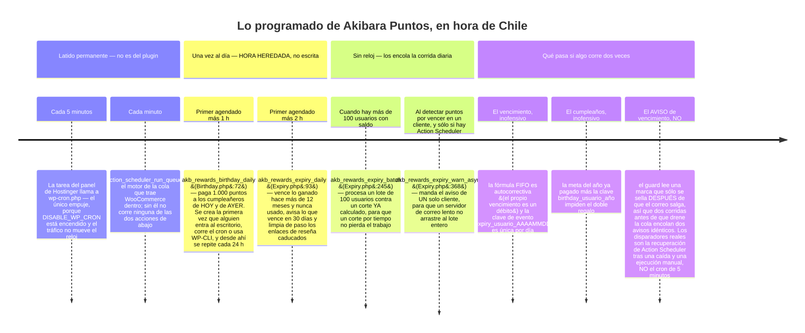
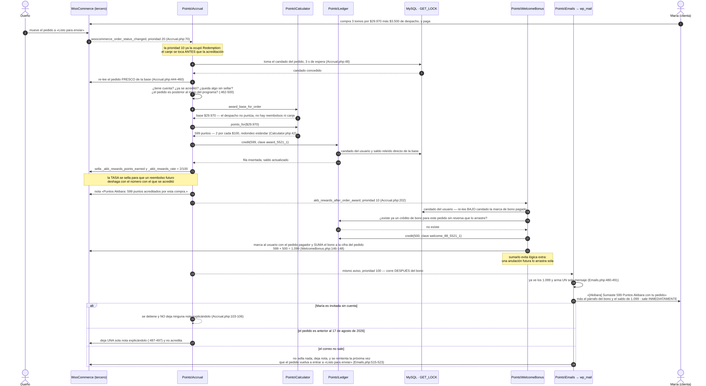
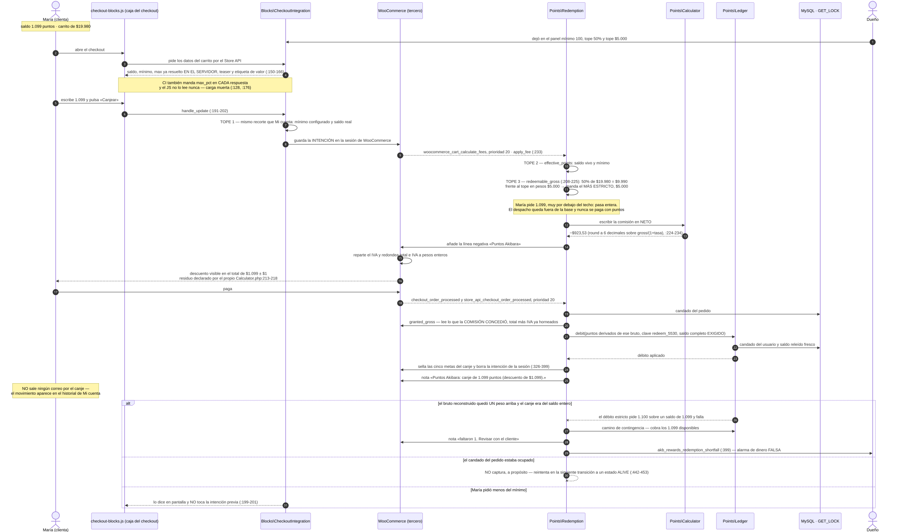
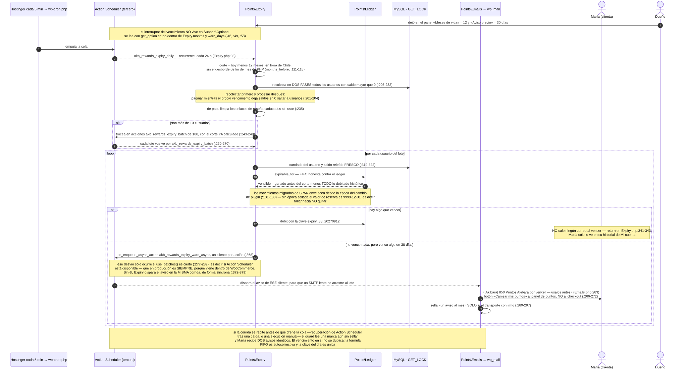

# akibara-rewards · Akibara Puntos: ganar, canjear, caducar

> **Qué cubre este capítulo.** El programa de fidelidad de akibara.cl: cómo un cliente
> gana puntos comprando, cómo los convierte en descuento, y cómo los pierde si no los
> usa. Todo vive en el plugin propio `akibara-rewards` (versión **0.3.13**,
> `akibara-rewards.php:6`), que además contiene el motor de reseñas con foto — esa
> mitad tiene su propio capítulo y aquí sólo aparece donde se cruza con los puntos.
>
> **Fuente de verdad.** Cada afirmación técnica de este documento apunta a un fichero y
> una línea del código publicado en producción. Las rutas se escriben relativas a
> `public_html/wp-content/plugins/akibara-rewards/`.

---

## Para qué existe (en dos párrafos que entienda un novato)

Akibara es una tienda de manga en internet. Está hecha con **WordPress** —el programa
que sirve las páginas— y **WooCommerce**, un añadido que convierte WordPress en una
tienda de verdad: productos, carrito, pedidos, correos. Encima de esa base, la casa
escribe sus propios **plugins**: paquetes de código propio que se enchufan a WordPress
sin modificar nada de lo que viene de fábrica. `akibara-rewards` es uno de ellos, y su
trabajo es sostener un programa de fidelidad llamado **Puntos Akibara**.

La idea cabe en una frase: **cada compra deja puntos en la cuenta del cliente, y esos
puntos se convierten en descuento en la compra siguiente.** Con la configuración de
fábrica son 2 puntos por cada $100 de productos (`Support/Options.php:54` y `:89`),
cada punto vale $1 de descuento (`:239`), el canje parte desde 100 puntos (`:190`), el
descuento no puede pasar de $5.000 ni del 50 % de los productos del pedido —manda el
más estricto— (`:43`, `:30` y `Points/Redemption.php:208-225`), y los puntos duran 12
meses (`Points/Expiry.php:49`). Alrededor de ese núcleo hay cinco carriles más que
también regalan puntos —bono de bienvenida de 500 en la primera compra
(`Options.php:135`), cumpleaños de 1.000 al año (`:304`), referidos de 500 al que
invita (`:254`), reseña con foto aprobada de 500 (`:288`) y ajuste manual del dueño
(`Points/AdminAdjust.php`)— y **dos que los quitan**: el **canje**, que los cambia por
descuento (`Points/Redemption.php`), y la **caducidad**, que se los lleva sin nada a
cambio (`Points/Expiry.php`). Los dos son débitos del mismo libro de movimientos.

Existe además una razón histórica. Hasta el 30 de agosto de 2026 este trabajo lo hacía
un plugin de terceros, **Simple Points and Rewards (SPAR)**. Los valores de fábrica de
`akibara-rewards` **replican uno a uno la configuración real que tenía SPAR en
producción** ese día (`Options.php:5-9`), justamente para que el cambio de plugin no
alterara ninguna regla de negocio sin una decisión explícita del dueño.

---

## Cómo encaja con el resto (con quién habla y qué pasa si se apaga)

El mapa de piezas va en dos mitades, porque en una sola no se lee: la primera es el
motor —quién mueve los puntos—, la segunda son las superficies, la operación y los datos.



*Fuente: [`10-rewards-akibara-puntos-piezas-motor.mmd`](diagramas/10-rewards-akibara-puntos-piezas-motor.mmd).*



*Fuente: [`10-rewards-akibara-puntos-piezas-superficies.mmd`](diagramas/10-rewards-akibara-puntos-piezas-superficies.mmd).*

### Con quién habla

| Con quién | Por dónde | Qué se juega ahí |
| --- | --- | --- |
| **WooCommerce** (tercero) | Avisos `woocommerce_order_status_changed`, `woocommerce_order_refunded`, `woocommerce_refund_deleted` (`Points/Accrual.php:56-58`); `woocommerce_cart_calculate_fees`, `woocommerce_checkout_order_processed`, `woocommerce_store_api_checkout_order_processed` (`Points/Redemption.php:76-81`) | Es quien avisa de todo lo que mueve puntos. Sin WooCommerce el plugin ni siquiera arranca (`akibara-rewards.php:96-143`) |
| **Action Scheduler** (viene dentro de WooCommerce) | `as_schedule_recurring_action`, `as_schedule_single_action`, `as_enqueue_async_action` (`Points/Expiry.php:93`, `:245`, `:368`; `Points/Birthday.php:72`) | Corre las dos tareas diarias: vencimiento y cumpleaños |
| **WordPress** (tercero) | `wp_options`, `usermeta`, `wp_mail`, el flujo de privacidad (`Support/Privacy.php:37-39`), `register_activation_hook` (`akibara-rewards.php:172`) | Donde viven los ajustes, el saldo cacheado y los correos |
| **MySQL / MariaDB** | `GET_LOCK` por usuario y por pedido, con 3 segundos de espera (`Points/Ledger.php:46`, `Points/Accrual.php:48`) | Es lo que impide que dos pestañas del mismo cliente cobren dos veces |
| **`akibara-business`** (plugin propio) | La función global `spar_get_user_points()` (`akibara-rewards.php:202-223`) | La tarjeta «Recompensas» del panel de Mi cuenta y el menú móvil de ese plugin preguntan por ese nombre viejo; sin el puente la tarjeta se quedaba muda. **Y esa tarjeta convierte puntos a pesos por su cuenta**: pinta `wc_price( $akb_points )` con los puntos metidos tal cual en una función de precios (`akibara-business/templates/myaccount/dashboard.php:84-89`), sin pasar por `Options::redeem_value()`. Hoy acierta porque un punto vale $1; el día que el dueño ponga 2 en «Pesos de descuento por punto», esa tarjeta —y sólo ella— seguirá diciendo que 1.099 puntos son $1.099. Es deuda de otro plugin, pero se arregla igual |
| **El plugin de Blue Express** (tercero) | El estado de pedido `shipping-progress` («Listo para enviar»), que acreditaba de fábrica hasta el 2026-09-16 | Ese estado **no existe en WooCommerce**: lo registra el plugin de despacho y `akibara-business` lo lee de sus ajustes (`woocommerce_correios_settings['noBlueStatus']`, `akibara-business/src/Integrations/Bluex/OrderPreventaAdapter.php:171-178`). Mientras acreditó, si desaparecía no acreditaba ningún pedido y no saltaba error alguno. El default es ahora `processing`, nativo del núcleo, así que la dependencia sólo vuelve si el dueño elige ese estado en el panel |
| **El tema `akibara-gp`** | Indirecta: las pantallas del cliente se pintan dentro de las plantillas de Mi cuenta de WooCommerce que el tema estiliza | Ningún acoplamiento de código |
| **SPAR** (plugin viejo, de terceros) | Puerta de convivencia en `akibara-rewards.php:127-140` y el comando `wp akb-rewards migrate` | Mientras SPAR siga activo, `akibara-rewards` **duerme entero** |
| **CusRev / Customer Reviews** (tercero) | `Options::reviews_engine_on()` (`Options.php:161-168`) | Decide si el sexto carril (reseñas) existe; los puntos por compra no dependen de esto |
| **LiteSpeed / Cloudflare** (caché) | El `?ver=` de los dos ficheros de JavaScript del plugin (`Support/Assets.php:42-47`); purga del carrusel al guardar ajustes | Que un arreglo publicado llegue de verdad al navegador del cliente. Cada vez que el navegador pide el JavaScript de la caja del checkout, la dirección lleva pegado un número al final (`…/checkout-blocks.js?ver=0.3.13.1757`). Si ese número cambia, el navegador y las cachés entienden que es un fichero distinto y lo vuelven a bajar; si no cambia, siguen sirviendo el viejo. Aquí ese número es **versión del plugin + fecha del fichero**, así que un arreglo publicado sin subir la versión igual llega |

### Qué pasa si se apaga

Hay **cuatro** formas distintas de «apagar» esto, y no significan lo mismo:

1. **Apagar un carril desde el panel.** El panel tiene **once casillas** de encendido y
   apagado (`SettingsPage.php:39-329`), y el interruptor se consulta **dentro del accesor
   del monto** (`Options::lane_on()`, `Options.php:67-69`). Apagar «Dar bono de
   bienvenida» hace que `welcome_bonus()` devuelva 0, y con eso se apagan a la vez el
   motor, el correo, Mi cuenta, la ficha de producto y la página pública: ninguna
   superficie tiene que preguntar aparte. Los montos guardados se conservan para cuando
   se vuelva a encender (`:62`).

   **Cinco de los seis carriles tienen interruptor**, no los seis: compra
   (`Options.php:51`), bienvenida (`:126`), referidos (`:251`), reseñas (`:285`) y
   cumpleaños (`:301`). Los dos que faltan:

   - El **ajuste manual** no lo necesita: no corre solo, lo dispara una persona. Para
     «apagarlo» basta con no usarlo, o con quitarle a esa persona el permiso
     `manage_woocommerce`.
   - El **canje no tiene forma de apagarse desde el panel**. No hay casilla, y poner
     los topes en 0 significa «sin tope», no «apagado» (`Options.php:207-211`,
     `:225-227`); «Pesos de descuento por punto» se fuerza a un mínimo de 1
     (`:238-241`). La única palanca que existe es subir «Mínimo de puntos por canje»
     por encima de cualquier saldo real —un millón, por ejemplo—: entonces
     `clamp_requested()` devuelve «bajo el mínimo» (`Redemption.php:149-152`) y
     `effective_points()` devuelve 0 (`:171-173`) para todo el mundo. Ojo: **la caja
     del checkout y el formulario de Mi cuenta se siguen viendo**, sólo que no aplican
     nada. No es un apagado limpio; es un tapón.

   **El interruptor de «Dar puntos por compra» apaga tres carriles más, y en silencio.**
   Ésta es la trampa más cara del programa, y no es evidente en ninguna pantalla. Con
   `akb_rewards_earn_enabled` en «no», `Options::earn_points()` devuelve 0
   (`Options.php:51-52`), `Calculator::points_for_base()` devuelve 0
   (`Calculator.php:38-41`) y `Accrual` entra en la rama de «cero puntos», sella el cero
   y hace `return` en `Accrual.php:162` — **antes** del
   `do_action( 'akb_rewards_after_order_award' )` de `:202`. De ese aviso cuelgan el
   **bono de bienvenida** (`WelcomeBonus.php:45`), los **referidos**
   (`Referrals.php:53`) y el **correo de puntos** (`Emails.php:243`). Resultado: apagar
   un interruptor apaga otros tres carriles que siguen con su propia casilla encendida.
   Y peor: el cartel del formulario de registro sigue prometiendo el bono, porque
   `render_register_teaser()` sólo mira que el monto sea mayor que cero y que la casilla
   del gancho esté marcada (`WelcomeBonus.php:166-168`), y lo mismo el banner de Mi
   cuenta (`is_pending_for()`, `:189-192`). Eso contradice de frente las dos promesas que
   este capítulo repite —«ninguna superficie puede prometer un premio que ningún código
   puede pagar» y «ningún carril apagado se promete en ninguna superficie»—: valen para
   cada carril mirado solo, **no** cuando se apaga la compra.

   **Y una excepción de ubicación**, corregida por el verificador: el interruptor del
   **vencimiento** y sus dos montos **no** viven en `Options`, sino leídos con
   `get_option` crudo dentro de `Expiry::months()` y `Expiry::warn_days()`
   (`Points/Expiry.php:46`, `:49`, `:58`). Lo mismo ocurre con el aviso de la ficha de
   producto (`Points/PdpNotice.php:44`) y con el gancho de bienvenida, que se lee crudo
   en **tres** sitios distintos (`Points/WelcomeBonus.php:167` y `:190`, más
   `Blocks/CheckoutIntegration.php:133`). Son **cuatro ficheros y siete lecturas**
   sueltas. Quien busque «dónde está la palanca del vencimiento» siguiendo la idea de
   «fuente única» no la va a encontrar en `Options`.
2. **Desactivar el plugin.** Los puntos dejan de moverse, las pantallas desaparecen y
   la tarjeta «Recompensas» de `akibara-business` se queda sin saldo (el puente
   `spar_get_user_points()` deja de existir). **Nada se borra**: el historial completo
   sigue en la tabla `wp_akb_rewards_ledger`.
3. **Desinstalar el plugin.** Por defecto **tampoco borra nada**: el desinstalador sale
   inmediatamente salvo que alguien haya declarado la constante
   `AKIBARA_REWARDS_ALLOW_WIPE` en `wp-config.php` (`uninstall.php:18-20`). El ledger
   es historia de dinero y borrarlo desde el botón «Eliminar» de WordPress sería un
   accidente irreversible. Ojo: cuando esa purga sí se ejecuta, **es incompleta** — ver
   la sección «Datos que deja».
4. **Que se apague algo de fuera.** Los dos apagados que más duelen no dependen de este
   plugin y no dan ninguna señal:
   - **El estado que acredita deja de existir.** Desde el 2026-09-16 el de fábrica es
     `processing` («Procesando»), que **sí** es de WooCommerce, así que este riesgo dejó
     de correr con la configuración por defecto. Sigue vivo si el dueño elige a mano
     `shipping-progress` («Listo para enviar»), que lo registra el plugin de Blue Express:
     si ese plugin se desactiva o cambia su ajuste, el estado configurado en
     `akb_rewards_award_status` ya no ocurre nunca. Amortigua —no cura— que la acreditación
     cuente también los estados pagados POSTERIORES (`OrderStates::is_at_or_after()`): un
     pedido que llegue a «Completado» acreditaría igual. Se comprueba abriendo el selector
     «Estado del pedido que acredita» del panel: si el valor guardado ya no aparece en la
     lista, eso es lo que pasó.
   - **La cola de Action Scheduler deja de drenar.** El vencimiento y el cumpleaños son
     las dos únicas cosas de este plugin que corren solas, y las dos viajan por esa cola.
     Si se atasca, dejan de correr **sin ninguna alarma**: este plugin no tiene vigía, y
     sus nueve avisos de emergencia no tienen un solo oyente (ver «Avisos propios»).
     Dónde se comprueba: WooCommerce → Estado → Acciones programadas, pestaña
     «Pendiente». Si `akb_rewards_expiry_daily` lleva días con la fecha vencida, la cola
     está parada.

---

## Piezas

Cada subsección responde siempre lo mismo: qué hace, en qué ficheros vive, en qué
momento actúa (con su gancho y su prioridad), qué datos lee y escribe, dónde lo opera
el dueño y qué ve el cliente.

### 1. Arranque del plugin

**Qué hace.** Comprueba que el terreno esté despejado y enciende los módulos en orden.

**Ficheros.** `akibara-rewards.php` (223 líneas) y `src/Plugin.php`.

**Momento.** Declara compatibilidad con HPOS y con el carrito/checkout de bloques en
`before_woocommerce_init` (`akibara-rewards.php:39-55`); registra el hook de activación
a nivel de fichero (`:172`); registra los comandos de línea si estamos en WP-CLI, con
prioridad 15 (`:181-189`); y arranca el plugin en `plugins_loaded` prioridad **20**
(`:191`). El puente `spar_get_user_points()` se define aparte, en `plugins_loaded`
prioridad **25** (`:202-223`), después de la puerta de dependencias.

La cabecera del plugin declara además el suelo de WordPress: **6.8 o superior**
(`akibara-rewards.php:7`, `Requires at least`). Ese número no lo comprueba ninguna de
las puertas de abajo; lo hace WordPress al instalar.

Antes de arrancar hay tres puertas (`akibara_rewards_check_dependencies`, `:96-143`):

1. Sin WooCommerce activo → cartel rojo en el escritorio y no arranca.
2. Con WooCommerce anterior a 10.0 → igual (`AKIBARA_REWARDS_MIN_WC`, `:33`).
3. **Si SPAR sigue activo, el plugin entero se queda dormido** (`:127-140`). Los dos
   acreditarían el mismo pedido —doble recompensa— y los dos registrarían la misma
   pantalla `rewards` de Mi cuenta.

Dos cosas quedan **fuera** de esa puerta a propósito: los **tres comandos de línea**
—`wp akb-rewards migrate`, `wp akb-rewards cleanup` y `wp akb-rewards audit`—, que
tienen que existir precisamente mientras SPAR vive (`:175-189`), y el puente de
compatibilidad.

**Datos.** No escribe nada por su cuenta; define las **cinco** constantes del plugin
(`:28-32`): `AKIBARA_REWARDS_VERSION`, `_FILE`, `_DIR`, `_URL` y `_MIN_WC`. Hubo una sexta,
`AKIBARA_REWARDS_BASENAME`, que se retiró por muerta — hoy no aparece en ningún fichero del
árbol (corregido 2026-09-20, ronda 10: la cita decía `:28-33`).

**Dónde lo opera el dueño.** Escritorio → Plugins.

**Qué ve el cliente.** Nada. Si falta WooCommerce, la tienda sigue funcionando sin
puntos.

`Plugin::boot()` (`src/Plugin.php:69-121`) registra los módulos en un orden fijo. Los de
puntos se registran **siempre**; los de reseñas sólo si el motor propio está despierto
(`:97-116`).

### 2. `Support\Options` — la configuración

**Qué hace.** Es el lugar donde se leen los ajustes del programa, cada uno con su valor
de fábrica y su tipo.

**Fichero.** `src/Support/Options.php` (366 líneas).

**Momento.** No cuelga de ningún gancho: son funciones estáticas que llaman los demás.

**Datos que lee.** Las options `akb_rewards_*`. **No escribe ninguna.**

**Dónde lo opera el dueño.** WooCommerce → Puntos y Reseñas.

**Qué ve el cliente.** Nada directamente; todas las cifras que ve salen de aquí.

La pieza clave del diseño es `lane_on()` (`:67-69`), explicada arriba. Dos accesores
merecen mención aparte: `reviews_engine_on()` (`:161-168`) es la autoridad única de
«¿está vivo el motor propio de reseñas?», y `reviews_lane_on()` (`:177-179`) exige
además que el monto sea mayor que cero — **ninguna superficie puede prometer un premio
que ningún código puede pagar**.

> **Corrección del verificador.** La idea de «fuente única» tiene tres fugas ya
> nombradas (`Expiry.php:46/:49/:58`, `PdpNotice.php:44`,
> `WelcomeBonus.php:167/:190`, `CheckoutIntegration.php:133`). El propio fichero
> documenta en `Options.php:244-248` que a **Referidos** ya se le corrigió exactamente
> esto: la centralización quedó a medias.

### 3. `Support\Schema` — la tabla del ledger

**Qué hace.** Crea y mantiene las dos tablas propias del plugin.

**Fichero.** `src/Support/Schema.php` (225 líneas).

**Momento.** `register()` cuelga `maybe_install()` de `init` prioridad **5** (`:85`).
También llama a `register_activation_hook()` en `:84` — **registro inerte**: a esa
altura el hook de activación ya no puede dispararse, y el que funciona de verdad es el
del fichero principal (`akibara-rewards.php:172`). Es ruido que confunde al leer quién
crea las tablas.

**Datos que escribe.** Las tablas `wp_akb_rewards_ledger` (el `CREATE TABLE` está en
`:169-186`) y `wp_akb_rewards_review_forms` (`:194-207`); la option
`akb_rewards_db_version`, sellada en `1.2.0` (`:41`, `:118`). Cuidado al leer el
fichero: `ledger_table()` (`:49-52`) y `review_forms_table()` (`:59-62`) sólo
**devuelven el nombre** de la tabla, no la crean.

Decisiones de esquema que vale la pena entender:

- **`delta` firmado + `balance_after`** (`:172-173`): la suma de la columna *es* el
  saldo, y cada movimiento queda auditable sin reconstruir la historia.
- **`event_key` único y nulable** (`:177`): los movimientos de un solo disparo llevan
  clave; los que pueden repetirse legítimamente (reembolsos parciales) van con `NULL`,
  y MySQL admite muchos `NULL` en un índice único.
- **La versión sólo se sella si la tabla quedó realmente creada** (`:100-112`).
  `dbDelta` es la función de WordPress que crea o actualiza una tabla comparando la que
  hay con la que se le pide; su defecto conocido es que **si la creación falla, devuelve
  lo mismo que si hubiera funcionado**. Por eso aquí se comprueba que la tabla exista de
  verdad antes de sellar la versión: sellar a ciegas dejaría el módulo convencido de que
  ya migró, y envenenado para siempre.
- **`autoloaded_options()`** (`:132-137`) pone las options del programa en la carga
  automática de WordPress porque se leen en el camino del cliente; sin esa pasada, un
  render de Mi cuenta pagaba 17 consultas sueltas y cada ficha de producto 6 (`:124-128`).

> **Corrección del verificador.** El comentario de `:124` habla de «36 montos e
> interruptores». Contadas una a una, las filas del catálogo de la pantalla de ajustes
> son **40** (`Support/SettingsPage.php:39-329`). El número 36 quedó viejo.

### 4. `Support\OrderStates` — el vocabulario de estados

**Qué hace.** Dos listas cerradas de estados de pedido.

**Fichero.** `src/Support/OrderStates.php` (61 líneas).

- **DOWN** (`:32`): `cancelled`, `refunded`, `failed`, `trash`. La venta no existe.
- **ALIVE** (`:40`): `pending`, `on-hold`, `processing`, `shipping-progress`,
  `completed`. La venta sigue en pie.

Existe porque ese conjunto vivía triplicado como texto literal en tres módulos que
tienen que coincidir. Son **literales**, mientras que el selector del panel ofrece
todos los estados reales del sitio, personalizados incluidos
(`SettingsPage.php:560-576`): esa asimetría es una de las sospechas abiertas.

### 5. `Support\SettingsPage` — el panel

**Qué hace.** Dibuja y guarda la única pantalla de ajustes del programa.

**Fichero.** `src/Support/SettingsPage.php` (584 líneas).

**Momento.** `admin_menu` para el menú y `admin_post_<acción>` para el guardado
(`:347-348`).

**Datos.** Lee y escribe las **40 options** del catálogo `FIELDS` (`:39-329`), siempre
con carga automática activada (`:541`).

**Dónde lo opera el dueño.** WooCommerce → Puntos y Reseñas. La dirección directa es
**`/wp-admin/admin.php?page=akb-rewards-settings`** (`SettingsPage.php:27`), y hace falta
el permiso `manage_woocommerce` para verla y para guardar (`:25`) — el mismo que exige el
ajuste manual. Quien no lo tenga no ve el menú siquiera.

Detalles que el panel resuelve bien:

- Una casilla apagada no viaja en el envío del formulario, así que el guardado recorre
  el **catálogo** y no lo recibido: la ausencia es el «no».
- El selector de «estado que acredita» ofrece los estados reales del sitio, sin el
  prefijo `wc-`, y un valor desconocido cae al de fábrica (`:560-576`).
- La **fecha de vigencia** se valida al guardar (`:532-533`): un formato mal escrito
  bloqueaba toda la acreditación en silencio, así que ahora se rechaza, se conserva la
  anterior y se avisa en pantalla con un transitorio de un minuto.

### 6. `Points\Ledger` — la puerta única de los movimientos

**Qué hace.** Todo crédito y todo débito de puntos pasa por aquí. Nada suma ni resta
puntos por otro camino.

**Fichero.** `src/Points/Ledger.php` (448 líneas).

**Momento.** No cuelga de ningún gancho: lo llaman los demás. `Ledger::` aparece en
**catorce ficheros** del plugin: los seis carriles que suman (`Accrual`, `WelcomeBonus`,
`Referrals`, `Birthday`, `AdminAdjust`, `Reviews/ReviewPoints`), los dos que restan
(`Expiry`, `Redemption`), las herramientas (`Audit`, `Migration`, `Privacy`) y las
superficies que sólo leen el saldo (`AccountRewards`, `Blocks/CheckoutIntegration`,
`Emails`).

**Datos.** Escribe filas en `wp_akb_rewards_ledger` y actualiza dos usermeta, cuyos
nombres se declaran como constantes en `:43` y `:44`: `_akb_rewards_points` (el saldo
cacheado, escrito en `:360`) y `_akb_rewards_total_earned` (el histórico de lo
ganado, escrito en `:110-113`). No dispara avisos: `akb_rewards_points_applied` se
retiró en la 0.4.1 porque nadie lo escuchaba.

Cada movimiento hace cuatro cosas, en este orden:

1. Toma un **candado de MySQL por usuario** (`GET_LOCK`, 3 segundos de espera, `:46`).
   Sin candado no hay movimiento: se registra el fallo y se devuelve `null`.
2. Re-lee el saldo **directo de la base**, saltándose la caché (`:433`): dos pestañas
   del mismo cliente comprando a la vez.
3. Si el movimiento trae `event_key` y esa fila ya existe, se declara **ya aplicado** y
   no se toca nada (`:295-329`).
4. Inserta la fila y actualiza el saldo del usuario (`:331-386`).

El **contrato de retorno** está pensado para que los fallos no se confundan: `null` =
problema de infraestructura (se puede reintentar), `false` = rechazo de negocio
(argumentos inválidos o saldo insuficiente en un débito estricto), `int` = éxito.
Confundir los dos primeros haría que un candado ocupado se leyera como «saldo
insuficiente», que es una acusación al cliente.

El débito tiene **dos semánticas** (`:141`): la reversa de un pedido debita *hasta
donde alcance* —el cliente pudo haber gastado ya esos puntos y un saldo negativo no es
cobrable—; la captura de un canje exige el saldo completo o no debita nada, porque
jamás se financia un descuento con puntos que ya no existen.

### 7. `Points\Calculator` — la matemática

**Qué hace.** Convierte pesos en puntos y calcula el importe exacto de la comisión de
canje. Es código puro donde importa.

**Fichero.** `src/Points/Calculator.php` (235 líneas).

La base puntuable de un pedido es: **líneas de producto (total tras descuentos, con
IVA), menos todo lo reembolsado que toque mercadería, menos el canje neto todavía
aplicado** (`:124-152` y `:62-100`). El despacho **no** puntúa.

Tres finuras que costaron sangre:

- **Convivencia con cupones (Anti Double-Dipping, 2026-10-21):** Si el cliente aplica un
  cupón (por ejemplo, el 10% de bienvenida de `WelcomeCoupon`), `$item->get_total()` ya
  refleja la línea *tras* el descuento proporcional del cupón. Por ende, los puntos (2 por
  cada $100 CLP) se otorgan exclusivamente sobre el dinero neto efectivamente pagado: un pedido
  de $33.980 CLP con cupón de -$3.398 CLP liquida sobre $30.582 CLP, sumando exactamente 612
  puntos. Se elimina el riesgo de doble bonificación protegiendo el margen del comercio y
  alineándose con el estándar global de programas de fidelización (Smile.io, Yotpo, LoyaltyLion).
- No usa `$order->get_total()`: ese total incluye el envío y ya pasó por un `max(0,…)`;
  reconstruir sobre un total recortado regalaba puntos en compras de $0.
- Los **reembolsos por importe** (el campo «Importe del reembolso» y casi todos los de
  pasarela) no llevan líneas: el residuo sin asignar a líneas, envío o comisiones se
  trata como mercadería. Es conservador — retira puntos de más antes que dejarlos de
  menos.
- El **valor por punto de una devolución se deriva del propio pedido** (valor canjeado
  ÷ puntos canjeados), no de la tasa vigente: cambiar la tasa entre la compra y el
  reembolso valoraba la devolución con el número equivocado.

`redemption_fee_amount()` (`:224-234`) resuelve un detalle de WooCommerce: el núcleo
**reparte IVA sobre las comisiones negativas aunque se declaren no imponibles**. Por
eso la comisión de canje se escribe en **neto**, es decir `bruto / (1 + tasa)`.

> **Bruto y neto, que aquí se usan todo el rato.** En Chile los precios de la tienda
> **incluyen** el IVA del 19 %: lo que ve y paga el cliente es el **bruto**. El **neto**
> es ese mismo dinero sin el impuesto. Para pasar de uno a otro se divide por 1,19: un
> descuento de **$1.099 brutos** son **$923,53 netos**, porque 923,53 × 1,19 = 1.099.
> El canje se le promete al cliente en bruto («$1.099 de descuento») y se le escribe a
> WooCommerce en neto (−$923,53), precisamente para que el IVA que WooCommerce vuelve a
> repartir encima devuelva los $1.099 prometidos.

**Una rama de código que no corre nunca.** `award_base_for_cart()` (`:161`) acepta un
segundo parámetro, `$redeemed_gross`, y si es mayor que cero descuenta ese canje de la
base (`:171-173`). Sus **dos únicos llamadores** —`Redemption.php:188` y
`CheckoutIntegration.php:160`— no lo pasan nunca, así que esas tres líneas son
inalcanzables. O alguien las usa, o se borran: la regla de la casa es cero código
muerto, y esto está en el fichero que el propio capítulo llama «la matemática».

**La base es lo que el cliente ve (0.4.14, `R6-canje-redondeo`).** `line_total` del carrito y
`get_total()` del ítem son el neto SIN redondear (8.394,81 por un tomo de $9.990 con IVA
incluido) y el impuesto llega YA redondeado (1.595): la suma cruda daba 9.989,81, el mínimo de
canje de $50.000 se quedaba en 49.999,81 —canje bloqueado— con exactamente $50.000 en pantalla,
y «te faltan» decía 40.011 donde la resta real era 40.010. Desde 0.4.14 `award_base_for_cart()`
y `conserved_items_base()` redondean la suma a los decimales de la tienda
(`wc_get_price_decimals()`, 0 en pesos) ANTES de restar el canje, igual que WooCommerce redondea
el total del pedido (`Calculator::store_rounding()`); carrito y pedido siguen dando la misma cifra.
Dos cuidados que trajo la revisión independiente: la reposición proporcional del canje mide la
mercadería devuelta con `Calculator::items_base()` (las líneas íntegras, con el MISMO redondeo) y no
con una suma cruda, que inventaba décimas devueltas; y el ajuste por reembolso parcial compara lo
sellado contra lo que la base íntegra —redondeada igual— da hoy (`Accrual::on_order_refunded`,
`target_full`): un pedido acreditado antes de 0.4.14 sobre la base sin redondear no pierde un punto
por un reembolso que no devuelve mercadería (sólo envío), y uno que sí la devuelve retira
exactamente lo de las líneas que volvieron.

> **Corrección del verificador.** El resultado **no** es exacto al peso. El propio
> fichero declara dos residuos aceptados el 2026-08-30 (`:213-218`): (a) la tasa se
> mide sobre las líneas y el reparto real de WooCommerce incluye el envío; (b) **con
> pesos chilenos a cero decimales el redondeo final puede mover el descuento ±$1**. No
> se puede prometer «exactamente $1.099»: se puede prometer «$1.099 ± $1».

### 8. `Points\Accrual` — acreditar y revertir por pedido

**Qué hace.** Es el carril principal: convierte un pedido en puntos y los retira si la
venta se cae.

**Fichero.** `src/Points/Accrual.php` (535 líneas).

**Momento.** Tres ganchos de WooCommerce, todos en prioridad **20** (`:56-58`):
`woocommerce_order_status_changed`, `woocommerce_order_refunded` y
`woocommerce_refund_deleted`. La prioridad 20 importa: el módulo de canje corre antes,
en la 10.

**Datos que escribe.** Las order meta `_akb_rewards_points_earned` (`:43`),
`_akb_rewards_welcome_bonus` (`:44`), `_akb_rewards_pre_program_noted` (`:45`) y
`_akb_rewards_rate` (`:46`). Dispara `akb_rewards_after_order_award` (`:202`),
`akb_rewards_award_already_done` (`:115`, `:136`),
`akb_rewards_after_order_deduct` (`:290`), `akb_rewards_reversal_failed` (`:272`,
`:365`) y `akb_rewards_manual_review_needed` (`:432`).

**Qué ve el cliente.** Su saldo sube, le llega un correo, y le queda una nota en el
pedido visible para el dueño.

**Acreditar** ocurre cuando el pedido *entra* al estado configurado **o a cualquier
estado pagado posterior** (`OrderStates::is_at_or_after()`, `Accrual.php:77`). Desde el
2026-09-16 (decisión del dueño) el estado de fábrica es **«Procesando»**
(`Options::DEFAULT_AWARD_STATUS`): es el momento en que la pasarela confirma el pago, así
que el cliente ve sus puntos apenas paga. Antes era «Listo para enviar»
(`shipping-progress`), que esperaba a que el paquete estuviera preparado.

Lo de «o posterior» no es un adorno: sin eso, un pedido que salta directo a «Completado»
—pago manual, retiro en tienda, el dueño moviéndolo a mano— pasaba de largo y no acreditaba
nunca, y cambiar el estado en el panel dejaba huérfanos a los pedidos ya en curso. Acreditar
de más no es un riesgo: `maybe_award()` es idempotente bajo candado y un pedido caído
revierte entero.

> **Lo que el cambio se llevó por delante (para bien).** El estado viejo,
> `shipping-progress`, **no es de WooCommerce**: lo registra el plugin de Blue Express (ver
> el recuadro de abajo), de modo que la acreditación entera dependía de un tercero. Con
> «Procesando» —estado nativo del núcleo— ese punto único de fallo desaparece.

> **Ojo, que `shipping-progress` no es de WooCommerce.** WooCommerce trae de fábrica
> `pending`, `processing`, `on-hold`, `completed`, `cancelled`, `refunded` y `failed`, y
> nada más. «Listo para enviar» es un estado **a medida que registra un tercero**: el
> plugin de despacho de Blue Express, que lo guarda en sus propios ajustes
> (`woocommerce_correios_settings['noBlueStatus']`); `akibara-business` lo lee de ahí y
> usa `shipping-progress` como valor de reserva
> (`akibara-business/src/Integrations/Bluex/OrderPreventaAdapter.php:171-178`,
> `.../Modules/OrderPreventa/ShippableStamp.php:44`). Ningún código de esta casa lo crea.
> Consecuencia práctica: **si ese plugin se desactiva, el estado configurado deja de
> existir y ningún pedido acredita nunca más**, sin error, sin nota y sin una línea en el
> registro. El síntoma es «los clientes dejaron de recibir puntos» y la causa está en
> otro plugin.

La idempotencia —que una operación repetida no cobre dos veces— va en **tres capas**:
la meta del pedido re-leída fresca bajo candado de pedido (`:444-460`); una
**conciliación contra el ledger**, que sella el neto exacto si hay una acreditación
viva sin sellar (una caída entre acreditar y escribir la meta); y la clave de evento
única por ocurrencia (`award_1234_2` tras un revival).

Además hay una **compuerta de vigencia** (`:462-500`): los pedidos creados antes del
inicio del programa no acreditan, aunque alguien los mueva de estado años después. Y
falla **cerrada**: si la fecha configurada no se puede interpretar, no se acredita nada
y se grita en el registro (`:470-472`).

**Revertir**: un estado terminal retira todo lo acreditado, bono incluido — el bono
viaja *dentro* de la cifra del pedido a propósito, así las anulaciones lo arrastran sin
lógica extra. Un **reembolso parcial** recalcula sobre lo conservado y retira la
diferencia, preservando el bono, usando la **tasa sellada en el pedido** y no la
vigente (`:339-344`, `:387-395`).

**Una ausencia con nombre.** Un pedido de invitado sale del módulo en `:103-106` sin
dejar nota ni registro de por qué. Cuando un cliente escriba «compré y no me llegaron
los puntos», el dueño abre el pedido y no ve absolutamente nada que explique el
silencio — mientras que el caso «pedido anterior al programa» sí escribe su nota
(`:487-497`).

### 9. `Points\WelcomeBonus` — el bono de bienvenida

**Qué hace.** Regala 500 puntos en la primera compra acreditada.

**Fichero.** `src/Points/WelcomeBonus.php` (247 líneas).

**Momento.** `akb_rewards_after_order_award` prioridad **10** (`:45`),
`akb_rewards_after_order_deduct` prioridad **10** (`:46`),
`akb_rewards_award_already_done` prioridad **5** (`:53`) y `woocommerce_register_form`
prioridad **25** para el gancho del formulario de registro (`:54`).

**Datos.** Usermeta `_akb_rewards_welcome_paid` (guarda el pedido que lo pagó) y la
order meta `_akb_rewards_welcome_bonus`.

**Qué ve el cliente.** En el formulario de registro, la **promesa**: «te esperan 500
Puntos Akibara: se activan con tu primera compra». En el correo de la primera compra,
el bono explicado.

La regla está escrita en el fichero y tiene historia: **nunca se paga por registrarse**.
El bono por registro se lo reclamaron retroactivamente 58 cuentas existentes, $29.000
sin una sola venta.

Si el pedido pagador se anula, el cliente recupera la elegibilidad **sólo si la reversa
recuperó al menos el bono completo** (`:230-241`). Con el saldo ya gastado, el débito
se recorta a 0 y devolver la elegibilidad crearía 500 puntos de la nada, en bucle.

### 10. `Points\Redemption` — el canje

**Qué hace.** Convierte puntos en descuento. Es el módulo más grande (686 líneas) y el
que mueve dinero real.

**Fichero.** `src/Points/Redemption.php`.

**Momento** (`:76-81`): `woocommerce_cart_calculate_fees` prioridad **20** (añade la
comisión), `woocommerce_checkout_order_processed` prioridad **20** y
`woocommerce_store_api_checkout_order_processed` prioridad **20** (cobra los puntos),
`woocommerce_cart_emptied` (borra la intención),
`woocommerce_order_status_changed` prioridad **10** y `woocommerce_order_refunded`
prioridad **10** (repone y re-cobra). La prioridad 10 lo pone **antes** de `Accrual`.

**Datos que escribe.** La intención en la sesión de WooCommerce (`SESSION_KEY`, `:49`)
y cinco order meta: `_akb_rewards_redeemed_points` (`:51`), `_akb_rewards_redeemed_value`
(`:52`), `_akb_rewards_redeemed_restored` (`:53`), `_akb_rewards_redeemed_revival_debt`
(`:54`), `_akb_rewards_redeemed_unsettled` (`:55`) y, desde la 0.4.1,
`_akb_rewards_redemption_retries`. Dispara `akb_rewards_redemption_shortfall` (cobro con
saldo corto **fuera** de la caja) y `akb_rewards_redemption_stuck` (reintentos
agotados); los dos los escucha `Support\Alerts`.

**Desde la 0.4.1.** En la caja, un saldo que ya no respalda el descuento **detiene la
compra** (`capture_order()` lanza `RouteException` 409 `akb_rewards_balance_changed`
con el carrito recalculado); por eso la transición `checkout-draft → pending` ya no
captura y le deja el cobro a `woocommerce_store_api_checkout_order_processed`. Un
candado ocupado o un fallo del libro agenda `akb_rewards_redemption_retry` (5 minutos,
hasta 5 veces), que decide por el estado actual del pedido; antes se esperaba «la
próxima transición», que un pedido anulado no tiene. Un pedido que sigue `pending` no se
cobra desde la cola: lo cobran completo la caja, «pagar pedido» o el paso a pagado.

**Pago rechazado (0.4.1, revisión final).** `WC_Cart::get_cart_hash()` incluye el total,
así que la Store API sólo reutiliza el pedido pendiente de la sesión si el descuento sale
idéntico. Por eso el canje retenido por ese pedido cuenta como disponible para la misma
compra: `available_points()` = saldo + `releasable_for_session()` (pedido
`order_awaiting_payment` o `store_api_draft_order`, del mismo cliente, `pending`, con pago
pendiente **y con la marca de pago rechazado**). Lo usan `clamp_requested()`,
`effective_points()` y el `balance` de la caja. Si el cliente cambia el carrito y nace otro
pedido, `remember_superseded()` (`woocommerce_store_api_checkout_order_created`, antes de
que WooCommerce pise la sesión) anota los rechazados y `release_superseded()` les devuelve
**todos** los puntos —con deuda de revival— justo antes de cobrar el nuevo.

**Lo que no se acredita, no se promete (R2-2c367bf6, 0.4.11).** La acreditación tiene una compuerta de vigencia: con «Inicio de vigencia del programa» en el futuro —o ilegible— no acredita nadie (`Accrual::in_program()`). La caja ya callaba desde la 0.4.4; la ficha, Mi cuenta y la página pública seguían imprimiendo «Gana N Puntos Akibara» con la misma matemática y sin preguntar. Desde la 0.4.11 toda superficie pregunta a `Points\Promise` (`points_for()`, `rate()`), que devuelve cero fuera de vigencia. `Accrual::program_state()` da tres respuestas —`vigente`, `agendado`, `ilegible`— porque piden cosas distintas a quien pinta: con el programa **agendado** la página pública anuncia la regla *con su fecha* («…, desde el 1 de octubre de 2026») y con la fecha **ilegible** calla (`0%`, sin tabla de ejemplos, sin la fila «Cada compra elegible»). El panel lo dice junto al campo, en naranja o en rojo. Y la fecha se lee en **un solo sitio**, `Accrual::parse_program_start()`, estricta (exige ida y vuelta): había cinco copias, y sólo el validador del panel rechazaba «2026-13-45 00:00:00», que PHP convierte sin avisar en el 14 de febrero de 2027. **El bono y el padrino, por la misma puerta (revisión independiente, misma versión).** El bono de bienvenida cuelga de `akb_rewards_after_order_award`, y `Accrual::award()` corta ANTES de emitirlo cuando el pedido está fuera de vigencia; `Referrals::reason_not_to_pay()` rechaza ese mismo pedido. La primera versión de `Promise` sólo envolvía el tramo por compra, y el registro, el banner «esperándote», la caja (`welcome_bonus` del payload) y «Invita a un amigo» seguían prometiendo. Ahora `Promise::welcome_bonus()` y `Promise::referral_points()` responden cero fuera de vigencia; `WelcomeBonus::is_pending_for()` (sólo pinta, no decide pagos), `render_register_teaser()`, `AccountRewards`, `PdpNotice` y `Referrals::render_invite_block()` pasan por ahí, y la página pública trata sus dos filas como la de compra (agendado: «, desde el …»; ilegible: no salen; `[solo=bienvenida]` da 0). Reseñas y cumpleaños NO consultan la vigencia al pagar, así que sus promesas no se tocan. La captura del `?ref=` tampoco: sigue guardando al padrino aunque el bloque no se pinte. **La tabla de ejemplos (R3-bd4c0ed7, 0.4.12).** `[akb_puntos_resumen solo="ejemplos"]` se usa siempre SOLA, así que no puede confiar en que otra pieza diga desde cuándo: con el programa agendado lleva su propia nota («Esta tabla rige desde el …»). Vigente: sin nota. Ilegible: sigue sin tabla.

**Sólo los rechazados (tercera revisión, 2026-09-13, ALTA).** Un pedido que redirigió a la
pasarela (Flow, MercadoPago con redirección) también queda `pending` mientras el cliente
paga allí. Contarlo como disponible permitía usar los mismos puntos en otra compra y, al
terminar de pagar el primero, había dos descuentos con un solo saldo. La marca
`_akb_rewards_payment_rejected` la pone `watch_checkout_response()` (`rest_post_dispatch`
sobre `POST /wc/store/v1/checkout`: `payment_result.payment_status` `failure`/`error`, o
los códigos `woocommerce_rest_payment_error`, `…_process_payment_error` e
`…_invalid_payment_result`) y `after_order_pay()` (`woocommerce_after_pay_action`, que
WooCommerce sólo dispara si no redirigió). Se borra **antes de llamar a la pasarela**, no
cuando contesta —en esos segundos otra pestaña podía llevarse los puntos del pedido que se
está pagando—: `guard_order_pay()` en «pagar pedido» y, desde la 0.4.10, `capture_from_order()`
en la caja de bloques, **después** de la captura (si ésta detiene la caja, la marca sigue
puesta y el carrito recalculado conserva el descuento del reintento). Si la pasarela rechaza,
la respuesta de la caja o `after_order_pay()` la reponen. Y si la caja se detiene por algo
que **no es de pago** —otra extensión que lanza en el mismo gancho,
`woocommerce_rest_unknown_server_error`, un fatal—, la petición repone lo que ella misma
borró (`await_outcome()` → `restore_unsettled_marks()`, en la respuesta y en `shutdown`):
sin eso el pedido quedaba pendiente, reteniendo los puntos y sin marca, y el reintento salía
a precio completo. No se marca ante *cualquier* error de la caja: puede venir de otra pestaña
con el pedido en una pasarela con redirección; sólo se vuelve al estado de antes. La caja **clásica** es la
excepción deliberada: WooCommerce no avisa por ningún gancho de que su pasarela rechazó, así
que nadie podría reponerla; allí sólo la borra un pago aceptado
(`woocommerce_payment_successful_result`). `restore()` con `replaced_by` la relee bajo el candado. Mi cuenta muestra como «apartado»
lo retenido en **todos** los pedidos pendientes del cliente (`held_in_unpaid_orders()`) y
cuándo vuelve (`unpaid_cancel_minutes()`: 0 si WooCommerce no anula impagos).

**La intención gastada.** No se borra al capturar: `remember_intent()` guarda en el pedido
el `set_at` de la intención que la caja horneó (`_akb_rewards_intent_set_at`) y
`forget_spent_intent()` la borra cuando ese pedido ya está pagado y la intención de la
sesión es la misma. Una intención con otro `set_at` se fijó después y es para la compra
siguiente. Compararla con la creación del pedido fallaba al pagar un pedido reutilizado
tras volver a canjear.

**Deuda de revival en la caja.** `settle_debt_at_checkout()` la re-cobra **completa**
(débito estricto, bajo candado) en `capture_from_order()`, en la captura clásica y en
`guard_order_pay()` (`woocommerce_before_pay_action`), o detiene el pago. Sólo comprobar
el saldo dejaba gastar esos puntos en otra pestaña mientras se pagaba en la pasarela.

**Candado ocupado en la caja = detener, no seguir.** Los cobros hechos donde todavía se
puede parar el pago devuelven `COBRO_OK`, `COBRO_SIN_SALDO` o `COBRO_OCUPADO`. Con
`COBRO_OCUPADO` (`Ledger::debit` devuelve `null` o no se consigue el candado del pedido),
`stop_without_balance()` detiene con «No pudimos confirmar tus Puntos Akibara en este
momento…» (código Store API `akb_rewards_busy`, 409). Seguir dejaba ir a la pasarela un
descuento sin cobrar y, con la deuda viva, la conciliación cobraba la diferencia y el paso a
pagado la volvía a cobrar. `reconcile_reused()` además se niega con deuda viva.

**«Pagar pedido» sobre un fallido.** WooCommerce no lo pasa por `pending`. Tras re-cobrar se
anota `_akb_rewards_pay_window_until` (ahora + `unpaid_window()`) y se agenda la revisión
`akb_rewards_redemption_retry( id, 'impago' )`, con argumentos propios para que un reintento
de 5 minutos ya en la cola no la tape. Mientras la ventana está abierta, un reintento sin
motivo no devuelve un fallido (el cliente puede estar pagando). Si la pasarela rechaza sin
redirigir, `after_order_pay()` devuelve **al instante** y borra la ventana.

**Qué ve el cliente.** Una línea negativa llamada «Puntos Akibara» (`:50`) en el
resumen del pedido.

El flujo tiene cuatro momentos:

- **La intención** —cuántos puntos quiere canjear— se guarda en la sesión de
  WooCommerce. La fijan dos superficies, Mi cuenta y la caja del checkout, y las dos
  pasan por el **mismo recorte** (`clamp_requested`): mínimo configurado y saldo real.
- **La comisión** se añade al carrito en cada recálculo (`apply_fee`, `:233`).
  `effective_points()` vuelve a topar: por saldo vivo, por el mínimo y por el **techo
  del pedido**. Ese techo lo calcula `redeemable_gross()` (`:208-225`): el porcentaje y
  el monto máximo del panel, **mandando el más estricto**. El despacho queda fuera de
  la base, y por eso nunca se paga con puntos.
- **La captura** ocurre al crear el pedido, y cobra **lo que la comisión del pedido
  concedió** —el total más el IVA de la comisión ya horneada— y jamás la intención
  cruda de la sesión (`:326-338`). Corre bajo candado de pedido, con la meta releída
  fresca y clave de evento única. En la caja, si el saldo no alcanza, **detiene la
  compra**; fuera de ella (reintentos y cambios de estado) cobra lo disponible, deja
  nota y dispara `akb_rewards_redemption_shortfall`. Si el candado falla, el pedido
  queda sin capturar a propósito y se reintenta desde la cola y en la siguiente
  transición viva — un pedido con comisión nuestra y sin captura es un descuento
  regalado.
- **La reposición** lleva contabilidad en **tres cuentas**. Son tres contadores que el
  código nombra en mayúsculas —`RESTORED`, `REVIVAL_DEBT` y `UNSETTLED`— y que en el
  pedido se guardan como las order meta `_akb_rewards_redeemed_restored` (`:53`),
  `_akb_rewards_redeemed_revival_debt` (`:54`) y `_akb_rewards_redeemed_unsettled`
  (`:55`). Cuando este capítulo diga «RESTORED», está hablando de esa meta.
  - **`RESTORED`**: el acumulado de puntos ya devueltos al cliente por este pedido, por
    la razón que sea.
  - **`REVIVAL_DEBT`** —la *deuda de resurrección*: la porción devuelta porque el pedido
    **se murió** (cancelado, fallido, reembolsado entero) y sólo esa. Si el pedido
    revive, es lo único que se vuelve a cobrar.
  - **`UNSETTLED`**: la parte de esa deuda que, al revivir el pedido, ya no se pudo
    cobrar porque el cliente se gastó los puntos. El cliente se queda con los puntos
    *y* con el descuento, así que esa plata nunca entró: el cálculo de puntos deja de
    perdonarla (caso K).

  La reposición proporcional de un reembolso parcial es **definitiva** (`:504-523`): el
  pedido sigue vivo y re-cobrarla en el siguiente avance de preparación le robaría al
  cliente lo devuelto. La proporción se mide sobre los **ítems**: un reembolso sólo del
  envío no devuelve canje.



*Fuente: [`10-rewards-akibara-puntos-estados-canje.mmd`](diagramas/10-rewards-akibara-puntos-estados-canje.mmd).*

### 11. `Points\Expiry` — la caducidad

**Qué hace.** Vence los puntos viejos y avisa por correo antes de hacerlo.

**Fichero.** `src/Points/Expiry.php` (381 líneas).

**Momento.** `register()` (`:66-75`) cuelga tres ganchos propios —
`akb_rewards_expiry_daily` (`:71`), `akb_rewards_expiry_batch` (`:72`) y
`akb_rewards_expiry_warn_async` (`:73`)— más `init` prioridad **20** para asegurar la
agenda (`:74`). La acción recurrente se crea con `as_schedule_recurring_action`
apuntando a **dentro de dos horas**, con intervalo de un día (`:93`).

**Datos.** Lee `akb_rewards_expiry_enabled`, `akb_rewards_expiry_months`,
`akb_rewards_expiry_warn_days` y `akb_rewards_migration_epoch` (`:46`, `:49`, `:58`,
`:135`). Escribe débitos en el ledger y la usermeta `_akb_rewards_expiry_warned`
(`:36`) — esta última la sella el **correo**, no este módulo. Dispara
`akb_rewards_expiry_warning` (`:302`, `:379`).

**Dónde lo opera el dueño.** Panel → «Meses de vida de los puntos» y «Aviso previo
(días)». El estado de la cola se ve en WooCommerce → Estado → Acciones programadas.

**Qué ve el cliente.** Un correo de aviso 30 días antes, y la línea «vence pronto» en
Mi cuenta. Al vencer efectivamente, **nada**.

La contabilidad es **FIFO honesta contra el ledger** (`:6-11`):

```
vencible = max(0, ganado_antes_del_corte − todo_lo_debitado_histórico)
```

Los débitos consumen primero los puntos más viejos, así que lo que vence es exactamente
lo ganado hace más de N meses que nunca se usó. La fórmula es **autocorrectiva**: el
propio vencimiento es un débito, y la corrida siguiente parte de cero. Por eso trocear
el trabajo en lotes no puede vencer dos veces ni de menos.

Dos cuidados de calendario: `months_before()` (`:111-118`) evita el desborde de fin de
mes de PHP —restar 6 meses al 31 de agosto **no** es el 3 de marzo—, y los movimientos
migrados de SPAR conservan su fecha original en el historial pero **envejecen desde la
época del cambio de plugin** (`:131-138`), para que la primera corrida nocturna no
venciera en masa todo el saldo heredado. Sin época sellada quedan protegidos: el valor
de reserva es `9999-12-31 23:59:59` (`:137`), es decir, **fallar hacia no quitar**.

Esa época no tiene pantalla en ninguna parte, así que la única forma de mirarla es por
línea de comandos:

```bash
wp option get akb_rewards_migration_epoch
```

Si devuelve una fecha (`2026-08-30 03:12:44`, por ejemplo), los puntos heredados de SPAR
envejecen desde ahí. Si devuelve vacío o dice que la option no existe, el código usa
`9999-12-31 23:59:59` y **los puntos heredados no vencen nunca**. Escribirla mal en la
otra dirección —una fecha muy antigua— los vence a todos en la corrida siguiente. Es la
option más peligrosa del programa y la que menos se ve.

**El aviso previo tiene dos caminos, no uno.** Cuando `process_user()` detecta puntos
por vencer, mira primero si hay troceo disponible (`use_batches()`, `:277-289`, que es
simplemente «¿existe Action Scheduler?»). Si lo hay —en producción **siempre**, porque
viene dentro de WooCommerce—, encola una acción asíncrona por cliente y sale
(`:365-369`). Si no lo hay, dispara `akb_rewards_expiry_warning` **en la misma corrida**,
de forma síncrona (`:379`). El segundo camino no se da en el sitio real, pero existe y
cambia el diagnóstico: en el primero el correo sale *con la cola*, minutos después, y se
puede duplicar; en el segundo sale al instante y no.

La corrida diaria (`:192-251`) recolecta en dos fases todos los usuarios con saldo
mayor que cero —recolectar primero y procesar después, porque paginar mientras el
propio vencimiento deja saldos en 0 saltaría usuarios (`:201-204`)—, limpia de paso los
enlaces de reseña caducados (`:235`) y, si son más de 100 (`BATCH_SIZE`, `:38`), trocea
el trabajo en acciones de Action Scheduler (`:243-248`).

> **Dato sin documentar, señalado por el verificador.** `expirable_for()` tiene un
> **tercer parámetro**, `bool $fresh` (`:128`), que no aparece en su bloque de
> documentación (`:121-127`, que sólo declara dos). Decide si el saldo se lee de la
> caché de usermeta o directo de la base (`:159-161`). Mi cuenta la llama cacheada; el
> cron, fresca y bajo candado. Es la función que decide cuántos puntos se le quitan a
> un cliente, y el parámetro que la hace segura bajo concurrencia está sin documentar.

> **Asimetría con su módulo hermano.** `Expiry::register()` sale en `:67-69` cuando el
> carril está apagado y deja la acción recurrente ya creada **sin callback**; de paso,
> la limpieza de enlaces de reseña deja de correr. `Birthday::register()`
> (`Points/Birthday.php:42-52`) hace lo contrario: cuelga sus ganchos **siempre** y es
> `run_daily()` quien sale temprano si el carril está apagado (`:160-164`). El patrón
> correcto ya existe dentro del propio plugin.

### 12. `Points\Birthday` — cumpleaños

**Qué hace.** Regala 1.000 puntos una vez al año.

**Fichero.** `src/Points/Birthday.php` (268 líneas).

**Momento** (`:42-51`): `woocommerce_edit_account_form` y `woocommerce_register_form`
para el campo; `woocommerce_save_account_details` y `woocommerce_created_customer`
prioridad **10** para guardarlo; el gancho propio `akb_rewards_birthday_daily` (`:50`);
e `init` prioridad **20** para la agenda (`:51`). La acción recurrente se crea apuntando
a **dentro de una hora**, con intervalo de un día (`:72`).

**Datos.** Usermeta `_akb_rewards_birthday_md` (día y mes, `:35`) y
`_akb_rewards_birthday_paid_year` (`:36`). Dispara `akb_rewards_birthday_paid` (`:265`).

**Qué ve el cliente.** Dos desplegables —día y mes— en Mi cuenta → Detalles de la
cuenta y en el formulario de registro; y un correo de saludo.

El cliente registra **sólo día y mes**: dato mínimo, opcional, sin año. La corrida mira
**hoy y ayer** (`:174-175`), porque un día perdido dejaba al cumpleañero sin regalo todo
el año. El 29 de febrero se paga el 1 de marzo en los años no bisiestos (`:178-181`). El
paginado es completo (`:194-222`): truncar en un número fijo dejaba al usuario 501 sin
regalo para siempre.

### 13. `Points\Referrals` — invita a un amigo

**Qué hace.** Paga 500 puntos al padrino cuando su invitado hace su primera compra
acreditada.

**Fichero.** `src/Points/Referrals.php` (318 líneas).

**Momento** (0.4.1): `woocommerce_order_status_changed` prioridad **30** paga al entrar
al estado de `Options::referral_status()` («Completado») y revierte en estados caídos;
`woocommerce_order_refunded` prioridad **30** revierte con reembolso total. Con el carril
encendido, además: `wp_enqueue_scripts` imprime el script de captura
(`enqueue_capture()`), `woocommerce_created_customer` y `user_register` prioridad **10**
sellan el vínculo, y `akb_rewards_account_extra` pinta el bloque de Mi cuenta.

**Datos.** Usermeta `_akb_rewards_ref_code`, `_akb_rewards_referred_by` y
`_akb_rewards_referral_order`; la cookie `akb_ref` (30 días configurables) la escribe el
**navegador**; meta de pedido `_akb_rewards_referral_not_paid_noted`. Dispara
`akb_rewards_referral_paid( $padrino, $invitado, $puntos, $pedido )`, que escucha
`Emails::send_referral_email()`.

**Qué ve el cliente.** Su enlace personal en Mi cuenta → Puntos Akibara, «ya llevas N»
(premios **vigentes**, `Ledger::count_live_referrals()`) y el correo «Tu invitación sumó N
Puntos Akibara», que no identifica al invitado.

Anti-abuso: nada por registrarse, autorreferencia imposible —código propio y mismo
correo se rechazan—, uno por persona (RUT, teléfono, correo: `FirstPurchase`), un premio
vivo por invitado y tope opcional de premios **vigentes** por padrino, contado bajo el
candado del padrino. Si el pedido que pagó el premio se anula, el premio se revierte y el
invitado vuelve a ser elegible; si la reversa queda corta, no vuelve a serlo y se alerta.
Todo premio no pagado deja una nota con el motivo (`reason_not_to_pay()`), una vez por
pedido.

**Cerrado en 0.4.1 (2026-09-13).** Hasta la 0.4.0 la captura era un `setcookie()` en
`init`, y en producción **nunca llegó al navegador**: Cloudflare quita el `Set-Cookie` de
las páginas públicas cacheables incluso en MISS (medido con `curl` contra el origen y
contra el borde). Ningún invitado quedó ligado y el libro no tenía filas `referral`.
El padrino tampoco recibía correo: `akb_rewards_referral_paid` no tenía oyente. Pruebas:
`tests/Points/ReferidosCierreTest.php` (ejecuta el script en node) y
`tools/akibara-releases/rewards-qa/qa-referidos-canje-alertas.mjs` (navegador real).

### 14. `Points\AdminAdjust` — otorgar o quitar a mano

**Qué hace.** El puente operativo para premios fuera del circuito automático.

**Fichero.** `src/Points/AdminAdjust.php` (271 líneas).

**Momento** (`:51-52`): `admin_post_<acción>` para el envío y
`akb_rewards_settings_after` para pintar el formulario debajo de los ajustes.

**Datos.** Escribe una fila en el ledger con `counts_as_earned = false` (`:210`) y un
transitorio con el aviso para el dueño (`:134`).

**Dónde lo opera el dueño.** Panel → «Otorgar o quitar puntos a mano»: correo del
cliente, signo, puntos, **motivo obligatorio** (`:167-169`) y casilla para avisar por
correo.

**Qué ve el cliente.** Un correo con el motivo y el saldo resultante, si la casilla
está marcada.

El módulo nació de una pregunta del dueño sobre premiar historias de Instagram; eso se
descartó el 2026-09-14 y la herramienta quedó para compensaciones y correcciones. Lo que
queda en el asiento del ledger es **quién, cuánto y por qué**. El débito se recorta al saldo y nunca deja negativo, y el
correo anuncia **lo asentado, no lo pedido** (`:219-234`): el 2026-09-06 se pidieron
9.999 sobre un saldo de 6.500, se asentaron 6.500 y el correo anunció 9.999,
contradiciendo el saldo final que él mismo mostraba. El mismo ajuste repetido dentro
del minuto asienta una sola vez, porque la clave de evento se arma por contenido y
minuto (`:180-192`).

**Los dos asuntos del correo** salen del mismo `if` (`:263-265`), según el signo:

| Signo | Asunto que llega a la bandeja |
| --- | --- |
| Otorgar (+) | `[Akibara] 🎁 Sumaste N Puntos Akibara` |
| Quitar (−) | `[Akibara] Movimiento en tus Puntos Akibara` |

**Efecto de borde conocido.** Al quitar puntos a un cliente cuyo saldo ya es 0, el
débito recortado devuelve 0, `$aplicado` queda en 0 (`:222`) y la comparación
`0 >= 0` elige el asunto festivo: el cliente recibe «🎁 Sumaste 0 Puntos Akibara» con el
motivo del castigo dentro. Si en la bandeja aparece el asunto festivo con un 0, eso fue
un castigo, no un premio.

### 15. `Points\AccountRewards` — Mi cuenta → Puntos Akibara

**Qué hace.** La pantalla del cliente.

**Fichero.** `src/Points/AccountRewards.php` (430 líneas).

**Dirección.** El endpoint se llama `rewards` (`:35`) y cuelga de la página «Mi cuenta»
de WooCommerce, que en akibara.cl vive en `/mi-cuenta/`. La dirección completa es
**`https://akibara.cl/mi-cuenta/rewards/`** — el propio plugin la escribe así como
reserva cuando arma los botones de los correos (`Points/Emails.php:48`). Sin sesión
iniciada redirige al formulario de acceso.

**Momento** (`:47-60`): `init` para registrar la ruta e `init` prioridad **999** para
recargar las reglas de URL —aparte y tarde, porque hacerlo en la prioridad 10 dejaba
`/manga/` y `/comics/` en 404—; `woocommerce_account_menu_items` prioridad **5**, antes
del reordenador de `akibara-business`; y `template_redirect` para recibir el canje.

**Datos.** La option `akb_rewards_rewrite_version` (`:38`), que **no tiene casilla en el
panel**. Dispara `akb_rewards_account_extra` (`:305`).

**Qué ve el cliente.** Saldo y su equivalencia en pesos, el banner del bono pendiente,
lo que vence pronto, el formulario de canje, los últimos 10 movimientos en lenguaje de
persona, un bloque didáctico que se arma solo con los carriles **vivos** —un carril
apagado no se promete jamás (`:263-282`)— y el bloque de referidos.

> **Y ésta es la única pantalla de historial que existe en todo el programa.** No hay
> ninguna en el escritorio: el dueño, ante un «compré y no me llegaron los puntos», no
> tiene dónde mirar los movimientos de ese cliente. Ni siquiera puede apoyarse en ésta,
> porque muestra **sólo diez filas** (`:331`, `… ORDER BY created_at DESC, id DESC LIMIT
> 10`) y es la del cliente, no la suya. La salida de hoy es la base de datos o la línea
> de comandos —ver «Si el cliente dice que no le llegaron los puntos»—. Que no exista
> esa pantalla es una carencia conocida, no un descuido de este documento.

**Dos cosas que esta pantalla dice a medias:**

- El formulario de canje sólo exige saldo mayor que cero para aparecer (`:213`), y
  pinta `min` = mínimo configurado y `max` = saldo (`:229-243`). Con 50 puntos y un
  mínimo de 100 sale `min="100" max="50"`: el navegador bloquea el envío con un mensaje
  genérico y la pantalla nunca explica que hacen falta 100. La caja del checkout **sí**
  lo explica: pinta el aviso «No se aplicó: el mínimo para canjear es N puntos y pediste
  M» (`assets/js/checkout-blocks.js:179`, con su estado en `:70-72` y su dibujo en
  `:205-214`), además de la frase fija «El canje parte desde N» que va siempre en la caja
  (`:146`).
- El aviso verde tras canjear (`:408-426`) nombra **sólo el tope porcentual** y nunca el
  tope en pesos, que con la configuración de fábrica ($5.000) es justo el que manda en
  cualquier carrito por encima de $10.000. La página pública
  (`Points/ProgramPage.php:99-111`) y la caja del checkout nombran los dos; esta
  pantalla, que es donde el cliente decide, se quedó a medias.

### 16. `Points\PdpNotice` — el aviso en la ficha de producto

**Qué hace.** Pinta «★ Gana N Puntos Akibara con este tomo» junto al precio.

**Fichero.** `src/Points/PdpNotice.php` (92 líneas).

**Momento.** `woocommerce_single_product_summary` prioridad **11** (`:35`): pegado al
precio. El aviso del plugin viejo quedaba a 309 px del precio en móvil.

**Datos.** Lee `akb_rewards_pdp_notice_enabled` con `get_option` crudo (`:44`).

**Qué ve el cliente.** La cifra real del programa, nunca un texto inventado. En un
producto variable dice «desde». Al invitado le añade el gancho del bono, y sólo si ese
carril está vivo (`:71-80`).

### 17. `Points\ProgramPage` — la página pública

**Qué hace.** Da el código corto `[akb_puntos_resumen]`, el trozo de texto que se pega
dentro de una página de WordPress y que al publicarse se reemplaza por el resumen del
programa con las cifras vigentes.

> **La página `/akibara-puntos/` hay que crearla a mano, y el plugin no avisa si no
> está.** El código no crea ninguna página: busca una página de WordPress cuyo *slug*
> —la última parte de la dirección— sea exactamente `akibara-puntos`
> (`ProgramPage::SLUG`, `:30`; `get_page_by_path()`, `:60`). Si no la encuentra, `url()`
> devuelve una cadena vacía (`:72-76`) y el **enlace secundario «Conoce cómo funciona el
> programa» desaparece del correo de puntos** sin decir nada (`Points/Emails.php:496-502`).
> El código corto sigue funcionando donde esté pegado; lo que se apaga solo, en silencio,
> son los enlaces que apuntan a esa página. Quien monte esto de cero: Páginas → Añadir
> nueva, slug `akibara-puntos`, y dentro el código corto.

**Fichero.** `src/Points/ProgramPage.php` (309 líneas).

**Momento.** `add_shortcode` en `register()` (`:46`).

**Qué ve el cliente.** El resumen del programa con las cifras vigentes. Admite piezas
sueltas para la prosa: `tasa`, `ratio`, `bienvenida`, `desde`, `ejemplos`, `canje`,
`vencimiento`.

Existe porque la página era HTML con montos escritos a mano y al primer cambio de
configuración quedaba mintiendo en la superficie más pública: el 2026-09-02 la
configuración decía 7 puntos y el titular seguía diciendo 2.

### 18. `Points\Emails` — los correos del programa

**Qué hace.** Es el sobre y el cartero de casi todos los correos del programa.

**Fichero.** `src/Points/Emails.php` (525 líneas).

**Momento** (`:242-248`): `akb_rewards_after_order_award` prioridad **100** —después
del bono, que va en la 10, y de los referidos, que van en la 30—;
`akb_rewards_award_already_done` prioridad 10; `akb_rewards_review_points_paid`,
`akb_rewards_birthday_paid` y `akb_rewards_expiry_warning` en prioridad **100**. Además
`phpmailer_init` (`:159`) para adjuntar la parte de texto plano.

**Cuántos correos son, exactamente.** `register()` cuelga cinco oyentes, pero eso no son
cinco correos distintos de este carril:

| Correo | Quién lo dispara | Asunto textual |
| --- | --- | --- |
| Puntos por compra | `send_order_email`, `:243` | `[Akibara] Sumaste N Puntos Akibara con tu pedido` (`:465`) |
| Reenvío del mismo correo de compra | `maybe_resend`, `:244` | El mismo de arriba |
| Cumpleaños | `send_birthday_email`, `:246` | `[Akibara] 🎂 1.000 Puntos Akibara de regalo por tu cumpleaños` (`:333`) |
| Aviso de vencimiento | `send_expiry_warning`, `:247` | `[Akibara] N Puntos Akibara por vencer — úsalos antes` (`:283`) |
| Reseña pagada (**del otro capítulo**, comparte esta clase) | `send_review_email`, `:245` | `[Akibara] Tu reseña sumó N Puntos Akibara` (`:389`) |

Es decir: **cuatro correos propios del carril de puntos** —compra, su reenvío,
cumpleaños y aviso de vencimiento— más el de reseñas, que vive aquí por comodidad pero
pertenece al otro capítulo. Y hay un sexto correo del programa que **no sale de esta
clase**: el del **ajuste manual**, que lo arma y lo manda `AdminAdjust::notify()`
(`Points/AdminAdjust.php:245-270`) llamando directamente a `Emails::send_branded()`.

**Datos.** Order meta `_akb_rewards_email_sent` (`:35`), usermeta
`_akb_rewards_birthday_email_year` y `_akb_rewards_expiry_warned` (esta última sellada
aquí), `_akb_rewards_referral_email_sent` (usermeta del invitado, desde la 0.4.1). Los
correos de pedido, reseña premiada y padrino que no salen se reintentan con
`akb_rewards_order_email_retry`, `akb_rewards_review_email_retry` y
`akb_rewards_referral_email_retry` (cada 6 horas, 3 intentos); al agotarse dispara
`akb_rewards_email_gave_up`, que escucha `Support\Alerts`.

**De dónde sale el sobre.** Los seis correos pasan por el mismo `send_branded()`
(`:142-171`), que hace tres cosas: envuelve el texto en la **plantilla de correo de
WooCommerce** (`WC()->mailer()->wrap_message()`, `:144`) —la misma cabecera, el mismo
pie, el mismo color y el mismo logotipo que los correos de pedido, configurados en
WooCommerce → Ajustes → Correos—; deja pasar el cuerpo por el filtro
`akb_rewards_points_email_body` (`:156`) por si algún día hay que retocarlo desde fuera;
y manda por un `WC_Email` propio con identidad (`Points\BrandedEmail`, id
`akb_rewards_<correo>`, desde 0.4.15), es decir con **el remitente configurado en
WooCommerce**, no con uno propio. Este plugin no elige remitente ni servidor de salida:
en akibara.cl eso lo fija el mu-plugin de transporte SMTP (capítulo 15). Hasta 0.4.14 se
mandaba con `$mailer->send()`, que instancia un `WC_Email` sin `id`: los siete correos del
programa quedaban en WooCommerce → Estado → Registros como «Email "" sent» —30 líneas sin
nombre, dos de ellas fallos— (`R7-correos-sin-nombre`). Ahora el registro dice cuál salió o
falló, y la parte plana la rellena el propio `WC_Email` (multipart) además del respaldo propio.

**El barrido diario de acreditación (0.4.15, `R7-pedido-pagado-sin-puntos`).** La
acreditación cuelga de la transición de estado; si en ese instante algo falla —el pedido
#27973 de producción, pagado el 2026-09-16 y cuatro días en «Procesando» sin un punto, sin
nota y sin alerta— o si el estado que acredita cambia con pedidos ya parados en él, nadie
vuelve a mirar. `Accrual::sweep_unawarded()` (acción `akb_rewards_accrual_sweep_daily`, 100
pedidos por pasada) busca pedidos en un estado que acredita, con cuenta, posteriores al inicio
del programa, sin `_akb_rewards_points_earned` y sin la nota de «anterior al programa», y los
pasa por el mismo `maybe_award()` idempotente, dejando una nota que dice que lo acreditó el
barrido. Los de invitado no entran (regla del programa, `R3-89ab0284`).

**La promesa contra el hecho en la pantalla (0.4.15, `R7-invitacion-nunca-sale`).** Bajo los
campos «Estado del pedido que acredita» y «Estado del pedido que dispara la invitación», la
pantalla enumera cuántos pedidos de los últimos 90 días están hoy en cada estado pagado y
avisa cuando el elegido no lo alcanza ninguno («hoy tus pedidos terminan en «Listo para
enviar», así que con este ajuste no se dispara nunca»). En producción el disparador de la
invitación seguía en el valor de fábrica, «Completado», y los pedidos terminan en «Listo para
enviar» (Blue Express): cero invitaciones a clientes reales en toda la historia. Decisión del
dueño en el capítulo 21 (`R7-invitacion-disparador`).

**Cómo probarse uno a uno mismo.** No hay botón de «enviar prueba». El camino barato, en
el espejo local, es llamar al mismo sobre por línea de comandos:

```bash
wp eval '\Akibara\Rewards\Points\Emails::send_branded(
  "tu-correo@ejemplo.cl",
  "[Akibara] Prueba de sobre",
  "Prueba de sobre",
  "<p>Cuerpo de prueba.</p>",
  array( "email" => "order", "user_id" => 0, "order" => null, "comment" => null )
);'
```

Eso prueba la plantilla, el remitente y la parte de texto plano, pero **no** la lógica de
cada carril. Para probar el correo de verdad hay que provocar el hecho: mover un pedido
al estado que acredita, o correr la tarea de cumpleaños. Y recordar la regla de la casa:
en producción, `wp eval` **nunca** debe disparar ganchos de administración.

Tres decisiones importantes:

- **Un correo por pedido, no uno por movimiento.** El plugin viejo mandaba dos en el
  mismo segundo en la primera compra (compra y bono). Aquí el correo sale en prioridad
  100, con el total y el bono explicado dentro del mismo texto (`:480-491`).
- **Se sella sólo si el transporte confirmó** (`:509-517`). En los tres días sin correo
  de agosto, el plugin viejo marcaba «enviado» y el aviso se perdía para siempre. Si
  falla: nota en el pedido, alarma y pedido reintentable.
- **Doble parte, HTML y texto plano.** Ninguno de los 14 correos del sitio llevaba
  parte plana. La parte plana se **deriva** del mismo HTML para que las dos no puedan
  divergir, conservando las URL de los enlaces.

**Dos costuras conocidas.** El correo de puntos se manda a `$order->get_billing_email()`
(`:457`) pero el saldo que anuncia es `Ledger::balance( $user_id )` con el `$user_id`
del titular de la cuenta (`:463`): en un pedido-regalo, el saldo del titular viaja al
correo del destinatario. Y el texto dice «Tu pedido ya está en camino» (`:473`) aunque
el estado que dispara la acreditación sea configurable (`Options.php:101-104`): moverlo
a «Procesando» hace que el correo mienta.

### 19. `Points\Migration` — el traspaso desde SPAR

**Qué hace.** Lee el mundo del plugin viejo y reconstruye el ledger nuevo.

**Fichero.** `src/Points/Migration.php` (432 líneas).

**Momento.** Sólo por línea de comandos: `wp akb-rewards migrate`, registrado en
`akibara-rewards.php:181-189` **fuera** de la puerta de convivencia, porque la migración
corre precisamente con SPAR aún activo.

**Datos que escribe.** Filas de ledger con `action = 'migration'`, las usermeta de saldo
(`:369-371`), `_akb_rewards_total_earned` (`:377-379`), la marca del bono (`:381-383`), las
order meta espejadas, y la option `akb_rewards_migration_epoch`
**con carga automática desactivada** (`:388`).

Reconstruye el ledger en orden con saldo corrido, contrasta el saldo declarado contra
el reconstruido **en ambas direcciones** y avisa de cada divergencia (`:301-326`):
«saldo SPAR %d != reconstruido del log %d. Se conserva el SPAR (es lo que el cliente
ve)». Espeja las metas de pedido (pendiente = ganado − deducido, nunca el bruto) y
sella la época de migración para el vencimiento.

**Los comandos, escritos enteros.** Se ejecutan por SSH, desde la carpeta del sitio. Los
tres del plugin son:

```bash
wp akb-rewards migrate --dry-run   # ensayo: dice qué haría y no escribe nada
wp akb-rewards migrate             # la migración de verdad
wp akb-rewards migrate --force     # vuelve a correrla sobre un ledger ya poblado
wp akb-rewards cleanup --dry-run   # lista las tablas y datos de SPAR/CusRev que borraría
wp akb-rewards cleanup --confirm   # los borra (exige que los dos plugins estén inactivos)
wp akb-rewards audit               # sólo informa de los saldos que no cuadran (y lista aparte los ledgers negativos)
wp akb-rewards audit --fix         # además los repara, re-derivándolos del ledger (un ledger negativo NO es desviación: la meta ya vale 0)
```

`migrate` y `cleanup` se registran en `Migration::register_cli()` (`:57-71`); `audit`, en
`Support/Audit.php:91-123`. **Siempre hay `--dry-run`**: es la forma de ver el informe
completo antes de tocar nada. `cleanup` se niega si SPAR o CusRev siguen activos, si la
migración todavía no vive en el ledger, o si falta `--confirm`.

> **Correcciones del verificador.** (a) La option de la época se guarda **sin** carga
> automática (`:388`), aunque `Expiry::expirable_for()` la lee en cada llamada
> (`Expiry.php:135`), incluido el render de Mi cuenta
> (`AccountRewards.php:197` → `Expiry.php:161`, `:184`): es una consulta suelta por
> visita. (b) La migración **también escribe** `_akb_rewards_total_earned` importando
> `_spar_total_earned_points` (`:377-379`); un grep de esa cadena no lo ve porque el
> código usa la constante `Ledger::META_TOTAL_EARNED`.

### 20. `Blocks\CheckoutIntegration` + `assets/js/checkout-blocks.js` — la caja del checkout

**Qué hace.** Pinta la caja «⭐ Tus Puntos Akibara» dentro del checkout de bloques.

**Ficheros.** `src/Blocks/CheckoutIntegration.php` (222 líneas) y
`assets/js/checkout-blocks.js` (260 líneas). Sin compilación ni marco de trabajo.

**Momento** (`:53-63`): `woocommerce_blocks_loaded` para registrar los datos en el Store
API; `woocommerce_blocks_enqueue_checkout_block_scripts_after` y
`woocommerce_blocks_enqueue_cart_block_scripts_after` para encolar el JS. Hacen falta los
dos: en WC 11.1 el bloque Carrito también monta los plugins de `scope:
'woocommerce-checkout'`, con `context: 'woocommerce/cart'`.

**Datos que cuelga del carrito** (`cart_data()`): `logged_in`, `balance`, `intent`, `min`,
`min_cart`, `missing`, `first_min`, `max` —el tope ya resuelto en puntos para *este*
carrito—, `value_label`, `earn_points`, `earn_amount`, `welcome_bonus`, `earn_now`,
`redeem_value`, `account_url` y `teaser`. El JS los lee todos:
`tests/Blocks/CheckoutIntegrationContratoTest.php` exige que datos y esquema coincidan y
que no viaje ningún campo que el checkout no use.

Los tres últimos son de 0.4.4:

- **`earn_now`** — lo que ESTE carrito suma, calculado con la misma función que después
  acredita (`Calculator::points_for()` sobre `award_base_for_cart()`), menos lo que ya se
  está pagando con puntos (`cart_redeemed_gross()`, espejo de `Redemption::granted_gross()`
  sobre los fees). No se recalcula en el navegador a propósito: una fórmula paralela se
  desincroniza el día que el dueño cambie el tramo en el panel y el checkout prometería
  puntos que luego no se abonan.
- **`redeem_value`** — pesos por punto, para decir «500 puntos = $500» sin que la caja se
  invente el cambio.
- **`account_url`** — la página de Mi cuenta que fija WooCommerce. En `/carrito/` no existe
  la casilla «Crear una cuenta» (es sólo del checkout), así que el gancho prometía puntos y
  no ofrecía nada que pulsar; ahí el botón se cambia por un enlace a esa página.

**Qué ve el cliente.** Este fichero pinta **dos cajas distintas**, y sólo una de ellas es
el canje:

1. **«⭐ Tus Puntos Akibara»**, para quien tiene sesión iniciada y saldo
   (`checkout-blocks.js:57-278`, montada dentro de `ExperimentalDiscountsMeta`, `:427`).
   Trae saldo, valor del punto, mínimo, tope del pedido y un campo para canjear. El JS es
   honesto en dos sitios donde antes no lo era: cuando el canje se recorta dice **cuánto
   pidió, cuánto se aplicó y por qué** —no es lo mismo quedarse sin saldo que toparse con
   el límite del pedido—, y cuando se pide menos del mínimo lo dice en pantalla
   («No se aplicó: el mínimo para canjear es N puntos y pediste M», `:240`; el texto fijo
   «El canje parte desde N» está siempre en `:205`), porque el servidor rechaza en
   silencio a propósito.
2. **El gancho para invitados** (`GanchoCreaCuenta`, `:342-419`, montada aparte dentro de
   `ExperimentalOrderMeta`, `:428`). Sólo la ven los que **no** tienen sesión iniciada, y
   sólo si la casilla del gancho está encendida. Es un recuadro con borde dorado que dice
   «Crea tu cuenta y llévate más:» y debajo hasta tres viñetas: seguimiento del envío con
   Blue Express, «🎁 500 Puntos Akibara te esperan: se activan con tu primera compra»
   —sólo si el bono es mayor que cero— y «⭐ Acumula 2 puntos por cada $100 en cada
   compra» —sólo si la acumulación está viva—. Las cifras son las del panel, nunca texto
   escrito a mano. Es la pieza comercial que ve **todo comprador sin cuenta, en cada
   checkout**, y es la única consumidora real de los campos `teaser`, `welcome_bonus`,
   `first_min`, `earn_points` y `earn_amount` que viajan en la respuesta del carrito.

   Cierra con el botón **«Crear mi cuenta»** (0.4.3, pedido del dueño). En el celular el
   resumen del pedido va al final: medido en producción (390 × 844), la casilla nativa
   «Crear una cuenta con Akibara» a 515 px y el gancho a 2.805 px. El botón
   (`llevarACasillaDeCuenta`, `:301-330`) hace un clic real sobre esa casilla —React recibe
   su `onChange` y el store `wc/store/checkout` queda igual que la casilla—, la centra (sin
   animación con `prefers-reduced-motion`), le pone el foco y la resalta 2,4 s; un segundo
   toque dentro de 700 ms se ignora. El estado sale de `getShouldCreateAccount()`: marcada,
   la caja dice «✓ Crearemos tu cuenta con este pedido», «Te llegará un correo para elegir
   tu contraseña» (sólo si WooCommerce la genera, `generatePassword`) y ofrece «Prefiero
   comprar sin cuenta», que la desmarca. Sin invitados o sin registro en el checkout
   (`checkoutAllowsGuest` y `checkoutAllowsSignup` de `wc-settings`) WooCommerce no pinta la
   casilla y la caja no ofrece botón. Pruebas que pulsan el botón:
   `tests/js/gancho-lleva-a-la-casilla-de-cuenta.test.js`.

**Las dos cajas también salen en /carrito/.** El bloque Carrito monta los plugins del
mismo `scope` con `context: 'woocommerce/cart'` (medido en producción el 2026-09-15). Allí
no existe la casilla de cuenta, así que el gancho pone el título genérico «Con una cuenta
en Akibara te llevas más:» y no ofrece botón; hasta la 0.4.2 decía «Marca "Crear una
cuenta"» también en el carrito, donde no había nada que marcar.

**Hallazgos de la primera versión de este documento.** Uno era **falso**: decía que el JS
se encolaba en el carrito sin montar nada. La 0.4.3 llegó a quitar ese encolado y la
revisión independiente lo frenó antes de desplegar, porque borraba la caja y el aviso de
/carrito/. `CheckoutIntegrationContratoTest` exige ahora los dos encolados. El otro era
cierto: `max_pct` viajaba en cada respuesta del carrito sin que el JS lo leyera nunca, y se
borró en la 0.4.3. El número del panel sigue llegando a la caja, resuelto en puntos dentro
de `max` vía `Redemption::redeemable_gross()`.

### 21. `Support\Audit` — el comando que repara

**Qué hace.** Compara el saldo cacheado contra la suma del ledger y repara.

**Fichero.** `src/Support/Audit.php` (125 líneas). Comando `wp akb-rewards audit
[--fix]` (`:86-124`).

`mismatches()` (`:37-61`) lista los usuarios cuya usermeta no cuadra con la suma;
`repair()` (`:70-79`) re-deriva la caché **de la suma**, nunca al revés. Asentar «la
diferencia» movería la verdad para igualar la caché: la dirección equivocada.

> **Riesgo señalado por el verificador.** En un sitio migrado, la auditoría **deshace
> una decisión deliberada de la migración**. La migración escribe a propósito el saldo
> declarado por SPAR aunque no cuadre con la suma de los movimientos importados, y lo
> deja dicho en su informe (`Points/Migration.php:309-316`, `:369-371`). La auditoría no
> sabe nada de esa decisión: para ella cualquier meta que no iguale la suma del ledger
> es una desviación, y `--fix` la re-deriva (`Support/Audit.php:74-77`) — **bajando el
> saldo que el cliente ya vio**. Es una decisión de negocio pendiente, no un arreglo
> obvio.

### 22. `Support\Privacy` — datos personales

**Qué hace.** Añade un grupo «Puntos Akibara» al flujo estándar de exportar y borrar
datos personales de WordPress.

**Fichero.** `src/Support/Privacy.php` (210 líneas).

**Momento** (`:37-39`): `delete_user` para congelar la identidad,
`wp_privacy_personal_data_exporters` y `wp_privacy_personal_data_erasers`.

**Tres costuras, todas en la misma dirección:**

- `stamp_identity()` (`:49-64`) **pega la dirección de correo del cliente dentro del
  texto de cada fila del ledger** al borrar la cuenta, mientras el mensaje que se le
  entrega al cliente dice que «la identidad queda desvinculada» (`:188`).
- El exportador (`:112-170`) entrega saldo y filas del ledger, y nada más: fuera quedan
  el cumpleaños (`_akb_rewards_birthday_md`) y el vínculo padrino-invitado
  (`_akb_rewards_ref_code`, `_akb_rewards_referred_by`).
- El borrador declara `items_removed => false` **siempre** (`:179-192`) y justifica la
  retención con un argumento contable que sólo aplica al ledger. El cumpleaños y el
  vínculo de referido no son registro contable de nada, no se borran, y no se
  mencionan.

### 23. `Support\Log` y `Support\Assets`

- **Log** (`src/Support/Log.php`, 50 líneas): los eventos críticos de dinero van a
  **WooCommerce → Estado → Registros**, con pantalla, retención y filtro por origen, en
  vez de a un fichero que hay que abrir por SSH.
- **Assets** (`src/Support/Assets.php`, 48 líneas): un solo criterio de `?ver=`
  —versión del plugin más fecha del fichero— para que un arreglo publicado sin subir la
  versión no se sirva viejo desde la caché del navegador o de LiteSpeed.

### 24. `uninstall.php` — la purga consentida

**Fichero.** `uninstall.php` (28 líneas). Sale inmediatamente salvo que
`AKIBARA_REWARDS_ALLOW_WIPE` esté definida (`:18-20`). Cuando corre, borra la tabla del
ledger, tres usermeta y todas las options `akb_rewards_%` (`:25-27`). Lo que **no**
borra está en la sección «Datos que deja».

---

## Lo programado

Sólo hay **dos** trabajos por reloj en este carril, y los dos viajan por **Action
Scheduler**, el planificador que trae WooCommerce dentro. Los otros dos ganchos que
aparecen abajo no tienen hora: son receptores de trabajo troceado que la corrida diaria
encola en el momento.

Un detalle honesto sobre las horas: **ninguna de las dos corridas tiene una hora fija de
Chile escrita en el código**. La acción recurrente se crea la primera vez que alguien
entra al escritorio, corre el cron o usa WP-CLI, apuntando a «ahora más dos horas» para
el vencimiento (`Points/Expiry.php:93`) y «ahora más una hora» para el cumpleaños
(`Points/Birthday.php:72`), y desde ahí se repite cada 24 horas. La hora real de cada
sitio es la del momento en que se agendó por primera vez.

| Trabajo | Mecanismo | Frecuencia y hora Chile | Quién lo programa | Qué hace | Qué pasa si corre dos veces |
| --- | --- | --- | --- | --- | --- |
| `akb_rewards_expiry_daily` | Action Scheduler, acción recurrente (`Expiry.php:93`) | Cada 24 h. La hora es «primer agendado + 2 h», no una hora fija | `Expiry::ensure_scheduled()` en `init` prioridad 20, memoizado 12 h y sólo en escritorio/cron/CLI (`:82-99`) | Vence lo caducado, avisa lo que vence en 30 días y limpia los enlaces de reseña caducados (`:235`) | **El vencimiento, inofensivo**: la fórmula FIFO es autocorrectiva y la clave de evento `expiry_<usuario>_<AAAAMMDD>` es única por día (`:336`). **El aviso, no**: el guard lee una marca (`:358`) que sólo sella el correo después (`Emails.php:289-297`), así que dos corridas antes de que drene la cola encolan dos avisos idénticos |
| `akb_rewards_birthday_daily` | Action Scheduler, acción recurrente (`Birthday.php:72`) | Cada 24 h. Hora = «primer agendado + 1 h» | `Birthday::ensure_scheduled()` en `init` prioridad 20, mismas guardas (`:62-78`) | Paga 1.000 puntos a los cumpleañeros de hoy y de ayer (`:174-175`) | Inofensivo: la meta del año pagado (`:249-251`) más la clave de evento `birthday_<usuario>_<año>` (`:262`) impiden el doble pago |
| `akb_rewards_expiry_batch` | Acción única encolada por la corrida (`Expiry.php:245`) | Sin hora: se encola cuando hay más de 100 usuarios con saldo | `Expiry::run_daily()` | Procesa un lote de 100 usuarios contra un corte ya calculado (`:260-270`) | Inofensivo, por la misma autocorrección FIFO |
| `akb_rewards_expiry_warn_async` | Acción asíncrona encolada por usuario (`Expiry.php:368`) | Sin hora: se encola al detectar puntos por vencer | `Expiry::process_user()` | Dispara el aviso de un solo cliente, para que un SMTP lento no arrastre al resto del lote (`:366-367`) | **Duplica el correo**: `as_enqueue_async_action` no deduplica por defecto |

> **Corrección del verificador sobre el doble aviso.** El mapa original culpaba al «cron
> del servidor cada 5 minutos». No es eso: la acción es **recurrente diaria**
> (`as_schedule_recurring_action` con `DAY_IN_SECONDS`, `Expiry.php:93`), y un cron cada
> 5 minutos sólo reduce la latencia de la ejecución, no la duplica. Los disparadores
> reales del doble encolado son la **recuperación de Action Scheduler tras una caída** y
> una **ejecución manual** (`wp action-scheduler run`, o un `do_action` suelto). El
> mecanismo se sostiene; la causa declarada, no.



*Fuente: [`10-rewards-akibara-puntos-cron.mmd`](diagramas/10-rewards-akibara-puntos-cron.mmd).*

Nota de entorno: en Akibara el reloj de WordPress no lo empuja el tráfico
(`DISABLE_WP_CRON` está encendido); lo llama la tarea de Hostinger cada 5 minutos.

---

## Casos de uso

### A. María compra y gana puntos



*Fuente: [`10-rewards-akibara-puntos-caso-compra.mmd`](diagramas/10-rewards-akibara-puntos-caso-compra.mmd).*

1. María, con cuenta, compra tres tomos por $29.970 con despacho de $3.500. Paga.
2. La pasarela confirma el pago y el pedido entra en **«Procesando»**. WooCommerce
   avisa del cambio de estado y despierta `Accrual::on_status_changed()`
   (prioridad 20). Si el pedido se saltara ese estado y fuera directo a «Listo para
   enviar» o «Completado», acreditaría igual: el disparador cuenta el estado configurado
   **y los pagados posteriores**.
3. El módulo toma el candado del pedido, lo re-lee fresco de la base
   (`Accrual.php:444-460`) y comprueba en orden: ¿tiene cuenta? sí. ¿ya se acreditó? no.
   ¿hay algo pendiente en el ledger sin sellar? no. ¿el pedido es posterior al inicio
   del programa? sí (`:462-500`).
4. `Calculator::award_base_for_order()` calcula la base: **$29.970** — los tres tomos
   con IVA; el despacho no puntúa, no hay reembolsos ni canje.
5. `Calculator::points_for()` aplica la configuración: 2 puntos por cada $100 →
   **599 puntos** (redondeo estándar, `Calculator.php:42`).
6. `Ledger::credit()` toma el candado de María, re-lee su saldo directo de la base,
   comprueba que la clave `award_5521_1` no existe, inserta la fila y actualiza el
   saldo.
7. Se sella en el pedido la cifra acreditada y **la tasa con la que se acreditó**
   (`2/100`, meta `_akb_rewards_rate`), para que un reembolso futuro deshaga con el
   número correcto. Queda la nota: «Puntos Akibara: 599 puntos acreditados por esta
   compra.»
8. Se dispara `akb_rewards_after_order_award` (`Accrual.php:202`). Se cuelgan tres: el
   bono de bienvenida (prioridad 10), los referidos (30) y el correo (100).
9. **Correo:** asunto **«[Akibara] Sumaste 599 Puntos Akibara con tu pedido»**
   (`Emails.php:465`). Sale **inmediatamente**, en la misma petición que movió el
   estado, con el botón «Ver mis puntos».

**Bifurcaciones.** Si María fuera invitada sin cuenta, el proceso se detiene en el paso
3 y **no queda ninguna nota en el pedido** explicándolo (`Accrual.php:103-106`). Si el
pedido no tuviera líneas todavía, se deja virgen para que la próxima transición
acredite. Si el pedido es anterior al 17 de agosto de 2026, se deja **una sola** nota
explicándolo (`:487-497`) y no se acredita. Si el transporte del correo falla, no se
sella nada, queda nota en el pedido y el aviso se reintenta la próxima vez que el
pedido vuelva a entrar al estado que acredita (`Emails.php:515-523`).

### B. Es la primera compra: entra el bono de bienvenida

Continúa el caso A, dentro del paso 8.

1. `WelcomeBonus::maybe_pay()` toma el candado de María y re-lee **bajo candado** la
   marca de bono pagado. Está vacía.
2. Concilia contra el ledger: ¿ya existe un crédito de bono para este pedido sin una
   reversa que lo haya arrastrado? No.
3. Acredita **500 puntos** con la clave `welcome_88_5521_1`, marca al usuario con el
   pedido pagador, **suma el bono a la cifra del pedido** (599 + 500 = 1.099, para que
   una anulación lo arrastre sin lógica extra, `WelcomeBonus.php:146-148`) y deja nota.
4. El correo de puntos (prioridad 100, después) ya ve el bono y manda **un solo
   correo**: «sumaste 599… además, por ser tu primera compra te regalamos un bono de
   bienvenida de 500 puntos… tu saldo actual es de 1.099 puntos»
   (`Emails.php:480-491`).

### C. María canjea puntos en el checkout



*Fuente: [`10-rewards-akibara-puntos-caso-canje.mmd`](diagramas/10-rewards-akibara-puntos-caso-canje.mmd).*

1. María tiene 1.099 puntos y arma un carrito de $19.980.
2. En el checkout de bloques ve la caja **«⭐ Tus Puntos Akibara»**: saldo, mínimo de
   100 y el tope del pedido, ya resuelto en el servidor
   (`CheckoutIntegration.php:150-166`).
3. Escribe 1.099 y pulsa **Canjear**. El JS avisa al servidor;
   `CheckoutIntegration::handle_update()` (`:191-202`) aplica los mismos recortes que Mi
   cuenta y guarda la **intención** en la sesión.
4. WooCommerce recalcula el carrito. `Redemption::apply_fee()` (prioridad 20) vuelve a
   topar: el 50 % de $19.980 son $9.990 y el tope en pesos son $5.000, así que manda
   $5.000 = 5.000 puntos; María pide 1.099, y pasa entera. Se añade una comisión
   negativa llamada «Puntos Akibara» escrita en **neto**: −$923,53.
5. Con el IVA que WooCommerce reparte sobre ella, el descuento en el total es de
   **$1.099 ± $1** — el propio `Calculator.php:213-218` declara ese residuo del
   redondeo a pesos enteros.
6. María paga. Al crearse el pedido, `Redemption::capture_from_order()` toma el candado
   del pedido, lee **lo que la comisión concedió**, debita esos puntos **exigiendo
   saldo completo** con la clave `redeem_5530` y sella las metas del pedido. La
   intención **no** se borra: vive hasta que el carrito se vacía o el pedido de la
   compra queda pagado, para que un pago rechazado reintente con el mismo descuento.
7. Nota en el pedido: «Puntos Akibara: canje de 1.099 puntos (descuento de $1.099).»
8. **No sale ningún correo por el canje.** El movimiento aparece en el historial de Mi
   cuenta.

**Bifurcaciones.** Si el saldo no alcanza —compra concurrente en otro equipo— la caja
**detiene la compra** con 409 `akb_rewards_balance_changed` y el carrito recalculado
(0.4.1). Si la pasarela rechaza el pago, el reintento ve el mismo descuento y reutiliza
el pedido (ver «Pago rechazado» en el módulo 10). Si el candado del pedido está ocupado,
**no se captura** y se reintenta desde la cola — el caso realmente peligroso es el pedido
que nace y muere dentro de un estado a medida que no está en ninguna de las dos listas de
`OrderStates`: ése sí se queda con el descuento regalado. Si el cliente pide menos del mínimo, la caja lo dice en
pantalla y la intención previa no se toca (`CheckoutIntegration.php:199-201`).

> **Ojo con canjear el saldo entero.** Como el bruto reconstruido puede quedar un peso
> por encima del facial (`Calculator.php:213-218`), la captura —que deriva los puntos
> de ese bruto y los cobra con saldo completo exigido— puede pedir 1.100 sobre un saldo
> de 1.099, fallar, y caer al camino de contingencia: cobra 1.099, escribe la nota «el
> canje pedía 1.100 puntos pero el saldo solo cubrió 1.099 (faltaron 1). Revisar con el
> cliente» y dispara `akb_rewards_redemption_shortfall`. Nada está mal en la venta: es
> una alarma falsa en el escenario más común del carril.

### D. María canjea desde Mi cuenta

1. Entra a **Mi cuenta → Puntos Akibara**, escribe los puntos y envía.
2. `handle_redeem()` (`AccountRewards.php:340-429`) comprueba el token del formulario,
   recorta por mínimo y saldo, guarda la intención y muestra un aviso verde: «Canje
   listo: 1.099 puntos ($1.099 de descuento) se aplicarán en tu próximo carrito. En el
   pedido se aplicarán hasta el 50 % de los productos» (`:408-426`).
3. Si vuelve a la pantalla, ve «Canje activo: 1.099 puntos» con un botón **Quitar
   canje**, y si su carrito actual aplica menos, se lo dice ahí mismo.
4. La intención vive en la sesión de WooCommerce hasta que compre, la quite o la sesión
   caduque.

**Bifurcación incómoda.** Ese aviso verde **no nombra el tope en pesos**. Un cliente con
8.000 puntos lee «8.000 puntos ($8.000 de descuento)… hasta el 50 % de los productos»,
hace la cuenta sobre su carrito de $40.000 (=$20.000, no limita) y en el checkout se
encuentra con $5.000.

### E. El pedido se cancela o se reembolsa entero

1. El dueño pone el pedido en **Cancelado**. WooCommerce avisa.
2. Primero corre `Redemption::on_status_changed()` (prioridad **10**,
   `Redemption.php:80`): si había canje, **repone al saldo todo lo que quedaba**
   (canjeado − ya repuesto), lo anota como deuda de revival y deja nota.
3. Después corre `Accrual::on_status_changed()` (prioridad **20**) → `deduct_all()`
   (`Accrual.php:214`). Toma lo mayor entre la meta del pedido y el pendiente real del
   ledger —la meta puede haberse perdido en una caída; el ledger no— y **debita 1.099
   puntos**, bono incluido.
4. El débito **se recorta al saldo disponible**: si María ya gastó sus puntos, se retira
   lo que haya y la nota lo dice.
5. Se dispara `akb_rewards_after_order_deduct` (`:290`). El bono escucha: la elegibilidad
   **sólo** se devuelve si la reversa recuperó al menos los 500 del bono
   (`WelcomeBonus.php:230-241`). Los referidos escuchan también: si éste era el pedido
   que pagó un premio de padrino, el premio se revierte (`Referrals.php:248-291`).
6. **No sale ningún correo.** El cliente ve el movimiento en su historial de Mi cuenta
   («Anulación del pedido #5521»).

**Bifurcación.** Si el candado del usuario está ocupado, la reversa **no ocurre**, queda
nota en el pedido («Reintentar guardando el pedido de nuevo») y se dispara
`akb_rewards_reversal_failed` (`Accrual.php:272`).

### F. Reembolso parcial

1. El dueño reembolsa un tomo de los tres ($9.990). WooCommerce dispara
   `woocommerce_order_refunded`.
2. Prioridad **10**, `Redemption::on_order_refunded()`: mide la proporción reembolsada
   **sobre los ítems** (un tercio) y devuelve al saldo un tercio del canje. Esa
   devolución es **definitiva** (`:504-523`).
3. Prioridad **20**, `Accrual::on_order_refunded()` (`:301`): clasifica. ¿Es un total
   encubierto? Mira los **dos** canales de valor: la plata conservada (total −
   reembolsado) *y* el canje neto todavía aplicado. Si ambos están vacíos, es un total
   y arrastra todo, bono incluido. Aquí no.
4. Recalcula sobre lo conservado con la **tasa sellada** (`:387-395`): base $19.980 →
   400 puntos, más los 500 del bono = 900. Como se habían acreditado 1.099, **retira
   199** con la clave `refund_5521_812`.
5. Nota: «Puntos Akibara: 199 puntos retirados por reembolso parcial (quedan 900).»
   **Nunca se re-acredita** por un ajuste de reembolso.
6. **No sale correo.**

**Bifurcación.** Si el dueño **borra** un reembolso corrigiendo un tipeo
(`woocommerce_refund_deleted`, `Accrual.php:408-433`), los puntos descontados no se
devuelven solos: queda una nota que manda a corregir a mano desde el ajuste manual, y
se dispara `akb_rewards_manual_review_needed` (`:432`).

### G. Los puntos caducan



*Fuente: [`10-rewards-akibara-puntos-caso-vencimiento.mmd`](diagramas/10-rewards-akibara-puntos-caso-vencimiento.mmd).*

1. Cada 24 horas, la acción `akb_rewards_expiry_daily` despierta en Action Scheduler.
2. Calcula el corte: hoy menos 12 meses, en hora de Chile, sin el desborde de fin de mes
   (`Expiry.php:198-199`).
3. Recolecta en dos fases **todos** los usuarios con saldo mayor que 0 (`:205-232`). De
   paso limpia los enlaces de reseña caducados sin usar (`:235`).
4. Si son más de 100, trocea el trabajo en acciones de Action Scheduler (`:243-248`):
   reintento y reanudación gratis; un solo proceso con correos dentro se corta por
   tiempo y no se reanuda.
5. Por cada usuario, **bajo su candado y con el saldo releído fresco** (`:319-322`),
   calcula lo vencible con la fórmula FIFO y lo debita con la clave
   `expiry_88_20270912`.
6. Si no vence nada, mira lo que vence en los próximos 30 días. Si hay algo y no se
   avisó este mes, encola una acción asíncrona por cliente (`:365-369`).
7. **Correo:** asunto **«[Akibara] 850 Puntos Akibara por vencer — úsalos antes»**
   (`Emails.php:283`), con el botón «Canjear mis puntos» apuntando al panel de puntos y
   **no** al checkout: con el carrito vacío el checkout es un callejón sin salida
   (`Emails.php:266-272`). Sale **con la cola de Action Scheduler**, no al instante. La
   marca de «un aviso al mes» se sella **sólo si el transporte confirmó** (`:289-297`).
8. Cuando los puntos efectivamente vencen, **no sale ningún correo**: el método hace
   `return` en `Expiry.php:341-343` y no existe ningún camino de aviso posterior. El
   cliente lo ve en su historial como «Vencimiento de puntos con más de 12 meses».

### H. Cumpleaños

1. María registra «14 de marzo» en Mi cuenta → Detalles de la cuenta. Se guarda como
   `03-14`; el año no se pide.
2. Cada 24 horas, `akb_rewards_birthday_daily` busca a los cumpleañeros de **hoy y de
   ayer** (`Birthday.php:174-175`).
3. Por cada uno que no haya cobrado este año (`:249-251`), acredita **1.000 puntos** con
   la clave `birthday_88_2027` y marca el año pagado.
4. **Correo:** asunto **«[Akibara] 🎂 1.000 Puntos Akibara de regalo por tu
   cumpleaños»** (`Emails.php:333`), con el botón de canje. Sale con la corrida. Se
   sella por año y sólo con transporte confirmado.

### I. Un referido que termina en venta

1. María copia su enlace desde Mi cuenta → Puntos Akibara
   (`https://akibara.cl/?ref=a1b2c3d4e5`).
2. Su amigo Pedro entra por ahí. El script de `Referrals::enqueue_capture()`, que va en
   toda página pública (también en la copia cacheada), guarda en **su navegador** la
   cookie `akb_ref` por 30 días. Hasta la 0.4.1 la escribía PHP y Cloudflare la borraba.
3. Pedro crea su cuenta. La cookie se sella en su usuario como «referido por María»: el
   vínculo es permanente y la cookie muere. Se rechaza si el código es propio o si los
   dos correos coinciden (`:146-156`).
4. **No pasa nada todavía.** Nada se paga por registrarse.
5. Pedro compra y su pedido entra a «Completado». En `woocommerce_order_status_changed`,
   prioridad 30, `Referrals::maybe_pay_referrer()` comprueba uno por persona y el tope de
   premios vigentes de María, y le acredita **500 puntos** con la clave `referral_{Pedro}`.
   Si algo lo impide, el pedido de Pedro lo anota con el motivo.
6. Se anota qué pedido justificó el premio (`_akb_rewards_referral_order`), para que si
   *ese* pedido se cae, la reversa sepa a quién cobrarle.
7. A María le llega «Tu invitación sumó 500 Puntos Akibara» (`Emails::send_referral_email()`),
   sin el nombre ni el correo de Pedro. Hasta la 0.4.1 no le llegaba nada.

### J. El dueño compensa a mano a un cliente

1. Verifica el caso —por ejemplo una demora— y el pedido.
2. Entra a **WooCommerce → Puntos y Reseñas**, baja a «Otorgar o quitar puntos a mano»,
   escribe el correo del cliente, «Otorgar +», 400 puntos, el motivo («Compensación por
   demora») y, opcional, el **número de pedido**; deja marcado «Avisar al cliente».
3. `AdminAdjust::handle()` comprueba el permiso `manage_woocommerce` y el token del
   formulario, saca del campo el PRIMER número («pedido 1234 (2026)» es 1234), busca al
   cliente por correo y llama al núcleo.
4. El núcleo exige motivo, arma una **clave determinista por contenido, pedido y minuto**
   —un doble clic o un F5 asientan una sola vez, y eso se comprueba ANTES que cualquier
   aviso del pedido— y acredita con `counts_as_earned = false`.
5. **Con pedido** (desde 0.4.2) el asiento va a `ref_type = order_adjust`, que NO entra en
   la conciliación de la compra, y antes de otorgar avisa si ese pedido ya recibió puntos
   a mano (con cuándo, cuánto y la nota anterior) o si el pedido es de otro cliente. El
   aviso no bloquea: el dueño marca «Confirmo» y se aplica. La confirmación está atada a
   QUÉ aviso responde y a los valores revisados (`AdminAdjust::huella()`): si corrige el
   número o el correo, los avisos se vuelven a evaluar. Un reembolso, un borrador o un
   pedido en la papelera se rechazan con su nombre.
6. El asiento dice: «Ajuste manual por alefvaras: Compensación por demora (pedido #1234)»,
   recortado sin partir caracteres ni perder el pedido si el motivo es largo.
7. **Correo:** asunto **«[Akibara] 🎁 Sumaste 400 Puntos Akibara»**, inmediato, con el
   motivo y el saldo resultante.
8. El dueño vuelve a la pantalla y ve el aviso verde con lo asentado y el saldo actual.

**Las historias de Instagram NO se premian** (decisión del dueño, 2026-09-14: se vuelve
difícil de controlar). Ningún plugin de puntos puede verificarlas —WPLoyalty lo declara y
premia «por honor» al hacer clic, y Points and Rewards for WooCommerce también premia el
clic—, así que la verificación sería humana y la promesa, incontrolable.

**Bifurcaciones.** Al **quitar**, el ledger recorta al saldo disponible y tanto el aviso
del panel como el correo dicen **lo asentado, no lo pedido** (`:219-234`). Pero si el
saldo ya es 0, lo asentado es 0 y `0 >= 0` elige el asunto de regalo: el cliente recibe
«🎁 Sumaste 0 Puntos Akibara» con el motivo del castigo dentro.

### K. Un pedido muerto que revive

1. Un pedido con canje pasa a **Fallido**: se repone el canje al saldo y se anota como
   **deuda de revival** (`_akb_rewards_redeemed_revival_debt`); la acreditación se
   revierte entera.
2. El cliente reintenta el pago y el pedido vuelve a **Pendiente**, que está en la lista
   ALIVE. `Redemption::on_status_changed()` re-cobra la deuda de revival (`:577-645`).
3. Si el saldo ya no alcanza, se cobra lo que hay, se cancela la deuda **con alarma**
   (`:637`), y la porción no recuperada se anota como `UNSETTLED` (`:55`): el cliente
   conserva esos puntos *y* el descuento, así que la base puntuable deja de perdonar esa
   parte. Sin esto, el pedido revivido puntuaba sobre plata que nunca entró.
4. Si el pedido vuelve al estado que acredita, **vuelve a acreditar**: las claves de
   evento van por ocurrencia (`award_5521_2`), no por pedido. Y el bono de bienvenida
   vuelve a pagarse con una clave nueva si la reversa lo había recuperado.

### L. El dueño cambia un ajuste

1. Entra a **WooCommerce → Puntos y Reseñas** y cambia, por ejemplo, «Puntos por tramo
   de compra» de 2 a 3.
2. Al guardar (`SettingsPage.php:470-556`): se comprueban permisos y token, se sanea por
   tipo desde el mismo catálogo que dibujó la pantalla, se guarda con carga automática
   (`:541`) y **se purga la caché del carrusel del home** — un clic tiene que regir al
   instante, no cuando expire un transitorio de una hora.
3. Desde ese instante la ficha de producto, Mi cuenta, la página pública y el checkout
   dicen **3 puntos por cada $100**, porque todos leen el mismo accesor.
4. Los pedidos ya acreditados conservan su tasa sellada: un reembolso posterior deshará
   con **2/100**, la tasa con la que se acreditaron.

**Bifurcación.** Si el ajuste tocado es la **fecha de vigencia** y el formato está mal
escrito, se rechaza, se conserva la anterior y se avisa en pantalla
(`SettingsPage.php:532-533`): antes, una fecha ilegible bloqueaba toda la acreditación
en silencio.

### M. El traspaso desde SPAR (una sola vez, el 2026-08-30)

1. Con SPAR **todavía activo**, se corre `wp akb-rewards migrate --dry-run`. El plugin
   nuevo está dormido (`akibara-rewards.php:127-140`) pero el comando existe igual
   (`:181-189`).
2. El comando lee la tabla de registros de SPAR, sus saldos y sus metas de pedido, y
   reconstruye el ledger nuevo en orden con saldo corrido.
3. Contrasta el saldo declarado contra el reconstruido **en las dos direcciones** y
   escribe un AVISO por cada divergencia (`:301-326`). La decisión escrita: **se
   conserva el de SPAR, porque es lo que el cliente ve**.
4. Se corre en serio. Se escriben las filas, los saldos, los totales históricos, las
   marcas de bono y las metas espejadas de pedido.
5. Se sella `akb_rewards_migration_epoch` (`:388`): los movimientos migrados conservan
   su fecha original en el historial, pero para el vencimiento envejecen desde aquí.
   Sin este sello, la primera corrida nocturna habría vencido en masa todo el saldo
   heredado.
6. Se desactiva SPAR. `akibara-rewards` despierta con los saldos ya puestos, en el mismo
   slug `rewards` de Mi cuenta, así que ninguna URL queda en 404.

---

## Reglas de negocio

| Regla | Dónde está escrita | ¿Configurable? | Dónde se configura |
| --- | --- | --- | --- |
| 2 puntos por cada $100 de productos | `Support/Options.php:54`, `:89` | Sí | Panel → «Puntos por tramo» y «Tamaño del tramo» |
| Tramo en 0 apaga la acumulación | `Support/Options.php:85-90` | Sí | Panel → «Tamaño del tramo» |
| La base puntuable son las líneas con IVA tras descuentos, sin despacho | `Points/Calculator.php:124-152` | No | — |
| A la base se le resta el canje neto todavía aplicado | `Points/Calculator.php:62-100` | No | — |
| Redondeo estándar al calcular puntos | `Points/Calculator.php:42` | No | — |
| Se acredita al **entrar** al estado «Procesando» —el pago confirmado— o a uno pagado posterior | `Support/Options.php` (`DEFAULT_AWARD_STATUS`), `Support/OrderStates.php` (`is_at_or_after()`), `Points/Accrual.php` | Sí | Panel → «Estado del pedido que acredita» |
| Los pedidos creados antes del 2026-08-17 no acreditan nunca | `Support/Options.php:115-118`, `Points/Accrual.php:462-500` | Sí | Panel → «Inicio de vigencia» |
| Si la fecha de vigencia no se puede interpretar, **nadie** acredita (falla cerrada) | `Points/Accrual.php:470-472` | No | — |
| Los puntos exigen cuenta: un pedido de invitado no acredita | `Points/Accrual.php:103-106` | No | — |
| Bono de bienvenida de 500 en la **primera compra acreditada**, nunca por registrarse | `Support/Options.php:125-136`, `Points/WelcomeBonus.php:81-155` | Sí | Panel → «Bono de bienvenida» |
| El bono viaja dentro de la cifra acreditada del pedido | `Points/WelcomeBonus.php:146-148` | No | — |
| La elegibilidad del bono sólo vuelve si la reversa recuperó el bono entero | `Points/WelcomeBonus.php:230-241` | No | — |
| Cancelado / reembolsado / fallido / papelera revierten **todo** lo acreditado | `Support/OrderStates.php:32`, `Points/Accrual.php:83-85` | No | — |
| La reversa se recorta al saldo: nunca deja saldo negativo | `Points/Ledger.php:155-162` | No | — |
| Un reembolso parcial recalcula con la **tasa sellada** y nunca re-acredita | `Points/Accrual.php:339-344`, `:387-395` | No | — |
| Un reembolso borrado no devuelve puntos solo: se corrige a mano | `Points/Accrual.php:408-433` | No | — |
| 1 punto = $1 de descuento, IVA incluido | `Support/Options.php:238-241` | Sí | Panel → «Pesos de descuento por punto» |
| Mínimo 100 puntos por canje | `Support/Options.php:189-191` | Sí | Panel → «Mínimo de puntos por canje» |
| Tope del canje: 50 % del pedido | `Support/Options.php:30`, `:207-211` | Sí | Panel → «Máximo del pedido que se paga con puntos (%)» |
| Tope del canje: $5.000 por pedido | `Support/Options.php:43`, `:225-227` | Sí | Panel → «Máximo de descuento por pedido ($)» |
| Con los dos topes activos manda el más estricto | `Points/Redemption.php:208-225` | No | — |
| El despacho nunca se paga con puntos | `Points/Redemption.php:203-205`, `Points/Calculator.php:161-176` | No | — |
| La comisión de canje se escribe en neto; el descuento final puede desviarse ±$1 | `Points/Calculator.php:213-218`, `:225-234` | No | — |
| La captura cobra lo que la comisión del pedido concedió, no la intención de sesión | `Points/Redemption.php:326-338` | No | — |
| Si el saldo no alcanza, se cobra lo disponible y se avisa: nunca en silencio | `Points/Redemption.php:366-399` | No | — |
| Una captura fallida por candado se reintenta al entrar a cualquier estado ALIVE | `Points/Redemption.php:442-453`, `Support/OrderStates.php:40` | No | — |
| La anulación repone el canje restante; el revival lo re-cobra | `Points/Redemption.php:577-645` | No | — |
| La reposición de un reembolso parcial es definitiva y se mide sobre los ítems | `Points/Redemption.php:504-523` | No | — |
| Los puntos duran 12 meses, FIFO (se gastan primero los más viejos) | `Points/Expiry.php:49`, `:128-164` | Sí | Panel → «Meses de vida de los puntos» |
| Sin época de migración sellada, los puntos heredados quedan protegidos | `Points/Expiry.php:135-138` | No (option sin pantalla) | — |
| Aviso de vencimiento 30 días antes, máximo uno al mes por cliente | `Points/Expiry.php:58`, `:357-360` | Sí | Panel → «Aviso previo (días)» |
| La marca del aviso se sella sólo con transporte confirmado | `Points/Emails.php:289-297` | No | — |
| Al vencer efectivamente no se manda ningún correo | `Points/Expiry.php:341-343` (ausencia de camino) | No | — |
| Cumpleaños: 1.000 puntos, una vez al año, sólo día y mes | `Support/Options.php:300-305`, `Points/Birthday.php:243-266` | Sí | Panel → Cumpleaños |
| El 29 de febrero se paga el 1 de marzo en años no bisiestos | `Points/Birthday.php:178-181` | No | — |
| El cron de cumpleaños mira hoy y ayer | `Points/Birthday.php:174-175` | No | — |
| Referido: 500 al padrino cuando el invitado hace su primera compra **acreditada** | `Support/Options.php:250-255`, `Points/Referrals.php:170-236` | Sí | Panel → Referidos |
| La visita con `?ref=` se recuerda 30 días (rango 1-90) | `Support/Options.php:262-264` | Sí | Panel → «Días de memoria del enlace» |
| Un premio por invitado en toda la historia | `Points/Referrals.php:193-213` | No | — |
| Autorreferencia prohibida: código propio o mismo correo se rechazan | `Points/Referrals.php:146-156` | No | — |
| Si el pedido que pagó el premio se anula, el premio se revierte | `Points/Referrals.php:248-291` | No | — |
| Tope de premios por padrino (0 = sin tope) | `Support/Options.php:271-273` | Sí | Panel → Referidos |
| El ajuste manual exige `manage_woocommerce`, token y **motivo** | `Points/AdminAdjust.php:112-115`, `:167-169` | No | — |
| Lo otorgado a mano **no cuenta como ganado** | `Points/AdminAdjust.php:210` | No | — |
| El correo del ajuste anuncia lo asentado, no lo pedido | `Points/AdminAdjust.php:219-234` | No | — |
| El mismo ajuste repetido dentro del minuto asienta una sola vez | `Points/AdminAdjust.php:180-192` | No | — |
| Todo movimiento pasa por el ledger, bajo candado de usuario | `Points/Ledger.php:81`, `:141`, `:184` | No | — |
| Un movimiento con clave de evento repetida se declara ya aplicado | `Points/Ledger.php:295-329` | No | — |
| Desinstalar **no** borra nada salvo que se declare `AKIBARA_REWARDS_ALLOW_WIPE` | `uninstall.php:18-20` | No (constante en `wp-config.php`) | — |
| Al borrar datos personales, el historial se **retiene** como registro contable | `Support/Privacy.php:179-192` | No | — |
| Con SPAR activo el plugin entero duerme | `akibara-rewards.php:127-140` | No | — |
| Ningún carril apagado se promete en ninguna superficie | `Points/AccountRewards.php:263-282`, `Points/ProgramPage.php:256-296` | Sí (los interruptores) | Panel |
| La reparación de la auditoría siempre re-deriva la caché desde el ledger | `Support/Audit.php:70-79` | No | — |
| Reseña con foto aprobada: 500 puntos (frontera con el capítulo de reseñas) | `Support/Options.php:284-289`, `Reviews/ReviewPoints.php` | Sí | Panel → Reseñas |

---

## Datos que deja

### Tablas propias

| Tabla | Quién la crea | Qué guarda | ¿La borra el desinstalador? |
| --- | --- | --- | --- |
| `wp_akb_rewards_ledger` | `Support/Schema.php:169-186` | Un renglón por movimiento: `user_id`, `delta` firmado, `balance_after`, `action`, `ref_type`, `ref_id`, `event_key` (único, nulable), `note`, `created_at` | Sí (`uninstall.php:25`), sólo con la constante |
| `wp_akb_rewards_review_forms` | `Support/Schema.php:59-62` | Los enlaces de invitación a reseñar (frontera con el capítulo de reseñas) | **No** |

### Options

| Option | Quién la escribe | Qué gobierna | ¿Tiene casilla en el panel? |
| --- | --- | --- | --- |
| Las **40** claves `akb_rewards_*` del catálogo `FIELDS` | `Support/SettingsPage.php:541` (siempre con carga automática) | Todos los montos e interruptores del programa | Sí (`SettingsPage.php:39-329`) |
| `akb_rewards_db_version` | `Support/Schema.php:118` | La versión de esquema sellada (`1.2.0`) | **No** |
| `akb_rewards_rewrite_version` | `Points/AccountRewards.php:105` | Marca de una sola vez para recargar las reglas de URL | **No** |
| `akb_rewards_migration_epoch` | `Points/Migration.php:388`, **sin carga automática** | Desde cuándo envejecen los puntos heredados de SPAR. Sin ella, reserva `9999-12-31` | **No** |

> **Corrección del verificador.** El mapa decía «todas salvo dos internas tienen su
> casilla». Son **tres** las que no la tienen, y la tercera —la época de migración—
> gobierna dinero del cliente: si se pierde o se escribe mal, o todos los puntos
> heredados quedan protegidos para siempre, o vencen en masa en la corrida siguiente.

### Usermeta (pegadas a cada cliente)

| Meta | Quién la escribe | Qué guarda | ¿La borra el desinstalador? |
| --- | --- | --- | --- |
| `_akb_rewards_points` | `Points/Ledger.php:43` | El saldo cacheado (la verdad es la suma del ledger) | Sí |
| `_akb_rewards_total_earned` | `Points/Ledger.php:110-113` y `Points/Migration.php:377-379` | Histórico de lo ganado. **Nadie lo lee**: `Ledger::total_earned()` (`:64`) no tiene llamadores | Sí |
| `_akb_rewards_welcome_paid` | `Points/WelcomeBonus.php` | El pedido que pagó el bono | Sí |
| `_akb_rewards_birthday_md` | `Points/Birthday.php:35` | Día y mes de nacimiento (**dato personal**) | **No** |
| `_akb_rewards_birthday_paid_year` | `Points/Birthday.php:36` | Último año cobrado | **No** |
| `_akb_rewards_birthday_email_year` | `Points/Emails.php` | Último año en que salió el saludo | **No** |
| `_akb_rewards_ref_code` | `Points/Referrals.php:37` | Código de invitación del cliente | **No** |
| `_akb_rewards_referred_by` | `Points/Referrals.php:38` | Quién lo invitó (**dato personal de relación**) | **No** |
| `_akb_rewards_referral_order` | `Points/Referrals.php:39` | Pedido que justificó el premio del padrino | **No** |
| `_akb_rewards_expiry_warned` | `Points/Emails.php:289-297` | Mes del último aviso de vencimiento (`AAAA-MM`) | **No** |
| `_akb_rewards_review_qualifying` | `Reviews/ReviewPoints.php` | Progreso del carril de reseñas | **No** |

### Order meta (pegadas a cada pedido; con HPOS viven en `wp_wc_orders_meta`)

| Meta | Quién la escribe | Qué guarda |
| --- | --- | --- |
| `_akb_rewards_points_earned` | `Points/Accrual.php:43` | Puntos acreditados por el pedido, bono incluido |
| `_akb_rewards_welcome_bonus` | `Points/Accrual.php:44` | Porción de bono dentro de esa cifra |
| `_akb_rewards_pre_program_noted` | `Points/Accrual.php:45` | Marca de «ya se dejó la nota de pedido anterior al programa» |
| `_akb_rewards_rate` | `Points/Accrual.php:46` | La tasa sellada con la que se acreditó |
| `_akb_rewards_redeemed_points` | `Points/Redemption.php:51` | Puntos efectivamente cobrados |
| `_akb_rewards_redeemed_value` | `Points/Redemption.php:52` | Pesos de descuento concedidos |
| `_akb_rewards_redeemed_restored` | `Points/Redemption.php:53` | Acumulado devuelto al cliente |
| `_akb_rewards_redeemed_revival_debt` | `Points/Redemption.php:54` | Porción devuelta por muerte del pedido, re-cobrable si revive |
| `_akb_rewards_redeemed_unsettled` | `Points/Redemption.php:55` | Porción que el cliente conserva junto con el descuento |
| `_akb_rewards_email_sent` | `Points/Emails.php:35` | Marca de correo de puntos confirmado |

> **Corrección del verificador sobre la purga.** El desinstalador se presenta como «una
> purga real y consciente» (`uninstall.php:5-9`) pero sólo borra la tabla del ledger,
> **tres** usermeta y las options (`:25-27`). Sobreviven: la tabla
> `akb_rewards_review_forms`, **ocho usermeta** (incluido el cumpleaños del cliente,
> que es un dato personal), **todas las order meta** de la tabla de arriba, y las
> comment meta del carril de reseñas (`_akb_rewards_review_email_sent`,
> `_akb_rewards_review_counted`, `_akb_rewards_review_progress`). Con HPOS las order
> meta viven en `wp_wc_orders_meta` y no las barre nada: una reinstalación posterior
> leería `_akb_rewards_points_earned > 0` de pedidos viejos y trataría el pedido como
> ya acreditado, o intentaría conciliar contra un ledger que ya no existe.

### Transitorios

| Transitorio | Quién lo escribe | Para qué | Vida |
| --- | --- | --- | --- |
| `akb_rewards_expiry_scheduled` | `Points/Expiry.php:98` | No revisar la agenda en cada petición | 12 h |
| `akb_rewards_birthday_scheduled` | `Points/Birthday.php:77` | Lo mismo, para cumpleaños | 12 h |
| Aviso del ajuste manual (con el id del dueño en la clave) | `Points/AdminAdjust.php:134` | Mostrar el resultado tras la redirección | Corta |
| Marca de fecha rechazada | `Support/SettingsPage.php:533` | Avisar que la fecha de vigencia no se guardó | 1 minuto |

### Avisos propios (hooks que este plugin dispara)

| Aviso | Dónde se dispara | ¿Tiene oyentes? |
| --- | --- | --- |
| `akb_rewards_after_order_award` | `Accrual` | Sí: bono (10), correo (100) |
| `akb_rewards_after_order_deduct` | `Accrual` | Sí: bono (10) |
| `akb_rewards_award_already_done` | `Accrual` | Sí: bono (5), correo (10) |
| `akb_rewards_birthday_paid` | `Birthday` | Sí: correo (100) |
| `akb_rewards_expiry_warning` | `Expiry` | Sí: correo (100) |
| `akb_rewards_review_points_paid` | `Reviews/ReviewPoints` | Sí: correo (100) |
| `akb_rewards_referral_paid` | `Referrals` | Sí: correo al padrino (100) |
| `akb_rewards_account_extra` | `AccountRewards` | Sí: bloque de referidos |
| `akb_rewards_settings_after` | `SettingsPage` | Sí: formulario de ajuste manual |
| `akb_rewards_redemption_shortfall` | `Redemption` | Sí: `Support\Alerts` |
| `akb_rewards_redemption_stuck` | `Redemption` | Sí: `Support\Alerts` |
| `akb_rewards_reversal_failed` | `Accrual`, `Referrals` | Sí: `Support\Alerts` |
| `akb_rewards_manual_review_needed` | `Accrual` | Sí: `Support\Alerts` |
| `akb_rewards_review_pay_failed` | `Reviews/ReviewPoints` | Sí: `Support\Alerts` |
| `akb_rewards_email_gave_up` | `Emails` | Sí: `Support\Alerts` |

Hasta la 0.4.0 ocho de estos avisos no tenían oyente, varios con un comentario que decía
lo contrario. En la 0.4.1 los que cuestan plata avisan al dueño por correo
(`Support\Alerts`, interruptor y destinatarios en el panel), los que se arreglan solos se
reintentan desde la cola (`akb_rewards_lock_busy`, `akb_rewards_capture_failed` y
`akb_rewards_points_email_failed` se retiraron) y `akb_rewards_points_applied` se borró.
`tests/GanchosConOyenteTest.php` lee el fuente y falla si vuelve a aparecer un aviso sin
oyente.

---

## Glosario del capítulo

- **Acreditar**: sumar puntos a la cuenta de un cliente por una compra.
- **Action Scheduler**: el planificador de trabajos que viene dentro de WooCommerce.
  Guarda una cola de acciones en la base de datos, con reintento y reanudación. Aquí
  corre las dos tareas diarias.
- **Autoload (carga automática)**: marca de una option que hace que WordPress la cargue
  en memoria al principio de cada petición, en un solo viaje a la base, en vez de pedirla
  suelta cuando se necesite.
- **Base puntuable**: la parte del pedido sobre la que se calculan puntos — líneas de
  producto con IVA, tras descuentos, menos reembolsos de mercadería y menos el canje
  todavía aplicado. El despacho queda fuera.
- **Candado (`GET_LOCK`)**: un cerrojo que ofrece MySQL. Mientras un proceso lo tiene,
  otro que pida el mismo nombre espera (aquí, hasta 3 segundos) o se rinde. Impide que
  dos pestañas del mismo cliente muevan el saldo a la vez.
- **Canje**: convertir puntos en descuento sobre un pedido.
- **Clave de evento (`event_key`)**: texto único que identifica un movimiento
  irrepetible (`award_1234_1`, `birthday_88_2027`). Tiene índice único en la tabla: si
  la fila ya existe, el movimiento se declara ya aplicado y el saldo no se toca.
- **Comisión / fee**: una línea extra en el carrito de WooCommerce. La del canje es
  **negativa**, así que resta.
- **Cron**: el reloj que ejecuta tareas solas. En Akibara no lo empuja el tráfico: lo
  llama el servidor de Hostinger cada 5 minutos.
- **FIFO** (*first in, first out*): «lo primero que entra es lo primero que sale».
  Aplicado al vencimiento, significa que los gastos del cliente consumen siempre sus
  puntos más viejos.
- **Gancho / hook**: un aviso que WordPress o WooCommerce grita mientras trabajan
  («cambié el estado de un pedido»). Un plugin se cuelga de ese aviso para actuar en el
  momento exacto.
- **HPOS**: el almacenamiento moderno de pedidos de WooCommerce, en tablas propias en
  vez de en las tablas de entradas del blog. Cambia dónde viven las order meta.
- **Idempotencia**: la propiedad de que repetir una operación no cambie el resultado.
  Es lo que impide que un pedido acredite dos veces.
- **Intención de canje**: cuántos puntos dijo el cliente que quiere usar. Vive en la
  sesión de WooCommerce hasta que compre, la retire o la sesión caduque. No es un cobro.
- **Ledger**: el libro de movimientos. Tabla propia donde queda escrito cada suma y cada
  resta de puntos, con su signo, su saldo resultante, su motivo y su fecha.
- **Meta (usermeta, order meta, comment meta)**: campos sueltos pegados a un usuario, a
  un pedido o a un comentario.
- **Option**: un ajuste guardado en la base de datos con un nombre. Aquí todos empiezan
  por `akb_rewards_`.
- **Prioridad**: número que decide el orden en que corren varios oyentes del mismo
  aviso. Menor corre antes. Aquí importa mucho: el canje va en la 10 y la acreditación
  en la 20.
- **Reversa**: retirar puntos ya acreditados porque la venta se cayó.
- **Saldo cacheado**: la copia rápida del saldo guardada en el usuario. La **verdad
  contable** es la suma de las filas del ledger; `wp akb-rewards audit --fix` las vuelve
  a igualar.
- **Shim / puente de compatibilidad**: una función con el nombre viejo que responde con
  datos nuevos, para que el código que todavía llama al nombre viejo no se rompa. Aquí
  es `spar_get_user_points()`.
- **SPAR**: *Simple Points and Rewards*, el plugin de terceros que hacía este trabajo
  antes del 30 de agosto de 2026.
- **Store API**: la interfaz que alimenta el carrito y el checkout de bloques de
  WooCommerce. El plugin cuelga sus datos ahí bajo el espacio `akibara-rewards`.
- **Transitorio (transient)**: un dato guardado con fecha de caducidad. Se usa como
  memoria corta.
