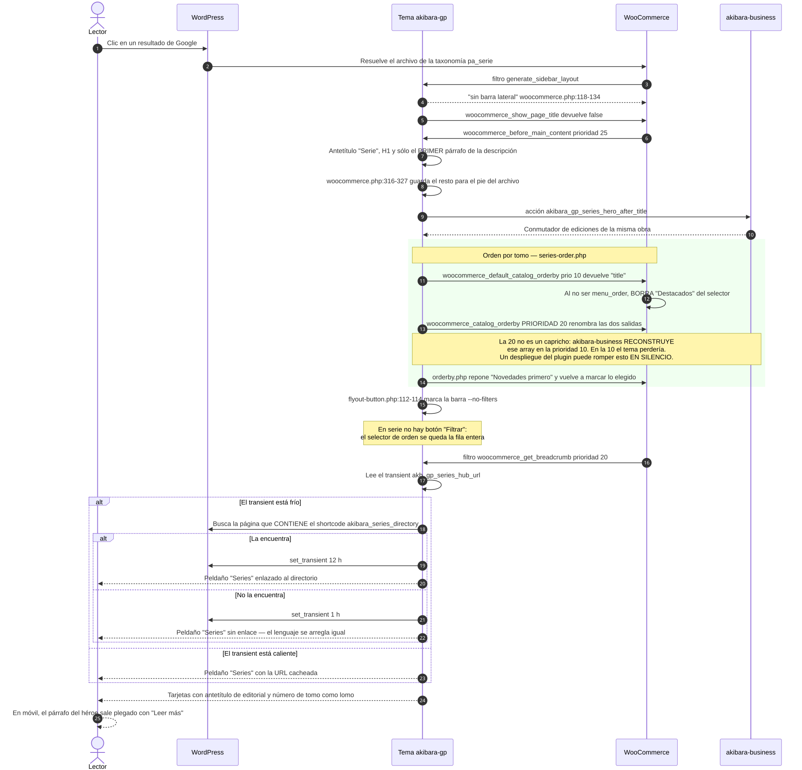
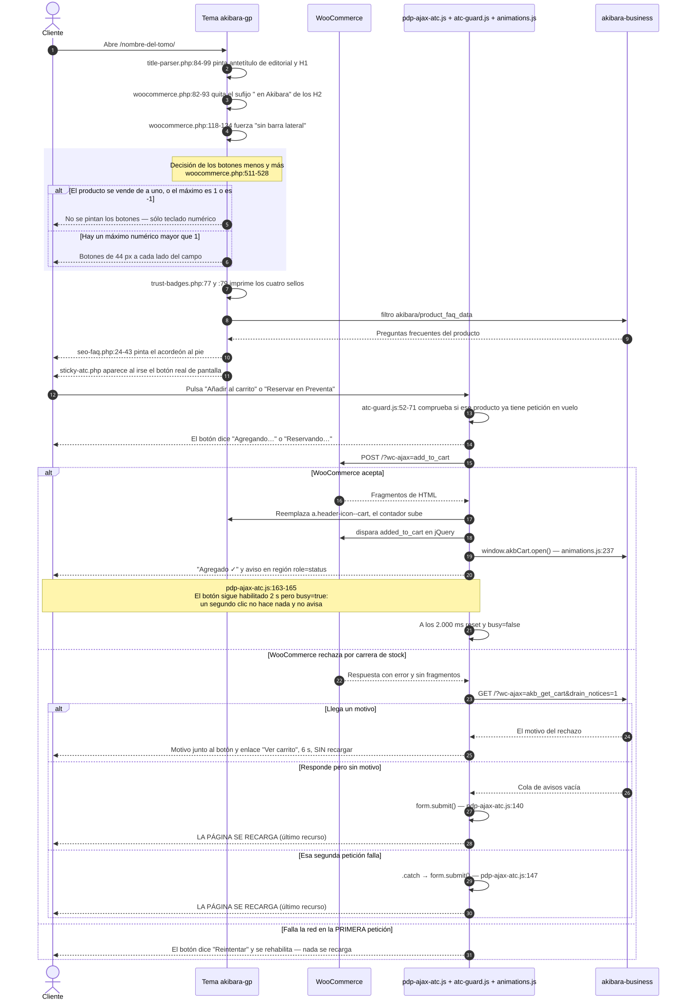
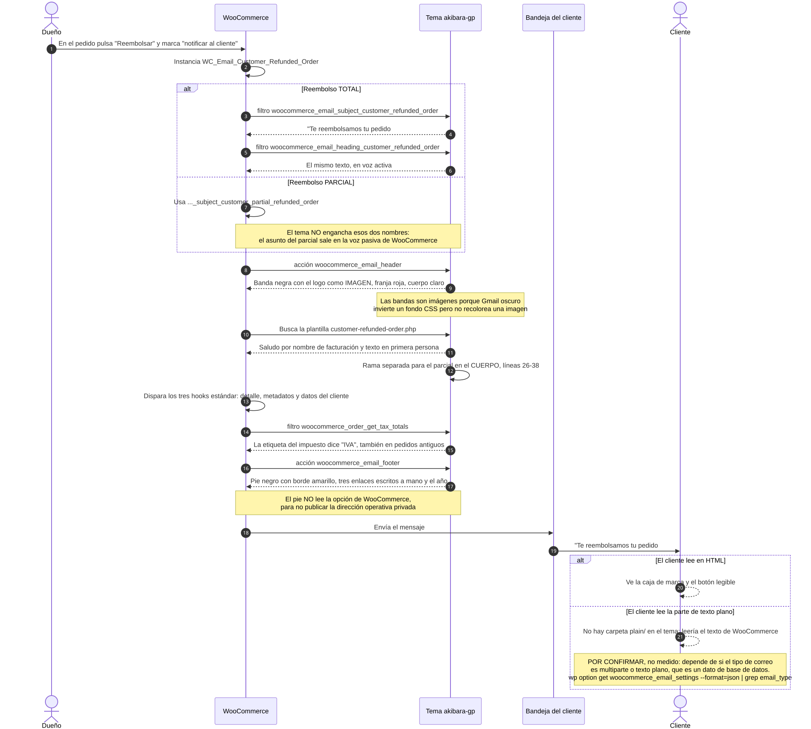

# Tema akibara-gp · todo lo que el cliente ve

> Leído contra el snapshot congelado de producción: tema `akibara-gp` **2.1.118**, con
> `akibara-business` 1.116.4, `akibara-search` 0.1.60, `akibara-cart-checkout-blocks` 2.2.17 y
> `akibara-rewards` 0.3.13 alrededor. Cada afirmación técnica lleva su fichero y su línea.
>
> **Cómo leer las rutas.** Salvo que se diga otra cosa, **todas las rutas de este capítulo son
> relativas a `public_html/wp-content/themes/akibara-gp/`**: `inc/woocommerce.php` vive en
> `public_html/wp-content/themes/akibara-gp/inc/woocommerce.php`. Cuando hay que salir del tema se
> escribe la ruta larga desde `public_html/wp-content/` (`plugins/akibara-business/…`). Las que
> empiezan por `tools/` o por `ops/` son relativas a la raíz del repositorio.
>
> **Cómo leer `gancho:prioridad`.** `wp_head:2` se lee «enganchado en el gancho `wp_head` con
> prioridad 2». El número menor corre primero y, a igualdad de número, corre primero quien se enganchó
> antes. En este capítulo ese detalle decide dos defectos: el preload de la portada (§5.1) y la
> posición del botón «Filtrar» en la pantalla sin resultados (§5.2).
>
> **Cómo ver los diagramas.** Cada diagrama se publica **dos veces**: el `.svg` ya renderizado —que es
> el que se embebe, y que cualquier visor de Markdown pinta— y el `.mmd` de al lado, que es la fuente
> editable en formato Mermaid. Si se toca un `.mmd` hay que volver a generar su `.svg`:
> `mmdc -i diagramas/<fichero>.mmd -o diagramas/<fichero>.svg -b white`.
>
> **Advertencia sobre lo «sellado por tests».** El mapa de lectura citaba cuatro candados de fuente
> (`tests/online-store-truth.test.js`, `tests/serie-landing-ux.test.js`, `tests/series-order.test.js`,
> `tests/AssetVersionTest.php`) como si viajaran con el tema. **El ZIP publicado no lleva carpeta
> `tests/`**: la raíz del tema en el snapshot de producción tiene **catorce** entradas, y ninguna es
> `tests/`. Son éstas, y conviene tenerlas a mano porque es contra ellas que un recién llegado compara
> su `ls`:
>
> ```
> 404.php   archive.php   assets/   customer-reviews-woocommerce/   footer.php   functions.php
> header.php   home.php   inc/   single.php   style.css   template-parts/   theme.json   woocommerce/
> ```
>
> Esos candados existen, pero viven en el árbol de trabajo, no en lo desplegado. Quien quiera
> comprobarlos tiene que ir al repositorio, no al servidor.
>
> **Hasta dónde llega esta lectura.** La verificación del área declaró una cobertura del **88 %** y dejó
> por escrito qué no se leyó línea a línea: `animations.js`, `archive-intro.js`, `page-toc.js`,
> `akibara-brands-filter.js` y **el grueso de las 18 hojas de CSS (30.503 líneas)**. Eso alcanza a
> §4.28, §4.38, §4.40 y a la mayor parte de §4.35 («Sistema de diseño»): ahí se describe el
> comportamiento observado y los comentarios del propio código, no una auditoría línea a línea. El resto
> del capítulo sí se leyó entero.
>
> **Actualización 2026-09-26 — tema 2.1.143 en producción.** Lote de UX, diseño y rendimiento de la
> auditoría `ops/informe-tema-ux-rendimiento-2026-09-22.md`, desplegado el 2026-09-26 06:08-06:11 UTC
> junto con `akibara-search` 0.1.75, `akibara-business` 1.117.0, `akibara-cart-checkout-blocks` 2.2.26 y
> `akibara-rewards` 0.4.18. Todo lo marcado «(2.1.143)» se leyó contra el ZIP publicado
> `dist/akibara-gp-2.1.143.zip`, no contra el árbol de trabajo. Lo nuevo vive en §4.42-§4.49; las
> secciones que cambiaron llevan un párrafo «**En 2.1.143**». Donde una cita `fichero:línea` antigua ya
> no casa, manda el nombre de la función. Lo que quedó abierto está en el capítulo 20 (sección «Lote UX
> y rendimiento del tema») y lo que decide el dueño, en el 21.

---

## Para qué existe (en dos párrafos que entienda un novato)

akibara.cl es una tienda hecha con **WordPress** —el programa que guarda y publica las páginas— y
**WooCommerce**, el añadido que le da carrito, pedidos y pagos. En WordPress, el **tema** es la capa
que decide cómo se ve todo: qué HTML se imprime, qué hojas de estilo (CSS) se cargan y qué guiones de
JavaScript se envían al navegador del cliente. `akibara-gp` es ese tema. Es un **tema hijo**: se apoya
en otro tema comprado llamado **GeneratePress** (el «padre») y sólo reemplaza o corrige las piezas que
necesita, para no reescribir el padre ni perder los cambios cuando el padre se actualice
(`style.css:7`, `Template: generatepress`).

La regla de la casa está escrita en la cabecera del propio tema: **«Theme = solo HTML/CSS/JS UI; cero
business logic»** (`style.css:4`). Los precios, el stock, el buscador, la preventa y los puntos viven
en los plugins propios; el tema los consume. Esa separación no es total y está declarada a propósito:
el tema tiene una **dependencia dura** con `akibara-business`, porque le pide todas las direcciones
canónicas del sitio —carrito, mi cuenta, contacto, tienda, favoritos— a una clase suya,
`NavigationLinks`. El comentario de `functions.php:16-22` lo dice con todas las letras: «Si el plugin
se desactiva, los templates fail loud (Class not found). Es intencional». Traducido: sin ese plugin la
tienda no funciona de todos modos, así que se prefiere un error ruidoso a una página a medio pintar.

Dos palabras que aparecen todo el rato. Un **gancho** (*hook*) es el mecanismo con el que WordPress
deja que un tema o un plugin se enganche a un momento concreto —«justo antes de imprimir la cabecera»,
«justo después del botón de comprar»— o transforme un dato antes de que se use; eso último se llama
**filtro**. Casi todo lo que hace este tema es engancharse a ganchos de WordPress, de WooCommerce o de
GeneratePress: son **69 registros de `add_action`/`add_filter`** en total, contados sobre el snapshot
(de esos, dos no registran código del tema sino que **reponen** una función ajena que el propio tema
había quitado: `functions.php:71` devuelve `generate_add_viewport` de GeneratePress y
`woocommerce/cart/cart-empty.php:46` devuelve el mensaje de carrito vacío de WooCommerce).

**Son 69, no 63, y aquí este capítulo corrige al verificador del área.** El `verificacion.json` de
`mapas/theme/` cierra afirmando que «los **63** `add_action`/`add_filter` del tema están todos
representados». El conteo se hizo con una expresión que sólo ve el nombre del gancho cuando está en la
misma línea, y **siete registros llevan el nombre en la línea siguiente** porque la llamada va partida:
`inc/trust-badges.php:82`, `inc/setup.php:82`, `inc/woocommerce.php:200`, `:598`, `:613`, `:629` e
`inc/rank-math.php:36`. Con esos siete, 62 + 7 = 69. El comando que da el número bueno:

```bash
cd public_html/wp-content/themes/akibara-gp
grep -rn "add_action(\|add_filter(" . --include='*.php' | grep -v 'remove_action\|remove_filter' | wc -l   # → 69
```

Una **option** es un ajuste
guardado en la base de datos con un nombre; el tema lee tres de ellas para los textos del pie y una
promesa comercial, y el dueño las edita desde el panel «Akibara → Textos», que publica el plugin.

---

## Cómo encaja con el resto



### Lo que el tema NO hace (esto acota el radio de daño de cualquier despliegue)

Este es el dato más importante para el dueño, y conviene enunciarlo antes que nada. Barrido sobre el
snapshot completo del tema:

| Verbo | Cuántas veces | Dónde |
| --- | --- | --- |
| `get_option()` | **4** | `single.php:24` (`page_for_posts`) y `inc/site-copy.php:35`, `:55`, `:69` |
| `update_option()` | **0** | — |
| `get_theme_mod()` | **2** | `template-parts/header/shell.php:30` y `template-parts/footer/main.php:62`, las dos para `custom_logo` |
| `get_transient()` / `set_transient()` / `delete_transient()` | **1 + 1 + 1** | `inc/series-breadcrumb.php:61`, `:91`, `:110` |
| `wp_schedule_event()` / `as_schedule_*` | **0** | — |
| `register_rest_route()` | **0** | — |
| `wp_mail()` | **0** | — |

O sea: **el tema no escribe ninguna option, no agenda nada, no publica ningún endpoint y no envía
ningún correo por su cuenta.** Lo único que escribe en la base de datos es un transient de caché que
se invalida solo. Un despliegue del tema puede romper el *aspecto* del sitio —y hay ejemplos caros de
eso— pero no puede corromper datos de pedidos, ni dejar tareas colgadas, ni abrir una puerta nueva a
internet.

**En 2.1.143 la conclusión no cambia**, contado otra vez sobre el ZIP publicado: `update_option()`,
`wp_schedule_event()`, `wp_schedule_single_event()`, `as_schedule_*`, `register_rest_route()` y
`wp_mail()` siguen en **cero**; el único transient sigue siendo `akb_gp_series_hub_url`. Lo que sí creció
es lo que el tema **lee**: `akibara_gp_copy()` (`inc/site-copy.php:34`) ahora resuelve también la pista
del buscador, el título de «Lo más vendido», los cinco textos de las guías del blog y el título de las
reseñas (options de business y de rewards: tabla de «Datos que deja»), y `inc/woocommerce.php:442` lee el
interruptor del carrito nativo de business. Los registros `add_action`/`add_filter`, con el mismo `grep`
de «Para qué existe», son **84** (eran 73 en 2.1.142).

### Con quién habla

| Dominio | Habla con | Qué pasa si se apaga |
| --- | --- | --- |
| **Navegación y URLs** | `akibara-business` → `Services\NavigationLinks` | Error fatal en cabecera, pie y barra inferior. **Intencional** (`functions.php:16-22`). `404.php:32` y `woocommerce/cart/cart-empty.php:31-32` sí tienen respaldo con `class_exists` — la política no es una sola (§5.17) |
| **Favoritos** | `akibara-business` → `Modules\Wishlist\Storage::count()` | El contador del corazón queda en 0 |
| **Estados vacíos** | `akibara-business` → filtro `akibara/popular_product_ids` | El cross-sell no pinta nada (`inc/performance.php` devuelve lista vacía y la consulta usa `array(0)`) |
| **Preguntas de la ficha** | `akibara-business` → filtro `akibara/product_faq_data` | El acordeón simplemente no se imprime (`inc/seo-faq.php:24-43`) |
| **Directorio de editoriales** | `akibara-business` → `BrandsDirectory` carga las plantillas del tema con `locate_template()` | /editoriales/ y la vitrina de la portada desaparecen |
| **Filtros y sugeridor** | `akibara-search` → `akibara_search_facets_active()`, `akibara_search_suggest_active()` | El botón «Filtrar» no se pinta y el campo de búsqueda pasa a ser un formulario GET clásico. **Es el rollback documentado** |
| **Carrito y pago** | `akibara-cart-checkout-blocks` → sirve `cart/cart-empty.php` por shortcode | El carrito vacío del tema deja de verse: es lo único que mantiene vivo ese override |
| **Cajón del carrito** | `akibara-business` → el objeto global de JavaScript **`window.akbCart`**, que publica `plugins/akibara-business/assets/js/native-cart.js` (`:103` en 1.117.0). **En 2.1.143 lo llama `assets/js/animations-loader.js:184-186`** (`window.akbCart.open()`) al oír `akb:added_to_cart`, con o sin vuelo (§4.43); `animations.js` ya no abre el cajón | **El alta ocurre igual y el cajón no se abre.** El cargador comprueba `typeof window.akbCart.open === 'function'` antes de llamar, así que no hay error en consola. Es el fallo más silencioso de esta tabla |
| **Búsqueda sin resultados** (2.1.143) | `akibara-search` → acción `akibara_search_empty_after` dentro de `[data-akb-empty]`; `akibara-business` → filtro `akibara_show_popular_in_empty_search` | Sin el buscador no hay acción y no se pinta nada; sin business el filtro devuelve el valor de fábrica y la fila tampoco sale porque no hay más vendidos (§4.46) |
| **Barra de compra: llegada** (2.1.143) | `akibara-business` → filtro `akb_eta_linea_corta` (`EstimatedDelivery\BannerRenderer`) | La línea «Llega …» no sale; la barra queda con precio y botón (§4.26) |
| **Guías del blog** (2.1.143) | `akibara-business` → filtro `akb_guide_series_card` (`RelatedGuides\GuideSeriesCard`) | Sin tarjeta de la serie y con el cierre a la tienda, como antes (§4.47) |
| **Rechazo al agregar** (2.1.143) | `akibara-business` → `?wc-ajax=akb_get_cart&drain_notices=1` devuelve `motivo` (`ya_en_carrito` / `sin_stock`, `NativeCart\RejectionReason`) | La ficha recarga como último recurso; la tarjeta vuelve al comportamiento de WooCommerce (§4.37, §4.45) |
| **Tema padre** | GeneratePress → 5 filtros y **5 acciones replicadas** (`generate_before_header`, `generate_inside_header`, `generate_after_header`, `generate_before_footer`, `generate_after_footer`), más un sexto gancho del padre del que el tema **cuelga** código (`generate_before_main_content`, `inc/blog.php:272`) y un séptimo del que **descuelga** el «saltar al contenido» ajeno (`inc/setup.php:72`) | Sin el padre, WordPress no activa el hijo |
| **Tienda** | WooCommerce → **32 de los 69** registros cuelgan de ganchos `woocommerce_*`; los otros 37 son de WordPress (28), de GeneratePress (6) y de LiteSpeed (3). Un `grep` ingenuo devuelve otra cosa: hay que sumar los siete registros con el nombre del gancho en la línea siguiente (ver «Piezas») | El sitio pasa de «tienda rota» a **error fatal global** (§5.3) |
| **Caché** | LiteSpeed Cache → 3 filtros de exclusión más `data-no-optimize`/`data-no-defer` | Los guiones críticos se combinan o se retrasan y el carrito deja de funcionar sin recargar |
| **SEO** | Rank Math → un guion en el editor de entradas | El semáforo de Rank Math vuelve a reclamar la imagen destacada. Cero efecto público |
| **Reseñas** | `customer-reviews-woocommerce` → `customer-reviews-woocommerce/form.css` | Ver §4.20: es la única superficie del tema acoplada al árbol de otro plugin |

### Y al revés: quién depende del tema

- `akibara-business` → `Utilities\ThemeAssetVersion::for_path()` llama a `akibara_gp_asset_ver()` del
  tema para versionar los ficheros del tema que el plugin encola (`akibara-forms.js`, `forms.css`,
  `brands.css`, `akibara-brands-filter.js`, `tokens.css`, `fonts.css`). Usar la versión del plugin no
  invalidaría nada, porque los ficheros son del tema. **En 2.1.143 / business 1.117.0** además
  `ThemeAssetVersion::served_path()` le pregunta a `akibara_gp_asset_servido()` **qué** fichero se sirve
  (la copia `.min`, o la fuente con `SCRIPT_DEBUG` o si la copia falta), y la versión se pide sobre ese
  fichero: `for_path( served_path( … ) )` en `Forms` y `BrandsDirectory` (§4.44).
- `akibara-rewards` → el carrusel de reseñas de la portada declara `gsap` y `gsap-scrolltrigger` como
  dependencias **si están registrados** (`src/Reviews/Carousel.php:237-246`); por eso el tema los
  registra siempre en las superficies con animaciones aunque sólo la portada los encole (§4.43).
- `akibara-rewards` → la option `akb_rewards_carousel_title` titula también la sección de reseñas de
  cada ficha (`akibara_gp_reviews_title()`, §4.21).
- `akibara-business` → `BrandsDirectory\Shortcode`, `HomeCarousel`, `Forms\ContactoForm` y
  `Wishlist\Render` cargan plantillas del tema con `locate_template()`.
- `akibara-business` → el panel del hero de la portada carga `assets/css/tokens.css` y
  `assets/css/fonts.css` del tema para su previsualización, y ofrece Bebas Neue, Saira e Inter.
- `akibara-search` → emite el evento nativo `akb:pjax` tras cada intercambio de la rejilla, y el tema
  lo escucha para recalcular el contador de filtros y volver a revelar las tarjetas nuevas.
- `akibara-search` → desde 0.1.75 dispara `akibara_search_empty_after` dentro del aviso de «sin
  resultados» para que el tema pinte la venta cruzada, y su PJAX distingue esa rejilla de la del
  catálogo con `mainGrid()` (§4.46 y capítulo 09).
- `akibara-cart-checkout-blocks` → llama a `wc_get_template('cart/cart-empty.php')`.

---

## Piezas

**En 2.1.143:** `inc/` tiene 22 ficheros (entra `guide-series.php`) y `assets/js/` **14 guiones propios**
(entran `toque-temprano.js` y `animations-loader.js`), cada uno con su copia `.min`; `assets/css/` suma
11 copias `.min.css` y las cuatro partes de `woocommerce.css` (§4.44). El recuento de abajo es el de
2.1.118.

Veinte módulos en `inc/`, diez partes de plantilla, nueve sobrescrituras de WooCommerce, cuatro
plantillas propias, **doce guiones propios** (uno de ellos sólo de administración, §4.18) **más GSAP y
ScrollTrigger empaquetados en `assets/js/vendor/`**, y dieciocho hojas de estilo. `functions.php` no
contiene lógica: sólo encadena los módulos en orden fijo, con `page-targets.php` primero porque los
demás usan sus helpers (`functions.php:34-53`).

### Lo que el tema NO tiene (y es lo primero que hay que saber para buscar dónde editar)

Un recién llegado supone que, si quiere cambiar un `<div>` de la ficha de producto, el fichero está en
el tema. **No está.** El tema **no tiene plantilla propia de página, ni de catálogo, ni de ficha de
producto**: no existen `page.php`, `index.php`, `single-product.php` ni `archive-product.php`. Esas
pantallas —la ficha, el catálogo y las once páginas de contenido (`/faq/`, `/envíos/`, `/nosotros/`…)—
las pinta **GeneratePress** con lo que le pasa **WooCommerce**, y el tema sólo las modifica
**por ganchos** (§4.7). Las cuatro plantillas propias son las cuatro superficies editoriales y el error:
`home.php` (la portada del blog), `archive.php` (categoría, etiqueta, autor, fecha), `single.php` (una
entrada) y `404.php`.

Consecuencia práctica: **para cambiar el HTML de una ficha no se busca un fichero, se busca un gancho**.
La lista de ganchos del tema que tocan la ficha está en §4.7, §4.11, §4.12 y §4.13.

### Dónde está cada cosa

| Fichero o carpeta (relativo a la raíz del tema) | Qué es | Sección |
| --- | --- | --- |
| `functions.php`, `style.css` | Arranque y cabecera del tema (número de versión en `style.css:8`) | §4.1 |
| `inc/setup.php` | Supports y las cinco ubicaciones de menú | §4.2 |
| `inc/generatepress-compat.php` | Recorte del hover rojo del padre | §4.3 |
| `inc/page-targets.php` | Única lista de «en qué página estamos» | §4.4 |
| `inc/enqueue.php` | Qué CSS y qué JS recibe cada página; el `?ver` | §4.5 |
| `inc/performance.php` | Tamaño y prioridad de imágenes; hojas diferidas | §4.6 |
| `inc/woocommerce.php` | El módulo grande de tienda (21 ganchos) | §4.7 |
| `inc/flyout-button.php` | Fila «Filtrar / Ordenar» y el botón del cajón de facetas | §4.8 |
| `inc/series-order.php` + `woocommerce/loop/orderby.php` | Orden tomo 1 → N en `/serie/*` | §4.9 |
| `inc/series-breadcrumb.php` | Peldaño «Series» de las migas | §4.10 |
| `inc/title-parser.php` | Antetítulo de editorial y número de tomo | §4.11 |
| `inc/seo-faq.php` | Acordeón de preguntas de la ficha | §4.12 |
| `inc/trust-badges.php` | Los cuatro sellos de confianza | §4.13 |
| `inc/site-copy.php` | Las tres options de texto editable | §4.14 |
| `inc/icons.php` | Los trece iconos SVG | §4.15 |
| `inc/page-header.php` | Supresión del H1 del padre | §4.16 |
| `inc/blog.php` | Blog: `alt` de respaldo, comentarios, puente de búsqueda | §4.17 |
| `inc/rank-math.php` + `assets/js/rank-math-content-analysis.js` | Sólo escritorio de WordPress | §4.18 |
| `inc/class-mainnav-walker.php`, `class-mobile-walker.php`, `class-footer-walker.php` | El HTML de los menús | §4.19 |
| `customer-reviews-woocommerce/form.css` | Override del formulario de reseñas de un tercero | §4.20 |
| `assets/css/reviews-p5-v4.css` | Hoja de reseñas que hoy puede no pintar nada | §4.21 |
| `header.php`, `template-parts/header/shell.php`, `navigation.php` | Cabecera | §4.22 |
| `template-parts/header/mobile-drawer.php`, `assets/js/main.js` | Cajón móvil y hoja de búsqueda | §4.23 |
| `footer.php`, `template-parts/footer/main.php` | Pie del sitio | §4.24 |
| `template-parts/footer/bottom-nav.php` | Barra inferior fija de móvil | §4.25 |
| `template-parts/woocommerce/sticky-atc.php`, `assets/js/sticky-atc.js` | Barra de compra pegajosa | §4.26 |
| `template-parts/empty/cross-sell.php` | Rejilla «Más vendidos» de toda pantalla vacía | §4.27 |
| `template-parts/brands/grid.php`, `home-carousel.php`, `assets/js/akibara-brands-filter.js` | Editoriales | §4.28 |
| `template-parts/forms/contacto.php`, `assets/js/akibara-forms.js` | Formulario de contacto | §4.29 |
| `woocommerce/cart/cart-empty.php`, `woocommerce/loop/no-products-found.php` | Carrito vacío y sin resultados | §4.30 |
| `woocommerce/loop/orderby.php`, `pagination.php` | Selector de orden y paginación | §4.31 |
| `woocommerce/emails/email-header.php`, `email-footer.php` | La caja de todos los correos | §4.32 |
| `woocommerce/emails/customer-new-account.php`, `customer-reset-password.php`, `customer-refunded-order.php` | Los tres correos de marca | §4.33 |
| `404.php`, `home.php`, `archive.php`, `single.php` | Las cuatro plantillas propias | §4.34 |
| `theme.json`, `assets/css/tokens.css`, `fonts.css`, `critical.css` | Sistema de diseño | §4.35 |
| `assets/js/main.js` | Todo el comportamiento de interfaz | §4.36 |
| `assets/js/wc-event-bridge.js`, `atc-guard.js`, `pdp-ajax-atc.js` | Puente de eventos y guardas del carrito | §4.37 |
| `assets/js/animations.js` + `assets/js/vendor/gsap.min.js`, `ScrollTrigger.min.js` | Animaciones | §4.38 |
| `assets/js/franja-inferior.js` | Medición en vivo de las barras fijas | §4.39 |
| `assets/js/archive-intro.js`, `page-toc.js` | Guiones menores | §4.40 |
| `assets/js/toque-temprano.js` (se imprime EN LÍNEA en el `<head>`) | Toques antes de que arranque el JS; ficha `inert` con un POST de camino (2.1.143) | §4.42 |
| `assets/js/animations-loader.js` | Carga tardía de GSAP fuera de la portada y «agregar → cajón» (2.1.143) | §4.43 |
| `assets/css/*.min.css`, `assets/js/*.min.js`, `assets/css/woocommerce-{listado,ficha,carrito,cuenta}.min.css` | Lo que de verdad se sirve; generado por `tools/akibara-releases/build-theme-min-assets.mjs` (2.1.143) | §4.44 |
| `inc/asset-dequeue.php` | Qué assets de WooCommerce se retiran por superficie; en 2.1.143 también `wc-cart` en el carrito de bloques | §4.44, §4.48 |
| `inc/guide-series.php` | Tarjeta de la serie en una guía del blog (2.1.143) | §4.47 |
| `assets/images/embalaje/`, `assets/img/logo-akibara-2x.webp` | Binarios sin dueño declarado | §4.41 |
| `assets/img/editoriales/*.svg` (ocho) | Logos de editorial | §4.7 |
| `assets/img/akb-email-logo-banner.png`, `akb-btn-red.png`, `akb-hdr-white.png` | Las tres imágenes de los correos | §4.32 |

### Cómo lo pruebo (tres comandos)

Antes de mirar nada, el espejo local y el `core.css` regenerado. **El árbol de trabajo mezcla trabajo
sin terminar; la verdad de lo publicado es el ZIP de `dist/`.**

```bash
# 1. Levantar el espejo (Docker). Sirve en http://localhost:8080
docker compose -f compose.yaml up -d

# 2. Regenerar core.css Y las copias .min ANTES de mirar (desde 2.1.143 el mismo script llama al final a
#    build-theme-min-assets.mjs): son ficheros generados y lo que se SIRVE es la .min
bash tools/akibara-releases/build-theme-core-css.sh

# 3. Pedir una ficha como pediría el cliente, marcando la sonda para el qlog
curl -s -A AkibaraQA 'http://localhost:8080/<slug-de-un-tomo>/' | grep -c 'akb-qty-btn'
```

El **gate** del tema es `bash tools/akibara-releases/qa-theme.sh [version]`. Prueba el **ZIP publicado
en `dist/`**, no el árbol, extrayéndolo y copiándole encima las pruebas del árbol. Hasta el 2026-09-11
validaba un artefacto congelado (2.1.48) con las pruebas de hoy, así que llevaba semanas en rojo sin que
nadie lo corriera; desde entonces prueba la versión que de verdad se despliega. Los dos artefactos
congelados conservan sus propios gates de bytes e inventario:
`qa-theme-production-superset.sh` y `qa-theme-seo-production.sh`.

### 4.1 Bootstrap del tema — `functions.php`

**Qué hace en una frase:** carga los veinte módulos y deja enganchadas cuatro cosas sueltas de
rendimiento.

- **Ficheros:** `functions.php`, `style.css`.
- **Cuándo actúa:**
  - `generate_meta_viewport:10` → `akibara_gp_meta_viewport()` (`functions.php:130-133`): cambia el
    meta viewport del padre por uno con `viewport-fit=cover`, para que el diseño llegue bajo la muesca
    del iPhone.
  - `after_setup_theme:10` → `akibara_gp_viewport_before_preloads()` (`functions.php:69-73`): mueve
    `generate_add_viewport` de `wp_head:1` a `wp_head:0`. Motivo medido y escrito en el código: el
    `wp_preload_resources` del núcleo también va en prioridad 1 y ganaba, así que los `<link
    rel=preload media=…>` del hero quedaban **antes** del meta viewport, el navegador evaluaba sus
    media queries con el ancho por defecto de 980 px y en móvil **descargaba además la imagen de
    escritorio, ~108 KB tirados**.
  - `wp_enqueue_scripts:20` → `akibara_gp_enqueue_p5_reviews()` (`functions.php:76-83`): encola
    `assets/css/reviews-p5-v4.css` si `is_product()`.
  - `wp_enqueue_scripts:20` → `akibara_gp_enqueue_cart_badge_sync()` (`inc/asset-dequeue.php`, 2.1.136): encola
    `wc-cart-fragments` donde el contador del carrito sale de HTML cacheado (ver §5.19).
  - `wp_enqueue_scripts:99` → `akibara_gp_dequeue_unused_assets()` (desde 2.1.136 en `inc/asset-dequeue.php`): quita
    scripts y estilos de WooCommerce fuera de sus contextos. **Ver §5.3: llama a siete condicionales
    de WooCommerce sin `function_exists`.**
  - `wp_head:2` → cierre anónimo (`functions.php:139-173`, que es donde acaba el fichero): debería
    imprimir el preload de la portada de la ficha. **Ver §5.1: hoy no se emite nunca.** Su primera línea,
    `if ( ! is_product() )`, es la tercera llamada sin guarda de §5.3.
- **Datos:** ninguno.
- **Dónde lo opera el dueño:** en ninguna parte.
- **Qué ve el cliente:** indirecto — qué CSS y qué JS recibe cada página, y la velocidad de la primera
  pintura.

### 4.2 Theme setup — `inc/setup.php`

**Qué hace:** declara qué sabe hacer el tema y registra los cinco sitios donde el dueño cuelga menús.

- `after_setup_theme:10` → `akibara_gp_setup()`: `add_theme_support` de `title-tag`,
  `post-thumbnails`, `automatic-feed-links`, `html5`, `custom-logo` (80×201, flexible) y
  `woocommerce`; activa lightbox y carrusel de la galería (`inc/setup.php:57-58`); registra las cinco
  ubicaciones de menú; y quita el enlace «saltar al contenido» de GeneratePress, que apunta a un ancla
  inexistente (`#content`) mientras el del tema apunta a `#main` (`:72`).
- `after_setup_theme:99` → cierre anónimo (`inc/setup.php:82-88`): `remove_theme_support('wc-product-gallery-zoom')`.
  **El zoom se quita una sola vez, no dos.** El tema **nunca lo activa**: en `akibara_gp_setup()` sólo
  hay lightbox y carrusel, y el zoom está ahí comentado. Quien sí lo añade es **GeneratePress**, en
  `after_setup_theme` prioridad 10 (`inc/plugin-compat.php` del padre), así que retirarlo dentro de
  `akibara_gp_setup()` —que corre en esa misma prioridad 10— no serviría de nada: hay que hacerlo
  **después** del padre, y por eso existe el cierre de prioridad 99.

**Las cinco ubicaciones de menú, con su nombre en wp-admin.** Importa porque **el nombre que se ve en el
sitio no es el que se ve en Apariencia → Menús**, y quien busque «Novedades» en el escritorio no lo va a
encontrar:

| Identificador (código) | Nombre en Apariencia → Menús | Título que se ve en el sitio | Dónde sale |
| --- | --- | --- | --- |
| `akibara-primary` | Akibara Principal | — (sin título) | Menú de escritorio **y** cajón móvil, los dos (§4.19) |
| `akibara-footer-catalog` | Akibara Footer — Catálogo | **Catálogo** | Primera columna del pie |
| `akibara-footer-explore` | Akibara Footer — **Explorar** | **Novedades** | Segunda columna del pie |
| `akibara-footer-help` | Akibara Footer — Ayuda | **Ayuda** | Tercera columna del pie |
| `akibara-footer-mobile` | Akibara Footer — Atajos mobile | — (sin título) | Tira de atajos del pie en móvil |

Los identificadores están en `inc/setup.php:60-66`; los títulos visibles, escritos a mano en
`template-parts/footer/main.php:148-150`. Una ubicación sin menú asignado **no pinta su columna** y el
diseño no se rompe.
- **Qué ve el cliente:** la galería de la ficha abre en lightbox al hacer clic, pero no hace zoom al
  pasar el cursor. Con portadas de 550-610 px el zoom dibujaba una copia **más chica** encima.
- **Dónde lo opera el dueño:** Apariencia → Menús (cinco ubicaciones) y Personalizar → Identidad del
  sitio (logo).

### 4.3 Compatibilidad con GeneratePress — `inc/generatepress-compat.php`

**Qué hace:** recorta una regla del CSS del padre que pintaba de rojo cualquier `<button>` al pasar el
cursor, incluidos los controles propios: flechas del carrusel, botones −/+ de cantidad, filtros.

- `generate_colors_css_output:PHP_INT_MAX` → recorta los selectores `button:hover` y `button:focus`
  del CSS recién generado.
- `option_generate_dynamic_css_output:PHP_INT_MAX` → **el mismo recorte sobre la copia guardada en
  base de datos**, porque a partir de la segunda petición GeneratePress sirve esa copia y se salta el
  filtro normal.
- **Datos que lee:** la option `generate_dynamic_css_output`, que escribe GeneratePress. El tema sólo
  la lee filtrada, **no la escribe**.
- **Qué ve el cliente:** los botones propios conservan su color de reposo al pasar el cursor y al
  recibir el foco.

### 4.4 Resolución de páginas objetivo — `inc/page-targets.php`

**Qué hace:** es la **única lista** de «en qué página estamos» del tema. Antes vivía repartida en tres
ficheros con números de base de datos escritos a mano, y las copias derivaron hasta dejar `/genero/` y
`/autor/` con botones de compra muertos (documentado en el propio fichero, líneas 88-94).

- `AKIBARA_GP_CONTENT_PAGES` (`inc/page-targets.php:39-50`): los **diez** slugs con diseño propio —
  `contacto`, `editoriales`, `series`, `faq`, `nosotros`, `envios`, `embalaje-seguro`, `devoluciones`,
  `terminos-y-condiciones`, `politica-de-privacidad`. Eran once hasta el tema **2.1.139**, que retiró
  `encargos` porque ese slug no correspondía a ningún post (corregido 2026-09-20, ronda 10).
- `akibara_gp_wc_activo()` (desde 2.1.135): la única guarda de «¿hay WooCommerce?» del tema. Tres hooks que corren en **todas** las páginas —el descolgado de assets, la precarga de la portada en `wp_head` y la clase `body_class` del distrito— llamaban a `is_shop()` / `is_product()` sin preguntar; con WooCommerce desactivado, en cuarentena de Imunify o a medio desplegar, cualquiera de los tres tumbaba el sitio entero (S-bf0c1196). Vive aquí porque este fichero es el primer `require_once` de `functions.php`.
- `AKIBARA_GP_HOME_ALT = 'home-1'` (`inc/page-targets.php:56`) y su helper
  `akibara_gp_is_home_surface()` (`:83-85`): portada **o** la home alternativa.
- **Retirado en el tema 2.1.139: `/suscripcion-confirmada/`.** Hasta el tema 2.1.138 había aquí una
  cuarta entrada, `AKIBARA_GP_SUBSCRIBED_PAGE = 'suscripcion-confirmada'` con su helper
  `akibara_gp_is_subscribed_page()`, cuyo único efecto era que esa página recibiera `empty-states.css`
  por su botón «Explorar catálogo». **Se retiraron los dos porque la página no existe**: el slug no
  corresponde a ningún post en ningún estado —tampoco en la papelera— y `/suscripcion-confirmada/`
  responde 404 (lo deja escrito el propio fichero, `inc/page-targets.php:12` y `:22-23`). Era una rama
  que no se podía alcanzar. El test del tema (`tests/PageTargetsTest.php:178-194`) fija que ni la
  constante ni el helper renazcan, junto a los otros slugs retirados (`encargos`, `wishlist`, `manga`)
  (corregido 2026-09-20, ronda 10).
- `akibara_gp_surface_has_product_loop()`: fuente única de «esta página pinta tarjetas con botón de
  compra» — tienda, categoría, etiqueta, marca, `pa_serie`, `pa_genero`, `pa_autor`, ficha, búsqueda de
  productos, carrito, mi cuenta, 404 y home. Protege sus llamadas con `function_exists`
  (`inc/page-targets.php:105`).
- **Se resuelve por slug, no por número de identificador**, porque los números cambian entre entornos
  y las ramas dejaban de coincidir en silencio.
- **Qué ve el cliente:** indirecto — de esta lista depende que el botón «Añadir al carrito» de una
  tarjeta funcione por AJAX en `/genero/` y `/autor/` en vez de recargar la página.

### 4.5 Encolado de assets y versionado — `inc/enqueue.php`

**Qué hace:** decide qué hoja de estilo y qué guion recibe cada página, en qué orden, y con qué número
de versión para que el navegador se entere de un cambio.

- `wp_enqueue_scripts:10` → `akibara_gp_enqueue()`: todo el encolado condicional.
- `wp_head:1` → `akibara_gp_preload_fonts()` (`inc/enqueue.php:679` en 2.1.143): cuatro `<link rel=preload
  as=font>`: Bebas regular e **Inter 400/500/700** (desde 2.1.140 el 500 sustituye al 600, que en el
  primer viewport casi no se usa: R11-precarga-peso-equivocado). Las cuatro Inter de `assets/fonts/`
  suman 97.036 B; PM-18, decidido por delegación el 2026-09-26 (capítulo 21), prueba en el próximo lote
  una Inter variable subconjuntada y sólo la adopta si pesa claramente menos.
- `wp_head:2` → `akibara_gp_print_toque_temprano()` (`:711`, 2.1.143): el captador de toques tempranos,
  impreso en línea (§4.42).
- `litespeed_optimize_js_excludes:10`, `litespeed_optm_js_defer_exc:10`, `litespeed_optm_gm_js_exc:10`
  → excluyen de la combinación y del retraso de LiteSpeed: `main.js`, el puente de eventos, GSAP,
  `animations.js`, `animations-loader.js`, `atc-guard.js`, `pdp-ajax-atc.js`, `sticky-atc.js` y el
  filtro de editoriales. **En 2.1.143 cada guion va con sus dos rutas** (la fuente y la `.min`):
  LiteSpeed compara por subcadena y `main.js` no es subcadena de `main.min.js`
  (`akibara_gp_litespeed_rutas_js()`, `:747`).
- `script_loader_tag:10` → añade `data-no-optimize` y `data-no-defer` a esos mismos handles. **Cinturón
  y tirantes:** por filtro *y* por atributo en la etiqueta. En 2.1.143 escribe además, en la etiqueta
  del cargador de animaciones, el atributo `data-akb-diferidos` con las URLs de GSAP, ScrollTrigger y
  `animations.js` (§4.43).
- `generate_load_child_theme_stylesheet` → `__return_false` (`inc/enqueue.php:581-590`): el
  `style.css` del hijo **no se encola**. GeneratePress lo encolaba con el handle `generate-child` y un
  `filemtime()` pelado, y en producción eso era una petición por página y por visitante a un fichero
  que LiteSpeed minificaba a 0 bytes. Se usa el interruptor que el propio padre ofrece, que evita el
  encolado *y* el `filemtime()`, en vez de deshacerlo después. Hasta el tema 2.1.138 aquí había un
  `akibara_gp_fix_child_style_version()` colgado de `style_loader_src` que reescribía ese `?ver`;
  murió con el `<link>` (R8-css-vacio) y hoy **no existe ni la función ni el hook** — el test
  `AssetVersionTest:253` fija que no vuelva. El CSS real del tema vive en `assets/css/` y lo encola
  `akibara_gp_enqueue()` (corregido 2026-09-20, ronda 10).

**El versionado, que es contraintuitivo.** `akibara_gp_asset_ver()` (`inc/enqueue.php:37-47`) construye
el sufijo `?ver=` juntando la versión del tema y la fecha de modificación del fichero, separadas por un
punto. En producción esa fecha es **siempre la misma**: el empaquetador la congela en 1980 para que el
ZIP sea reproducible byte a byte, y 1980-01-01 en segundos es `315532800`. O sea que hoy, con el tema en
2.1.118, **los ~103 ficheros del tema llevan exactamente el mismo sufijo**:

```
/wp-content/themes/akibara-gp/assets/css/core.css?ver=2.1.118.315532800
```

**El número que importa se edita a mano**, en la cabecera del propio tema: `style.css:8`,
`Version: 2.1.118`. **Ése es el único que invalida la caché del navegador en producción.** La parte
`filemtime` sí discrimina fichero a fichero en Docker y en cualquier árbol sin empaquetar, que es donde
hace falta. Si `filemtime()` falla, la función devuelve la versión sola.

**Estructura del CSS, que tampoco es obvia.** Tres capas:

1. **`critical.css` viaja dentro del propio HTML**, compactado: se le quitan los comentarios, que
   viajaban en **cada** respuesta. Medido hoy sobre el snapshot publicado, el fichero son 142 líneas y
   **5.885 bytes**, de los cuales **4.209 bytes son sus siete comentarios de bloque** — el 72 %. (El
   docblock de `inc/enqueue.php:52-53` sigue diciendo «3.646 de sus 5.322 bytes»: es una medición vieja
   que nadie actualizó, y el fichero creció desde entonces. El argumento se refuerza; las cifras del
   comentario ya no son las del artefacto publicado.) El comando que las produce:

   ```bash
   cd public_html/wp-content/themes/akibara-gp
   wc -lc assets/css/critical.css                     # → 142 líneas, 5885 bytes
   python3 -c "import re,sys; s=open('assets/css/critical.css').read(); c=re.findall(r'/\*.*?\*/',s,re.S); print(len(c), sum(len(x.encode()) for x in c))"   # → 7 4209
   ```

   Trae el fondo oscuro, la cabecera
   pegajosa, los estados cerrados del cajón del carrito y del menú, y el parche del autorrelleno de
   Chrome. Sin eso hay un fogonazo blanco antes de la primera pintura.
2. **`core.css`**: un solo fichero que concatena tokens + fonts + base + header + footer. **De dónde
   salen las 26 peticiones:** no son cinco hojas del tema, son **todas las hojas de estilo que la
   portada pide** —las del tema más las de los plugins propios y de terceros—, contadas en producción el
   2026-08-24 sobre la portada, en móvil y sobre HTTP/3 (`inc/enqueue.php:143-165`). Las 26 arrancaban
   juntas a los ~120 ms y la última terminaba a los **1.706 ms**, para ficheros de 1 a 3 KB. No es peso
   —la página entera son 188 KB—: es **contención**, 26 flujos compitiendo, con el TTFB en 101 ms y nada
   interactivo hasta el segundo. Juntar las cinco del núcleo del tema en una sola quita cinco de esos
   flujos del camino crítico. Los cinco ficheros originales
   siguen siendo la fuente editable y sus handles se conservan **como alias sin fichero**, para no
   romper las trece dependencias que declaran el tema y los plugins. El handle `generate-style` también
   se registra sin fichero: el `style.css` del padre es puro encabezado y no merece un `<link>` vacío,
   pero el CSS dinámico de GeneratePress sigue saliendo.
3. **Hojas condicionales**: `woocommerce.css` y `loop.css` donde hay productos, `pages.css` en las
   páginas estáticas, `blog.css` en el blog, `empty-states.css` donde puede salir un estado vacío, y
   `home.css` / `trust.css` / `brands-home.css` sólo en la portada.

**Guiones:** `wc-event-bridge.js` y `main.js` en la cabecera con `defer`; `franja-inferior.js` en el
pie; `archive-intro.js` en series/género/autor; `page-toc.js` en páginas de contenido y entradas;
`sticky-atc.js` y `pdp-ajax-atc.js` en la ficha; `atc-guard.js` en toda superficie con rejilla; y GSAP
+ ScrollTrigger + `animations.js` en las superficies de descubrimiento — **no** en carrito ni en Mi
cuenta, porque son 46 KB y ahí la rejilla es venta cruzada o favoritos, no descubrimiento.

**En 2.1.143 cambian tres cosas de este apartado.** (1) Cada `wp_enqueue_*` del tema pasa por
`akibara_gp_asset()`: se sirve la copia **`.min`** salvo con `SCRIPT_DEBUG`, y `woocommerce.css` va
**partida en cuatro** según el contexto (§4.44); el `?ver` se calcula sobre el fichero servido y sigue
siendo `versión del tema + mtime` del fichero **en el servidor**, no del ZIP: el ZIP trae todas las fechas
congeladas en 1980 y `ops/akibara-deploy-runtime.sh` las vuelve a estampar al desplegar (su «TRAMPA 2»,
`:24-32`, y el paso que la aplica, `:143`, el `find … -exec touch {} +`, explicado en el comentario de
`:126-142`). En producción el 2026-09-26 sale `?ver=2.1.143.1790403032`,
que es 06:10:32 UTC, la hora del paso del tema. (2) GSAP, ScrollTrigger y
`animations.js` se **registran** en esas superficies pero sólo la portada los **encola**; en el resto
los inyecta tarde `animations-loader.js`, que sí va en todas (§4.43). (3) `empty-states.css` ya no va en
un listado con resultados (§4.44). Y en la ficha, `toque-temprano.js` viaja en línea en el `<head>`
(§4.42).

**GSAP viaja dentro del tema, y conviene saber en qué versión.** No se pide a ningún CDN: son dos
ficheros del propio tema, `assets/js/vendor/gsap.min.js` (72.927 bytes) y
`assets/js/vendor/ScrollTrigger.min.js` (44.575 bytes), los dos en **GSAP 3.15.0** (la versión está en
la primera línea de cada fichero, en su cabecera de licencia). Los «46 KB» del comentario de
`inc/enqueue.php:432` son el **peso comprimido** que ve el cliente (28,4 KB + 18,0 KB medidos con
`gzip -c … | wc -c`); en disco son ~115 KB. Consecuencia operativa: **actualizar GSAP, o parchear una
vulnerabilidad suya, es publicar una versión del tema** — no hay otra vía.

### 4.6 Rendimiento de imágenes y diferido del home — `inc/performance.php`

**Qué hace:** le dice al navegador qué imágenes bajar primero, de qué tamaño, y qué hojas del home
puede bajar sin frenar la primera pintura.

| Gancho | Prioridad | Callback | Qué hace |
| --- | --- | --- | --- |
| `wp_get_attachment_image_attributes` | 10 | `akibara_gp_handle_home_product_image_loading` | En la portada fuerza `loading=lazy` y quita `fetchpriority` a `woocommerce_thumbnail`/`shop_catalog` |
| `woocommerce_before_shop_loop` | 5 | `akibara_gp_prime_catalog_thumbnails` | `update_post_thumbnail_cache()` sobre la consulta principal: 48 consultas menos en una página de 24 productos |
| `wp_calculate_image_sizes` | 10 | `akibara_gp_catalog_image_sizes` | Declara el ancho exacto de la portada con `calc()`, con o sin barra de filtros (lo decide `akibara_gp_archive_sidebar_layout()`); desde 2.1.126 |
| `wp_get_attachment_image_attributes` | **11** | `akibara_gp_catalog_cover_loading` | En archivos de catálogo: las N primeras celdas de la rejilla sin `loading` (la #1 con `fetchpriority=high` si N ≥ 1), el resto `loading=lazy` + `decoding=async`; alinea `sizes="auto, …"` con el `loading` final |
| `wp_omit_loading_attr_threshold` | 10 | `akibara_gp_catalog_lazy_threshold` | N: **2** en archivos de catálogo, **0** si la ficha de datos de la serie quedó impresa encima de la rejilla |
| `woocommerce_before_shop_loop` | 1 | `akibara_gp_catalog_grid_start` | Sólo en la primera rejilla de la petición, y **nunca en una de shortcode** (`wc_get_loop_prop( 'is_shortcode' )`): fija desde qué celda se cuenta y abre un búfer |
| `woocommerce_before_shop_loop` | 3 | `akibara_gp_catalog_grid_detect_above` | Lee lo impreso en prioridad 2 (`SeriesFacts`) **y en prioridad 3 por quien se registrara antes que el tema** —business arranca en `plugins_loaded:20`— y decide si la rejilla quedó bajo el pliegue |
| `wp_lazy_loading_enabled` | 99 | `akibara_gp_email_images_without_lazy` | Dentro de `woocommerce_email_order_details` y `woocommerce_email_fulfillment_details`, core no difiere: los correos salen sin `loading` ni `sizes="auto"`, como siempre |
| `style_loader_tag` | 20 | `akibara_gp_defer_noncritical_home_style` | Convierte diez hojas al patrón `media=print` + `onload` |

**Corrección al mapa de lectura.** El docblock de `inc/blog.php:136`, el de `akibara_blog_image_alt_fallback()`,
afirma ser el «único callback del tema» para `wp_get_attachment_image_attributes`. Es falso: hay **tres**, y
el orden importa — prioridad 10 (`akibara_gp_handle_home_product_image_loading()`, `inc/performance.php:42`,
enganchada en `:57`), prioridad 11 (`akibara_gp_catalog_cover_loading()`, `inc/performance.php:565`,
enganchada en `:598`) y prioridad 20 (`akibara_blog_image_alt_fallback()`, `inc/blog.php:141`, enganchada en
`:166`). Son líneas de 2.1.143; en 2.1.142 la de prioridad 11 estaba en `:433`/`:466` y la de blog en
`:83`/`:108`, con el docblock en `:78`. El comentario miente y el mapa lo repetía como hecho.

**El `sizes` medido.** Antes WordPress pedía 700 px para una celda de 184 px, y se bajaban **53.883
bytes de más por imagen**.

**El `sizes` al píxel (tema 2.1.126, 2026-09-14).** El `48vw / 31vw / 350px` que lo reemplazó se pasaba:
en móvil por 1-2 px (a DPR 3 eso cruza el peldaño de 560 px: 185 × 3 = 555 cabe, 187,2 × 3 = 561,6 no) y en
tablet y escritorio por mucho, porque /tienda/ tiene barra de filtros y la tarjeta mide 248 px a 1440, no 350.
Medido en producción antes del despliegue: las portadas de entrada bajaban **683 px donde bastaba 350** en
tablet 820@2 y laptop 1280@1,5, y **709 donde bastaba 500** en Retina; en tablet la landing de serie declaraba
**menos** de lo pintado (254 contra 259). Ahora la fórmula sale de la rejilla: la portada mide su pista menos
los 2 px de borde de cada lado; con barra, el ancho útil pierde 344 px (280 de barra, 16 de hueco, 24 de
margen por lado); el contenedor se detiene en 1.400 px. `tests/catalog-cover-sizes.test.js` recalcula la
fórmula desde `loop.css`, `woocommerce.css`, `tokens.css` y `theme.json`, y `PerformanceHooksTest` la compara
con 30 anchos medidos en navegador. En escritorio la barra de desplazamiento de 14 px (`base.css`) deja el valor
3,5-4,7 px por encima: dirección segura. Chromium 151 y WebKit 26.5 usan el ancho pintado en las diferidas
(`sizes="auto"`, medido); en las de entrada manda la fórmula.

**La caja 2:3 no puede hacerse con `aspect-ratio` (tema 2.1.127, 2026-09-15).** WebKit —Safari, y por tanto
**todo iPhone**— no cuenta la altura de una caja con `aspect-ratio` al medir la tarjeta: dejaba la tarjeta
36 px más baja que Chromium y, como `.akb-product-cover-wrap` es un ítem flex, la **encogía**; con
`object-fit: cover` eso recorta la portada por arriba y por abajo. Medido a 393 px en el espejo y en
producción: caja de 170,8 × **220,2** (0,776) en WebKit contra 170,8 × **256,2** (2:3) en Chromium, con
pérdidas del **8 % al 13 %** de alto. Lo levantó el dueño desde su teléfono; ninguna ronda de QA lo había
visto porque las sondas medían en Chromium. Hoy el 2:3 sale de `padding-top: 150%` en un `::before` y la
imagen va `position: absolute; inset: 0`; la jaula lleva `flex-shrink: 0`. `flex-shrink: 0` **solo** no
arregla nada: el motor ya había medido mal la fila. `tests/catalog-cover-sizes.test.js` prohíbe volver a
`aspect-ratio` en esa jaula.

**La portada llena la caja: `object-fit: cover` (decisión del dueño 2026-07-06, confirmada el 2026-09-15 tras probar `contain`).**
Desde que las portadas pasan por **Akibara Image Studio** (`~/Documents/akibara-image-studio`, Docker en
`:8420`), que recorta el marco y exporta a ancho 800 con **alto libre** —igual que WooCommerce—, cada portada
llega con la proporción real del tomo y no en 2:3. Medido en producción sobre 1.603 portadas:

| Mes de subida | Portadas | 2:3 | Otras | Mediana |
| --- | --- | --- | --- | --- |
| julio (importación del catálogo viejo) | 1.501 | 1.500 | 0 % | 0,6667 |
| agosto | 27 | 5 | 81 % | 0,7072 |
| septiembre | 75 | 1 | **99 %** | 0,7067 |

0,707 es el A5 (148 × 210 mm) del tomo. En una caja 2:3 eso obliga a elegir, y **se probaron las cuatro
salidas en producción, con WebKit a 393 px, sobre portadas reales** (2026-09-15):

| Opción | Qué se ve | Resultado |
| --- | --- | --- |
| `contain` (tema 2.1.128 / business 1.116.11, desplegado unas horas) | portada entera con franja de 2 a 12 px arriba y abajo (50 px en Demon Slayer EE) | el dueño la vio en su iPhone: «se ven arriba y abajo en negro». En tema oscuro la franja se lee siempre, aunque sea del color de la tarjeta; Amazon la esconde porque su fondo es blanco |
| relleno con el color del borde (JS + canvas, prototipo) | sin negro; arriba casi invisible | abajo aparece una raya de colores (Bleach Remix 17, Saint Seiya 22) |
| `cover` con excepción para las muy fuera de proporción | llena la caja | igual a `cover` en todas salvo Demon Slayer EE |
| **`cover` para todas** (elegida) | grilla pareja, sin franjas | pierde de 1 a 4 % por lado: a «Bleach Remix 17» se le va el «1», que ya nace cortado en el borde de la portada |

**Recorte inteligente, medido y descartado.** Se probó mover el recorte hacia el lado con menos detalle
(`object-position` según el gradiente de cada borde, el «gravity auto» de los CDN de imágenes) sobre 16
portadas de /tienda/: a tamaño de tarjeta no se distingue del centrado (el recorte es de 2 a 8 px) y en
Bleach los dos bordes dan el mismo detalle (52,1 contra 54,9), así que ni siquiera salva el «1». No se
programa: sería código sin beneficio visible.

**El recorte grande que vio el dueño en «Maximum Berserk 01» (8-13 % del alto) no era esto:** era la caja
encogida de WebKit, y la corrige el padding de arriba, que se queda.

**Las que no son portada de libro se quedan como están, por decisión del dueño (2026-09-15).** Hoy la única
fuera de 0,60-0,76 es «Demon Slayer 23 Edición Especial»: su imagen es la foto promocional del pack de Ivrea
(640 × 640, ya pasada por el Studio a 800 × 765), y `cover` le quita el 36 %. Pasarla otra vez por el Studio
no cambia la forma. Se le mostraron dos alternativas —portada del tomo 23 (la misma del tomo normal) con la
foto del pack en la galería, o la foto encuadrada a la izquierda— y eligió dejarla.

**No se normaliza a 2:3 en la subida.** Se probó el recorte del toolkit del Studio sobre 6 portadas
antiguas: 5 salieron **bloqueadas** («corners are not a uniform frame») y la sexta habría recortado arte.
Mismo criterio en todas las cajas de portada: tarjeta del catálogo y miniatura de pedidos (tema), cajón y
venta cruzada del carrito, vista rápida, «Mi colección», vitrina de series y tarjetas de edición (plugin).
Lo fijan `tests/catalog-cover-sizes.test.js` (tema, recorre todas las reglas de la tarjeta en `loop.css` y
`woocommerce.css`) y `tests/CoverObjectFitContractTest.php` (plugin, las seis superficies). Los `contain`
que quedan son de logos y de la galería de la ficha, y están bien.

**Zoom y «reducir movimiento» (tema 2.1.129).** El `scale(1.02)` del hover vive en `woocommerce.css` con
especificidad 0,5,3 y le ganaba al `transform: none` del `prefers-reduced-motion` de `loop.css` (0,4,3):
quien pedía menos movimiento seguía viendo el zoom. Ahora `woocommerce.css` lleva su propia anulación,
después de la regla. Medido en producción con Chromium: `matrix(1.02…)` sin preferencia, `none` con `reduce`.

**Por qué no se regeneraron las portadas antiguas (2026-09-14).** El tamaño de 560 px existe desde el
2026-08-17 y sólo lo traen las 67 portadas subidas después (4-5 sep), donde pesa el 71 % de su archivo de
~700 px (138 KB de mediana). Las 1.518 anteriores no lo tienen, y **no se les crea a propósito**: su archivo
de ~700 px se comprimió más fuerte y pesa 71 KB de mediana, menos que un 560 hecho hoy (~95 KB; en el espejo,
1,33 veces el peldaño siguiente en 1.494 portadas). Regenerarlas habría hecho las páginas más pesadas.

**La carga diferida medida (2026-09-14).** En producción LiteSpeed apagaba el lazy nativo de WordPress
(`media-lazy`) y no ponía el suyo: `/tienda/` en móvil difería 1 imagen de 26 y bajaba de entrada 22 portadas
fuera de pantalla, 3.472 KB de imagen. Dos arreglos que no dependen uno del otro: la baranda `media-lazy` en
`mu-plugins/akibara-litespeed-guardrails.php` (capítulo 15, §5) y la regla explícita de este módulo, que da el
mismo HTML con el lazy de core encendido o apagado. El umbral pasó de 4 a **2** —la fila 1 móvil está en
`top=303` y la 2 en `848`, ya fuera de un alto de 844— y a **0** donde la ficha de datos de la serie deja la
primera celda en 1.210 px (móvil) y 955 px (escritorio). La señal es lo **impreso** encima de la rejilla, no el
tipo de página: la cabecera de editorial, con logo, mide más que la de serie y deja la primera fila a la vista.
La señal acepta un coste medido en escritorio grande (1920x1080, donde la primera fila de una serie sí se ve):
~110-160 ms de LCP en el peor caso y **mejor** LCP donde la cabecera es larga. La tabla medida de cada
superficie, y ese A/B, vivían en el docblock de `akibara_gp_catalog_grid_detect_above()`, que en 2.1.142
estaba en `inc/performance.php:352` y se retiró en 2.1.143 (ver el párrafo siguiente). La cuenta es de **celdas** (`woocommerce_before_shop_loop_item`), no de
imágenes, y se reinicia sólo en la primera rejilla de la petición.

**En 2.1.143 esa señal ya no existe.** `akibara_gp_catalog_grid_detect_above()`, el búfer que abría
`akibara_gp_catalog_grid_start()` y la marca `empujada` se retiraron (en el ZIP no queda ningún `ob_start` en
`inc/performance.php`), y `akibara_gp_catalog_lazy_threshold()` (`:455`) devuelve **2** en todo archivo de
catálogo, series incluidas, porque la ficha de datos de la serie bajó bajo la rejilla (§4.48). En la tabla de
arriba, la fila de prioridad 3 ya no existe, la de `akibara_gp_catalog_lazy_threshold` ya no tiene el caso del
0, y la de prioridad 1 sólo fija desde qué celda se cuenta (`:480`). Y entra un gancho que 2.1.142 no tenía:

| Gancho | Prioridad | Callback | Qué hace |
| --- | --- | --- | --- |
| `wp_calculate_image_sizes` | 10 | `akibara_gp_single_cover_sizes` (`inc/performance.php:336`, enganchada en `:355`) | En la ficha, declara el `sizes` de la portada al ancho que se pinta (móvil, 48 % hasta 1073 px, techo de 500 px); el preload de `functions.php` pasa por el mismo filtro. Detalle en §4.48 |

**Salida propia:** el filtro `akibara/popular_product_ids`, con el que
`akibara_get_popular_cross_sell_ids()` le pide a `akibara-business` los 4 productos más vendidos. Si el
plugin no está, devuelve lista vacía.

### 4.7 Capa WooCommerce del tema — `inc/woocommerce.php`

El módulo más grande: **veintiún ganchos** que ajustan docenas de detalles sin tocar el código de
WooCommerce.

| Gancho | Prioridad | Callback | Qué hace |
| --- | --- | --- | --- |
| `woocommerce_account_menu_items` | 99 | `akibara_gp_rename_account_menu_items` | Quita «Descargas»: la tienda no vende nada descargable |
| `template_redirect` | 10 | `akibara_gp_redirect_downloads_endpoint` | 301 de `/mi-cuenta/downloads/` al panel |
| `the_content` | 20 | `akibara_gp_strip_seo_suffix_from_product_h2` | Quita « en Akibara» antes de `</h2>` en la ficha |
| `generate_sidebar_layout` | 10 | `akibara_gp_archive_sidebar_layout` | **Dueño único** del layout de barra lateral de toda la web |
| `woocommerce_show_page_title` | 10 | cierre anónimo | Oculta el H1 por defecto en editorial y serie |
| `woocommerce_before_main_content` | 25 | `akibara_gp_render_archive_hero` | Pinta el héroe de editorial/serie |
| `woocommerce_after_main_content` | 5 | `akibara_gp_render_archive_desc_rest` | Imprime el resto de la descripción del término |
| `woocommerce_add_to_cart_fragments` | 10 | `akibara_gp_cart_icon_fragment` | Devuelve el `<a>` del carrito fresco bajo la clave `a.header-icon--cart` |
| `woocommerce_pagination_args` | 10 | `akibara_gp_pagination_args` | `mid_size=1`, `end_size=1`: cabe en una fila de móvil |
| `init` | 10 | `akibara_gp_add_catalog_alias_rewrites` | Registra las rutas cortas del catálogo |
| `template_redirect` | 10 | `akibara_gp_redirect_legacy_aliases` | 301 de `/cart/` y `/preguntas-frecuentes/` cuando ya hubo 404 |
| `woocommerce_bacs_account_fields` | 10 | `akibara_gp_bacs_account_field_labels` | «Tipo de cuenta», «RUT», «Email» en vez de Sort code / IBAN / BIC |
| `woocommerce_before_quantity_input_field` | 10 | `akibara_gp_qty_minus_button` | Botón −, **sólo si la cantidad es ajustable** |
| `woocommerce_after_quantity_input_field` | 10 | `akibara_gp_qty_plus_button` | Botón +, ídem |
| `body_class` | 10 | cierre anónimo | Añade `akb-distrito` en `/manga/` y `/comics/` |
| `woocommerce_countries_tax_or_vat` | 10 | cierre anónimo | Devuelve «IVA» |
| `woocommerce_order_get_tax_totals` | 10 | cierre anónimo | Renombra la etiqueta a IVA también en pedidos ya creados |
| `woocommerce_email_heading_customer_refunded_order` | 10 | `akibara_gp_refunded_active_voice` | «Te reembolsamos tu pedido #X» |
| `woocommerce_email_subject_customer_refunded_order` | 10 | `akibara_gp_refunded_active_voice` | Mismo texto para el asunto |
| `woocommerce_email_footer_text` | 20 | `akibara_gp_email_footer_public_line` | Desde 2.1.135: el pie de **todo** correo (HTML y texto plano, de cliente y de administrador) es la misma línea pública fija —«Tienda 100% online · Sin local abierto al público · Retiro con coordinación previa en San Miguel, Santiago»—. Corre a prioridad 20, **después** de que WooCommerce expanda `{store_address}` (prioridad 10), y descarta ese resultado: el pie HTML ya se negaba a leer la opción para no publicar la dirección operativa, pero las plantillas de texto plano sí la leían, y el mismo correo decía dos cosas (S-e9309aea). Reemplaza al antiguo `akibara_gp_email_footer_line_breaks` (prioridad 5), retirado con su prueba por quedarse sin consumidor |
| `woocommerce_email_settings` | 10 | `akibara_gp_email_footer_desc_truth` | Reescribe la ayuda del campo «Texto del pie» en WooCommerce → Ajustes → Correos: dice que ese campo **no se usa** en esta tienda, para que el dueño no edite algo que ningún correo va a mostrar |
| `after_setup_theme` | 20 | `akibara_gp_register_card_image_size` | `akb-card-2x` (450 px) y `akibara-logo-footer` (560 px) |

**Salida propia:** la acción `akibara_gp_series_hero_after_title`, donde `akibara-business` inserta el
conmutador de ediciones físicas de una misma obra bajo el título de la serie.

**Las rutas cortas y su paso manual de despliegue.** `akibara_gp_add_catalog_alias_rewrites()`
(`inc/woocommerce.php:400-424`) registra **dos** reglas `add_rewrite_rule(..., 'top')` que cubren ocho
slugs: `manga`, `comics`, `shonen`, `seinen`, `shojo`, `manhwa`, `vertigo`, `independiente` (una para
la raíz y otra para `/page/N/`). **Nadie llama a `flush_rewrite_rules()` ni engancha
`after_switch_theme`** — verificado: cero coincidencias en todo el tema. Las reglas `top` sólo entran
en el array servido cuando WordPress regenera y guarda la option `rewrite_rules`. Mientras no se
guarden los enlaces permanentes, **una ruta nueva de esa lista da 404 y el síntoma parece «el menú está
mal»**. Es un paso manual de despliegue: Ajustes → Enlaces permanentes → Guardar (o `wp rewrite flush`).

**El layout de barra lateral:** ficha y archivos de serie y de autor **sin barra** (las portadas piden
ancho y filtrar dentro de una sola serie es redundante); catálogo y búsqueda **con barra izquierda**;
el resto respeta el `_generate-sidebar-layout-meta` que fija el editor por página, y si no hay
preferencia, sin barra.

**El héroe de archivo** pinta logo, antetítulo, H1 y **sólo el primer párrafo** de la descripción
curada; el resto se guarda en un global y se imprime al pie del archivo, para no empujar la rejilla con
diez líneas de texto.

**Los logos de editorial, y por qué esto es una tarea de negocio bloqueada.** `akibara_gp_brand_logo()`
es la fuente única del logo de una editorial y busca en **dos** sitios, en este orden:

1. Un **SVG dentro del tema**, en `assets/img/editoriales/<slug>.svg` (`inc/woocommerce.php:171`). La
   extensión `.svg` es obligatoria y el nombre tiene que ser **exactamente el slug del término**. Hoy
   hay **ocho** ficheros: `arechi-manga.svg`, `ivrea-argentina.svg`, `ivrea-espana.svg`,
   `milky-way.svg`, `ovni-press.svg`, `panini-argentina.svg`, `panini-espana.svg`,
   `planeta-espana.svg`.
2. Si no existe ese SVG, la **imagen del término** (el `thumbnail_id` del `product_brand`).

La consecuencia que hay que decir en voz alta: **añadir la novena editorial con logo propio en SVG
obliga a publicar una versión del tema**, porque el fichero vive dentro del ZIP. Eso choca de frente con
la regla de la casa «todo operable sin código». **La salida existe y es el camino 2**: subir el logo
como imagen del término en **Productos → Editoriales → \<editorial\> → Imagen**. No hace falta
desplegar nada, y el héroe y las tarjetas del directorio la usan igual. La única diferencia es la
calidad: un SVG escala sin pixelarse y una imagen no.

**Los botones −/+ de cantidad.** El módulo existe para resolver un problema medido: con una sola unidad
disponible, WooCommerce emitía el campo oculto y los dos botones quedaban apagados ocupando 88 px, y
«un botón `disabled` no emite clic, así que quien lo pulsaba no recibía ni movimiento ni explicación —
un control que no reacciona se lee como página rota» (docblock, líneas 500-506). La condición real es
`! ( is_numeric($max) && (int) $max <= $min )` con `$min = 1` (`inc/woocommerce.php:524`).

**Lo que hay que entender antes de mirar una pantalla:** el docblock trae un dato que cambia por
completo la expectativa —«**el 94 % del catálogo tiene una sola unidad, de modo que era el estado NORMAL
de la ficha**» (`inc/woocommerce.php:500-501`). O sea que **en unas 94 de cada 100 fichas no se pinta
ningún botón**: lo normal es el campo de cantidad solo. Ver los dos botones es la excepción, no la
regla, y quien abra una ficha al azar esperando encontrarlos va a creer que están rotos.
**Ver §5.4: ahí está el defecto más caro de este capítulo.**

### 4.8 Barra de herramientas de la tienda y botón «Filtrar» — `inc/flyout-button.php`

**Qué hace:** abre y cierra la fila que en móvil agrupa «Filtrar» y «Ordenar», y pinta el botón que
despliega el cajón de facetas del buscador propio.

**Quién abre ese cajón no es el tema, y esto es lo primero que hay que saber si un día el botón no abre
nada.** El tema sólo **pinta el botón**: un `<button>` con el atributo `data-akb-drawer-open` y
`aria-controls="akb-facets-drawer"` (`inc/flyout-button.php:69-72`), sin una línea de JavaScript detrás.
Quien escucha ese atributo y abre el panel es **`akb-search.js`, del plugin `akibara-search`**
(`plugins/akibara-search/assets/js/akb-search.js:752`, `:1091` y `:1101`), y el panel que abre es el
formulario `#akb-facets-drawer`, que también lo imprime el plugin
(`plugins/akibara-search/frontend/facets-render.php:119`). Si el botón se pinta y no pasa nada al
pulsarlo, el fallo **no está en el tema**: o `akb-search.js` no cargó, o LiteSpeed lo combinó, o el
plugin no está imprimiendo su formulario.

| Gancho | Prioridad | Callback |
| --- | --- | --- |
| `woocommerce_before_shop_loop` | **4** | `akibara_gp_open_shop_toolbar` (`inc/flyout-button.php:117`) |
| `woocommerce_before_shop_loop` | **7** | `akibara_gp_render_flyout_trigger` (`:83`) |
| `woocommerce_before_shop_loop` | **35** | `akibara_gp_close_shop_toolbar` (`:132`) |
| `woocommerce_no_products_found` | **11** | `akibara_gp_open_shop_toolbar` (`:118`) |
| `woocommerce_no_products_found` | **13** | `akibara_gp_render_flyout_trigger` (`:84`) |
| `woocommerce_no_products_found` | **14** | `akibara_gp_close_shop_toolbar` (`:133`) |

`akibara_gp_shop_toolbar_has_filters()` es una sola condición con dos consumidores —el botón y la clase
CSS del contenedor—: excluye la ficha, las landings de serie y de autor, y exige que el filtrado propio
esté activo. Cuando no hay botón, el contenedor se marca `--no-filters` y el CSS le da la fila entera
al selector de orden, en vez de reservar media fila muerta.

**Ver §5.2:** en la rama «sin resultados» esas tres prioridades son más altas que la 10 con la que
WooCommerce sirve la plantilla entera, y el botón acaba al final de la página.

### 4.9 Orden por defecto de las landings de serie — `inc/series-order.php` + `woocommerce/loop/orderby.php`

**Qué hace:** al entrar a `/serie/loquesea/` los tomos salen del 1 al N y no en el orden interno del
catálogo, que dejaba el tomo 1 en la posición 13 de 17.

- `woocommerce_default_catalog_orderby:10` → `akibara_gp_series_default_orderby()`
  (`inc/series-order.php:104-107`): devuelve `title` **sólo** en la taxonomía `pa_serie`. Como los
  títulos del catálogo llevan el número rellenado a ceros («Gannibal 01»), título ascendente **es** el
  orden de tomo.
- `woocommerce_catalog_orderby:20` → `akibara_gp_series_orderby_options()`: renombra las dos salidas —
  `menu_order` → «Novedades primero», `title` → «Tomo 1 → N». **Prioridad 20 porque
  `akibara-business` reconstruye el array en la 10.**
- La plantilla `woocommerce/loop/orderby.php` repone «Novedades primero» y vuelve a marcar la opción
  elegida, porque WooCommerce **borra** esa opción del selector cuando el orden por defecto no es
  `menu_order`, y **también** descarta la elegida si no está en la lista en el momento de comprobar.
- **El orden viaja en la URL** (`?orderby=`), no en cookie.

### 4.10 Migas de pan de las series — `inc/series-breadcrumb.php`

**Qué hace:** cambia el peldaño del medio «Serie del producto» —jerga de máquina y sin enlace— por
«Series», enlazado al directorio de series.

**Sobre los números de esta sección.** El código trae dos cifras escritas en sus docblocks y **no son la
misma medición**: «el hub con las **104** series» (`inc/series-breadcrumb.php:13`) y «un 404 silencioso
en **106** páginas» / «el enlace se perdía en 106 landings» (`:42` y `:55`). Ninguna lleva fecha, y
ninguna se ha vuelto a medir para este capítulo. Se citan como lo que son —notas del autor del módulo—
y el número de hoy se saca así, en un solo comando:

```bash
wp term list pa_serie --format=count        # cuántas series hay ahora mismo
```

- `woocommerce_get_breadcrumb:20` → `akibara_gp_series_breadcrumb()`: sustituye el penúltimo peldaño,
  y **sólo si no tiene URL** (esa es la firma del peldaño-etiqueta).
- `woocommerce_breadcrumb_defaults:20` → traduce el `aria-label` «Breadcrumb» —que WooCommerce escribe
  en inglés sin pasar por traducción— a «Ruta de navegación».
- `save_post:10` y `delete_post:10` → `akibara_gp_forget_series_hub_url()`: borra el caché si lo
  guardado o borrado era una página.
- **Cómo localiza el hub:** busca la página que **contiene** el shortcode `akibara_series_directory`,
  no por slug — el dueño puede renombrarla.
- **Datos:** el transient `akb_gp_series_hub_url` (`inc/series-breadcrumb.php:61`, `:91`, `:110`).
  **12 h si lo encuentra, 1 h si no** — un falso negativo cacheado medio día dejaba sin enlace todas las
  landings de serie (el docblock dice 106; ver arriba).
- **Qué ve el cliente:** el 72,5 % de las visitas a estas páginas llega desde Google sin contexto;
  ahora la única ruta de salida lleva a algún sitio.

### 4.11 Título de producto y editorial — `inc/title-parser.php`

**Qué hace:** reemplaza el título que pinta WooCommerce en la tarjeta y en la ficha.

- `woocommerce_shop_loop_item_title:10` → `akb_template_loop_product_title()`, que sustituye a
  `woocommerce_template_loop_product_title` (eliminado).
- `woocommerce_single_product_summary:5` → `akb_template_single_title()`.
- En la tarjeta imprime `<span class="akb-editorial-eyebrow">` con el nombre de la **primera**
  editorial (`product_brand`) y el título en `<h3>` — no `<h2>`, porque las tarjetas viven dentro de
  secciones cuyo encabezado ya es h2; medido, la portada tenía 1 h1 + 40 h2 + cero h3.
- `akb_loop_title_markup()`: si el título termina en número, lo separa en `.akb-title-name` +
  `.akb-vol` para que **el número quede fuera del recorte de líneas** y nunca se lo coma la elipsis.
- Lee la editorial con `get_the_terms()` y no con `wp_get_post_terms()`: el segundo va a la base de
  datos en cada tarjeta, o sea 24 consultas por página de catálogo.

### 4.12 FAQ de la ficha — `inc/seo-faq.php`

**Qué hace:** pinta el acordeón de preguntas frecuentes al final de la ficha. Las preguntas **no son
suyas**: las pide por el filtro `akibara/product_faq_data` a `akibara-business` (módulo `ProductFaq`).
Si no llega nada, no imprime nada.

- `woocommerce_after_single_product:5` → `akibara_render_product_faqs()` (`inc/seo-faq.php:24-43`).
- **Nota para quien mida:** un `<details>` plegado da falsos solapes en las sondas visuales.

### 4.13 Sellos de confianza — `inc/trust-badges.php`

**Qué hace:** los cuatro sellos «Envíos a todo Chile / Embalaje reforzado / 3 cuotas sin interés /
Atención por WhatsApp».

- `woocommerce_after_add_to_cart_form:15` → sellos bajo el botón (sólo si hay formulario de compra).
- `woocommerce_single_product_summary:65` → sellos al cierre del resumen, **para las fichas agotadas**,
  donde el primer gancho no se dispara: medido, 0 de 4 fichas agotadas mostraban sellos. Un guard
  estático evita el duplicado en el producto disponible, donde ambos ganchos se disparan.
- `woocommerce_review_order_after_submit:15` → **código muerto**, ver §5.5.
- **Dónde lo opera el dueño:** sólo la promesa de cuotas es editable (Akibara → Textos). Los otros tres
  textos y la URL `/embalaje-seguro/` son literales de código.
- **Qué ve el cliente:** los sellos en cada ficha, en el carrito vacío y en la banda del pie de **todas**
  las páginas.

**Cómo conviven el guard y el pie, que parece una contradicción y no lo es.** El guard estático es
`static $impresos` **dentro de `akibara_gp_render_trust_badges()`** (`inc/trust-badges.php:67-74`), y su
único trabajo es que los **dos ganchos de la ficha** no impriman dos veces seguidas en el mismo resumen
de producto. El pie **no pasa por ese guard**: `template-parts/footer/main.php:157` llama directamente a
`akibara_get_trust_badges_html()`, que es la función que devuelve el HTML. Así que en una ficha de
producto **los cuatro sellos se imprimen dos veces en la misma página, y es a propósito**: una bajo el
botón de comprar y otra en la banda del pie, que sale en todas las páginas del sitio.

### 4.14 Textos configurables del sitio — `inc/site-copy.php`

**Qué hace:** los pocos textos que el dueño puede cambiar sin tocar código.

**La URL exacta del panel**, porque aparece nueve veces en este capítulo y nunca con su dirección:

```
/wp-admin/admin.php?page=akibara-panel&tab=copys
```

**El slug es `akibara-panel`, no `akibara`.** Escribir el corto devuelve un 403 que parece un problema
de permisos y no lo es. La pestaña se llama «Textos» y su identificador interno es `copys`
(`plugins/akibara-business/src/Modules/CopyManager/CopyManager.php:146-156`). La otra pestaña que este
capítulo nombra, «Carrito», es `&tab=native_cart`.

| Option | Dónde se edita | Valor por defecto | Qué pasa si se vacía |
| --- | --- | --- | --- |
| `akb_copy_promise_installments` | Akibara → Textos → «Promesas de la tienda» (`…&tab=copys`) | «3 cuotas sin interés» | **Vuelve al literal de fábrica** (§5.9) |
| `akb_copy_footer_support_hours` | Akibara → Textos → «Pie del sitio» (`…&tab=copys`) | «Horario de soporte: Lun a Vie · 10:00 a 18:00 hrs» | La línea entera no se pinta |
| `akb_copy_footer_phone` | Akibara → Textos → «Pie del sitio» (`…&tab=copys`) | «+56 9 4424 2844» | No se pintan ni el `tel:` ni el de WhatsApp |

Regla escrita en el propio fichero (`inc/site-copy.php:15`): **lee con `get_option()` en vez de llamar
a una clase del plugin**, porque un tema no puede quedarse sin pie porque un plugin esté desactivado.
El teléfono es **un** campo del que se derivan tres formas: el número visible con sus espacios, el
enlace `tel:` y el de `wa.me` (`:68-82`).

### 4.15 Biblioteca de iconos — `inc/icons.php`

**Qué hace:** devuelve dibujos SVG escritos dentro del propio HTML. Cero peticiones extra, cero
consultas.

**Corrección al mapa:** son **trece** iconos, no once. Ocho de contorno de interfaz (`cart`, `package`,
`heart`, `user`, `home`, `search`, `shop`, `close`), dos de información (`clock`, `phone`) y tres de
marca con relleno (`instagram`, `facebook`, `whatsapp`) — `inc/icons.php:43-106`. Cada icono lleva
`data-akibara-icon="<nombre>"` para auditoría, y un nombre desconocido devuelve cadena vacía.

### 4.16 Supresión del título por defecto — `inc/page-header.php`

**Qué hace:** evita el doble H1 apagando el título que GeneratePress imprime encima del contenido.

- `generate_show_title:10` → `akibara_gp_hide_entry_title()` (`inc/page-header.php:42-61`): devuelve
  `false` en la portada y en la lista `AKIBARA_GP_CONTENT_PAGES` más `carrito` y `checkout`.
- **Corrección al mapa:** la rama de `'checkout'` **no puede casar nunca**. El slug servido es
  `/finalizar-compra/` — lo confirma el propio tema en `assets/css/woocommerce.css:3023`. Quien suprime
  el H1 del pago es `akibara-cart-checkout-blocks` con su propio filtro a prioridad 100
  (`plugins/akibara-cart-checkout-blocks/src/RuntimeCompatibility.php:447`). Ver §5.10.

### 4.17 Blog — `inc/blog.php`

**Qué hace:** tres cosas del lado editorial.

- `wp_get_attachment_image_attributes:20` → `akibara_blog_image_alt_fallback()`: cadena de respaldo del
  `alt` — alt del editor → título del producto o de la entrada en contexto → leyenda del adjunto →
  título del adjunto → literal de marca. **Nunca vacío, nunca pisa uno existente.** (Su docblock dice
  ser el único callback del filtro; son tres, ver §4.6.)
- `comment_form_default_fields:99` y `comment_form_defaults:99` → quitan los `placeholder` del
  formulario de comentarios y cambian la clase `screen-reader-text` de las etiquetas por una propia.
  Motivo: `wc-blocks.css` declara `position:absolute !important` y las cuatro etiquetas quedaban
  **encima** de su campo, solapando el texto que la persona escribía. Se devuelve el asterisco de
  obligatorio, que vivía dentro del placeholder borrado.
- `generate_before_main_content:10` → `akibara_search_bridge_to_shop()` (`inc/blog.php:237-272`): en la
  búsqueda nativa (`/?s=`) pinta un bloque que dice «¿Buscabas un tomo? Esta página busca en el blog» y
  ofrece el mismo término en `/tienda/?_buscar=…`. **No redirige**: las guías sólo se encuentran por esa
  vía. El motor propio indexa **cero** entradas: ése es el punto entero del bloque. (El docblock de
  `inc/blog.php:221` dice «1.568 productos»; es una nota del autor del módulo, sin fecha, y el número
  real de hoy se saca con `wp post list --post_type=product --format=count`. El `CLAUDE.md` del
  repositorio habla de 1.631 documentos indexados, que es otra medición y de otro día. **Ninguna de las
  dos cifras es un dato vivo: lo único que sostiene el bloque es el cero.**)

### 4.18 Integración con Rank Math en el editor — `inc/rank-math.php`

**Qué hace:** le enseña al analizador de Rank Math la imagen destacada que `single.php` ya pinta, para
que no la cuente como ausente. Sólo funciona dentro del escritorio de WordPress.

- `enqueue_block_editor_assets:20` → encola `assets/js/rank-math-content-analysis.js` **sólo** si Rank
  Math está activo y el editor abierto es de una entrada.
- El guion inyecta el marcado de la imagen destacada en el contenido que Rank Math analiza; **no toca
  el contenido real ni el HTML público**.
- **Qué ve el cliente:** nada. Es superficie de administración pura.
- **Recordatorio de entorno:** Rank Math está inactivo en el espejo local **a propósito**, así que esta
  pieza no se puede probar ahí.

### 4.19 Walkers de menú — `inc/class-mainnav-walker.php`, `class-mobile-walker.php`, `class-footer-walker.php`

Un «walker» es la clase que decide el HTML de cada elemento de un menú. Los tres convierten los menús
que el dueño arma en wp-admin en el marcado exacto que espera el CSS, sin clases sobrantes.

- **Mainnav (escritorio):** tres niveles. Un elemento de nivel 0 con hijos abre un
  `<div class="mainnav__sub">` con `aria-haspopup`/`aria-expanded`/`aria-controls`, e inyecta un enlace
  **«Ver todo en \<Categoría\>»** al archivo del padre — salvo que el elemento lleve la clase
  `akb-brands-mega` o no tenga URL (`inc/class-mainnav-walker.php:58-65` y `:158-164`). Reenvía al
  contenedor del desplegable las clases `mainnav__sub--cols-2/3/4` que el dueño escriba en el campo
  «Clases CSS» del menú: **mega-menús multicolumna sin tocar código** (`:101-108`). Un elemento con la
  clase `mainnav__sub-label` sale como `<span role="heading" aria-level="3">` en vez de enlace, para
  los encabezados de región del mega-menú de editoriales.
- **Mobile:** los mismos tres niveles, pero con `<button data-target>` que abren un acordeón manejado
  por `main.js`.
- **Footer:** menús planos (`depth=1`) a `<li><a class="footer-column__link">`; acepta dos argumentos
  propios, `link_class` y `list_wrap`, para reutilizarse en los atajos móviles sin `<li>`.

### 4.20 Override de reseñas de un tercero — `customer-reviews-woocommerce/form.css`

**Qué hace:** repinta en oscuro el formulario de reseñas por invitación del plugin de terceros
`customer-reviews-woocommerce` (CusRev). 203 líneas.

**Esta pieza no estaba en el mapa de lectura y merece su propia sección**, porque es la **única
superficie del tema acoplada al árbol de otro plugin por ruta relativa**. Su primera línea es:

```css
@import url("../../../plugins/customer-reviews-woocommerce/css/form.css");
```

Tres consecuencias:

1. **El tema no la encola en ninguna parte.** La carga el propio plugin por convención de override, así
   que ningún `grep` de `wp_enqueue_style` la delata.
2. Si el plugin se actualiza y mueve `css/form.css`, el `@import` da 404 y la página de reseñas se
   sirve a medio estilar. Encima, un `@import` es serie pura: bloquea hasta que resuelve.
3. **`akibara-rewards` declara literalmente «Reemplaza a customer-reviews-woocommerce y
   simple-points-and-rewards»** (`plugins/akibara-rewards/akibara-rewards.php:5`). Si el tercero ya no
   está activo, esta carpeta es pegamento que sobrevivió a su tercero: el caso exacto de la regla de
   oro «cero código muerto».

**Cómo resolverlo, en un comando:** `wp plugin list --status=active | grep customer-reviews`. Si no
aparece, la carpeta se borra en el mismo barrido que el resto del pegamento de CusRev — y conviene
revisar en la misma pasada `assets/css/reviews-p5-v4.css` (ver §4.21). Si aparece, hay que comprobar
que `plugins/customer-reviews-woocommerce/css/form.css` existe y medir la cascada del formulario
servido.

### 4.21 La hoja de reseñas que puede no estar pintando nada — `assets/css/reviews-p5-v4.css`

`functions.php:76-83` la encola en **todas** las fichas. Son **135 líneas y 3.911 bytes**, y apuntan sin
excepción a `#reviews .commentlist` —la lista de reseñas del núcleo de WooCommerce—: **once reglas**
empiezan literalmente por ese selector (líneas 7, 13, 22, 38, 43, 48, 65, 80, 87, 98 y 110), y una
duodécima aparición de la palabra `commentlist` está en el comentario de la línea 6.

**Aquí este capítulo corrige dos cifras publicadas.** Una versión anterior decía «doce apariciones de ese
selector» y el `verificacion.json` del área dice «sus **15** selectores». Ninguna de las dos es la del
fichero; el comando que zanja la discusión es `grep -c '#reviews \.commentlist' assets/css/reviews-p5-v4.css`
→ **11**.

Producción tiene **cero reseñas registradas**. Si eso sigue así, son ~3,8 KB servidos en cada una de las
fichas del catálogo para estilar un nodo que no existe. Y si `akibara-rewards` pasa a pintar su propio
marcado de reseñas, esta hoja queda huérfana sin que nadie lo note.

**En 2.1.143 (DS-15):** la hoja se reescribió con **0 `!important`** (tenía 39), todo cuelga de
`#reviews` y la estrella dejó de ser global; se sirve como `reviews-p5-v4.min.css`. Desapareció el truco
que escondía el `<h2>` de WooCommerce con `visibility:hidden` y pintaba «Voces del Distrito» con un
`::after` (el lector leía «Valoraciones» y el cliente veía otra cosa): ahora el título es **texto real**.
Lo escribe `inc/woocommerce.php` por los dos caminos de WooCommerce —con reseñas, el filtro
`woocommerce_reviews_title` (`akibara_gp_reviews_title_with_reviews()`, `:865`); sin reseñas, un
`gettext_woocommerce` de **un solo uso** que se arma al cargar la plantilla de reseñas (`comments_template:99`)
y se desarma en cuanto traduce ese literal o al cerrar las pestañas— con el texto de
`akibara_gp_reviews_title()` (`inc/site-copy.php:59`), que lee la option **de rewards**
`akb_rewards_carousel_title` (Akibara → Puntos y Reseñas → «Título de las reseñas (portada y fichas)»,
hasta 60 caracteres visibles; nunca vacío, de fábrica «Voces del Distrito»).

### 4.22 Cabecera — `header.php` + `template-parts/header/shell.php` + `navigation.php`

**Qué hace:** el armazón de la página y la barra superior.

- **Imprime «Saltar al contenido» ANTES de `wp_body_open()`** (`header.php:31-43`): la barra de
  anuncios del plugin se engancha a ese hook y, con el orden anterior, el primer tabulador caía en su
  botón «Siguiente anuncio».
- Replica los hooks de GeneratePress `generate_before_header`, `generate_inside_header` y
  `generate_after_header`, que son el **contrato público** para que plugins y add-ons inyecten interfaz
  sin editar el tema.
- Abre `<div id="main-content">`, que es un `div` a propósito: el landmark `<main>` lo emite cada
  plantilla y **sólo puede haber uno**.
- `shell.php`: logo (del Personalizador, `get_theme_mod('custom_logo')` en `:30`, o el fichero del
  tema), formulario de búsqueda que **siempre** apunta a `/tienda/?_buscar=…` (`:61`), y tres iconos —
  Mi cuenta, Favoritos (con contador de `Wishlist\Storage::count()`) y Carrito (con el contador que
  arma el helper compartido con el fragmento de WooCommerce).
- El campo de búsqueda sólo recibe `data-akb-suggest` si el sugeridor del buscador propio está activo;
  sin él es un formulario GET clásico.
- `navigation.php`: `wp_nav_menu` de la ubicación `akibara-primary` con el walker de escritorio. Si no
  hay menú asignado, **no imprime nada**.

**En 2.1.143:** la pista del buscador de escritorio dejó de ser el literal «Buscar productos…»: sale de
`akibara_gp_search_placeholder()` (`inc/site-copy.php:72`, option `akb_copy_search_placeholder`, de
fábrica «Buscar manga, series o autor…», editable en Akibara → Textos → «Blog / Buscador»; UC-16), y la
etiqueta oculta del campo es esa misma pista sin los puntos suspensivos (`akibara_gp_search_label()`,
`:90`; WCAG 2.5.3). El cajón móvil conserva «Buscar…» a propósito. El menú de escritorio pasó al
patrón «disclosure»: cada padre con hijos es enlace **más** un botón `.mainnav__toggle` (§4.49).

**Nota de higiene:** `$akb_search_ctx_attr` (`shell.php:61-64`) y su gemela `$akb_mobile_ctx_attr`
(`mobile-drawer.php:33`) son siempre la cadena vacía desde que se retiró el buscador «context-aware».
Lo que queda es un `echo` sin escapar con un `phpcs:ignore` que afirma «escapado arriba» — y arriba ya
no se escapa nada.

### 4.23 Cajón móvil y hoja de búsqueda — `template-parts/header/mobile-drawer.php` + `assets/js/main.js`



**Qué hace:** el mismo panel sirve de menú lateral y de hoja de búsqueda a pantalla completa.

- Mismo menú que el escritorio (misma ubicación `akibara-primary`) con el walker móvil.
- Su propio formulario de búsqueda, con placeholder corto («Buscar…») porque el largo se truncaba por
  debajo de 340 px.
- Botón «Cancelar» que sólo se ve en modo hoja de búsqueda: **limpia el campo** además de cerrar, para
  que el término no reaparezca al abrir el menú con las tres rayas.
- Accesibilidad, en `main.js`: `role="dialog"` con `aria-modal`, trampa de foco con Tab/Shift+Tab,
  `inert` + `aria-hidden` sobre todo lo que queda detrás, ESC cierra, y el foco vuelve al control que
  abrió.
- **En 2.1.143:** el contenedor es un `<div role="dialog">` y el menú va dentro, en su propio
  `<nav class="mobile-drawer__nav" aria-label="Menú principal">` (antes `<nav role="dialog">`, que
  anulaba el landmark; AI-11). El `inert` + `aria-hidden` del resto del documento se aplica y se suelta
  en la tarea **siguiente al pintado** (`afterNextPaint`, PC-11) y el foco vuelve después, con
  `preventScroll`. En la hoja de búsqueda el **primer Escape cierra sólo la lista** de sugerencias y el
  segundo, la hoja (AI-4): el manejador del tema sale si el buscador ya consumió la tecla
  (`e.defaultPrevented`).
- Al abrir desde el tabulador Buscar, el foco va **síncrono** al input, porque iOS sólo abre el teclado
  dentro del gesto; y el estado inicial del sugeridor se repinta en el siguiente tick, porque el mismo
  clic seguía burbujeando hasta `document` y lo cerraba.

### 4.24 Pie del sitio — `footer.php` + `template-parts/footer/main.php`

- Cierra `#main-content` y replica `generate_before_footer` / `generate_after_footer`.
- **Bloque de marca:** logo en el tamaño propio `akibara-logo-footer` de 560 px, descripción, y los
  datos públicos: «Tienda 100 % online · Sin local abierto al público» y «Retiro de pedidos con
  coordinación previa en San Miguel» (`:84-92`), más horario y teléfono, que sí son editables y
  omitibles (`:107-125`).
- **Redes:** las dos direcciones están **escritas a mano en la plantilla**:
  `https://www.instagram.com/akibara.cl` (`template-parts/footer/main.php:115`) y
  `https://www.facebook.com/akibara.cl` (`:118`). «Fijos» no quiere decir «siempre visibles»: quiere
  decir **literales de código**. Si un día la tienda cambia de cuenta de Instagram, **hay que publicar
  una versión del tema**; no hay pantalla donde cambiarlo. El tercer icono, **WhatsApp, sí es
  condicional**: sólo se pinta si la option del teléfono tiene valor (`:121-125`).
- **Tres columnas** (Catálogo / Novedades / Ayuda) que se pintan sólo si su ubicación tiene menú
  asignado (`:33-36`); en móvil son acordeones con `aria-expanded` e `inert` sincronizados por
  `main.js` a partir de 600 px. **Ojo con la del medio:** el título que se ve es «Novedades» pero la
  ubicación se llama «Akibara Footer — **Explorar**» en Apariencia → Menús (`:149`). Los cinco nombres
  están en la tabla de §4.2.
- **Banda de sellos de confianza en todas las páginas**, y copyright con el año real (`wp_date`, `:162`).
- Carga la barra inferior fija y, sólo en la ficha, la barra de compra pegajosa.

### 4.25 Barra inferior fija de móvil — `template-parts/footer/bottom-nav.php`

Cuatro accesos fijos: Inicio, Catálogo, Buscar y Carrito, con la burbuja del número de artículos.
Resuelve las tres URLs por `NavigationLinks`, nunca por slug escrito a mano.

**El detalle que merece la pena:** separa el resaltado visual del `aria-current`. `page` sólo cuando la
URL del enlace **es** la actual; `true` cuando sólo estamos dentro de la sección (`:62-71`). Antes, en
`/serie/*`, `/manga/`, `/marca/*` y en la ficha, el lector de pantalla oía «estás en /tienda/» sin
estarlo. Ver §5.6 y §5.11 para las dos grietas que quedan en esa lógica.

El contador se imprime desde el servidor y `main.js` lo corrige copiándolo del icono de la cabecera,
que **sí** es fragmento de WooCommerce.

### 4.26 Barra de compra pegajosa — `template-parts/woocommerce/sticky-atc.php` + `assets/js/sticky-atc.js`

> **Reescrita para 2.1.143.** Hasta 2.1.142 la barra sólo existía en móvil, aparecía en cuanto el
> formulario salía de la vista —ya al cargar la ficha, tapando el título (UM-7)— y cedía mientras
> **cualquier** píxel de «Arma tu pack» estuviera en pantalla (UM-2).

Barra fija con precio y un botón **espejo** del de comprar. En ≤1024 px va apilada **encima** de la
barra inferior; **en escritorio también existe desde 2.1.143**, pegada al borde inferior y con el nombre
del tomo delante (UC-4: a 1366×768 el botón real de un tomo a pedido quedaba bajo el pliegue).

- **No imprime nada** si el producto no es comprable o está agotado; la preventa (`onbackorder`) **sí**
  pasa. Desde 2.1.143 hay **un solo botón de compra** (DS-2): la clase `akb-sticky-atc__btn--preorder`
  desapareció y la preventa se distingue por el **texto** del botón (`single_add_to_cart_text()`, con
  los mismos filtros del plugin: «Reservar en Preventa»), sin lógica de negocio en el tema.
- **La llegada va bajo el precio** en los tomos a pedido o en preventa con fecha: «Llega 7 – 13 nov»
  (`.akb-sticky-atc__eta`). **La fecha la calcula y la redacta `akibara-business`** por el filtro
  `akb_eta_linea_corta` (`EstimatedDelivery\BannerRenderer::linea_corta()`, texto «Llega {fecha}»
  editable en Akibara → Textos → «Barra de compra: llegada»); el tema sólo la pinta. Sin el plugin, o en
  un tomo en stock, el filtro devuelve vacío y la línea no sale.
- El nombre del tomo (`.akb-sticky-atc__title`) sólo se ve en escritorio y va con `aria-hidden`, porque
  repite el H1.
- El botón es un **proxy**: hace clic en el botón real, así que respeta la cantidad elegida, las
  validaciones y el AJAX. **Desde 2.1.143 no hace nada si `form.cart` está `inert`** (un POST normal de
  camino antes de que enganche `pdp-ajax-atc.js`, §4.42): un `click()` por código saltaba el `inert` y
  cada toque en la barra mandaba otra alta.
- **Se muestra sólo si se cumplen TRES condiciones** (`sticky-atc.js`, todo con `IntersectionObserver`,
  sin oyentes de scroll):
  1. el `form.cart` real no asoma por encima de la franja fija (alturas leídas de los tokens de
     `tokens.css`, que salen de `theme.json`, no escritas a mano);
  2. **el título (H1) no queda debajo de la barra** (UM-7): espera a que el título suba por encima de
     ella o salga por arriba —en un móvil de 390×844 son ~16 px de scroll—. La raíz del observador del
     título se estira 100.000 px hacia arriba para que cualquier salto de scroll (ancla, «atrás»,
     `scrollTo`) cruce un umbral; con una raíz del tamaño de la ventana, la barra se quedaba escondida;
  3. **el pack no está en condiciones de mandar** (UM-2): la barra cede ante «Arma tu pack» sólo cuando
     el **botón de envío del pack** (`[data-akb-sb-builder] [data-akb-sb-add]`) está en pantalla **y
     habilitado**; un `MutationObserver` sobre su `disabled` sigue los cambios del armador. Antes cedía
     ante el contenedor entero (1.600 px) y dejaba ~1.800 px de ficha sin ningún CTA usable. El
     armador **no es del tema**: lo publica `akibara-business`, módulo `SeriesBundles`.
- **El motivo de un rechazo se ve dentro de la barra** (UM-3): si el servidor rechaza el alta con la barra
  visible, `pdp-ajax-atc.js` pinta el motivo en un `<p class="akb-sticky-atc__motivo">` justo encima de
  ella (posición absoluta: no cambia el alto de la barra ni `--buy-bar-height`), sin `scrollIntoView`,
  y lo retira a los 6 s. Con el código `ya_en_carrito` los dos botones pasan a «Ver carrito» (§4.37).
- **QAM-9, decidido por delegación el 2026-09-26 (capítulo 21): la línea se mantiene.** Con la línea de
  llegada la barra de un tomo a pedido mide 83-85 px en vez de 68; en un teléfono en horizontal (844×390)
  cabecera + barra + barra inferior dejan 165 px de contenido. Si algún día se prefiere pantalla, se oculta
  la línea con `@media (max-height: 480px)`; hoy se muestra.

### 4.27 Cross-sell compartido de estados vacíos — `template-parts/empty/cross-sell.php`

La rejilla de «Más vendidos» que aparece en el 404, en el carrito vacío, en la búsqueda sin resultados
y en los favoritos vacíos. Antes estaba copiada tres veces.

Pide los 4 IDs por `akibara_get_popular_cross_sell_ids()`; **si no hay, usa `array(0)`** para no acabar
listando el catálogo entero. Pinta la rejilla estándar `ul.products.columns-4` con
`wc_get_template_part('content','product')`, para heredar el estilo del catálogo. Acepta por argumento
el nivel del encabezado (h2 o h3, con lista blanca), su id y su texto.

**En 2.1.143:** el loop se marca con nombre (`AKIBARA_GP_CROSS_SELL_LOOP`, «akb-cross-sell», con
`wc_set_loop_prop` y devolviendo el nombre anterior al terminar) para que sus portadas lleven el `sizes`
de su celda (PC-10); la usa también la búsqueda sin resultados del buscador, dentro de su aviso (§4.46).
Cuáles salen lo decide business: con «Una tarjeta por serie» (Akibara → Recomendaciones, de fábrica),
los más vendidos se eligen de a uno por serie (UC-13).

### 4.28 Plantillas de editoriales — `template-parts/brands/grid.php` y `home-carousel.php`

El marcado es del tema; los datos los pone `akibara-business`, que carga las plantillas con
`locate_template()` y les pasa todo resuelto.

- `grid.php`: resumen «N editoriales · M regiones», barra de filtro con buscador y chips por región
  **sólo si hay seis editoriales o más** (`:46`), y una tarjeta por editorial con logo, descripción
  recortada a 18 palabras y número de productos.
- Publica en cada tarjeta `data-akb-brand-slug/region/name` para que el filtro de JavaScript trabaje
  **leyendo el DOM**, sin AJAX ni datos extra.
- `akibara-brands-filter.js` esconde tarjetas y secciones enteras, anuncia el resultado en una región
  `aria-live` y admite entrar con `?region=argentina`. Está excluido del retraso de LiteSpeed
  precisamente para que ese enlace profundo se aplique **antes** de la primera pintura.
- `home-carousel.php`: rejilla de 4/3/2 columnas con insignia de país, cuyo color llega del plugin como
  variable CSS en línea — añadir un país nuevo no obliga a tocar la plantilla. **En 2.1.143** la pista
  (`ul.akb-brands-home__track`) va envuelta en `div.akb-brands-home__viewport`, que es quien recorta y
  difumina, para que la cabecera y el botón de pausa de la marquesina (§4.49) queden fuera del recorte.
  Un HTML cacheado de 2.1.142 servido con el CSS nuevo no tiene esa envoltura (TEMA-VENTANA-1, §4.43):
  se evita purgando Cloudflare tras desplegar.
- Las dos resuelven el logo con `akibara_gp_brand_logo()`.
- **Nota de endurecimiento:** `grid.php:146` y `:173` pasan el resultado de `get_term_link()` a
  `esc_url()` sin comprobar `is_wp_error`, mientras `woocommerce/loop/no-products-found.php:85-88` sí
  filtra. La asimetría es real, pero la severidad es **baja**, no media: `get_term_link()` sólo
  devuelve `WP_Error` si el término no existe o su taxonomía no está registrada, y los `WP_Term` que
  llegan aquí los acaba de resolver `BrandsDirectory` contra `product_brand` ya registrada, en la misma
  petición. Para que falle haría falta desregistrar la taxonomía a mitad de render.

### 4.29 Formulario de contacto — `template-parts/forms/contacto.php` + `assets/js/akibara-forms.js`

El tema pone el HTML; el plugin pone el shortcode, el campo trampa anti-spam (honeypot) y el endpoint.

- Tres campos obligatorios con `maxlength` y `autocomplete`, más el honeypot que inyecta
  `Forms\Honeypot::field_html()`.
- El guion envía por REST a **`/wp-json/akibara/v1/contacto`** (POST, público, con honeypot y límites
  del plugin). **El endpoint lo publica `akibara-business`, no el tema.**
- **El nonce sólo se manda si el servidor lo entregó:** la página se sirve desde caché y un nonce
  horneado llega caducado y produce 403.
- Los errores de WordPress (código `rest_*`) no se le enseñan al visitante: se sustituyen por uno propio
  con el correo de contacto.
- **En 2.1.143 (AI-5) valida en el navegador antes del envío:** `validateForm()` marca cada campo
  inválido con `aria-invalid` y un `<span class="akb-form__error">` enlazado por `aria-describedby`, lleva
  el foco al primero, no envía, y borra el error al corregir. Los mensajes llegan en
  `AkibaraFormsConfig.messages` desde business (`Forms\Settings::MESSAGES`: «Completa este campo.»,
  «Escribe un correo válido, por ejemplo nombre@correo.cl.», «Es demasiado largo: acórtalo un poco.»,
  editables en Akibara → Textos → «Formulario de contacto»). Sin JavaScript, el envío es el de siempre.

### 4.30 Sobrescrituras de WooCommerce: carrito vacío y sin resultados

- **`woocommerce/cart/cart-empty.php`**: titular «TU CARRITO ESTÁ VACÍO», copy editable desde
  Akibara → Carrito (`NativeCart\Settings::get_empty_copy()`, `…&tab=native_cart`), botón «Explorar
  catálogo», tres señales de confianza y el cross-sell.
  **La maniobra del «aviso amarillo», con nombre grepeable:** ese aviso es la función
  **`wc_empty_cart_message`** de WooCommerce, enganchada a la acción **`woocommerce_cart_is_empty`**. La
  plantilla la **desengancha** en `:36-39` (leyendo antes su prioridad real con `has_action()`, para
  reponerla exactamente donde estaba), **dispara igual `do_action('woocommerce_cart_is_empty')`** en
  `:43` para que los terceros se sigan enterando, y la **vuelve a enganchar** en `:45-47`. Si un día el
  carrito vacío sale con el aviso amarillo duplicado encima del titular, el par a revisar es ése:
  `wc_empty_cart_message` sobre `woocommerce_cart_is_empty`. Si el plugin de bloques o `akibara-business`
  no están, el copy y la URL caen a literales de respaldo (`class_exists` en `:31-34`).
- **`woocommerce/loop/no-products-found.php`**: titular, sugerencia, chips de las seis categorías más
  buscadas —resueltas en **una** consulta `get_terms` con los seis slugs, no seis—, el cross-sell y un
  cierre con enlace a contacto.
- **Lo que mantiene vivo el override del carrito:** `akibara-cart-checkout-blocks` lo sirve por
  shortcode (`Shortcodes.php:54`, `wc_get_template('cart/cart-empty.php')`). Sin esa llamada, la
  plantilla sería código muerto, porque el carrito es de bloques.
- **`critical.css:38-47` reserva 86rem de alto** para el bloque mientras React lo monta, acotado a la
  clase `.is-loading`, para que el pie no dé un salto. Esa cifra está duplicada a propósito en
  `empty-states.css:34` y **si las dos divergen vuelve el salto**.
- **En 2.1.143 (PC-3):** la regla de `.is-loading` no bastaba —mientras hidrata, el bloque pinta el
  esqueleto del carrito **lleno** y el pie saltaba igual (CLS 0,28-0,48), también con el carrito lleno—.
  Se añadió una regla aparte, idéntica en las dos hojas, que ata la reserva al esqueleto
  (`.woocommerce-cart .wp-block-woocommerce-cart:has(.wc-block-cart-items
  .wc-block-components-skeleton__element)`) y oculta el resumen mientras el esqueleto está en pantalla.
  Va aparte porque un navegador sin `:has()` descarta la lista entera. Medido: CLS 0,0004 en el espejo;
  en producción el 2026-09-26, de 0,24 a 0. Y en un carrito de bloques el tema retira `wc-cart`, el
  guion del carrito clásico, que al oír `added_to_cart` recargaba `/carrito/` entera (§4.48).
- **En 2.1.143** el título de «Lo más vendido» de `no-products-found.php` sale de la option
  `akb_copy_search_empty_popular` (`akibara_gp_empty_popular_title()`). Recordatorio: con las facetas
  de akibara-search activas (lo normal en producción) esta plantilla **no se sirve**; el aviso es el del
  buscador y la venta cruzada entra por su gancho (§4.46).

### 4.31 Sobrescrituras de WooCommerce: selector de orden y paginación

Dos copias casi literales de las plantillas de WooCommerce, con las mínimas desviaciones necesarias.

- `orderby.php`: repone «Novedades primero», vuelve a marcar la opción elegida (§4.9) y cambia el
  `aria-label` «Shop order» — que en español se traduce «Pedido de la tienda», o sea **una compra** —
  por «Ordenar resultados».
- `pagination.php`: emite enlaces `<a href>` reales (crawleables y cacheables) y conserva en ellos los
  parámetros de faceta `_*` **menos `_paged`**, saneando tanto la clave como el valor.
- Las dos llevan una nota de mantenimiento: al actualizar WooCommerce hay que comparar contra el
  original y rehacer la copia si sube la `@version`.
- **En 2.1.143, la paginación del catálogo** (filtro `woocommerce_pagination_args`,
  `akibara_gp_pagination_args()`, `inc/woocommerce.php:517`): **la página 1 enlaza a la URL base** y no a
  `/page/1/`, que WordPress redirige con 301 (`akibara_gp_pagination_pagina_1_en_la_base()`, `:592`; en
  producción había 76 archivos enlazando así el 2026-09-23); las flechas son decorativas y llevan
  «Página anterior»/«Página siguiente» ocultos; cada número lleva «Página » oculto delante, y al
  `<span>` de la página actual se le quita el `aria-label` que le pone WooCommerce, prohibido en un
  `span` sin rol (`paginate_links_output:11`, `:554`). La página actual **sigue siendo un bloque rojo**:
  reservar el rojo a comprar (DS-3) espera la decisión del dueño (capítulo 21) y se revirtió en este
  lote (T6-R4, comentario en `woocommerce.css`); sólo cambió el peso de la letra (Bebas existe en 400).
- **En 2.1.143, el orden de las series con búsqueda:** con `?_buscar=` dentro de una serie, el orden
  por defecto deja de ser «Tomo 1 → N» y la opción `menu_order` se llama «Relevancia» (el nombre lo pone
  business): la lista iba por puntaje y el selector decía otra cosa (`akibara_gp_series_search_active()`,
  `inc/series-order.php:87`). Sin búsqueda, «Novedades primero» sigue siendo la clave `menu_order`, pero
  en `/serie/*` business la traduce a «lo más nuevo arriba, lo agotado al final» con el stock en vivo
  (`CatalogOrder\SeriesNewestOrder`), porque desde el 2026-09-22 ese número lo escribe la vitrina
  «disponibles primero» de la tienda.

### 4.32 Correos: cabecera y pie de marca — `woocommerce/emails/email-header.php` y `email-footer.php`

La caja en la que viajan **todos** los correos de la tienda: banda negra con el logo, franja roja con
el titular, cuerpo claro y pie negro con borde amarillo.

- Construcción «a prueba de balas»: tablas, colores repetidos como atributos `bgcolor`, y estilos que
  el motor de WooCommerce mete en línea.
- **Defensa contra el modo oscuro de Gmail:** las bandas de color son **imágenes** (Gmail no recolorea
  imágenes, pero sí invierte un fondo CSS), y se declara `color-scheme: light only`. Además se
  neutraliza el `background-color: inherit` que WooCommerce mete en el `<h1>` y que Gmail oscuro
  materializa como una caja clara dentro de la franja roja — el famoso «rojo sobre rojo».
- La clase única de botón `.akb-email-btn` reinstala el relleno de texto blanco con `!important`: sin
  ella, WebKit pinta el texto rojo sobre el botón rojo (contraste 1,23:1, ilegible).
- Preheader invisible (la línea de vista previa de la bandeja).
- Tema de marca para la tabla de pedido: filete rojo bajo la cabecera, total con acento y la nota
  «(incluye $X IVA)» en gris.
- **Pie fijo, no leído de la opción de WooCommerce**, para no publicar la dirección operativa privada.
  Con tres enlaces (Inicio, Catálogo, Mi cuenta) y el año actual.
**Las tres imágenes, por su nombre — y por qué son el punto frágil de todo el correo.** Las «bandas de
color» son tres ficheros PNG del propio tema, resueltos en `woocommerce/emails/email-header.php:28-41`:

| Fichero | Para qué | Filtro de override |
| --- | --- | --- |
| `assets/img/akb-email-logo-banner.png` | La banda negra con el logo, arriba | `akibara_email_logo_banner_url` |
| `assets/img/akb-btn-red.png` | El rojo sólido de la franja del titular y del botón | `akibara_email_button_bg_url` |
| `assets/img/akb-hdr-white.png` | El claro del cuerpo, que bloquea la auto-inversión de Gmail móvil | `akibara_email_header_bg_url` |

Las tres viajan en el correo como **URL absolutas a akibara.cl** (`get_stylesheet_directory_uri()`), y
ahí está el riesgo: **un correo ya enviado no se puede arreglar**. Si el tema se renombra, si una de las
tres da 404, o si Cloudflare empieza a exigir algo para servirlas, **todos** los correos de la tienda
—los de ayer incluidos— quedan sin cabecera de marca. Tienen que ser **públicamente accesibles sin
cookie ni sesión**, y se comprueba en tres líneas:

```bash
for f in akb-email-logo-banner.png akb-btn-red.png akb-hdr-white.png; do
  curl -sI -A AkibaraQA "https://akibara.cl/wp-content/themes/akibara-gp/assets/img/$f" | head -1
done   # las tres tienen que responder 200
```

Los **tres filtros** de la tabla existen para previsualizar el correo con un host público mientras se
prueba en local, donde `akibara.cl` no resuelve a la máquina de desarrollo.

### 4.33 Correos de marca: cuenta nueva, contraseña y reembolso

- **Cuenta nueva:** saluda por **nombre** (`get_user_by('login',…)->first_name`), no por nombre de
  usuario; explica qué se puede hacer en Mi cuenta; y ofrece «Crear mi contraseña» si WooCommerce
  generó una, o «Ir a mi cuenta» si no. Sin nombre de pila, el saludo es «¡Hola!» a secas.
- **Restablecer contraseña:** saludo por nombre, mensaje tranquilizador («si no fuiste tú, ignóralo»),
  botón de marca con el enlace reconstruido (clave + id + login) y despedida «Nos vemos en el distrito».
- **Reembolso:** voz activa en primera persona, con **rama separada para el parcial en el cuerpo**
  (`customer-refunded-order.php:26-38`), y a continuación la tabla de pedido estándar.
- Los tres respetan el `additional_content` que el dueño escribe en WooCommerce → Ajustes → Correos.
- **Lo que falta:** la carpeta `plain/`. Ver §5.7.

**Cómo encontrar estos correos en la bandeja.** El tema **no fija ningún asunto ni ningún remitente**
para estos dos: el asunto sale de los ajustes de WooCommerce y el remitente, de un ajuste global. El
único asunto que el tema sí pisa es el del reembolso **total** (§4.7, `akibara_gp_refunded_active_voice`).
Los valores vivos no se pueden leer del código —son datos de base de datos—, así que se preguntan:

```bash
wp option get woocommerce_customer_new_account_settings --format=json      # subject, heading, enabled
wp option get woocommerce_customer_reset_password_settings --format=json
wp option get woocommerce_email_from_address                               # el remitente
wp option get woocommerce_email_from_name
```

Con esos cuatro valores en la mano se busca en Gmail por `from:` + `subject:`. Si un ajuste de asunto
está vacío, WooCommerce usa su texto por defecto traducido, que cambia con la versión del plugin: por eso
no se transcribe aquí ningún literal.

### 4.34 Plantillas de contenido: 404, blog, archivo y entrada

- **`404.php`**: dibujo SVG propio de viñeta de manga, el «404», el titular «¡TE HAS PERDIDO EN EL
  MAPA!», dos botones (inicio y catálogo), un buscador (ver §5.8) y el cross-sell.
- **`home.php`** (`/blog/`) y **`archive.php`** (categoría, etiqueta, autor, fecha): héroe con titular y
  rejilla de tarjetas con imagen, fecha, categoría, extracto de 22 palabras y paginación. La primera
  imagen carga `eager` y el resto diferida. La categoría «Sin categoría» (`term_id` 1) se salta.
- **`single.php`**: migas propias (lee `page_for_posts` en `:24`), H1, byline que muestra «Actualizado
  el …» **sólo cuando la fecha de modificación es de un día posterior** —para no marcar como
  actualizada una corrección de tipografía—, imagen destacada con prioridad alta, contenido, llamada a
  la tienda, etiquetas, enlaces anterior/siguiente y comentarios.
- Las cuatro emiten el `<main id="main">` que es el destino del enlace «saltar al contenido».
- **Deuda medida:** `home.php:31-93` y `archive.php:41-103` son **idénticos byte a byte** —
  `diff <(sed -n '31,93p' home.php) <(sed -n '41,103p' archive.php)` sale vacío, 63 líneas, y hasta el
  nombre de la variable de índice es el mismo (`$akb_card_index`). El mapa de lectura decía «hoy la
  diferencia son sólo los nombres de variable»; no hay ninguna diferencia. Cualquier arreglo futuro en
  la tarjeta se aplicará a una de las dos, y esa es la forma exacta en que este repositorio ya se hizo
  daño (`inc/page-targets.php:88-94`).

### 4.35 Sistema de diseño: `theme.json`, tokens y CSS crítico

La única fuente de los colores, las tipografías y los espacios de la marca; todo lo demás son alias.

- **`theme.json`** declara la paleta (rojo `#E60012` y su familia, amarillo `#FFD700`, superficies casi
  negras, grises), dos familias de fuente (Bebas Neue para titulares, Inter para el cuerpo, incrustadas
  como ficheros del propio tema), diez tamaños fluidos, doce espacios y valores propios: sombras duras
  estilo cómic, transiciones, alturas de cabecera (73 px), de barra inferior (66 px) y de barra de
  compra (68 px), niveles de superposición y anillo de foco. También fija los estilos de h1–h4 (Bebas,
  mayúsculas), del botón (rojo, sin esquinas redondeadas) y de los enlaces.
- **`tokens.css`** es un puente: crea los nombres antiguos `--aki-*` apuntando a los que genera
  WordPress desde `theme.json`, para no renombrar más de cien referencias. Regla escrita: **nunca
  definir un color en hexadecimal aquí**.
- **`fonts.css`** declara las cuatro variantes de Saira (que el panel del hero ofrece como fuente
  alternativa de título y bajada); hasta 2.1.142 declaraba también Bebas Neue (ver (b) más abajo).
- **Fuentes en disco:** Bebas Neue (8,5 KB), Inter 400/500/600/700 (~24 KB c/u) y Saira 400/500/600/700
  (~13,8 KB c/u).
- **Dos inconsistencias documentadas.** (a) El comentario de `critical.css:26-36` dice que su fondo
  coincide con `theme.json`, y no coincide: `theme.json:79-82` declara `black: #121212` y el valor
  incrustado es `#0a0a0a`. No produce un fallo visible, pero la nota de sincronización —lo único que
  impide que los dos diverjan— describe una equivalencia que ya no existe. (b) `Bebas Neue` se declara
  **dos veces**: en `assets/css/fonts.css:1-8` con `unicode-range`, y otra vez en `theme.json` sin él,
  de donde WordPress emite su propio `@font-face`. Inter sólo está en `theme.json` y Saira sólo en
  `fonts.css`. **En 2.1.143** `fonts.css` ya no declara Bebas (sólo Saira) y el panel del hero imprime
  las caras de `theme.json` en su vista previa (PC-4).
- **En 2.1.143** el sistema de diseño se consolidó por fases: foco amarillo único, un solo botón de
  compra con tokens `--aki-buy-*`, papeles tipográficos `--aki-type-*`, capas `custom.z` nuevas, tonos
  de estado `--aki-status-*` y 202 → 129 `!important`. Detalle y cifras en §4.49.

### 4.36 JavaScript de interfaz — `assets/js/main.js`

El guion grande del tema: **todo el comportamiento de la interfaz, sin una sola llamada a la tienda.**

- Enlace «saltar al contenido»: además de desplazar, **mueve el foco** al landmark.
- Cajón móvil completo (§4.23) y acordeones del cajón y del pie, con el mismo umbral de 600 px que el
  CSS.
- Barra de progreso de lectura y compactado de la cabecera a partir de 120 px de desplazamiento, con
  `requestAnimationFrame`.
- Menús desplegables de escritorio: hover, foco, toque (primer toque abre, segundo navega) y ESC.
  **En 2.1.143** el foco ya no abre el panel: lo abre el botón `.mainnav__toggle` (patrón
  «disclosure», AI-8), con dos maneras de estar abierto —de paso con el ratón, o fijado con el botón o
  un toque— y una gracia al salir el puntero hacia el panel (WCAG 1.4.13).
- **Contador de filtros activos** del botón «Filtrar», leyendo los parámetros `_*` de la URL — sin
  contar `_paged` ni `_buscar`, y contando los valores separados por coma (`:508-531`).
- Botón de limpiar del buscador y atajos de teclado `/` y ⌘K/Ctrl+K. **En 2.1.143 el atajo «/» se
  retiró** (una sola tecla incumple WCAG 2.1.4, AI-12); queda Ctrl/⌘+K, anunciado con
  `aria-keyshortcuts`.
- Rebote del icono al cambiar el contador de carrito o de favoritos, respetando «reducir movimiento».
- **Quita los estilos en línea blancos que el plugin de Blue Express incrusta** en el selector de envío
  del checkout, vigilando los reemplazos AJAX con un `MutationObserver`.
- Sincroniza la burbuja del carrito del tabulador inferior con el icono de la cabecera (`:690-705`).
- **Botones −/+ de cantidad:** delegados en el documento, respetando min/max/step, disparando `change`
  y avisando en una región `aria-live` al tocar el máximo. **El aviso se inserta DESPUÉS del botón de
  comprar**, porque insertado en medio empujaba el botón justo cuando el dedo iba hacia él y el primer
  clic se perdía.
- Coloca la tira de pestañas de Mi cuenta: en el panel siempre al inicio; en las subpáginas, el
  desplazamiento mínimo que asome la activa.
- Marca con `.akb-cover--error` las portadas rotas en **todas** las superficies, con delegación en fase
  de captura, porque los eventos `error`/`load` de las imágenes **no burbujean**.
- **Nuevo en 2.1.143:** `inert` del cajón después del pintado (PC-11); guarda para que el foco que cae
  en la cabecera fija no suba la página (QAM-1); la cabecera se compacta al pasar de 120 px y vuelve
  sólo por debajo de 60 (con un solo umbral temblaba sin fin entre 121 y 125 px); la barra de progreso se
  anima con `transform: scaleX()` y su primera medida va al cuadro siguiente; «Saltar a los filtros»
  enfoca el formulario de filtros; las filas deslizables de la portada siguen al foco; y el botón de
  WhatsApp cede ante un botón de compra (`akb-fab-cede`, UM-16). Detalle en §4.48 y §4.49.

### 4.37 Puente de eventos y guardas del carrito — `wc-event-bridge.js`, `atc-guard.js`, `pdp-ajax-atc.js`

- **`wc-event-bridge.js`**: WooCommerce dispara sus eventos con jQuery, que un `addEventListener`
  normal no oye; este shim los vuelve a emitir como eventos nativos `akb:*`. Sólo los cuatro que hoy
  existen en esta tienda — el carrito y el pago son de bloques y no hablan jQuery.
- **`atc-guard.js`**: bloquea el segundo clic sobre el **mismo** producto mientras hay una petición en
  vuelo (`:52-71`). Sin él, en un producto de una sola unidad el segundo intento recibía error de stock
  y WooCommerce **echaba al cliente de la rejilla a la ficha**. Red de seguridad de 2,5 s por producto
  (`:52-78`).
- **`pdp-ajax-atc.js`**: intercepta el envío del formulario de la ficha y lo manda a
  `?wc-ajax=add_to_cart`; aplica los fragmentos devueltos, dispara `added_to_cart` en jQuery (el cajón
  del carrito lo escucha), cambia el texto del botón real y del proxy pegajoso, y anuncia el resultado
  en una región `role=status`. El texto de los estados se adapta a la preventa: «Reservando…/Reservado ✓»
  en vez de «Agregando…/Agregado ✓».

  **Qué pasa si el servidor rechaza, con las tres salidas que existen de verdad.** El guion pide el
  motivo a `?wc-ajax=akb_get_cart&drain_notices=1` y entonces:

  1. **Si llega un motivo**, lo pinta junto al botón durante 6 s con un enlace «Ver carrito», y **no
     recarga** — antes recargar costaba 941 ms y le hacía perder la posición al cliente.
  2. **Si esa segunda petición responde pero sin motivo**, hace `form.submit()`: **la página se
     recarga** (`pdp-ajax-atc.js:140`). El comentario del propio código lo dice — «sin motivo que
     mostrar, la recarga sigue siendo la única forma de que el cliente vea algo. Último recurso, no el
     camino normal».
  3. **Si esa segunda petición falla del todo** (red caída a mitad), el `.catch` hace lo mismo:
     `form.submit()` y recarga (`:147`).

  **Este capítulo corrige aquí una versión anterior de sí mismo**, que prometía que «nunca se recarga».
  Se recarga en dos ramas, y saberlo importa para depurar: si alguien pregunta «¿por qué se recargó la
  página cuando falló el carrito?», la respuesta está en `pdp-ajax-atc.js:136-147` y quiere decir que el
  servidor rechazó **sin dejar un aviso en la cola de la sesión**.

**Endpoints que consume** (ninguno lo publica el tema): `/?wc-ajax=add_to_cart` (POST, del núcleo de
WooCommerce) y `/?wc-ajax=akb_get_cart&drain_notices=1` (GET, lo publica `akibara-business`).

**En 2.1.143:**

- **La respuesta del motivo trae un código** (`motivo`: `ya_en_carrito` o `sin_stock`), que calcula
  business con `NativeCart\RejectionReason::for_product()` haciendo las mismas preguntas y en el mismo
  orden que `WC_Cart::add_to_cart`. El tema ya no clasifica el texto del aviso. Con `ya_en_carrito` los
  dos botones de la ficha pasan a «Ver carrito» (`.is-ver-carrito`, estilo secundario) y el siguiente
  toque navega al carrito; cuando el carrito cambia (el cajón quita o cambia una línea) vuelven a
  comprar y el motivo se retira. Los textos del motivo son de business (Akibara → Textos → «Carrito:
  cuando no se puede agregar»).
- **Con la barra fija a la vista, el motivo va dentro de la barra** (§4.26), y el «No se pudo agregar»
  sólo en el botón que lleva ese motivo. Un solo temporizador de reinicio para todos los envíos.
- **`atc-guard.js` pinta el motivo en la tarjeta** del catálogo en vez de dejar que WooCommerce mande
  al cliente a la ficha (UM-4, §4.45).
- Las dos ramas de recarga de último recurso (`form.submit()` sin motivo o con la segunda petición
  caída) **siguen existiendo**: en 2.1.143 están en `pdp-ajax-atc.js:291` y `:305`.

### 4.38 Animaciones GSAP — `assets/js/animations.js`

Mejora progresiva pura: **si GSAP no carga, todo se ve igual** (el guion sale en la primera línea).

- **Aparición de tarjetas**: sólo las que están bajo el pliegue; nunca `visibility:hidden`, para no
  sacarlas del árbol de accesibilidad, y nunca escalado, porque reducía los botones de 44 a 42 px justo
  al entrar en pantalla.
- **Entrada del hero**: 100 % con transformaciones y **cero opacidad**, porque animar la opacidad de
  cualquier texto grande retrasaba la métrica LCP a 800-950 ms.
- **En 2.1.143 este fichero ya no abre el cajón ni se carga al leer el HTML fuera de la portada.** El
  oyente de `akb:added_to_cart` vive en `animations-loader.js`, que pide aquí el vuelo
  (`window.akbAnimations.volarAlCarrito`) sólo si ya cargó, y abre el cajón al aterrizar o sin vuelo
  (§4.43). `animations.js` sólo exporta el vuelo y emite `akb:animaciones-listas`. Lo que sigue describe
  el vuelo y el contrato con el cajón, que no cambian.
- **Vuelo al carrito** (`:270-330`): clona la portada, la lleva hasta el icono del carrito y, **al
  aterrizar**, abre el cajón. Si hay «reducir movimiento» o el menú está abierto, abre el cajón
  directamente: **el incentivo nunca se pierde**.
  **El cajón no es del tema.** Lo que hace `animations.js:236-240` es llamar a **`window.akbCart.open()`**,
  un objeto global de JavaScript que publica `akibara-business` en
  `plugins/akibara-business/assets/js/native-cart.js:48`. Ése es el contrato entre los dos, y hay que
  saberlo para depurar: el tema comprueba antes `typeof window.akbCart.open === 'function'`, así que si
  `native-cart.js` no cargó **el vuelo ocurre igual, el cajón no se abre y no hay ningún error en
  consola**.
- **Marquesina de editoriales**: duplica los elementos, los clones salen del árbol de accesibilidad, se
  pausa al pasar el ratón (sólo puntero real), al enfocar con teclado y con la pestaña oculta, y se
  puede arrastrar con el dedo o el ratón. **En 2.1.143** también se pausa **fuera de pantalla** (un
  `IntersectionObserver` con la bandera `offscreenPaused`, que nace en `true` para no arrancar un tween
  invisible; AI-1) y lleva un **botón de pausa** con `aria-pressed` (`userPaused`, AI-3), que sólo existe
  si la marquesina se monta: sin JS o con «reducir movimiento» es una rejilla quieta. Medido en la
  portada con CPU x4 y la sección fuera de pantalla: 0,77 s → 0,19 s de hilo principal en 5 s de reposo,
  junto con el pulso del cajón que business pasó a animar sólo con el cajón abierto (AI-2).
- Todo vive dentro de `gsap.matchMedia('(prefers-reduced-motion: no-preference)')` (`:873`), así que
  activar «reducir movimiento» lo revierte solo.
- Se re-ejecuta la aparición de tarjetas al recibir el evento `akb:pjax` del buscador propio.
- **Aviso para quien mida:** una pestaña de fondo congela `requestAnimationFrame`, así que GSAP parece
  muerto estando bien.

### 4.39 Medición de la franja inferior — `assets/js/franja-inferior.js`

Mide **en vivo** cuánto tapan las barras fijas de abajo y se lo dice al CSS, para que al tabular, al
saltar a un ancla o al usar Ctrl+F el navegador nunca dé por visible algo que está debajo de una barra.

- Escribe el alto real en la variable `--akb-franja-inferior`; `base.css` la usa como
  `scroll-padding-bottom`, con un respaldo estático de 134 px y el `env()` del iPhone.
- Sube **«techo a techo»**, porque la barra de compra se apoya **sobre** la barra inferior y no toca el
  borde de la ventana: de una pasada daba 66 px con la franja real en 132.
- Descarta como superposición cualquier fijo que ocupe más de media pantalla — el cajón del carrito mide
  la ventana entera incluso cerrado.
- Red de seguridad al enfocar: si el control queda tapado, desplaza lo mínimo, **pero sólo con foco de
  teclado o programático**. Desplazar durante un toque mueve el control bajo el dedo y el clic se
  pierde: medido, el clic llegaba al `<li>` en vez de al botón.
- Agrupa todas las señales de remedida en un fotograma y remide al terminar la transición de la propia
  barra, que es el único momento en que está en su sitio definitivo.

### 4.40 Guiones menores — `archive-intro.js` y `page-toc.js`

- **`archive-intro.js`**: pliega en móvil el texto introductorio de series/géneros/autores, sólo por
  debajo de 600 px (el mismo umbral que el CSS). El texto completo **siempre** está en el DOM, así que
  sin JavaScript se ve entero, y el botón sólo aparece si el texto realmente desborda.
- **`page-toc.js`**: observa los encabezados y marca con `aria-current="true"` el enlace de la sección
  visible más alta. Cubre el índice propio de las páginas legales **y** el bloque oficial de Rank Math
  en las entradas. La banda activa empieza 90 px por encima del pliegue, porque ahí es donde aterriza el
  título al pulsar el índice.

### 4.41 Imágenes sin dueño declarado — `assets/images/embalaje/` y `assets/img/logo-akibara-2x.webp`

Dos bolsas de binarios que **ningún código del snapshot referencia**:

- `assets/images/embalaje/` contiene cuatro `.webp` — `caja-abierta`, `caja-burbujas`, `caja-cerrada`,
  `manga_sleeve_real` — y son los binarios más pesados del tema después de las fuentes. Un
  `grep -rn 'caja-abierta\|manga_sleeve\|caja-burbujas\|caja-cerrada'` sobre todo el snapshot (tema,
  plugins, CSS y JS) no devuelve nada. **O** los consume el contenido editorial de `/embalaje-seguro/`
  por URL absoluta —y entonces son dependencias invisibles que ningún código declara y que un cambio de
  ruta del tema rompe sin aviso— **o** son residuo. Las dos respuestas exigen acción.
- `assets/img/logo-akibara-2x.webp` no lo referencia nadie: el único fallback del logo, en cabecera
  (`template-parts/header/shell.php:43`) y en pie (`template-parts/footer/main.php:72`), usa la versión
  1x con `width`/`height` fijos. **O** falta el `srcset` del fallback en pantallas densas, **o** sobra
  el fichero.

### 4.42 Toques antes de que arranque el JavaScript — `assets/js/toque-temprano.js` (2.1.143)

**Qué hace:** retiene el toque que llega **antes** de que los guiones diferidos enganchen sus manejadores
y lo repite cuando ya están (QAM-2). Con la red lenta el cliente ve la página unos 2,4 s antes de que
corra `main.js` (medido en el espejo a 1,6 Mbps / 150 ms y CPU x4), y en esa ventana «Buscar» de la
barra inferior, el ☰ y «Añadir al carrito» de una tarjeta eran botones sin nada detrás: el toque se
perdía sin respuesta.

- **Viaja EN LÍNEA en el `<head>`**, no como fichero: `akibara_gp_print_toque_temprano()`
  (`inc/enqueue.php:711`, enganchada en `wp_head:2`) imprime el contenido de la copia servida
  (`toque-temprano.min.js`, o la fuente si falta) con `id="akb-toque-temprano"`, `data-no-optimize` y
  `data-no-defer`. Como fichero diferido llegaría con los demás, justo cuando ya no hace falta. Sin
  ninguna de las dos copias no imprime nada y la página queda como antes.
- **Un único oyente de `click` en captura** sobre el documento. Destinos: `#menu-toggle`,
  `#bottom-nav-search` y `.ajax_add_to_cart`. Cada «Añadir» es una compra y se repite, en orden, **uno
  por producto** (dos toques en el mismo tomo no agregan dos); ☰ y «Buscar» se excluyen entre sí y sólo
  vale el último, y sólo si fue el último toque. Los controles retenidos llevan la clase
  `akb-toque-pendiente` y `aria-busy` hasta que se sueltan.
- **«Todo enganchado»** = `DOMContentLoaded` y, si hay jQuery, su `ready` más un turno (WooCommerce
  engancha su «Añadir» dentro de un `jQuery( function )`). Después el oyente se retira.
- **La ficha es el caso contrario:** su formulario hace POST y el toque no se pierde, pero un doble
  toque mandaba **dos** altas. Mientras hay un POST normal de camino, `form.cart` queda `inert` (no
  `disabled`, que sacaría del POST el botón que lleva `add-to-cart`); se devuelve al volver con «Atrás»
  (`pageshow` persistido) o cuando vence `PLAZO_ENVIO` = **30 s**, el peor tiempo real medido del
  servidor bajo carga. La barra de compra respeta ese `inert` (§4.26).
- **Defecto conocido, abierto (VERIF-Z-1, baja, sólo WebKit):** si el cliente pulsa «Detener» con el POST
  de camino, WebKit deja de disparar los oyentes registrados antes del `window.stop()`; el temporizador
  sí devuelve el formulario a los 30 s, pero el oyente de `submit` que pone el `inert` ya no corre, y un
  doble toque posterior manda dos POST (medido 9 de 9). Arreglo propuesto: volver a registrar el oyente
  dentro de `devolverFicha()`. Ver capítulo 20.

### 4.43 Cargador de las animaciones y dueño de «agregar → cajón» — `assets/js/animations-loader.js` (2.1.143)

**Qué hace:** dos cosas que antes vivían en `animations.js` y que se separaron para sacar GSAP de la
ventana del LCP (PC-8 = PM-11):

1. **Abrir el cajón del carrito al agregar, siempre.** Escucha `akb:added_to_cart` (que re-emite
   `wc-event-bridge.js`) y llama a **`window.akbCart.open()`**, el objeto que publica
   `plugins/akibara-business/assets/js/native-cart.js`. Si hay movimiento permitido y `animations.js` ya
   está listo, antes pide el «vuela al carrito» y abre al aterrizar; con «reducir movimiento», con el
   menú hamburguesa abierto, si GSAP no llega o si tarda más de `ESPERA_VUELO_MS` = **800 ms**, abre el
   cajón directo. **No depende de GSAP a propósito:** mientras el oyente vivía en `animations.js`, un
   GSAP caído dejaba al cliente sin cajón.
2. **Cargar tarde GSAP + ScrollTrigger + `animations.js` fuera de la portada.** Son ~59 KB comprimidos
   que se ejecutaban dentro de la ventana del LCP en ficha, catálogo, series, búsqueda y 404 para animar
   cosas bajo el pliegue. Los inyecta tras `load` + `requestIdleCallback`, o antes si el cliente toca,
   teclea o desplaza (`pointerdown`, `keydown`, `touchstart`, `scroll`, `wheel`), con `async = false`
   para que se ejecuten en orden. Si GSAP ya está en la página (el carrusel de reseñas de
   `akibara-rewards` lo declara como dependencia) no se vuelve a inyectar: `window.gsap` es contrato.

**Cómo llegan las URLs:** `akibara_gp_deferred_animation_sources()` (`inc/enqueue.php:635`) las lee del
registro de WordPress —la misma `src` y el mismo `?ver`, pasando por `script_loader_src`— y
`akibara_gp_main_script_loader_tag()` (`:837`) las escribe en el atributo **`data-akb-diferidos`** de la
etiqueta del cargador. En la portada no existe ese atributo: allí `akibara-animations` se **encola** en el
HTML, porque la entrada del hero corre al cargar.

**Dónde va:** `akibara_gp_surface_has_animations()` (`:618`) = toda superficie con rejilla menos carrito y
Mi cuenta. Los tres handles (`gsap`, `gsap-scrolltrigger`, `akibara-animations`) se **registran siempre**
en esas superficies, aunque sólo la portada los encole, porque rewards los pide como dependencia.

**Excluido de LiteSpeed por handle y por las dos rutas** (`animations-loader.js` y `.min.js`): combinado
o atrasado, el cajón no abriría hasta la primera interacción y el atributo `data-akb-diferidos` no
llegaría con él (lee su propio `document.currentScript`).

**Ventana de despliegue (TEMA-VENTANA-1 / PD-T-CACHE-1, baja):** el HTML de invitados de 2.1.142 que
Cloudflare sirve hasta 10 min después del cambio pide `animations.js?ver=2.1.142…` y no conoce el
cargador; si un PoP no tiene esa URL cacheada, el origen entrega el `animations.js` nuevo, que ya no
abre el cajón. Se evita purgando Cloudflare tras desplegar el tema, que es lo que se hizo el
2026-09-26 (capítulo 19, «Orden de despliegue y acoples»).

### 4.44 Copias `.min` y `woocommerce.css` partida por contexto — build y servido (2.1.143)

**Qué hace:** el tema deja de depender de LiteSpeed para servir su CSS y JS sin comentarios. LiteSpeed no
optimiza una respuesta que no se puede cachear, así que carrito, checkout, Mi cuenta, la búsqueda y las
series marcadas no-cache recibían las fuentes comentadas (el 41-56 % de cada hoja son comentarios:
~67 KB br bloqueantes de más, PC-1 = PM-4); y el JS del tema va **siempre** fuera del optimizador
(`data-no-optimize`), así que nunca se minificaba (PC-7).

- **Qué se sirve:** `akibara_gp_asset_servido()` (`inc/enqueue.php:84`) devuelve la copia `.min` hermana
  **salvo con `SCRIPT_DEBUG`**, y **la fuente si la copia falta** (un despliegue a medias da una página
  más pesada, nunca una sin estilos). `akibara_gp_asset()` (`:108`) devuelve URL y `?ver`, y la versión se
  calcula sobre el fichero **servido**. Todo el encolado del tema pasa por ahí, incluido
  `reviews-p5-v4.css` (`functions.php`) y el guion de Rank Math (`inc/rank-math.php`).
- **`woocommerce.css` se parte en cuatro:** `woocommerce-listado.min.css`, `-ficha`, `-carrito` y
  `-cuenta`. `akibara_gp_woocommerce_css_contexto()` (`:126`) elige: ficha si `is_product()`; carrito si
  carrito **o** checkout; cuenta en Mi cuenta; listado en todo lo demás (catálogo, búsqueda de productos,
  portada, 404, portada alternativa). Cada parte lleva **el subconjunto de reglas que puede casar ahí, en
  el orden original**: la cascada no cambia y el handle sigue siendo uno (`akibara-woocommerce`), impreso
  antes de `loop.css`. Medido sobre el ZIP publicado: la fuente pesa 196.246 B; las cuatro partes,
  24.939 / 32.516 / 43.145 / 50.432 B (4,2 / 5,2 / 6,3 / 7,0 KB con brotli). Los contextos y sus
  marcas viven en `tools/akibara-releases/build-theme-min-assets.mjs` (`WC_CONTEXTOS` / `MARCAS`) y esta
  función es su otra mitad: **tienen que coincidir**.
- **El build:** `bash tools/akibara-releases/build-theme-core-css.sh` concatena `core.css` y **al final
  llama a `build-theme-min-assets.mjs`**, que genera 11 hojas `.min.css` (las de `CSS_MIN` más las que
  encola business: `forms` y `brands`), las cuatro de WooCommerce y 14 `.min.js`, uno por guion propio de
  `assets/js/`: los 12 de 2.1.142 (incluidos `akibara-forms` y `akibara-brands-filter`, que encola business)
  más los nuevos `toque-temprano` y `animations-loader` (contados en el ZIP publicado). CSS: sólo quita comentarios y espacios
  (`--minify-whitespace`); la minificación completa ahorraba < 30 B br por hoja y reescribía la
  cascada. JS: `--minify --target=es5`, que no introduce sintaxis nueva, **salvo `akibara-forms.js`**, que
  va con `es2017` (`JS_DESTINO` en `build-theme-min-assets.mjs`): ya usaba `const`/`let`, flechas y
  `async`/`await` antes de servirse minificado, y ese destino hace que el minificador respete esa sintaxis. Su
  `.min.js` publicado es ES2017, no ES5 (24 `const`, 3 `let`, un `async` y una flecha en el ZIP). **esbuild va fijado a 0.28.2**
  (`npx --offline`). Cada fichero generado empieza con `/*! … sha256:<16> … gen:<16> … */` y
  `tests/min-assets.test.js` los recalcula: si alguien edita una fuente y no regenera, la prueba falla
  con el comando exacto. **Regla operativa: después de tocar cualquier hoja o guion del tema, correr
  `build-theme-core-css.sh`.**
- **Las exclusiones de LiteSpeed se duplican:** LiteSpeed compara cada entrada como **subcadena** de la
  URL y `assets/js/main.js` no es subcadena de `main.min.js`, así que `akibara_gp_litespeed_rutas_js()`
  (`:747`) lista las dos rutas de cada guion. La llave que de verdad protege sigue siendo
  `data-no-optimize` en la etiqueta.
- **`empty-states.css` ya no va en un listado con resultados** (PC-15): en los listados sólo se encola si
  la consulta principal vino vacía (`akibara_gp_consulta_principal_vacia()`, `:156`) **y** el filtrado
  de akibara-search no está activo (con facetas activas el aviso es `.akb-empty-state` del buscador, que
  estiliza `woocommerce.css`). El 404, el carrito y Mi cuenta la llevan siempre.
- **Lo que se midió y NO se hizo:** diferir `woocommerce` y `loop` en la portada (PC-6) bajaba el FCP
  256 ms pero dejaba las tarjetas sin estilo varios segundos (CLS 1,44-1,87): revertido y documentado
  en `inc/performance.php` para que nadie lo reintente a ciegas. Retirar `woocommerce-general` en la
  tienda (PM-9 / PC-13) no daba paridad visual total: revertido, `inc/asset-dequeue.php` quedó como
  estaba en esa parte.

### 4.45 Vista rápida como icono y la tarjeta de producto (2.1.143)

- **Vista rápida (UM-13 + UC-10).** El botón «Vista rápida», que iba apilado sobre «Añadir», es ahora un
  **círculo de 44 px sobre la portada, arriba a la derecha**, en el mismo lenguaje que el corazón de
  favoritos. Es el mismo `<button class="akb-qv-trigger">` que imprime `akibara-business`
  (`Modules/QuickView`), colocado por CSS del tema (`loop.css`, `.woocommerce ul.products li.product >
  .akb-qv-trigger`). El rótulo que se ve al pasar el ratón o con el teclado lo pone business en
  `data-akb-qv-label` (texto de Akibara → Textos → «Botón de vista rápida», de fábrica «Vista rápida») y
  el tema lo pinta con `content: attr(data-akb-qv-label)`; el nombre accesible sigue siendo
  «Vista rápida: <título>». La hoja de vista rápida de business se encola sólo desde 769 px: en el
  teléfono no hay vista rápida. Cada tarjeta mide 48 px menos.
- **Defectos conocidos, abiertos (capítulo 20):** VERIF-Z-2 (tema, baja) — si la vista rápida se abre a
  ≥769 px y la ventana pasa a <769 antes de que falle la red, el aviso de rechazo queda fuera de la
  vista, porque la regla de `loop.css` (`.akb-qv__actions > .akb-tarjeta-motivo`, `right: calc(100% +
  22px)`) no tiene la `@media (min-width: 769px)` de la hoja de business; VERIF-Z-3 (business, baja) —
  la cabecera fija `.akb-qv__head` no lleva `z-index` y la portada y el precio se le pintan encima con el
  diálogo desplazado.
- **La tarjeta se define en una sola hoja (DS-4):** `loop.css`, con el selector
  `.woocommerce ul.products li.product`, que también casa en la portada (el shortcode envuelve la
  rejilla en `div.woocommerce`). El salto va dentro de `@media (hover: hover)` y la sombra de cómic se ve
  (roja de 6 px; antes era `#121212` sobre fondo `#121212`).
- **Rechazo desde una tarjeta (UM-4):** `atc-guard.js` ya no deja que WooCommerce mande al cliente a la
  ficha cuando el servidor rechaza el alta: un `$.ajaxPrefilter` envuelve el `success` de esa petición,
  pide el motivo a `?wc-ajax=akb_get_cart&drain_notices=1` y lo pinta **en la tarjeta**. Si el servidor
  dice `ya_en_carrito`, el botón pasa a «Ver carrito» (el `<button>` de WooCommerce se reemplaza por un
  `<a>`). Sin motivo que mostrar, sigue la ficha de WooCommerce como último recurso. Los textos del
  motivo son de business (Akibara → Textos → «Carrito: cuando no se puede agregar»).
- **Sin descripción vacía (AI-11):** `akibara_gp_loop_add_to_cart_sin_descripcion_vacia()`
  (`inc/woocommerce.php:633`) quita el `aria-describedby_text` vacío que WooCommerce convertía en un
  `<span>` vacío por tarjeta (32 en la portada, con ids duplicados cuando un tomo sale en dos secciones).

### 4.46 Búsqueda sin resultados: la venta cruzada dentro del aviso del buscador (2.1.143)

**Qué hace:** cuando lo que el cliente **escribió** no encuentra nada, bajo el aviso de «Sin resultados»
del buscador aparece la fila «Lo más vendido» (UM-8 = UC-1). Antes, con facetas activas, el buscador
retiraba `woocommerce/loop/no-products-found.php` —la única plantilla que traía venta cruzada— y el
cliente quedaba sin una sola tarjeta.

- **El buscador pone el sitio; el tema lo pinta.** `akibara-search` dispara
  `do_action( 'akibara_search_empty_after', $q, $motivo )` **dentro** del nodo `[data-akb-empty]`
  (capítulo 09). El tema engancha `akibara_gp_search_empty_cross_sell()` (`inc/woocommerce.php:377`,
  prioridad 10, dos argumentos), que llama a `template-parts/empty/cross-sell` con el encabezado `h2`
  «Lo más vendido» (`akibara_gp_empty_popular_title()`, editable).
- **Sólo con el motivo `busqueda`.** Con `filtros` (los filtros marcados vaciaron la lista) la salida es
  quitar un chip y no se pinta nada; con `serie` (landing de una serie sin tomos) queda como estaba, con
  su enlace al directorio. No ponerle venta cruzada quedó decidido por delegación el 2026-09-26
  (capítulo 21): el 2026-09-20 se borraron las 13 series sin tomos de producción y quedaron 0.
- **Si se pinta lo decide el dueño**, no el tema: antes de pintar, el tema pregunta al filtro
  `akibara_show_popular_in_empty_search` (de fábrica `true`), al que responde `akibara-business` con la
  casilla Akibara → Recomendaciones → «Mostrar "Lo más vendido" cuando una búsqueda no encuentra nada»
  (encendida de fábrica).
- **Entra y sale con el aviso en el PJAX.** Como vive dentro de `[data-akb-empty]`, pasar de 0 a N
  resultados la retira y de N a 0 la trae; nunca queda una copia huérfana. Su `ul.products` **no es la
  rejilla del catálogo**: `akb-search.js` la distingue con `mainGrid()` (capítulo 09). Sus estilos van en
  `loop.css`, que ya está en todos los listados, porque un listado cargado con resultados no trae
  `empty-states.css`.
- **Imágenes:** el loop lleva nombre (`AKIBARA_GP_CROSS_SELL_LOOP = 'akb-cross-sell'`, marcado en
  `template-parts/empty/cross-sell.php` con `wc_set_loop_prop`) y `akibara_gp_cross_sell_image_sizes()`
  (`inc/performance.php:273`) le da el `sizes` real de su celda —404, carrito vacío, listado con barra
  de filtros y favoritos tienen fórmulas distintas, medidas en 16-45 anchos—. Antes declaraba el
  `(max-width: 350px) 100vw, 350px` de core y una celda de 152 px bajaba el original (294-413 KB por
  carrito vacío o 404 en móvil, PC-10). Sus cuatro celdas pasan por la regla de carga del catálogo: a
  1440×900 la portada #1 de la venta cruzada es el LCP y va de entrada.
- **El mismo título en las dos plantillas:** `woocommerce/loop/no-products-found.php` (listado vacío con
  las facetas apagadas) usa también `akibara_gp_empty_popular_title()`.

### 4.47 La serie de una guía del blog — `inc/guide-series.php` (2.1.143)

**Qué hace:** en una entrada del blog ligada a una serie, una tarjeta de la serie cerca del inicio y un
cierre que lleva a sus tomos (UC-12 = UM-17). Antes el único botón de tienda estaba al final
(y=4.142 en la guía de Berserk, con un scroll medio de 3.600 px) y llevaba a `/tienda/` entera.

- **Reparto:** `akibara-business` decide todo lo que es dato por el filtro **`akb_guide_series_card`**
  (`Modules/RelatedGuides/GuideSeriesCard`): qué serie es la de una guía (búsqueda inversa del meta
  `_akb_related_guide_post_id` de `pa_serie`; si varias ediciones apuntan a la misma guía, gana la de más
  productos), la portada cacheada, los tomos por estado ya redactados y la etiqueta de caché de la serie
  en la página de la guía. El tema **sólo pinta**: `akibara_gp_guide_series_data()` (`:48`),
  `akibara_gp_render_guide_series_card()` (`:100`) y `akibara_gp_insert_guide_series_card()` (`:167`),
  que la intercala antes del primer H2 del contenido.
- `single.php` reproduce lo que hace `the_content()` —el filtro y el escape de `]]>`— con la tarjeta
  intercalada. **No es un filtro de `the_content`** a propósito: ése corre también en extractos,
  descripciones de SEO y feeds, y la tarjeta sólo vale en la entrada.
- **Sin serie ligada (o sin business):** la entrada queda como antes, sin tarjeta y con el cierre a la
  tienda.
- **Textos** (Akibara → Textos → «Blog / Buscador», `akibara_gp_guide_copy()`, `inc/site-copy.php:118`):
  frase del cierre, botón a la tienda, botón a la serie (con el marcador `{serie}`, reemplazado con
  `str_replace`, nunca `sprintf`), rótulo de la tarjeta y su botón.
- Al cambiar la guía de una serie, business purga la guía vieja y la nueva
  (`SeriesRelatedGuide::handle_save_term()`).

### 4.48 Portada, catálogo, ficha e imágenes (2.1.143)

- **Portada en el teléfono (UM-10):** en ≤768 px cada vitrina (`.akb-section .woocommerce ul.products`
  y la rejilla de «Series más buscadas») es una **fila deslizable** con `grid-auto-flow: column` y
  `scroll-snap`, con la tercera tarjeta asomando. Sólo CSS en `home.css`, que sólo se encola en la
  portada; no se quitó ninguna sección ni tarjeta. Medido en producción el 2026-09-26: la portada en
  móvil pasó de 12.625 a 5.827 px de alto; en el espejo, «A pedido» subió de y=8.396 a y=3.151. `main.js` lleva a la vista la **tarjeta** que
  recibe el foco (`seguirAlFoco`), para que el anillo no quede recortado por la fila.
- **Sellos de confianza (UM-6):** en ≤768 px sólo `a.akb-trust-item` (Akibara Puntos) conserva el marco
  rojo; los otros tres, que no son enlaces, llevan un borde neutro. `strong` y `small` pasan a
  0,75 rem (12 px). **Abierto (PROD-COMP-2, baja):** por encima de 768 px el `small` sigue en 11,48 px
  (medido en producción a 1440, Chromium y WebKit): la corrección cubrió sólo el móvil.
- **Catálogo en escritorio (UC-10):** desde 1025 px el H1 del archivo y la fila «N productos · Ordenar
  por» comparten línea, **sólo** cuando la cabecera trae el título solo (`.page-title:only-child`) y no
  hay avisos del buscador; `/manga/` y la búsqueda con banda «Ver la serie» siguen apiladas. A
  1440×900 la primera fila entra entera (antes, CTA en y=961; después, 4 tarjetas y CTA en y=845).
- **Landing de serie:** el primer tomo sube porque business dejó arriba un resumen de una línea y bajó la
  ficha completa de la serie bajo la rejilla (UM-1). Con eso la señal «rejilla bajo el pliegue» del tema
  quedó muerta y **se retiró entera** (`akibara_gp_catalog_grid_detect_above`, el búfer y la marca
  `empujada`): `akibara_gp_catalog_lazy_threshold()` (`inc/performance.php:455`) devuelve **2** en todo
  el catálogo, también en series. Desde 769 px las landings sin barra (serie, autor) dejan 20 px por lado
  y su `sizes` lo refleja.
- **Ficha (UM-7, UC-4, UC-2):** el extracto de WooCommerce (la frase SEO del tomo) pasa de la prioridad
  20 a la **36** del resumen (`akibara_gp_extracto_tras_la_compra()`, `inc/woocommerce.php:831`): sigue
  en el HTML, pero ya no se interpone entre el precio y el botón. Bajo el botón, `akibara-business` pinta
  «Despacha en 24–48 h» en los tomos disponibles (`woocommerce_after_add_to_cart_form:5`) y
  `akibara-rewards` el aviso de puntos (`:10`). La barra de compra, en §4.26.
- **`sizes` al ancho pintado (PM-3, PM-7):** la portada de la ficha (`akibara_gp_single_cover_sizes()`,
  `inc/performance.php:336`: en móvil `min(100vw − 32px, 50vh × proporción)`, 48 % hasta 1073 px, 500 px
  de techo; el preload de `functions.php` pasa por el mismo filtro), la cabecera de una entrada del blog
  (`akibara_blog_post_image_sizes()`) y las tarjetas del índice del blog
  (`akibara_blog_card_image_sizes()`, con cortes 17 px más arriba por la barra de desplazamiento
  clásica). No se poda ningún `srcset`.
- **Carrito vacío (PC-3 = PM-8 = UM-11):** la reserva de 86rem ya no cuelga de `.is-loading`: se ata al
  **esqueleto** del bloque (`:has(.wc-block-cart-items .wc-block-components-skeleton__element)`) y el
  resumen se oculta mientras ese esqueleto está en pantalla. Va en una regla aparte, idéntica en
  `critical.css` y en `empty-states.css`, porque un navegador sin `:has()` descarta la lista entera.
  Medido: CLS 0,28-0,48 → 0,0004; en producción el 26-09, 0,24 → 0. Además, en un carrito de **bloques**
  se retira el guion del carrito clásico `wc-cart` (`inc/asset-dequeue.php`, `akibara_gp_carrito_de_bloques()`,
  `:95`), que al oír `added_to_cart` recargaba `/carrito/` entera (~2,8 MB) al agregar desde «Más
  vendidos» (QAM-3).
- **Botón de WhatsApp (UM-16):** con el scroll quieto 150 ms, `main.js` mira con `elementsFromPoint` seis
  puntos del botón de Joinchat; si debajo hay un botón de compra, pone `akb-fab-cede` en el `body` y
  `footer.css` retira el botón flotante. Nunca con el chat abierto o con el foco dentro.

### 4.49 Accesibilidad y sistema de diseño en 2.1.143 (resumen con dónde está cada cosa)

**Accesibilidad** (medido en Chromium y WebKit, con axe y pruebas del tema):

| Qué | Dónde |
| --- | --- |
| **Menú de escritorio como «disclosure» (AI-8):** cada padre es un enlace que navega y, al lado, un `<button class="mainnav__toggle">` con `aria-expanded`/`aria-controls` y `aria-label="Submenú de …"`. El foco ya no abre el panel; siguen el hover, el toque en tablet («primer toque abre, segundo navega») y, sin JS, `:focus-within`. Paradas de Tab en el menú: de 26 a 10. `mainnav--js` sólo se pone si el HTML trae los botones (una copia vieja cacheada con el JS nuevo no deja al teclado sin salida) | `inc/class-mainnav-walker.php` (`toggle_html()`), `assets/js/main.js`, `header.css` |
| **Primer Escape en la hoja de búsqueda móvil cierra sólo la lista (AI-4):** el manejador global sale si `e.defaultPrevented` (el combobox del buscador ya consumió ese Escape); el segundo cierra la hoja y devuelve el foco a «Buscar» | `assets/js/main.js` |
| **Sin atajo de una tecla «/» (AI-12, WCAG 2.1.4):** queda Ctrl/⌘+K, que no actúa dentro de campos y se anuncia con `aria-keyshortcuts="Control+K Meta+K"` desde JS | `assets/js/main.js` |
| **Contacto validado en el navegador (AI-5):** no se envía con errores; cada campo inválido lleva `aria-invalid` y un mensaje enlazado por `aria-describedby`, el foco va al primero y el error se borra al corregir. Los textos llegan en `AkibaraFormsConfig.messages` desde business (Akibara → Textos → «Formulario de contacto»). Sin JS, igual que antes | `assets/js/akibara-forms.js` |
| **Cajón móvil (AI-11):** el contenedor es `<div role="dialog" aria-modal>` y el menú va dentro en `<nav aria-label="Menú principal">` (antes `<nav role="dialog">` anulaba el landmark). El bloque de datos del pie lleva `role="group"`; los accesos rápidos del pie son `<nav>` | `template-parts/header/mobile-drawer.php`, `template-parts/footer/main.php` |
| **`inert` después del pintado (PC-11):** poner y quitar `inert` + `aria-hidden` en el resto del documento costaba 15-37 ms y 14-24 ms con CPU x4 dentro del toque (`#menu-toggle` daba INP 440 ms en campo); ahora se aplica en la tarea siguiente al pintado con el estado vigente, y el foco vuelve después de soltarlo, con `preventScroll` | `assets/js/main.js` (`afterNextPaint`) |
| **El foco que cae en la cabecera fija no mueve la página (QAM-1)** | `assets/js/main.js` |
| **Marquesina de editoriales:** botón de pausa `.akb-brands-home__pause` con `aria-pressed` y nombre fijo «Pausar el carrusel de editoriales», creado sólo al montar la marquesina (AI-3, WCAG 2.2.2); se pausa sola fuera de pantalla con un `IntersectionObserver` (`offscreenPaused`, AI-1). La máscara y el recorte viven en `.akb-brands-home__viewport`, que envuelve sólo la pista | `assets/js/animations.js`, `template-parts/brands/home-carousel.php`, `brands-home.css` |
| **Preguntas frecuentes de la ficha con el anillo amarillo de la marca (AI-9)** | `woocommerce.css` (`.product-faq__q:focus-visible`) |
| **Zonas táctiles de 24-30 px en migas y metadatos (AI-7 = UM-15, parcial):** `::after` transparente con inset vertical negativo; no se llega a 44 px porque en migas de dos líneas taparía el texto de arriba | `woocommerce.css`, `blog.css` |
| **Paginación con nombre (QA-ESC-TECLADO-11):** flechas decorativas con «Página anterior/siguiente» oculto, «Página » oculto delante de cada número, y sin el `aria-label` que WooCommerce pone al `<span>` de la página actual | `inc/woocommerce.php:517`, `:533`, `:554` |
| **«Saltar a los filtros» (QA-ESC-TECLADO-4):** enlace invisible hasta recibir el foco, justo después del total, sólo ≥769 px y sólo si la barra de filtros tiene algún filtro | `inc/flyout-button.php:110`, `:134` |
| **El buscador de la cabecera se llama como su pista (QA-ESC-TECLADO-6, WCAG 2.5.3):** la etiqueta oculta es la pista visible sin «…» | `inc/site-copy.php:90` (`akibara_gp_search_label()`) |
| **El marcador «▶» del menú ya no entra en el nombre de cada enlace** (`content: '▶' / ''`) | `header.css` |

**Sistema de diseño** (DS-1…DS-16; el plan por fases del informe, sin «big bang»):

- **Foco amarillo en todo el tema (DS-5):** `theme.json` → `custom.focus.outline` pasa de `primary` a
  **`accent`**; `--aki-focus-ring` es un alias de `--wp--custom--focus-ring`. Se retiraron el outline
  rojo de la lupa y de los `summary`, la sombra roja de campos y `select.orderby` y el outline blanco del
  botón de buscar.
- **Un solo botón de compra (DS-2):** tokens `--aki-buy-bg` (rojo legible `#CC0010`), `--aki-buy-bg-hover`
  (`#99000C`, 8,9:1 con el texto blanco) y `--aki-buy-fg`, en la tarjeta, la ficha, la barra fija y la vista
  rápida. Se fueron el hover a rayas, el degradado de la ficha, la clase `akb-sticky-atc__btn--preorder` y
  las reglas de preventa `:has(.akb-badge--preorder)` que hacían depender el color del botón de las
  tarjetas vecinas. La preventa se distingue por el **texto** del botón.
- **Papeles tipográficos (DS-1, DS-8):** `--aki-type-page` (el H1 de carrito, checkout y Mi cuenta pasa
  de 28 a 40 px, como el de tienda y ficha), `--aki-type-section` (= `--text-2xl`, 28 px: «Productos
  relacionados», «También te recomendamos…» y el título de las preguntas, antes a 17 px),
  `--aki-type-display`; sin negrita falsa de Bebas. `theme.json` **no** se tocó en los tamaños de h1-h4:
  corregirlo a ciegas subía un h2 sin clase de 17 a 56 px.
- **Estados y color (DS-7, DS-9, DS-12):** «Quedan N unidades» en ámbar `--aki-warning` (8,7:1) y no en el
  oliva de WooCommerce; tonos de estado únicos `--aki-status-*`; `primary-text` (`#FF4756`) e
  `input-border` (`#585858`) entran a la paleta de `theme.json`, y `tokens.css` deja de definir hex.
- **Capas (DS-14):** `theme.json` → `custom.z` suma `chat` 9000, `progress` 9999, `cart` 10400 y
  `skip-link` 10500 (el «saltar al contenido» queda por encima del carrito lateral).
- **Reseñas (DS-15):** `reviews-p5-v4.css` reescrita con **0 `!important`** (antes 39), todo colgado de
  `#reviews`; el truco `visibility:hidden` + `::after «Voces del Distrito»` desaparece y el título es
  texto real (ver §4.21).
- **Deuda que baja, con trinquete:** `!important` en las fuentes CSS del tema (sin comentarios, sin
  `core.css`): **202 → 129** medido sobre los dos ZIP (woocommerce 95 → 67, base 22 → 19, footer 16 → 12,
  reviews 39 → 0). Una prueba del tema (en el repo, no en el ZIP) impide que suban hoja a hoja. Los respaldos
  `var(--aki-*, …)` de las hojas que cargan tras `core.css` pasan de 117 a **0** (113 eran
  `#hex`, 3 `rgba()` y 1 otro `var()`; medido sobre los dos ZIP, fuentes sin comentarios, sin `core.css` ni
  `critical.css` ni las `.min`; `critical.css` los conserva porque puede pintarse antes que los tokens), y ya nadie usa los tokens
  fantasma `--aki-focus` y `--aki-amber`. Solapes de 768 px retirados salvo el de Joinchat, documentado.
- **Parcial, por decisión o por medición:** DS-3 (reservar el rojo a comprar) sólo se aplicó al marco de
  los sellos que no son enlace (UM-6); la página actual de la paginación **sigue en rojo** porque el
  color de la marca espera la decisión del dueño (T6-R4, capítulo 21). DS-9, DS-11, DS-12, DS-13 y
  DS-16 quedan parciales; PM-17 (los 25 KB de estilos globales de `theme.json`) sólo se analizó.

---

## Lo programado

**No hay nada programado.** El tema no agenda ninguna tarea: cero `wp_schedule_event()`, cero
`wp_schedule_single_event()`, cero `as_schedule_*` de Action Scheduler, cero `wp_cron` en todo el
árbol. Verificado sobre el snapshot completo.

Lo más parecido a «algo con caducidad» es un caché que se vence solo y no ejecuta nada cuando lo hace:

| Trabajo | Mecanismo | Frecuencia y hora Chile | Quién lo programa | Qué hace | Qué pasa si corre dos veces |
| --- | --- | --- | --- | --- | --- |
| Caducidad del transient `akb_gp_series_hub_url` | `set_transient()` con TTL; **no hay gancho de cron asociado** | Se vence **12 h** después de escribirse si el hub se encontró, **1 h** si no. No hay hora fija: depende de cuándo se escribió | `inc/series-breadcrumb.php:91`, en la primera petición que pinta migas de serie | Nada por sí solo. La siguiente petición que necesite el peldaño «Series» vuelve a buscar la página con el shortcode y reescribe el transient | Es idempotente: dos peticiones simultáneas repetirían la búsqueda y escribirían el mismo valor |
| Invalidación anticipada del mismo transient | Ganchos `save_post:10` y `delete_post:10` | Cada vez que el dueño guarda o borra **una página** | `inc/series-breadcrumb.php:110` | `delete_transient()` | Idempotente: borrar dos veces algo que ya no está no hace nada |

**Lo que sí depende del reloj de terceros y conviene tener presente:** el cron de producción no lo
empuja el tráfico (`DISABLE_WP_CRON` + tarea de Hostinger cada 5 minutos). Eso no afecta al tema, que
no agenda nada, pero sí a cualquiera que mida en producción esperando que «algo pase solo».

---

## Casos de uso

> **Qué cambia en 2.1.143 en estos casos** (el texto de cada caso describe 2.1.118 y se conserva):
> **Caso 1** — la portada en móvil mide la mitad (vitrinas deslizables, §4.48), un toque en ☰ o
> «Buscar» antes de que arranque el JS ya no se pierde (§4.42) y la marquesina se pausa fuera de
> pantalla (§4.38). **Caso 2** — el primer Escape de la hoja cierra sólo la lista (§4.23); si la
> búsqueda da cero, el aviso ofrece la serie parecida, lo más buscado y «Lo más vendido» (§4.46 y
> capítulo 09). **Caso 3** — la serie entera cabe en una página (48 tomos, business) y el primer tomo
> sube porque la ficha de la serie bajó bajo la rejilla (§4.48). **Caso 4** — si el servidor rechaza el
> alta, el motivo sale en la tarjeta y no se sale a la ficha (§4.45); el cajón lo abre
> `animations-loader.js` (§4.43). **Caso 5** — la barra de compra no tapa el título, existe en
> escritorio, muestra la llegada y el motivo de un rechazo (§4.26); «Despacha en 24–48 h» y el aviso de
> puntos van bajo el botón y el extracto baja a la prioridad 36 (§4.48). **Caso 6** — con facetas
> activas la venta cruzada entra por el gancho del buscador (§4.46). **Caso 7** — el pie ya no salta y
> agregar desde «Más vendidos» no recarga la página (§4.30). **Caso 12** — una guía ligada a una serie
> muestra la tarjeta de la serie y su cierre lleva a sus tomos (§4.47).

### Caso 1 — Un cliente abre la portada en su teléfono por primera vez



**Actor:** cliente. **Disparador:** escribe `akibara.cl` en el navegador del móvil.

1. WordPress resuelve la portada y carga el tema; `functions.php:34-53` encadena los veinte módulos.
2. En `wp_head:0` se imprime el meta viewport (`functions.php:69-73`). Va **antes** que cualquier
   `<link rel=preload>` para que el navegador evalúe bien las media queries de la imagen del hero.
3. `wp_head:1`: se precargan las cuatro fuentes woff2 (`inc/enqueue.php:462-477`).
4. Se incrusta `critical.css` dentro del HTML, ya compactado (`inc/enqueue.php:91-121`): el fondo
   `#0a0a0a` y la cabecera oscura existen desde el primer píxel, sin fogonazo blanco.
5. Se encola `core.css` y, por ser superficie de portada, `woocommerce.css`, `loop.css`, `home.css`,
   `trust.css` y `brands-home.css` (`inc/enqueue.php:188-315`).
6. Diez hojas de plugins se convierten al patrón `media=print` + `onload` para que bajen sin frenar la
   primera pintura, con su versión normal dentro de `<noscript>` (`inc/performance.php:521-589`).
7. `header.php:31-43` imprime «Saltar al contenido» **antes** de `wp_body_open()`.
8. `shell.php:21-137` pinta logo, buscador y los tres iconos.
9. Todas las portadas de producto del home reciben `loading=lazy` y pierden la prioridad alta
   (`inc/performance.php:42-57`): lo que se pinta primero es el hero.
10. `footer.php:18-32` monta el pie, la banda de sellos, la barra inferior fija de cuatro tabuladores y
    —por no ser ficha— ninguna barra de compra.
11. Diferidos al pie: `franja-inferior.js` mide cuánto tapa la barra inferior; GSAP + `animations.js`
    hacen aparecer las tarjetas al bajar y montan la marquesina de editoriales.

**Bifurcaciones.** Con «reducir movimiento» activado, `gsap.matchMedia` no ejecuta nada y la rejilla y
la marquesina quedan estáticas. Si GSAP no carga —por ejemplo si LiteSpeed lo combinara pese a las
exclusiones—, `animations.js` sale en la primera línea y todo se ve normal. Si el navegador no trae
`ResizeObserver`, la franja inferior se mide una sola vez y el CSS usa el peor caso medido, 134 px.

**Correos:** ninguno.

### Caso 2 — Un cliente busca «jujutsu kaisen» desde el móvil

**Actor:** cliente. **Disparador:** pulsa el tabulador «Buscar» de la barra inferior.

1. `main.js:290-331` intercepta el clic: pone al cajón las clases `mobile-drawer--search` y
   `mobile-overlay--search`, le cambia el `aria-label` a «Buscar productos» y llama a
   `openDrawer(input)`.
2. `openDrawer()` (`:108-128`) marca como `inert` todo lo que queda detrás, bloquea el desplazamiento
   del cuerpo y monta la trampa de foco.
3. El foco va **síncrono** al input, dentro del gesto del dedo, porque iOS sólo abre el teclado así.
   Antes se fuerza un reflujo: un `focus()` sobre un elemento aún oculto deja el elemento activo **sin
   emitir el evento `focus`**, y el sugeridor nunca pintaba su estado inicial.
4. En el siguiente tick se re-dispara `focus` a mano, porque el mismo clic sigue burbujeando hasta
   `document`, donde el sugeridor cierra su panel al detectar un clic fuera del formulario.
5. El sugeridor (plugin `akibara-search`) pinta «Recientes» y «Populares» y, al escribir, consulta su
   endpoint y enlaza directo a productos.
6. Si el cliente pulsa «Buscar» en vez de elegir una sugerencia, el formulario hace GET a
   `/tienda/?_buscar=jujutsu+kaisen` (`mobile-drawer.php:32`).
7. En `/tienda/`, `shell.php` y `mobile-drawer.php` releen `?_buscar` y repintan el término; el botón
   «Filtrar» muestra su contador, que **no** cuenta `_buscar` porque no es una faceta
   (`main.js:508-531`).

**Bifurcaciones.** Si el sugeridor está apagado (bandera del plugin), el campo no lleva
`data-akb-suggest` y es un formulario GET clásico: **ese es el rollback documentado**. «Cancelar» limpia
el campo además de cerrar, para que el término no reaparezca al abrir el menú con las tres rayas
(`main.js:332-345`).

**Decisión de negocio escrita (2026-08-29):** el buscador **nunca** busca dentro de la página actual.
Un buscador «contextual» daba cero resultados en `/serie/naruto/?_buscar=jjk` con 24 tomos a un paso en
`/tienda/`. El alcance por página vive en el cajón de facetas.

**Correos:** ninguno.

### Caso 3 — Un lector llega desde Google a `/serie/one-piece/` buscando el tomo 1



**Actor:** cliente. **Disparador:** clic en un resultado de Google.

1. WordPress resuelve el archivo de la taxonomía `pa_serie`; el tema decide «sin barra lateral»
   (`inc/woocommerce.php:124-126`).
2. Se suprime el H1 por defecto y, en `woocommerce_before_main_content:25`, se pinta el héroe:
   antetítulo «Serie», H1 con el nombre y **sólo el primer párrafo** de la descripción curada
   (`inc/woocommerce.php:207-309`).
3. El resto de la descripción se guarda en un global y se imprime al pie del archivo (`:316-327`).
4. En móvil el párrafo del héroe sale plegado a tres líneas con un botón «Leer más»; el texto completo
   sigue en el DOM (`archive-intro.js` + `loop.css:1253-1268`).
5. `akibara_gp_series_default_orderby()` mueve el orden por defecto a `title`
   (`inc/series-order.php:104-107`).
6. WooCommerce, al ver que el orden por defecto ya no es `menu_order`, **borra** «Destacados» del
   selector. `woocommerce/loop/orderby.php` lo repone como «Novedades primero» y vuelve a marcar la
   opción que el usuario pidió (`inc/series-order.php:159-211`).
7. La barra de herramientas se marca `--no-filters` (`inc/flyout-button.php:112-114`).
8. Las migas dicen «Inicio / Series / One Piece», con «Series» enlazado al directorio
   (`inc/series-breadcrumb.php:122-152`).
9. Cada tarjeta pinta el antetítulo de editorial y el número de tomo como un lomo
   (`inc/title-parser.php:35-77`).

**Bifurcaciones.** Si la página del directorio de series no existe, el peldaño sigue diciendo «Series»
pero sin enlace: **el arreglo de lenguaje no depende del de navegación.** Si el lector elige «Novedades
primero», la rejilla usa `menu_order` y el selector lo marca correctamente gracias a la segunda mitad
del arreglo. Fuera de `pa_serie` nada cambia.

**Correos:** ninguno.

### Caso 4 — Un cliente añade un tomo al carrito desde una tarjeta del catálogo

**Actor:** cliente. **Disparador:** pulsa «Añadir al carrito» en una tarjeta de `/tienda/`, `/manga/`,
`/genero/…` o de la portada.

1. La superficie tiene los guiones necesarios porque `akibara_gp_surface_has_product_loop()` la
   reconoce (`inc/page-targets.php:101-118`); si no, `functions.php` habría desencolado
   `wc-add-to-cart` y el clic navegaría en vez de agregar.
2. WooCommerce dispara su filtro jQuery `should_send_ajax_request.adding_to_cart`; `atc-guard.js:52-71`
   comprueba si ese **mismo** producto ya tiene una petición en vuelo y, si la tiene, devuelve `false`.
3. WooCommerce hace el POST y devuelve **fragmentos**: trozos de HTML que reemplaza en la página. El
   tema registra el suyo bajo la clave `a.header-icon--cart` (`inc/woocommerce.php:365-369`).
4. WooCommerce dispara `added_to_cart` en jQuery; `wc-event-bridge.js` lo vuelve a emitir como evento
   nativo `akb:added_to_cart`.
5. `main.js:595-705` hace rebotar el icono del carrito y copia el contador al tabulador inferior.
6. `animations.js:270-330` clona la portada de la tarjeta, la hace volar hasta el icono y, **al
   aterrizar**, llama a **`window.akbCart.open()`** (`animations.js:236-240`) para abrir el cajón del
   carrito nativo. Ese objeto lo publica `akibara-business`
   (`plugins/akibara-business/assets/js/native-cart.js:48`), no el tema.
7. `atc-guard.js` libera el candado al recibir `added_to_cart`; si no llega —por ejemplo, error de
   stock, que no dispara el evento— lo libera solo a los 2,5 s.

**Bifurcaciones.** Con «reducir movimiento» activado, o con el menú lateral abierto, no hay vuelo: el
cajón se abre directamente. Si no se encuentra la imagen de origen o el icono de destino, también. En
carrito y en Mi cuenta no se cargan GSAP ni `animations.js` (46 KB).

**Correos:** ninguno.

### Caso 5 — Un cliente compra desde la ficha de un tomo



**Actor:** cliente. **Disparador:** entra a la ficha y pulsa «Añadir al carrito» o «Reservar en
Preventa».

1. Al cargar, el tema pinta el antetítulo de la editorial y el H1 (`inc/title-parser.php:84-99`), quita
   el sufijo « en Akibara» de los H2 (`inc/woocommerce.php:82-93`) y fuerza «sin barra lateral».
2. Los botones −/+ de cantidad se pintan **sólo si la función los considera ajustables**
   (`inc/woocommerce.php:511-528`). **Aquí está el defecto de §5.4**: en las fichas «A pedido» no se
   pintan, y son justo donde la cantidad es libre.
3. Bajo el botón de comprar se imprimen los cuatro sellos de confianza; si el producto está **agotado**
   ese gancho no se dispara y los sellos salen por el segundo enganche, al cierre del resumen
   (`inc/trust-badges.php:67-79`).
4. Al pie se pinta el acordeón de preguntas frecuentes, con datos del plugin (`inc/seo-faq.php:24-43`).
5. En móvil, cuando el formulario se va de la pantalla, aparece la barra de compra pegajosa con el
   precio y un botón espejo.
6. Al enviar, `pdp-ajax-atc.js` lo intercepta: pone el botón en «Agregando…» —o «Reservando…» si el CTA
   habla de reservar—, postea a `?wc-ajax=add_to_cart`, aplica los fragmentos, dispara `added_to_cart`
   en jQuery y anuncia «Producto agregado al carrito» en una región para lectores de pantalla.
7. A los dos segundos el botón vuelve a su texto original.

**Bifurcaciones.** Si el servidor rechaza (carrera de stock), se pide el motivo a
`?wc-ajax=akb_get_cart&drain_notices=1` (`pdp-ajax-atc.js:110-149`) y hay **tres desenlaces**, no uno:

- **Llega un motivo** → se pinta junto al botón durante 6 s con un enlace «Ver carrito», y **no se
  recarga**. Éste es el camino normal.
- **La segunda petición responde pero sin motivo** → `form.submit()` y **la página se recarga**
  (`:140`).
- **La segunda petición falla** → el `.catch` hace `form.submit()` y **también se recarga** (`:147`).

Si falla la red en la **primera** petición, el botón dice «Reintentar» y se vuelve a habilitar, sin
recargar. Si el cliente pulsa «+» estando en el tope de stock, `main.js` escribe el aviso **después** del
botón de comprar, nunca entre el selector y el botón.

**Bifurcación no deseada (§5.12):** durante los 2.000 ms del estado «Agregado ✓», el botón está
habilitado pero `busy` sigue en `true` (`pdp-ajax-atc.js:163-165` y `:126-129`), así que un segundo
clic entra en `if (busy) return;` y **no produce nada: ni un segundo alta, ni un aviso**. La rama de
error del mismo fichero libera `busy` de inmediato con este razonamiento escrito: «dejarlo en true con
el botón habilitado convertía los siguientes clics en no-ops silenciosos». El camino feliz hace
exactamente eso.

**Correos:** ninguno.

### Caso 6 — Un cliente cae en una URL que no existe, o filtra hasta quedarse sin resultados

**Actor:** cliente. **Disparador:** un enlace viejo, un marcador, o una combinación de filtros vacía.

1. Si el path es uno de los alias conocidos (`/cart/` o `/preguntas-frecuentes/`), se redirige con 301 a
   la URL real antes de pintar nada (`inc/woocommerce.php:437-458`).
2. Si no, `404.php` pinta la viñeta de manga en SVG, el «404», el titular, dos botones y un buscador.
3. Se carga `empty-states.css` y, como el 404 entra en la lista de superficies con rejilla, también
   `loop.css`: sin ella el cross-sell saldría con los enlaces azules por defecto de WordPress.
4. El cross-sell pide al plugin los cuatro más vendidos y los pinta con la plantilla real del catálogo.
5. En una búsqueda o un filtro sin resultados, WooCommerce dispara `woocommerce_no_products_found`.
   **El orden real, corregido respecto al mapa de lectura:** WooCommerce engancha `wc_no_products_found`
   en la prioridad **10** y sirve `loop/no-products-found.php` **entero** —titular, los seis chips, la
   rejilla de 4 productos más vendidos y el cierre con enlace a contacto—; el tema abre su barra en la
   **11**, pinta el botón en la **13** y cierra en la **14**. O sea: el botón «Filtrar» sale **después**
   de todo el estado vacío, no encima. Ver §5.2.

**Bifurcaciones.** Los chips se resuelven en **una** consulta (`get_terms` con los seis slugs) y no
seis, porque es justo la página que ya está haciendo esperar; un slug que no exista simplemente no
pinta su chip. Si el plugin no da productos populares, la consulta usa `array(0)`.

**Correos:** ninguno.

### Caso 7 — Un cliente abre el carrito y está vacío

**Actor:** cliente. **Disparador:** pulsa el icono del carrito sin haber añadido nada.

1. La página `/carrito/` es **de bloques**. `akibara-cart-checkout-blocks` sirve la plantilla de carrito
   vacío del tema a través de su shortcode (`Shortcodes.php:54`).
2. `cart-empty.php` desengancha momentáneamente el aviso amarillo por defecto, dispara igual la acción
   pública `woocommerce_cart_is_empty` y lo vuelve a enganchar.
3. Pinta «TU CARRITO ESTÁ VACÍO», el copy editable desde Akibara → Carrito, el botón «Explorar
   catálogo» y tres señales: envíos a todo Chile, la promesa de cuotas (de la option) y atención por
   WhatsApp.
4. Debajo, el cross-sell de más vendidos.
5. `critical.css:38-47` reserva 86rem de alto mientras React monta el bloque, acotado a `.is-loading`,
   para que el pie no dé un salto.

**Bifurcaciones.** Si el plugin de bloques o `akibara-business` no están, el copy y la URL de tienda
caen a literales de respaldo (`cart-empty.php:31-34`). La reserva de alto tiene que ser idéntica a la de
`empty-states.css` (ambas 86rem): si divergen vuelve el salto.

**Correos:** ninguno.

### Caso 8 — Un cliente crea su cuenta y luego olvida la contraseña

**Actor:** cliente. **Disparador:** termina un pedido como usuario nuevo, o pulsa «He olvidado mi
contraseña».

1. WooCommerce compone el correo con `WC_Email_Customer_New_Account` y busca la plantilla; encuentra la
   del tema.
2. `woocommerce_email_header` pinta la caja de marca: banda negra con el logo **como imagen**, franja
   roja con el titular y cuerpo claro.
3. El cuerpo saluda por **nombre** y ofrece «Crear mi contraseña» si WooCommerce generó una, o «Ir a mi
   cuenta» si no.
4. `woocommerce_email_footer` cierra con el pie negro de borde amarillo, tres enlaces y la línea fija
   «Tienda 100 % online · Sin local abierto al público · Retiro con coordinación previa en San Miguel,
   Santiago», que **no** se lee de la opción de WooCommerce.
5. En el olvido de contraseña, la plantilla reconstruye el enlace con la clave, el id y el usuario, y
   cierra con «Nos vemos en el distrito. — Equipo Akibara».

**Bifurcaciones.** Si el usuario no tiene nombre de pila, el saludo es «¡Hola!» a secas. El
`additional_content` que el dueño escriba se respeta y se imprime al final. **Y si el cliente lee la
parte de texto plano, no ve nada de esto: ver §5.7.**

**Correos que salen:**

| Correo | Cuándo | De dónde sale el asunto | Cómo se lee su valor real |
| --- | --- | --- | --- |
| Cuenta nueva | Inmediato al crearse la cuenta | WooCommerce → Ajustes → Correos → Cuenta nueva. **El tema no lo toca** | `wp option get woocommerce_customer_new_account_settings --format=json` |
| Restablecer contraseña | Inmediato al pedirlo | WooCommerce → Ajustes → Correos → Restablecer contraseña. **El tema no lo toca** | `wp option get woocommerce_customer_reset_password_settings --format=json` |

El **remitente** de los dos (y de todos los demás) es global:
`wp option get woocommerce_email_from_address` y `…_from_name`. Con el remitente y el asunto reales en la
mano se busca el correo en Gmail con `from:` + `subject:`; sin ellos no se puede verificar en la bandeja,
que es donde el dueño comprueba estas cosas. Si un ajuste de asunto está vacío, WooCommerce usa su texto
por defecto traducido, que **cambia con la versión del plugin**: por eso este capítulo no transcribe
ningún literal.

### Caso 9 — El dueño devuelve el dinero de un pedido



**Actor:** dueño. **Disparador:** en wp-admin, en el pedido, pulsa «Reembolsar» y marca la casilla de
notificar al cliente.

1. WooCommerce dispara `WC_Email_Customer_Refunded_Order`.
2. **Si el reembolso es total**, el tema filtra el encabezado y el asunto para ponerlos en voz activa:
   «Te reembolsamos tu pedido #1234» (`inc/woocommerce.php:652-659`).
3. **Si el reembolso es parcial**, esos dos filtros **no se disparan**: WooCommerce ramifica con
   `$this->partial_refund` y usa los nombres `woocommerce_email_subject_customer_partial_refunded_order`
   y `..._heading_...`, que el tema **no engancha**. Ver §5.13.
4. La plantilla del tema saluda por nombre de facturación y escribe «Listo: procesamos el reembolso de
   tu pedido #1234…» — o la variante parcial. **El cuerpo sí distingue los dos casos**
   (`customer-refunded-order.php:26-38`).
5. A continuación se disparan los tres hooks estándar de WooCommerce (detalle del pedido, metadatos y
   datos del cliente), así que la tabla es la de siempre pero con el tema de marca.
6. El filtro `woocommerce_order_get_tax_totals` hace que la etiqueta diga **IVA** y no «Impuesto»,
   también en pedidos antiguos.

**Bifurcaciones.** Si el objeto de pedido no llega (caso defensivo del filtro), se devuelve el texto
original de WooCommerce.

**Correo que sale:** «Te reembolsamos tu pedido #N» (asunto de marca) en el reembolso **total**;
**el asunto por defecto de WooCommerce, en voz pasiva**, en el parcial. Inmediato, cuando el dueño marca
notificar al cliente.

### Caso 10 — El dueño cambia el teléfono de atención y reordena el menú

**Actor:** dueño. **Disparador:** va a wp-admin.

1. En Akibara → Textos → «Pie del sitio» escribe el teléfono nuevo. Es **un** campo del que el tema
   deriva tres formas: el número visible con sus espacios, el enlace `tel:` y el de `wa.me`
   (`inc/site-copy.php:68-82`).
2. En Apariencia → Menús arrastra elementos del menú «Akibara Principal». **El mismo menú alimenta el
   escritorio y el cajón móvil**, cada uno con su walker.
3. Si quiere un desplegable en tres columnas, escribe `mainnav__sub--cols-3` en el campo «Clases CSS»
   del elemento de primer nivel; el walker reenvía esa clase al contenedor
   (`inc/class-mainnav-walker.php:101-108`).
4. Si deja una ubicación de pie sin menú asignado, esa columna sencillamente no se pinta y el diseño no
   se rompe (`template-parts/footer/main.php:33-36`).

**Bifurcaciones.** Si vacía el teléfono, dejan de pintarse el enlace `tel:` del pie y el icono de
WhatsApp — **pero el sello «Atención por WhatsApp» de la ficha, del carrito vacío y del pie NO
desaparece** (§5.14). Si vacía el horario, esa línea del pie no se pinta: un reloj sin horario promete
atención sin decir cuándo. Si vacía la promesa de cuotas, **el tema vuelve al literal de fábrica** en
lugar de apagarla (§5.9).

**Correos:** ninguno.

### Caso 11 — El dueño despliega una versión nueva del tema

**Actor:** dueño. **Disparador:** se publica un ZIP nuevo de `akibara-gp` en producción.

**Qué se hace, con los nombres de los guiones.** Antes de lo que pasa, lo que hay que teclear:

| Paso | Comando o acción | Qué produce |
| --- | --- | --- |
| 1 | Subir `Version:` a mano en `style.css:8` | Es lo único que invalida la caché del navegador (paso 2 de abajo) |
| 2 | `bash tools/akibara-releases/build-theme-core-css.sh` | Regenera `assets/css/core.css` (es un fichero **generado**) |
| 3 | `bash tools/akibara-releases/package-theme.sh` | Empaqueta el ZIP **en `dist/`**: `dist/akibara-gp-<version>.zip` más su `.sha256` y su `.files.sha256` |
| 4 | `bash tools/akibara-releases/qa-theme.sh` | El gate: extrae **ese ZIP** y le corre encima la suite del árbol |
| 5 | El guion de promoción de `ops/` que corresponda (p. ej. `ops/akibara-theme-2.1.70-production-promotion.sh`) | Sube el ZIP a producción |

**La trampa de este repositorio, que ya costó una caída real.** Los ZIP se empaquetan con todas las
fechas congeladas en 1980-01-01 para que el artefacto sea reproducible byte a byte. Eso es deliberado y
está bien **para la caché del navegador**; el problema es el **servidor**. Si el ZIP se copia a
producción **sin hacer `touch` de los ficheros después de descomprimir**, PHP ve mtimes de 1980 y
**OPcache no invalida su copia compilada**: el servidor queda sirviendo **dos versiones mezcladas** —
unos ficheros nuevos y otros compilados de la versión anterior— y **nada lo delata**: ni un error en el
log, ni un aviso en el escritorio. El síntoma es una tienda que se comporta de forma imposible. Los
guiones de `ops/*-promotion.sh` lo hacen bien; una copia a mano con `scp` + `unzip`, no.

Y lo que pasa por dentro:

1. El empaquetador congela todas las fechas de los ficheros en 1980 para que el ZIP sea reproducible
   byte a byte; los ficheros del tema comparten la misma marca de tiempo.
2. `akibara_gp_asset_ver()` construye el `?ver=` como «versión del tema + fecha»; como la fecha es
   constante, **lo que invalida de verdad la caché del navegador es el número de versión del tema**
   (`inc/enqueue.php:37-47`).
3. El `style.css` del hijo **ya no se encola**: el tema apaga el encolado del padre con
   `generate_load_child_theme_stylesheet` → `__return_false` (`inc/enqueue.php:581-590`), así que no
   hay handle `generate-child` ni `?ver` que corregir. Lo que invalida la caché del resto de los
   assets sigue siendo el `Version:` de `style.css:8`, vía `akibara_gp_asset_ver()`. Hasta el tema
   2.1.138 esto se corregía por `style_loader_src` con `akibara_gp_fix_child_style_version()`, hoy
   retirada (corregido 2026-09-20, ronda 10).
4. `core.css` se regenera con `tools/akibara-releases/build-theme-core-css.sh`, concatenando
   tokens+fonts+base+header+footer en ese orden; los cinco ficheros siguen siendo la fuente editable.
5. `akibara-business`, que encola cuatro ficheros del tema, usa **la misma función**
   (`ThemeAssetVersion::for_path()` llama a `akibara_gp_asset_ver()`).
6. **Paso manual olvidable:** si el despliegue añade o cambia una de las ocho rutas cortas del catálogo,
   hay que guardar los enlaces permanentes (`wp rewrite flush`), porque nadie llama a
   `flush_rewrite_rules()` (§4.7).
7. Hay que **verificar la superficie servida**: el bundle `.min`, el `?ver` y la copia de LiteSpeed
   pueden dejar al cliente con código viejo.

**Bifurcaciones.** La combinación de CSS de LiteSpeed sigue **apagada a propósito**: mata el patrón
`media=print`+`onload` con el que se difieren las hojas no críticas del home. Los guiones que deben
ejecutar en la carga están excluidos de la combinación y del retraso **por filtro y por atributo**.

**Correos:** ninguno.

### Caso 12 — Un lector llega al blog y recorre una guía

**Actor:** cliente. **Disparador:** entra a `/blog/` o a una entrada.

1. `home.php` pinta el héroe «Blog» y la rejilla de tarjetas; la primera imagen carga `eager` y el resto
   diferida.
2. Se encola `blog.css` —sin ella el contenido editorial heredaría los enlaces azules de
   GeneratePress— y `page-toc.js`.
3. `single.php` pinta migas propias, el H1 y la byline: muestra «Actualizado el …» **sólo cuando la
   modificación es de un día posterior** a la publicación (`:65-72`).
4. El índice de contenidos (propio o el bloque de Rank Math) se sigue solo: `page-toc.js` marca con
   `aria-current` la sección visible, con la banda activa 90 px por encima del pliegue.
5. Si el lector usa la búsqueda nativa (`/?s=…`), `inc/blog.php:262-269` pinta un bloque que dice
   «¿Buscabas un tomo? Esta página busca en el blog» y ofrece el mismo término en la tienda.
6. En los comentarios, las etiquetas son visibles y llevan asterisco.

**Bifurcaciones.** No se redirige la búsqueda nativa a la tienda: las guías sólo se encuentran por esa
vía. La categoría «Sin categoría» (`term_id` 1) nunca se pinta en la tarjeta ni en las migas.

**Contradicción medida (§5.6):** en esa misma página la barra inferior resalta «Catálogo» con
`aria-current="true"`, porque `bottom-nav.php:32-38` usa `is_search()` a secas, que también es
verdadero en `/?s=`. Las dos superficies se contradicen en la misma pantalla.

**Correos:** ninguno.

### Caso 13 — Un cliente recorre `/editoriales/` y filtra por país

**Actor:** cliente. **Disparador:** pulsa «Editoriales» en el menú o llega con `?region=argentina`.

1. `akibara-business` resuelve el shortcode y carga la plantilla del tema con
   `locate_template('template-parts/brands/grid.php')`, y encola `brands.css` y el filtro con la versión
   del tema.
2. La plantilla cuenta el total desde los datos que va a pintar, imprime el resumen «N editoriales · M
   regiones» y, si hay seis o más, la barra de filtro con buscador y chips por región.
3. Cada tarjeta lleva su logo, el nombre completo con país, la descripción recortada a 18 palabras y el
   número de productos. Los tres datos de filtro viajan en atributos `data-*` de la propia tarjeta.
4. `akibara-brands-filter.js` lee esos atributos, esconde tarjetas y secciones enteras, anuncia el
   resultado en una región `aria-live` y admite el enlace profundo `?region=…`.
5. Al entrar a una editorial concreta, el héroe de marca pinta el logo, el antetítulo «Editorial», el H1
   y la descripción curada.

**Bifurcaciones.** El número de productos que se publica es el de la barra de resultados de la rejilla,
no uno estático en la ficha: al marcar una faceta, el estático mentía («855 títulos» junto a «492
productos»). Con menos de seis editoriales no se pinta el filtro.

**Grieta de redacción (§5.15):** el resumen elige la forma plural con el número de **editoriales**, pero
la cadena contiene además el de **regiones** (`grid.php:61-66`). Con una sola región y varias
editoriales, la primera línea de `/editoriales/` publica «12 editoriales · 1 regiones».

**Correos:** ninguno.

---

## Reglas de negocio

| Regla | Dónde está escrita | ¿Configurable? | Dónde se configura |
| --- | --- | --- | --- |
| En las landings de serie (`/serie/*`) la rejilla se ordena por título ascendente, que por el relleno numérico de los títulos equivale a «tomo 1 → N». Fuera de `pa_serie` no cambia nada | `inc/series-order.php:105` | No | Fijo en código; el lector puede cambiarlo con el selector de orden |
| El selector de orden de una landing de serie muestra sólo dos nombres propios: `menu_order` = «Novedades primero» y `title` = «Tomo 1 → N» | `inc/series-order.php:85-88` | No | Fijo a propósito: describen una garantía del catálogo, no una preferencia editorial |
| En un archivo `pa_serie` el penúltimo peldaño de las migas dice «Series» y, si existe la página del directorio, enlaza a ella | `inc/series-breadcrumb.php:143-148` | Sí, indirectamente | Depende de que exista una página que contenga el shortcode `akibara_series_directory` |
| El título de una tarjeta es un `<h3>`, y si termina en número ese número se separa en `.akb-vol` para quedar fuera del recorte de líneas | `inc/title-parser.php:39` y `:73-76` | No | Fijo en código |
| Encima del título, en la tarjeta y en la ficha, se pinta el nombre de la **primera** editorial (`product_brand`) | `inc/title-parser.php:47-52` y `:92-97` | Sí | Productos → Editoriales (asignación del término) |
| Layout de barra lateral: ficha, serie y autor sin barra; catálogo y búsqueda con barra izquierda; el resto respeta la preferencia por página | `inc/woocommerce.php:118-134` | Sí | Por página, con `_generate-sidebar-layout-meta` de GeneratePress |
| Mi cuenta no tiene pestaña «Descargas» y su URL redirige con 301 al panel | `inc/woocommerce.php:26-60` | No | Fijo en código |
| El impuesto se llama **IVA** en toda la tienda y también en los pedidos ya creados | `inc/woocommerce.php:613-641` | No | Fijo; la tasa en base de datos sigue llamándose «Impuesto» |
| Los campos de transferencia bancaria se muestran como «Tipo de cuenta», «RUT» y «Email» | `inc/woocommerce.php:470-482` | Parcial | Los **valores** en WooCommerce → Ajustes → Pagos → Transferencia; las **etiquetas**, no |
| La paginación se reduce a `mid_size=1` y `end_size=1` para caber en una fila de móvil. **(2.1.143)** La página 1 enlaza a la URL base, no a `/page/1/` | `inc/woocommerce.php:517` y `:592` (2.1.143) | No | Fijo en código |
| Existen ocho rutas cortas de catálogo: `/manga/`, `/comics/`, `/shonen/`, `/seinen/`, `/shojo/`, `/manhwa/`, `/vertigo/`, `/independiente/` | `inc/woocommerce.php:400-424` | No | Fijo (lista de slugs). **Exige guardar los enlaces permanentes tras desplegar** |
| `/cart/` y `/preguntas-frecuentes/` redirigen con 301 a sus URLs reales, sólo cuando WordPress ya devolvió 404 | `inc/woocommerce.php:437-458` | No | Fijo en código |
| Los botones −/+ de cantidad no se pintan cuando el producto se vende de a uno **ni cuando `get_max_purchase_quantity()` devuelve 1 o -1**. El -1 es el caso «A pedido»: ahí la cantidad **sí** es ajustable y los botones faltan. En la práctica, **en ~94 % de las fichas no se pinta ningún botón** (docblock, `:500-501`): el caso normal es el campo solo. ⚠️ **Que el -1 sea el valor de `onbackorder` está tomado del código de WooCommerce, que NO está en el snapshot**; se confirma con un `grep` en treinta segundos antes de tocar nada | `inc/woocommerce.php:511-528` (línea 524) | No | Depende del stock y del ajuste «vender individualmente». **Ver §5.4** |
| Los sellos de confianza se muestran también en las fichas **agotadas**, donde el gancho normal no se dispara | `inc/trust-badges.php:67-79` | No | Fijo en código |
| El sello «Embalaje reforzado» enlaza a `/embalaje-seguro/` | `inc/trust-badges.php:35` | No | Fijo (URL construida con `home_url`) |
| La promesa de cuotas de la ficha y del carrito vacío sale de una option compartida con el checkout; **vacía, vuelve al literal «3 cuotas sin interés»** | `inc/site-copy.php:34-48` | Sí | Akibara → Textos → «Promesas de la tienda» |
| El horario de atención del pie **no se pinta** si está vacío | `inc/site-copy.php:54-58` | Sí | Akibara → Textos → «Pie del sitio» |
| El teléfono es **un** campo del que se derivan tres formas; vacío, no se pinta ni el `tel:` ni el de WhatsApp **en el pie** | `inc/site-copy.php:68-82` y `template-parts/footer/main.php:107-125` | Sí | Akibara → Textos → «Pie del sitio» |
| El pie del sitio declara: tienda 100 % online, sin local abierto al público, retiro con coordinación previa en San Miguel | `template-parts/footer/main.php:84-92` | No | Fijo en código |
| El pie de los correos **no** usa el texto configurable de WooCommerce, para no publicar la dirección operativa privada | `woocommerce/emails/email-footer.php:21-26` | No | Fijo en código. (El candado `tests/online-store-truth.test.js` **no viaja en el ZIP**) |
| Las redes sociales del pie son **literales de código**: `instagram.com/akibara.cl` y `facebook.com/akibara.cl`. Cambiar de cuenta exige publicar una versión del tema | `template-parts/footer/main.php:115` y `:118` | No | Fijo en código. El icono de WhatsApp, en cambio, sí depende de la option del teléfono |
| Los logos de editorial salen de un SVG del tema por slug (`assets/img/editoriales/<slug>.svg`, hoy ocho ficheros) o, si no existe, de la imagen del término | `inc/woocommerce.php:171` | **Sí, por el segundo camino** | Productos → Editoriales → \<editorial\> → Imagen. Añadir un SVG nuevo, en cambio, **exige desplegar el tema** |
| El correo de reembolso **total** se titula en voz activa: «Te reembolsamos tu pedido #N», en asunto y encabezado. **El parcial no** | `inc/woocommerce.php:652-659` | No | Fijo en código |
| En la barra inferior, `aria-current="page"` sólo cuando la URL del enlace **es** la actual; `true` cuando sólo estamos dentro de la sección | `template-parts/footer/bottom-nav.php:62-71` | No | Fijo en código |
| El directorio de editoriales sólo muestra buscador y chips de región con **seis editoriales o más** | `template-parts/brands/grid.php:46` | No | Fijo en código |
| Los cross-sell de los estados vacíos muestran exactamente **4** productos, los más vendidos según el plugin | `inc/performance.php:599` y `template-parts/empty/cross-sell.php:53` | Parcial | La lista la calcula `akibara-business`; el número 4 es fijo |
| En la búsqueda nativa (`/?s=`) se pinta un bloque que aclara que esa página busca en el blog y ofrece el mismo término en la tienda; **no** se redirige | `inc/blog.php:237-272` | No | Fijo en código |
| El buscador de la cabecera y el del cajón móvil buscan **siempre** en toda la tienda, nunca dentro de la página actual | `template-parts/header/shell.php:61` y `mobile-drawer.php:32` | No | Decisión del dueño 2026-08-29, fija en código |
| **El buscador del 404 es la excepción:** envía a `/?s=…&post_type=product`, la búsqueda nativa de WordPress | `404.php:33` y `:86-91` | No | Fijo en código. **Ver §5.8** |
| En el blog, la primera tarjeta carga su imagen de inmediato y el resto diferida; «Sin categoría» (`term_id` 1) nunca se muestra | `home.php:36` y `:69`, `archive.php:46` y `:79` | No | Fijo en código |
| Una entrada muestra «Actualizado el …» sólo cuando la modificación es de un día **posterior** a la publicación | `single.php:65-72` | No | Fijo en código |
| El zoom de la galería de producto está desactivado; el lightbox y el carrusel siguen activos | `inc/setup.php:57-58` (activa lightbox y carrusel) y `:82-88` (retira el zoom) | No | Fijo. **El tema no activa el zoom: lo añade GeneratePress en `after_setup_theme:10`, así que hay que quitarlo UNA vez, después de él, en prioridad 99** |
| En el catálogo, las **2** primeras celdas de la rejilla se cargan de entrada y la primera lleva prioridad alta; el resto se difiere. **(2.1.143)** Ya no hay excepción para las series: la ficha de datos de la serie bajó bajo la rejilla y la regla del 0 se retiró; el umbral es 2 en todo el catálogo. El `sizes` declarado es el ancho exacto de la portada, con fórmula distinta con barra de filtros (tienda, categorías, editoriales, género, país, búsqueda) y sin ella (serie, autor) | (2.1.143) `akibara_gp_catalog_lazy_threshold()` (`inc/performance.php:455`, devuelve 2 en todo archive de catálogo), `akibara_gp_catalog_cover_loading()` (`:565`: la #1 con `fetchpriority`, de la N+1 en adelante `loading="lazy"`), que cuenta celdas desde `akibara_gp_catalog_grid_start()` (`:480`); el `sizes` en `akibara_gp_catalog_image_sizes()` (`:161`). La escucha de lo impreso encima de la rejilla que ponía el 0 en las series se retiró entera | No | Fijo, derivado de `loop.css`, `woocommerce.css` y `theme.json`; lo vigila `tests/catalog-cover-sizes.test.js` |
| En la portada, **todas** las portadas de producto se cargan diferidas y ninguna lleva prioridad alta | `inc/performance.php:42-57` | No | Fijo en código |
| Las imágenes de los artículos de los correos de pedido y de preparación salen sin `loading="lazy"` ni `sizes="auto"` | `inc/performance.php:477-519` | No | Fijo en código |
| Existen dos tamaños de imagen propios: `akb-card-2x` (450 px) y `akibara-logo-footer` (560 px). El de 560 sirve también de peldaño a las portadas subidas desde el 2026-08-17; las anteriores no lo tienen a propósito (pesaría más que su archivo de ~700 px) | `inc/woocommerce.php:743` y `:759` | No | Fijo en código |
| El copyright del pie usa el año real del sitio, no un literal | `template-parts/footer/main.php:162` | Automático | `wp_date()` |
| Cinco ubicaciones de menú: principal (compartida por escritorio y móvil) y cuatro de pie; una ubicación sin menú no pinta su columna | `inc/setup.php:60-66` y `footer/main.php:33-36` | Sí | Apariencia → Menús |
| El desplegable de un elemento de primer nivel incluye «Ver todo en \<Categoría\>», salvo con la clase `akb-brands-mega` o sin URL | `inc/class-mainnav-walker.php:58-65` y `:158-164` | Sí | Por elemento, campo «Clases CSS» del menú |
| La barra de compra pegajosa no se imprime si el producto no es comprable o está agotado; la preventa (`onbackorder`) **sí** la recibe. **(2.1.143)** Existe también en escritorio y aparece sólo con el formulario fuera de la vista, el título por encima de ella y sin un pack listo para enviar en pantalla | `template-parts/woocommerce/sticky-atc.php` y `assets/js/sticky-atc.js` | No | Depende del estado de stock |
| **(2.1.143)** La barra de compra muestra la llegada de un tomo a pedido o en preventa con fecha | filtro `akb_eta_linea_corta` (business) | **Sí** | Akibara → Textos → «Barra de compra: llegada» (de fábrica «Llega {fecha}») |
| **(2.1.143)** La búsqueda sin resultados muestra «Lo más vendido» sólo cuando lo que no se encuentra es el texto (motivo `busqueda`), nunca por filtros ni en una serie sin tomos | `inc/woocommerce.php:377-392` | **Sí**, encender o apagar | Akibara → Recomendaciones → «Lo más vendido» en la búsqueda sin resultados (encendida de fábrica); título en Akibara → Textos → «Blog / Buscador» |
| **(2.1.143)** La pista del buscador de escritorio y el nombre accesible del campo salen del mismo texto | `inc/site-copy.php:72` y `:90` | **Sí** | Akibara → Textos → «Blog / Buscador» → «Pista del buscador (escritorio)» |
| **(2.1.143)** Una guía ligada a una serie muestra la tarjeta de la serie y su cierre lleva a sus tomos | `inc/guide-series.php`, `single.php` | **Sí** | La guía se liga en la serie (Productos → Atributos → Serie → «Guía relacionada»); los textos, en Akibara → Textos → «Blog / Buscador» |
| El segundo clic sobre el **mismo** producto se descarta mientras hay una petición en vuelo, con liberación automática a los 2,5 s | `assets/js/atc-guard.js:52-78` | No | Fijo en código |
| Si el servidor rechaza un añadir al carrito desde la ficha, **no se recarga si la segunda petición devuelve un motivo**: se pinta junto al botón durante 6 s. Si no hay motivo, o si esa segunda petición falla, **sí se recarga la página** como último recurso | `assets/js/pdp-ajax-atc.js:136-147` (los dos `form.submit()`: `:140` y `:147`) | No | Fijo en código |
| La reserva de alto del bloque de carrito mientras carga es de 86rem, y debe ser **idéntica** en `critical.css` y en `empty-states.css`. **(2.1.143)** Hay dos reglas en cada hoja: la de `.is-loading` y la atada al esqueleto (`:has(… .wc-block-components-skeleton__element)`) | `assets/css/critical.css` y `assets/css/empty-states.css` | No | Fijo, duplicado a propósito y con nota de sincronización |
| **(2.1.143)** Lo que se sirve es la copia `.min` de cada hoja y guion (la fuente sólo con `SCRIPT_DEBUG` o si falta la copia), y `woocommerce.css` va partida en listado/ficha/carrito/cuenta | `inc/enqueue.php:84`, `:108`, `:126` | No | Regenerar con `bash tools/akibara-releases/build-theme-core-css.sh` tras tocar cualquier hoja o guion |

---

## Lo que está roto o mal declarado

Esta sección recoge lo que el verificador midió o refutó contra el código. **Nada de esto es una
propuesta de negocio**: son hechos comprobables sobre el snapshot.

### 5.1 [ALTA] El preload de la portada de la ficha no se emite nunca

`functions.php:139-173` —que es donde termina el fichero— engancha en `wp_head:2` un callback que debería imprimir un
`<link rel=preload as=image>` de la portada, con `imagesrcset` e `imagesizes`. Sale por
`if ( ! $product instanceof WC_Product ) return;`. El global `$product` lo puebla
`wc_setup_product_data()`, colgado de `the_post`, y `the_post()` se ejecuta **dentro del bucle de la
plantilla de producto**, o sea **después** de `wp_head()` (`header.php:27`). Verificado además que
ningún fichero del tema llama a `the_post()` ni escribe ese global antes. **Arreglo de una línea:**
`wc_get_product( get_queried_object_id() )`.

### 5.2 [MEDIA] En «sin resultados» el único botón para deshacer el filtro queda al final de la página



WooCommerce sirve `loop/no-products-found.php` entera en `woocommerce_no_products_found:10`; el tema
abre su barra en la **11**, pinta el botón en la **13** y cierra en la **14**
(`inc/flyout-button.php:84`, `:118`, `:133`). Así que «Filtrar (N)» se imprime **después** del titular,
los seis chips, la rejilla de 4 productos más vendidos y el cierre con enlace a contacto. En móvil son
dos pantallas de desplazamiento: la persona que acaba de dejar la lista en cero ve primero cuatro
productos que no buscaba. **Arreglo:** bajar las prioridades por debajo de 10 (por ejemplo 4/7/8, como
en la rama con resultados).

### 5.3 [MEDIA] `akibara_gp_dequeue_unused_assets()` llama a condicionales de WooCommerce sin guarda

`functions.php:90` y `:95` usan `is_checkout()`, `is_cart()`, `is_account_page()`, `is_shop()`,
`is_product()`, `is_product_category()` e `is_product_tag()` **sin `function_exists`**, mientras el
callback de al lado (`functions.php:77`) y `akibara_gp_surface_has_product_loop()`
(`inc/page-targets.php:105`) sí las protegen. Corre en `wp_enqueue_scripts:99`, o sea en **toda** página
del front: con WooCommerce caído el sitio pasa de «tienda rota» a **error fatal global**. El par
Business/Search caído ya provocó un 500 global una vez.

**Son tres llamadas sin guarda, no dos, y la tercera está en el mismo fichero.** El cierre anónimo de
`wp_head:2` empieza en `functions.php:140` con `if ( ! is_product() )`, también sin `function_exists`, y
también corre en **toda** página del front (`wp_head` se dispara en todas). Cualquier arreglo que se
proponga tiene que cubrir las tres: `functions.php:90`, `:95` y `:140`.

### 5.4 [ALTA] Los botones −/+ desaparecen justo en los productos «A pedido»

`WC_Product::get_max_purchase_quantity()` devuelve **-1** (sin tope) cuando el producto admite reservas
(`onbackorder`, o sea todo el catálogo «A pedido») o cuando no gestiona stock. `-1 <= 1` es verdadero,
así que `akibara_gp_quantity_is_adjustable()` responde «no ajustable» y los dos botones no se imprimen
(`inc/woocommerce.php:524`). Pero WooCommerce, con `max_value = -1`, **no** emite el campo como oculto:
pinta un `input type=number` **sin** atributo `max`, o sea el caso en el que el selector sirve de
verdad. El docblock justifica el recorte con «cuando min === max WooCommerce emite el campo como
hidden»; esa premisa no cubre el -1.



**Cómo medirlo en el espejo:**

```bash
docker compose exec -T cron wp eval '$p=wc_get_product(ID_A_PEDIDO); var_dump($p->get_stock_status(), $p->get_max_purchase_quantity(), $p->is_sold_individually());'
# debe salir onbackorder / -1 / false
curl -s -A AkibaraQA http://localhost:8080/<slug-a-pedido>/ | grep -c 'akb-qty-btn'   # → 0
curl -s -A AkibaraQA http://localhost:8080/<slug-a-pedido>/ | grep -o '<input[^>]*class="[^"]*qty[^"]*"[^>]*>'   # → type=number SIN max
```

Contraprueba con un producto `instock` de stock ≥ 2: ahí sí salen los dos botones.

### 5.5 [MEDIA] Los sellos del checkout cuelgan de un gancho del checkout clásico

`inc/trust-badges.php:82-88` engancha `woocommerce_review_order_after_submit`, que sólo dispara
`checkout/review-order.php` del checkout de shortcode. El propio tema declara veinte líneas antes, en
`inc/woocommerce.php:546-562`, que **ambas páginas son de bloques** y que por eso **retiró** dos
funciones equivalentes («con el Cart Block no hay tabla ni hook»). Este tercer enganche se quedó:
código muerto, y el checkout no muestra sellos.

### 5.6 [MEDIA] La barra inferior resalta «Catálogo» en la búsqueda del blog

`template-parts/footer/bottom-nav.php:32-38` incluye `is_search()` a secas, que es verdadero también en
`/?s=` de entradas. En esa misma página, `inc/blog.php:262-269` imprime «¿Buscabas un tomo? Esta página
busca en el blog». Las dos superficies se contradicen, y el lector de pantalla oye `aria-current="true"`
sobre `/tienda/`. La definición de la casa (`akibara_gp_is_catalog_archive()`,
`inc/woocommerce.php:41-43`) exige `'product' === get_query_var('post_type')`.

### 5.7 [ALTA, pendiente de medir en base de datos] Los correos de marca no tienen versión de texto plano

WooCommerce arma la versión de texto plano con las plantillas de `templates/emails/plain/`, que aquí
**no** están sobrescritas (la carpeta no existe en el tema). Si el tipo de correo está en «multiparte»
o en «texto plano», el mismo mensaje dice dos cosas distintas: la parte HTML saluda con la voz de
Akibara y la parte de texto plano usa el literal de WooCommerce.

**Matiz honesto:** esto **no es demostrable desde el código**, porque depende de
`woocommerce_email_settings['email_type']`, un dato de base de datos. La severidad ALTA está asumida, no
medida. El docblock de `inc/woocommerce.php:665-672` («QA lo vio el 2026-09-11 en la versión de texto
plano») es indicio fuerte de que la tienda sí está en multiparte, pero antes de tocar nada hay que
confirmarlo: `wp option get woocommerce_email_settings --format=json | grep email_type`.

### 5.8 [MEDIA] El buscador del 404 va a la búsqueda nativa, y el código afirma lo contrario

`404.php:33` fija `$akb_search_action = home_url('/')`, y el formulario (`404.php:86-91`) envía
`name="s"` más un `post_type=product` oculto, mientras `shell.php:61` y `mobile-drawer.php:32` apuntan a
`/tienda/` con `name="_buscar"`. El docblock de `inc/blog.php:230-231` dice «la cabecera, el cajón móvil
y el 404 ya van a /tienda/»: **es falso para el 404**. Matiz: con `post_type=product` el resultado sí lo
sirve el archivo de producto, así que no es una página rota — es **otro motor de búsqueda y otro
orden**.

### 5.9 [BAJA, decisión de negocio] El helper de textos documenta «vacío = apagar la línea» y hace lo contrario

De las tres options de `inc/site-copy.php`, sólo el horario y el teléfono cumplen la regla escrita en el
docblock **del fichero** —«Un valor vacío es una decisión, no un error: apaga la línea en vez de imprimir
una etiqueta huérfana», `inc/site-copy.php:18-19`, o sea **quince líneas más arriba** y no pegada a la
función; la promesa de cuotas pasa por `akibara_gp_copy()` (`:34-39`), que devuelve el literal
de fábrica cuando el campo está vacío. El dueño que borre el campo para dejar de prometer cuotas verá
que la promesa sigue ahí, en cada ficha, en el carrito vacío y en el pie. (El plugin hace lo mismo en
`CheckoutTrustSignals`.)

### 5.10 [BAJA] La página de pago tiene una rama de supresión de H1 que no puede casar nunca

`inc/page-header.php:47-58` incluye el slug `'checkout'`, pero la página servida es
`/finalizar-compra/`. Hoy no hay doble H1 porque `akibara-cart-checkout-blocks` suprime el título con su
propio filtro a prioridad 100 (`RuntimeCompatibility.php:447`), pero eso significa que **el tema tiene
una defensa que cree tener y no tiene**: si ese plugin cambia esa rama, el checkout estrena un segundo
H1 sin que nada avise. El comentario de al lado, además, sigue nombrando a `cart-empty.php` como fuente
del H1 cuando el propio docblock del fichero ya corrigió que no lo es. **Arreglo:** usar
`wc_get_page_id('checkout')` en vez de un slug escrito a mano, o retirar la rama y dejar la
responsabilidad declarada en el plugin.

### 5.11 [BAJA] El tabulador «Inicio» no se marca activo en la home alternativa

`bottom-nav.php:30` usa sólo `is_front_page()`, mientras el resto del tema trata la portada con
`akibara_gp_is_home_surface()` (`inc/page-targets.php:64-66`), que **incluye** la página `home-1` y es
la que decide `home.css`, `trust.css`, `brands-home.css` y la regla de carga diferida de las portadas.
En la home alternativa el cliente ve las mismas secciones pero con ningún tabulador resaltado.

### 5.12 [BAJA] Tras un alta exitosa el botón de la ficha se queda mudo dos segundos

`pdp-ajax-atc.js:163-165` y `:126-129`. Ver el detalle en el Caso 5. **Arreglo:** deshabilitar el botón
mientras dure el estado `is-added`, o liberar `busy` al aplicar los fragmentos.

### 5.13 [MEDIA, corregido respecto al mapa] En el reembolso parcial se pierde la voz de marca

El mapa de lectura afirmaba lo contrario: que el correo de reembolso **parcial** se titula como si se
hubiera devuelto el pedido entero. **No ocurre.** Los dos filtros que engancha el tema
(`woocommerce_email_heading_customer_refunded_order` y `..._subject_...`, `inc/woocommerce.php:658-659`)
sólo se disparan en la rama de reembolso **total**;
`WC_Email_Customer_Refunded_Order::get_subject()/get_heading()` ramifican con `$this->partial_refund` y
usan los nombres `..._partial_refunded_order`, que el tema **no** engancha. El cliente de un reembolso
parcial **no** lee «Te reembolsamos tu pedido #X»: lee el asunto pasivo de WooCommerce. **El defecto
existe, pero es el contrario del descrito.**

**Aviso de verificación (vale también para §5.4 y para la tabla de Reglas de negocio):** WooCommerce
**no está en el snapshot**, así que esta afirmación y la del `-1` de `get_max_purchase_quantity()`
dependen de código que nadie leyó aquí. La regla de severidad **ALTA** de todo el capítulo —§5.4, los
botones −/+ en «A pedido»— **descansa sobre ese -1**. Las dos se confirman con un `grep` contra el
WooCommerce instalado, en treinta segundos, y hay que hacerlo **antes de tocar nada**:

```bash
# el -1 de §5.4
grep -n 'function get_max_purchase_quantity' -A 20 \
  public_html/wp-content/plugins/woocommerce/includes/abstracts/abstract-wc-product.php
# los filtros del parcial de §5.13
grep -n 'partial_refunded_order' \
  public_html/wp-content/plugins/woocommerce/includes/emails/class-wc-email-customer-refunded-order.php
```

### 5.14 [BAJA, decisión de negocio] El sello «Atención por WhatsApp» no se apaga al borrar el teléfono

El texto es un literal en `inc/trust-badges.php:44-47`, sin ninguna lectura de option, mientras el pie
sí obedece (`akibara_gp_footer_phone_digits()`, `footer/main.php:107-125`). Con la option vacía, la
ficha, el carrito vacío (`cart-empty.php:69`) y la banda del pie de **todas** las páginas siguen
prometiendo un canal que ya no se publica. En general, **tres de los cuatro sellos son literales**
(`inc/trust-badges.php:29-48`) y son promesas comerciales, no etiquetas de interfaz.

### 5.15 [BAJA] El resumen del directorio de editoriales puede pluralizar mal «región»

`template-parts/brands/grid.php:61-66` usa un solo `_n()` cuyo número decisorio es el de **editoriales**,
en una cadena que contiene también el de **regiones**. Con una sola región y varias editoriales publica
«12 editoriales · 1 regiones», en la primera línea de una landing de la estrategia SEO/GEO. **Arreglo:**
dos `_n()` independientes, uno por número.

### 5.16 [BAJA] `role="listitem"` sobre los chips les quita el rol de enlace

`woocommerce/loop/no-products-found.php:90`:
`<a class="akb-empty__chip" role="listitem" href="…">` dentro de un `<div role="list">`. Un rol explícito
**sustituye** al implícito, así que los seis chips dejan de anunciarse como enlaces —y de aparecer en la
lista de enlaces de la página— justo en la única pantalla que existe para rescatar a quien no encontró
nada. La plantilla hermana lo hace bien: `<ul><li><a>` (`template-parts/brands/grid.php:144-173`).

### 5.17 [BAJA] Deuda declarada y verificada

- **`home.php` y `archive.php`, 63 líneas idénticas byte a byte** (§4.34).
- **`critical.css` dice `#0a0a0a` donde `theme.json` dice `#121212`** (§4.35).
- ~~**Bebas Neue declarada dos veces**, con `unicode-range` distinto (§4.35).~~ ✅ **Corregido en 2.1.143
  (PC-4):** `fonts.css` sólo declara Saira; Bebas vive únicamente en `theme.json` (medido en el ZIP: 0
  `@font-face` de Bebas en `fonts.css`, antes 1).
- **`performance.php:581-587` repite el `id="<handle>-css"`** en la copia diferida y conserva el `<link>`
  original dentro del `<noscript>`: con JavaScript desactivado el documento tiene dos elementos con el
  mismo `id` en diez hojas.
- **`email-footer.php:55-59` escribe a mano tres URLs** que el tema resuelve por servicio en todas
  partes, y en un sitio que **no se puede corregir después**: los correos ya enviados conservan la URL.
- **`no-products-found.php:76` dice «Probá … explorá»** (voseo rioplatense) y la línea 111 del mismo
  fichero dice «¿No encuentras…?».
- **El «fail loud» no es una política, es una mayoría.** `functions.php:16-22` declara que los
  templates deben reventar con «Class not found» si `akibara-business` no está. Y en diez sitios es
  así: `template-parts/footer/main.php:27`, `footer/bottom-nav.php:22-24`,
  `header/shell.php:113-114`, `header/mobile-drawer.php:101-102`, `brands/grid.php:211` e
  `inc/woocommerce.php:336` llaman a `NavigationLinks::` a pelo. Pero **cinco llamadas sí van
  guardadas** y caen a una URL escrita a mano: `404.php:32` (`/tienda/`),
  `woocommerce/loop/no-products-found.php:29` (`/contacto/`) y `woocommerce/cart/cart-empty.php:31`
  (`/tienda/`) y `:32` (el texto del carrito vacío, con copia literal de respaldo), más
  `header/shell.php:120` para `Wishlist\Storage`. El resultado práctico: si el plugin cae, la
  cabecera revienta **antes** de que esas ramas defensivas lleguen a servir de algo. O sobran las
  guardas, o falta extenderlas; hoy son código que no puede ejecutarse en la única situación para la
  que se escribió.
- **`akibara_gp_quantity_is_adjustable()` documenta una rama de carrito sin consumidor**: un
  `grep -rn 'woocommerce_quantity_input\|quantity-input'` sobre los cuatro plugins propios y los
  mu-plugins del snapshot **no devuelve nada**. En esta tienda el único emisor es la ficha.

### 5.18 Sospechas del mapa que la medición refutó

| Sospecha del mapa | Veredicto | Por qué |
| --- | --- | --- |
| nº4 — el reembolso parcial se titula como total | **Refutada, e invertida** | Ver §5.13 |
| nº9 — el contador de favoritos viaja en el HTML cacheado y «un visitante vería el contador de otro» | **Refutada** | `Wishlist\Storage::count()` devuelve 0 en cuanto `get_current_user_id() <= 0` (`plugins/akibara-business/src/Modules/Wishlist/Storage.php:123-127`), y el contador sólo existe para usuarios identificados, cuyas respuestas no se sirven desde la caché pública. Lo que se cachea es siempre `data-akb-wishlist-count="0"`, que es el valor correcto para un invitado. Queda cierto —y es otra cosa— que el badge no tiene refresco contra una copia cacheada de usuario identificado; eso no se ha medido |
| nº23 — `akibara_gp_compact_css()` colapsa el espacio dentro de cadenas | **Refutada** | `critical.css` (142 líneas, revisado entero) no contiene ni una cadena `content:`, ni un `url(data:…)`, ni un `/*` dentro de comillas. Las dos expresiones regulares no tienen nada que alterar. Es deuda preventiva sobre un fichero de un solo dueño, no un fallo medible hoy |
| nº8 — `get_term_link()` sin `is_wp_error` «puede tumbar /editoriales/», severidad MEDIA | **Severidad rebajada a BAJA** | Ver §4.28. La asimetría existe; el riesgo de caída, no |

### 5.18 bis El disparador del carrito anuncia el diálogo (R4-9c9fffc5, 2.1.137 + business 1.116.28)

`akibara_gp_cart_trigger_aria()` (inc/woocommerce.php) añade `aria-haspopup="dialog"` al icono de la cabecera y a la
pestaña «Carrito» de la barra inferior SÓLO donde el clic abre el cajón (fuera de carrito/checkout y con el carrito
nativo activo; sin akibara-business, `class_exists` corta antes de tocar la clase — el mismo fatal de S-bf0c1196).
`aria-expanded` lo pone y cambia `native-cart.js` sobre todos los `.akb-cart-trigger`, y lo reaplica tras cada refresco
de fragmentos. Medido en producción: `dialog/false` cerrado, `dialog/true` abierto, `dialog/false` tras Escape.

### 5.19 Un aviso de rendimiento con caducidad — ✅ CERRADO en 2.1.136 (R3-2c3c4720)

> **Cierre (2026-09-19).** Era real: LiteSpeed sirve su copia pública antes de ejecutar PHP aunque el
> visitante traiga las cookies de su carrito. Dos hallazgos al arreglarlo: (1) dejar de desencolar
> `wc-cart-fragments` NO bastaba, porque WooCommerce ya no lo encola solo —en producción lo encolaba un
> tercero, el seguimiento de páginas de Brevo; en el espejo, nadie—, así que lo encola el propio tema
> (`akibara_gp_enqueue_cart_badge_sync()`, `inc/asset-dequeue.php`, prioridad 20) en toda página que no sea
> carrito, checkout ni Mi cuenta; (2) **curl a secas mide otra variante de caché que la de los navegadores**
> (LiteSpeed varía por `Accept`/webp): el comando de abajo no sirve para esto; se mide con navegador real.
> Medido en el espejo sirviendo el HTML con el contador en 0 a un visitante con 1 producto: con el arreglo
> se corrige a 1 en `/contacto/`, `/faq/` y `/blog/` con UNA petición por pestaña; sin él se queda en 0.
> La baranda `optm-js_defer` (capítulo 15) impide que «JS Delayed» lo vuelva a romper. Lo que sigue es el
> texto original.


El badge del carrito puede quedar congelado en las páginas **sin** rejilla cuando la respuesta sale de
caché. `akibara_gp_surface_has_product_loop()` **no** incluye las once páginas de contenido (`/faq/`,
`/contacto/`, `/envios/`, `/editoriales/`…), el blog ni la búsqueda nativa, así que ahí se desencola
`wc-cart-fragments` (`functions.php:107-111`), que es el único mecanismo que corrige el contador contra
una copia cacheada. Y `syncBottomNavCartBadge()` de `main.js:690-705` copia el número **desde** el icono
de la cabecera, así que si el icono no se refresca el tabulador inferior tampoco. Un cliente con 3 tomos
en el carrito que entre a `/envios/` desde una copia cacheada puede leer «0» en las dos barras. **Sin
caché de página no se ve nunca, que es justo por qué el espejo no lo delata.** Se mide en producción, en
la ventana de QA: `curl -sI 'https://akibara.cl/envios/' -A AkibaraQA | grep -i 'x-litespeed-cache'`.

---

## Datos que deja

| Tipo | Clave | Quién la escribe | Qué guarda | Dónde se ve o se edita |
| --- | --- | --- | --- | --- |
| **option** | `akb_copy_promise_installments` | `akibara-business` (el tema **sólo lee**) | La promesa de cuotas, texto libre. Vacía → literal «3 cuotas sin interés» | Akibara → Textos → «Promesas de la tienda» |
| **option** | `akb_copy_footer_support_hours` | `akibara-business` (el tema sólo lee) | El horario del pie. Vacía → la línea no se pinta | Akibara → Textos → «Pie del sitio» |
| **option** | `akb_copy_footer_phone` | `akibara-business` (el tema sólo lee) | El teléfono visible, del que se derivan `tel:` y `wa.me`. Vacía → no se pintan | Akibara → Textos → «Pie del sitio» |
| **option** | `akb_copy_search_placeholder` (2.1.143) | `akibara-business` (el tema sólo lee) | La pista del buscador de escritorio y, sin «…», su nombre accesible. Vacía → «Buscar manga, series o autor…» | Akibara → Textos → «Blog / Buscador» |
| **option** | `akb_copy_search_empty_popular` (2.1.143) | `akibara-business` (el tema sólo lee) | El título de «Lo más vendido» en la búsqueda sin resultados y en el listado vacío | Akibara → Textos → «Blog / Buscador» |
| **option** | `akb_copy_guide_cta_text`, `akb_copy_guide_cta_shop`, `akb_copy_guide_cta_series`, `akb_copy_guide_card_kicker`, `akb_copy_guide_card_cta` (2.1.143) | `akibara-business` (el tema sólo lee) | Los textos del cierre de las guías y de la tarjeta de la serie; `{serie}` se reemplaza por el nombre | Akibara → Textos → «Blog / Buscador» |
| **option** | `akb_rewards_carousel_title` (2.1.143) | `akibara-rewards` (el tema sólo lee) | El título de las reseñas de cada ficha (y del carrusel de la portada). Nunca vacío: «Voces del Distrito» | Akibara → Puntos y Reseñas → sección «Carrusel del home» → «Título de las reseñas (portada y fichas)» |
| **option** | `akibara_native_cart_enabled` | `akibara-business` (el tema sólo lee, `inc/woocommerce.php:442` en 2.1.143) | Si el carrito nativo (cajón) está encendido, para los atributos ARIA del disparador del carrito | Akibara → Carrito |
| **option** | `page_for_posts` | WordPress (el tema sólo lee, `single.php:24`) | El id de la página del blog, para las migas de una entrada | Ajustes → Lectura |
| **option** | `generate_dynamic_css_output` | GeneratePress (el tema la **lee filtrada**, nunca la escribe) | El CSS dinámico del tema padre, con los `button:hover`/`:focus` recortados al vuelo | Sin pantalla propia |
| **option** | `woocommerce_bacs_accounts` | WooCommerce (el tema sólo renombra sus etiquetas) | Las cuentas bancarias de transferencia | WooCommerce → Ajustes → Pagos → Transferencia |
| **theme_mod** | `custom_logo` | El Personalizador (el tema sólo lee, dos veces) | El id del adjunto del logo | Personalizar → Identidad del sitio |
| **transient** | `akb_gp_series_hub_url` | **El tema** (`inc/series-breadcrumb.php:91`) | La URL del hub de series. **12 h si la encuentra, 1 h si no.** Se borra al guardar o borrar cualquier página | Sin pantalla: es caché y se invalida sola |
| **postmeta** | `_generate-sidebar-layout-meta` | El editor de GeneratePress (el tema sólo lee) | La preferencia de barra lateral por página | Panel lateral del editor de la página |
| **postmeta** | `_wp_attachment_image_alt` | El editor (el tema sólo lee) | El texto alternativo que escribió una persona. **Siempre gana** sobre la cadena de respaldo | Biblioteca de medios |
| **termmeta** | `thumbnail_id` de `product_brand` | WooCommerce / el editor (el tema sólo lee) | La imagen del término de editorial, usada como logo si no existe el SVG local | Productos → Editoriales |
| **taxonomía** | `product_brand`, `pa_serie`, `pa_genero`, `pa_autor` | El editor (el tema sólo lee) | El antetítulo de editorial, el héroe de archivo, el orden por tomo | Productos → Editoriales / Atributos |
| **cookie** | — | — | **Ninguna.** El término buscado y el orden viajan en la URL (`?_buscar=`, `?orderby=`) | — |
| **tabla propia** | — | — | **Ninguna.** El tema no crea ni escribe tablas | — |
| **fichero** | `assets/css/*`, `assets/js/*`, `assets/fonts/*.woff2`, `assets/img/*`, `assets/images/embalaje/*` | El empaquetador (`tools/akibara-releases/build-theme-core-css.sh` genera `core.css` y, desde 2.1.143, llama a `build-theme-min-assets.mjs`, que genera las copias `.min` y las cuatro partes de `woocommerce.css`) | Todos los assets del tema. **Las fechas están congeladas en 1980** en el ZIP publicado | — |

**El resumen que le importa al dueño:** el tema **no escribe ninguna option, ninguna tabla y ningún
meta**. Lo único que deja en la base de datos es un transient de caché de una sola clave, que se vence
solo y que cualquiera puede borrar sin consecuencias. Todo lo demás lo lee.

---

## Glosario del capítulo

| Término | Qué significa aquí |
| --- | --- |
| **Tema** | La capa de WordPress que decide cómo se ve el sitio: qué HTML se imprime, qué CSS y qué JavaScript se envían |
| **Tema hijo / tema padre** | El hijo (`akibara-gp`) se apoya en el padre (GeneratePress) y sólo reemplaza lo que necesita, para no perder los cambios cuando el padre se actualice |
| **Gancho** (*hook*) | Un punto concreto del programa donde uno deja apuntada una función propia para que se ejecute justo ahí |
| **Acción** | Un gancho que sólo avisa de que algo pasó; no espera nada de vuelta |
| **Filtro** | Un gancho que deja pasar un valor y permite devolverlo cambiado |
| **Prioridad** | El número que decide el orden entre funciones enganchadas al mismo punto: el menor corre primero |
| **Option** | Un ajuste guardado en la base de datos con un nombre |
| **Transient** | Una option con fecha de caducidad. Se usa como caché |
| **theme_mod** | Como una option, pero guardada por tema: lo que se configura en el Personalizador |
| **Meta** | Un dato extra colgado de un contenido concreto: `postmeta` de una entrada o página, `termmeta` de un término |
| **Taxonomía** | La forma de clasificar contenidos: categorías, etiquetas, editoriales (`product_brand`), series (`pa_serie`) |
| **Slug** | El trozo legible de una URL: en `/serie/one-piece/`, el slug es `one-piece` |
| **Walker** | La clase que decide el HTML de cada elemento de un menú |
| **Plantilla** (*template*) | Un fichero PHP que imprime una página o un trozo de ella |
| **Override de plantilla** | Una copia de una plantilla de WooCommerce dentro del tema, que WooCommerce usa en lugar de la suya |
| **Fragmento** | Un trozo de HTML que WooCommerce devuelve por AJAX para reemplazarlo en la página sin recargar |
| **CSS crítico** | El trozo de estilos que viaja **dentro** del HTML para que la primera pintura ya salga correcta |
| **LCP** | *Largest Contentful Paint*: cuánto tarda en verse el elemento más grande de la pantalla. Es una de las métricas que Google mide |
| **`fetchpriority` / `loading=lazy`** | Atributos de una imagen que le dicen al navegador «ésta primero» o «ésta cuando haga falta» |
| **`srcset` / `sizes`** | La lista de variantes de una imagen y el tamaño real que va a ocupar, para que el navegador elija el fichero correcto |
| **Preload** | Un aviso al navegador de que baje un recurso cuanto antes, antes de encontrarlo en el HTML |
| **`media=print` + `onload`** | Truco para que una hoja de estilo se descargue sin frenar la primera pintura y luego se aplique |
| **`inert`** | Atributo que saca un trozo de página de la navegación por teclado y de los lectores de pantalla |
| **`aria-live` / `role=status`** | Una región cuyo contenido, al cambiar, lo anuncia un lector de pantalla sin mover el foco |
| **`aria-current`** | Atributo que dice «éste es el elemento actual». `page` para la página exacta, `true` para la sección |
| **Landmark** | Una zona con significado para lectores de pantalla, como `<main>`. Sólo puede haber un `<main>` por página |
| **Trampa de foco** | Técnica que impide que el teclado salga de un panel abierto mientras está abierto |
| **Honeypot** | Un campo invisible del formulario que sólo un robot rellena. Si viene lleno, el envío se descarta |
| **Nonce** | Una ficha de seguridad de WordPress que caduca; una página cacheada puede servir uno ya vencido |
| **Shortcode** | Un código entre corchetes que se escribe en el contenido y que un plugin sustituye por HTML |
| **`locate_template()`** | La función con que un plugin carga una plantilla del tema |
| **GSAP / ScrollTrigger** | La biblioteca de animación empaquetada en el tema, y el añadido que dispara animaciones al desplazar |
| **`prefers-reduced-motion`** | La preferencia del sistema «reducir movimiento». Si está activa, el tema no anima nada |
| **PJAX** | Intercambiar un trozo de la página por AJAX sin recargar; el buscador propio lo hace y avisa con el evento `akb:pjax` |
| **`onbackorder`** | El estado de stock que WooCommerce usa para «se puede pedir aunque no esté en bodega». En Akibara es el catálogo «A pedido» |
| **Cross-sell** | La rejilla de productos sugeridos que aparece en toda pantalla vacía |
| **Fail loud** | Decisión de diseño: preferir un error ruidoso a una página a medio pintar |
| **Superficie servida** | Lo que el cliente recibe de verdad, después de la caché, la minificación y el CDN. No es lo mismo que el fichero del disco |
