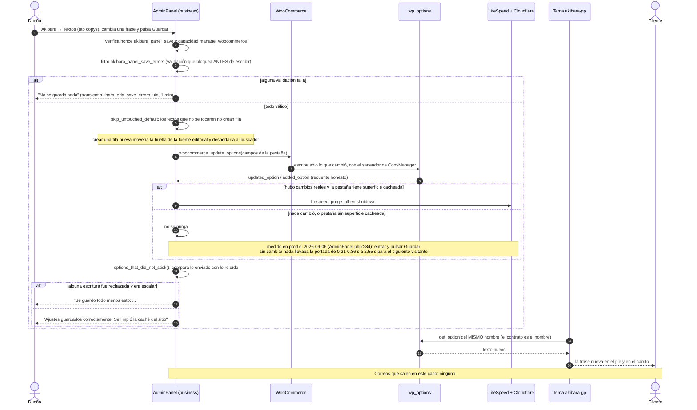
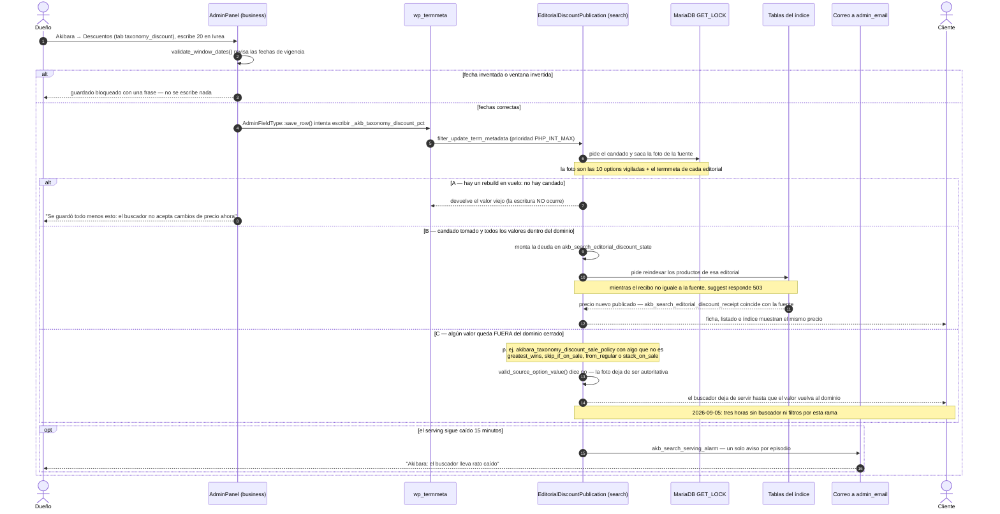
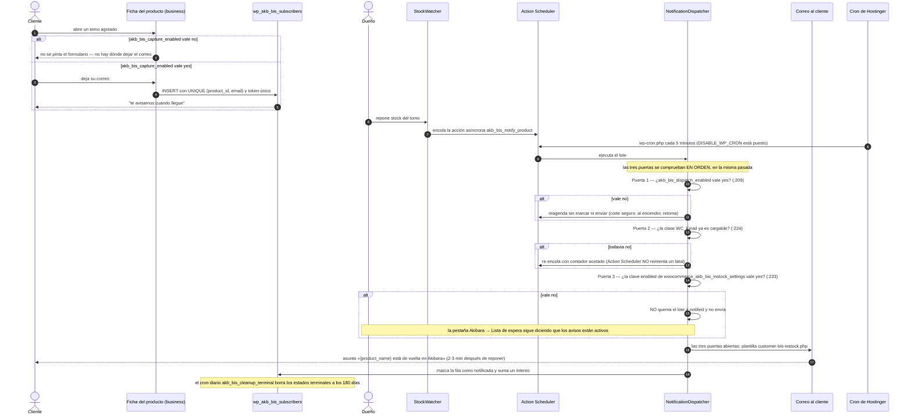
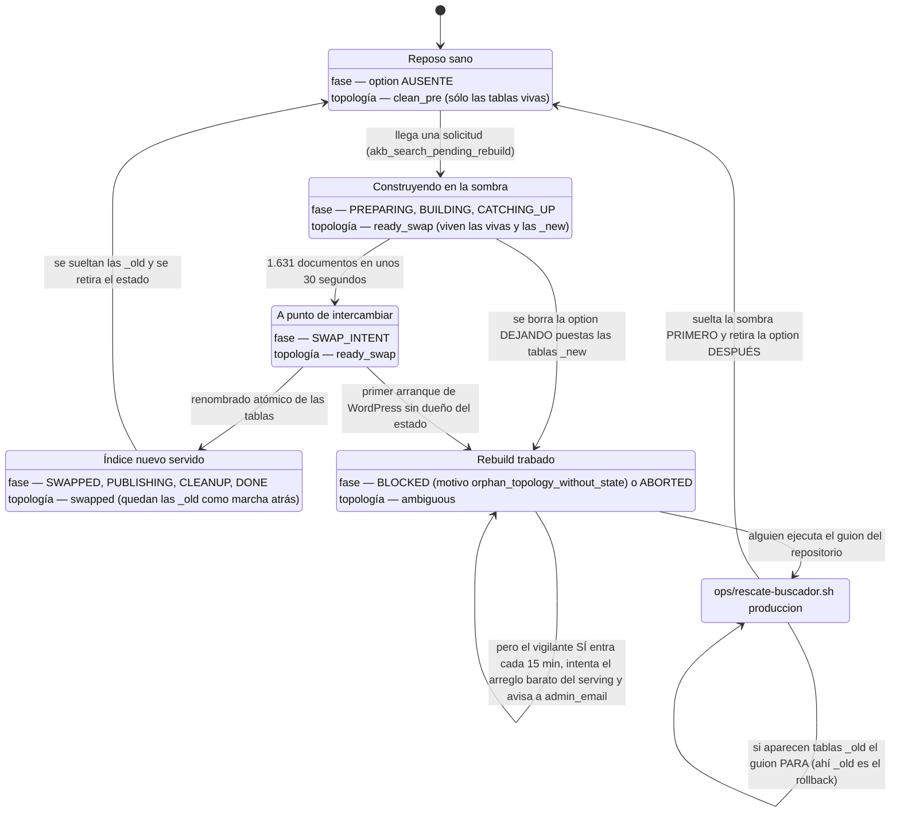
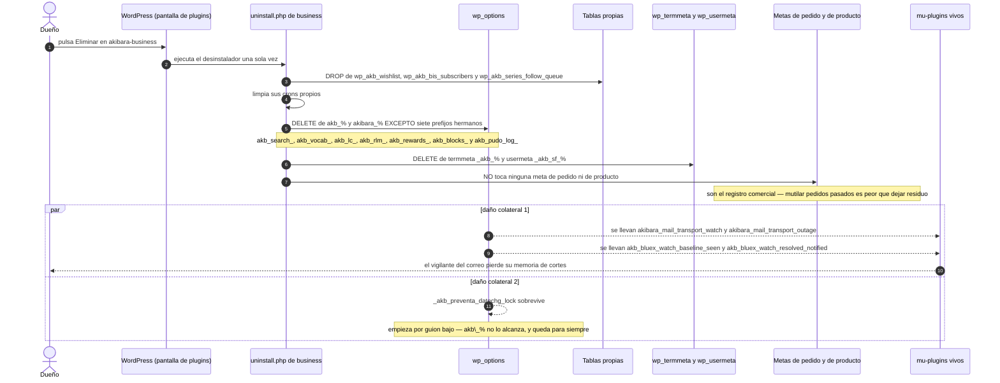

# Transversal · catálogo de datos: options, tablas, metas y transients, y quién las opera

> Fuente de verdad de este capítulo: el *snapshot* congelado de lo publicado en producción
> — `akibara-business` 1.116.4, `akibara-search` 0.1.60,
> `akibara-cart-checkout-blocks` 2.2.17, `akibara-rewards` 0.3.13, tema `akibara-gp`
> 2.1.118 y los 18 mu-plugins. Cada afirmación técnica lleva su fichero y su línea.
>
> **Cómo se comprobó, y hasta dónde llega la comprobación.** Todo lo que sigue se leyó en
> ese *snapshot*; **no se ejecutó nada** ni en el espejo local ni en producción. Por eso
> las pocas cifras *medidas* que aparecen van con la fuente pegada: los 2,55 segundos de
> la portada son una medición del 2026-09-06 anotada en el propio código
> (`AdminPanel.php:284`), y los «1.631 documentos en unos 30 segundos» vienen de una sonda
> de producción registrada en el `CLAUDE.md` del repositorio, no del código. Cuando un
> número no tiene fuente citada, es una cuenta hecha sobre el *snapshot* y se dice cómo se
> hizo.
>
> **Excepción declarada (2026-09-20, ronda 10): CU-6.** Ese caso de uso está releído contra
> el código **vivo** del árbol, `akibara-rewards` **0.4.17**, y lo dice en su propio recuadro. Se
> sacó del *snapshot* porque describía como vigente un defecto ya cerrado y lo hacía con
> dos nombres —un método y una acción— que **no existen en ninguna versión publicada**,
> tampoco en la 0.3.13 que este capítulo congela: ahí la cláusula de *snapshot* no
> protegía nada, sólo hacía imposible fiarse del caso. El resto del capítulo sigue anclado
> al *snapshot*; si se decide reanclar el capítulo entero, eso es decisión del dueño
> (capítulo 21), no de una ronda de QA.

---

## Para qué existe (en dos párrafos que entienda un novato)

Akibara es una tienda hecha con **WordPress** (el programa que arma y sirve las páginas)
y **WooCommerce** (el añadido que le da carrito, pedidos y pagos). Encima de esos dos hay
**código propio**: cuatro *plugins* —paquetes de código que se instalan y se activan—, un
*tema* (el que decide cómo se ve el sitio) y 18 *mu-plugins* (*must use*: código que
WordPress carga siempre y que nadie puede desactivar desde el panel). Todo ese código
tiene que **recordar cosas entre una visita y la siguiente**: a partir de qué monto el
envío es gratis, qué dice el cartel de la portada, quién dejó su correo esperando un tomo,
qué prometía la ficha el día que un cliente compró, cuántos puntos tiene cada persona,
cuándo se reconstruyó por última vez el índice del buscador.

WordPress ofrece **cuatro cajones** para guardar eso, y este capítulo es el inventario de
lo que Akibara puso en cada uno, más la respuesta a la pregunta que importa de verdad:
**quién lo opera**, es decir, en qué pantalla se cambia cada dato y qué pasa si nadie lo
toca. Los cuatro cajones son: **options** (una tabla de pares nombre → valor, donde vive
la configuración), **tablas propias** (cuando los datos son muchos y con forma de lista),
**metas** (un dato pegado a otra cosa: a un producto, a una serie, a un cliente, a un
pedido o a una línea de pedido) y **transients** (datos de usar y tirar, con fecha de
caducidad, que si se borran se vuelven a calcular). Sobre el cuarto conviene deshacer una
confusión desde ya: **los transients son un cajón por su uso, no por su sitio**. Se pueden
perder sin que pase nada, y eso es lo que los define; físicamente viven dentro de
`wp_options` como cualquier otra fila, salvo que el servidor tenga caché de objetos
persistente, en cuyo caso viven fuera de la base de datos. Este capítulo no explica cómo
funciona cada módulo —para eso están los capítulos de su área— sino **dónde deja lo que
recuerda y quién puede cambiarlo sin tocar código**.

---

## Cómo encaja con el resto (con quién habla: plugins, tema, terceros; qué pasa si se apaga)

*Piezas del catálogo de datos* — fuente: [`diagramas/17-catalogo-de-datos-piezas.mmd`](diagramas/17-catalogo-de-datos-piezas.mmd)

```mermaid
%% Piezas del capítulo 17 — catálogo de datos: options, tablas, metas y transients, y quién las opera.
%% Qué muestra: los cuatro cajones donde la tienda recuerda cosas, qué pieza escribe en cada uno, las tres fronteras que cruzan datos entre plugins, y las dos excepciones a la tesis del capítulo: las options sin pantalla y la tabla de terceros que poda un mu-plugin.
flowchart TB
    classDef propio fill:#fff3e0,stroke:#e07b39,stroke-width:1.5px,color:#4a2c10
    classDef tercero fill:#eef2f7,stroke:#7a90a8,stroke-width:1.5px,color:#22303f
    classDef persona fill:#e8f5e9,stroke:#4c8c4a,stroke-width:1.5px,color:#1b3a1c
    classDef dato fill:#f3e8fd,stroke:#8b5cf6,stroke-width:1.5px,color:#3a1d5c
    classDef alerta fill:#fdecea,stroke:#c0392b,stroke-width:1.5px,color:#5c1a12

    DUENO["Dueño<br/>edita en pantallas, no en código"]:::persona
    CLIENTE["Cliente<br/>compra, busca y deja su correo"]:::persona

    subgraph PANTALLAS["Pantallas donde se opera el catálogo"]
        PANEL["AdminPanel · menú akibara-panel<br/>19 secciones: nonce, validación, guardado y purga"]:::propio
        BUSCA["SearchAdminSection · pantalla Buscador<br/>submenú de akibara-panel; 7 sub-pestañas"]:::propio
        PUNTOS["SettingsPage · Puntos y Reseñas<br/>40 campos en seis secciones"]:::propio
        CORREOS["WooCommerce → Ajustes → Correos<br/>el SEGUNDO interruptor de los 4 correos WC_Email"]:::tercero
        CLAVES["akibara-provider-access.php<br/>submenú Claves y accesos"]:::propio
    end

    subgraph ESCRITORES["Código propio que guarda datos"]
        BIZ["akibara-business 1.116.4<br/>61 módulos, ~170 options, 3 tablas, casi todas las metas"]:::propio
        SEARCH["akibara-search 0.1.60<br/>5 tablas + sombras y ~35 options de protocolo"]:::propio
        REW["akibara-rewards 0.3.13<br/>2 tablas de dinero y 40 options"]:::propio
        BLOCKS["akibara-cart-checkout-blocks 2.2.17<br/>una option propia, el RUT y las metas de Blue"]:::propio
        TEMA["Tema akibara-gp 2.1.118<br/>lee 3 textos, usa el logo y un transient propio"]:::propio
        MU["17 mu-plugins (4 guardan estado)<br/>vigilantes del correo y de Blue, retención de logs"]:::propio
    end

    subgraph CAJONES["Los cuatro cajones de WordPress"]
        OPT["wp_options<br/>configuración; la marca autoload decide si se lee siempre"]:::dato
        TABLAS["10 tablas propias + 6 sombras del buscador<br/>listas largas: favoritos, avisos, índice, puntos"]:::dato
        METAS["postmeta, termmeta, usermeta,<br/>ordermeta, orderitemmeta y commentmeta"]:::dato
        TRANS["transients y caché de objetos<br/>de usar y tirar, con caducidad"]:::dato
    end

    subgraph FRONTERAS["Fronteras que cruzan datos"]
        CERROJO["EditorialDiscountPublication<br/>vigila 10 options y 1 termmeta ajenos"]:::propio
        BORRADO["uninstall.php de los 3 plugins<br/>quién puede borrar qué del prefijo akb_"]:::propio
        PRIVACIDAD["3 exportadores y borradores de privacidad<br/>puntos, favoritos y lista de espera"]:::propio
    end

    SINUI["Options SIN pantalla<br/>akb_markdown_negotiation_enabled,<br/>akb_crossorigin_scripts_enabled<br/>y los 4 enabled de los correos"]:::alerta
    BLUELOG["wp_bluex_logs — tabla de TERCEROS<br/>única que el código propio poda sin haberla creado"]:::alerta

    WOO["WooCommerce<br/>woocommerce_update_options y las metas de pedido"]:::tercero
    WP["WordPress<br/>zona horaria, logo del tema, página del blog"]:::tercero
    BLUE["Blue Express<br/>agencyId, agencyName, agencyAddress, isPudoSelected"]:::tercero
    JOIN["Joinchat<br/>option joinchat: el teléfono que se pinta al cliente"]:::tercero
    RANK["Rank Math<br/>rank_math_focus_keyword y los ownership de la casa"]:::tercero

    DUENO --> PANEL
    DUENO --> BUSCA
    DUENO --> PUNTOS
    DUENO --> CORREOS
    DUENO --> CLAVES
    DUENO -->|"wp option update por SSH: la excepción a la regla de oro"| SINUI
    SINUI --> OPT
    CLIENTE -->|"elige punto de retiro, escribe su RUT"| BLOCKS
    CLIENTE -->|"busca en el catálogo"| SEARCH
    CLIENTE -->|"deja su correo: fila en wp_akb_bis_subscribers"| BIZ

    PANEL -->|"woocommerce_update_options"| BIZ
    BUSCA --> SEARCH
    PUNTOS --> REW
    CORREOS -->|"escribe 4 filas woocommerce_akb_*_settings"| OPT
    OPT -->|"business LEE esas 4 filas al despachar"| BIZ

    BIZ --> OPT
    BIZ --> TABLAS
    BIZ --> METAS
    BIZ --> TRANS
    SEARCH --> OPT
    SEARCH --> TABLAS
    REW --> OPT
    REW --> TABLAS
    REW --> METAS
    BLOCKS --> OPT
    BLOCKS --> METAS
    TEMA --> TRANS
    MU --> OPT
    MU --> METAS
    MU -->|"poda por lotes, no la crea"| BLUELOG

    TEMA -->|"lee por el NOMBRE de la option"| OPT
    BLOCKS -->|"lee 3 options que declara business"| OPT
    TEMA -->|"custom_logo"| WP
    BIZ -->|"lee como contrato"| JOIN
    BLOCKS -->|"cuatro metas sin prefijo"| BLUE
    MU -->|"escribe meta de tercero"| RANK
    BIZ --> WOO
    WOO --> METAS

    CERROJO -->|"pre_update_option a PHP_INT_MAX"| OPT
    CERROJO -->|"5 filtros y 3 acciones de termmeta"| METAS
    WP -->|"timezone_string, gmt_offset"| CERROJO
    BIZ -->|"6 options de descuento y el porcentaje por editorial"| CERROJO
    SEARCH --- CERROJO

    BORRADO --> OPT
    BORRADO --> TABLAS
    PRIVACIDAD --> TABLAS
```



El catálogo de datos no es un módulo que se pueda apagar: **es el suelo** sobre el que
corren todos los demás. Lo que sí se puede describir es cómo se cruzan las piezas, y ahí
hay tres fronteras que conviene tener claras antes de leer las tablas.

**Primera frontera: el prefijo `akb_` no es de nadie.** Los cuatro plugins lo comparten.
Por eso los desinstaladores se excluyen mutuamente por lista explícita: el de `business`
borra `akb_%` y `akibara_%` **excepto** siete prefijos hermanos
(`akibara-business/uninstall.php:84` declara la lista, el `DELETE` está en `:96-104`), y
el de `search` filtra **sólo** `akb_search_%`, `akb_vocab_%`, `akb_lc_%` y `akb_rlm_%`
(`akibara-search/uninstall.php:81`). Un `LIKE 'akb\_%'` en el buscador se llevaría los
favoritos y la lista de espera de `business`.

**Segunda frontera: el buscador vigila options que no son suyas.** `akibara-search`
publica precios con descuento dentro de su índice, y para no servir nunca un precio que
no corresponde monta un cerrojo sobre **diez** options, que son literalmente éstas
(`EditorialDiscountPublication.php:90-102`, reunidas en `options()`, `:199-213`):

| # | Option | De quién es |
| --- | --- | --- |
| 1 | `akibara_taxonomy_discount_enabled` | `akibara-business` |
| 2 | `akibara_taxonomy_discount_from` | `akibara-business` |
| 3 | `akibara_taxonomy_discount_to` | `akibara-business` |
| 4 | `akibara_taxonomy_discount_apply_to` | `akibara-business` |
| 5 | `akibara_taxonomy_discount_sale_policy` | `akibara-business` |
| 6 | `akb_discount_max_pct` | `akibara-business` |
| 7 | **`akibara_business_search_feed_contract_version`** — el llamado «contrato del feed» | `akibara-business` |
| 8 | `woocommerce_price_num_decimals` | WooCommerce |
| 9 | `timezone_string` | WordPress |
| 10 | `gmt_offset` | WordPress |

La séptima es la que nadie nombra y la primera que hace falta cuando el cerrojo rechaza
una escritura: se llama `akibara_business_search_feed_contract_version` (constante
`OPTION_FEED`, `:99`), y su único valor legal hoy es `'2'` (`REQUIRED_FEED_CONTRACT`,
`:37`). Si alguien escribe una de esas diez sin que el cerrojo pueda cerrarse, la
escritura **se rechaza en silencio** y quien la hizo ve «Ajustes guardados»
(`:779-786`).

**Tercera frontera: el código propio lee options de terceros como si fueran un contrato.**
No basta con inventariar lo que empieza por `akb_`. El teléfono que se le pinta al cliente
en el pie de los avisos de preventa sale de la option `joinchat`, del plugin Creame
Joinchat (`OrderPreventa/ContactFooter.php:129` y
`PickupCoordination/PickupCoordination.php:163`). El sello de «despachable» depende de
`woocommerce_correios_settings`, del plugin de Blue Express
(`OrderPreventa/ShippableStamp.php:118` y `Integrations/Bluex/OrderPreventaAdapter.php:172`).
La analítica se calla si falta `clarity_project_id`
(`FrontendCompatibility/FrontendCompatibility.php:130`). Y el logo de la marca —que sale
en todas las páginas y en la cabecera de los correos— vive en `theme_mods_akibara-gp`, la
fila de options del propio tema, leída con `get_theme_mod('custom_logo')`
(`themes/akibara-gp/template-parts/header/shell.php:30` y
`template-parts/footer/main.php:62`). **Desinstalar o renombrar un tercero apaga
superficies que el cliente ve**, y ninguna de esas claves lleva el prefijo de la casa.

**Qué pasa si se apaga cada pieza:**

| Si se apaga… | Qué se pierde | Qué sigue funcionando |
| --- | --- | --- |
| `akibara-business` (desactivar) | El panel Akibara entero, los textos vuelven a su literal de fábrica, no hay avisos de lista de espera | Las tablas y metas siguen ahí: desactivar no borra nada. La pantalla **Buscador** no desaparece: se recoloca como menú de primer nivel (ver §4) |
| `akibara-business` (Eliminar) | Las tres tablas propias y casi todas sus options; **también** cuatro options de mu-plugins vivos | Las metas de pedido y de producto, respetadas a propósito (`uninstall.php:16-18`) |
| `akibara-search` | El autocompletado y los filtros del catálogo; el cerrojo sobre las diez options desaparece con él | El catálogo de WooCommerce, sin facetas |
| `akibara-rewards` (Eliminar) | **Nada**: el desinstalador retorna sin hacer nada salvo que la constante `AKIBARA_REWARDS_ALLOW_WIPE` esté **definida y en `true`** en `wp-config.php` | Todo: el libro mayor es historia de dinero |
| `akibara-cart-checkout-blocks` | El carrito y el checkout de bloques, el campo RUT y el selector de punto de retiro | Nada se borra: **no tiene desinstalador** |
| El tema `akibara-gp` | El pie, el sello de cuotas y las migas de las landings | Las options que leía siguen intactas: el tema no crea ninguna |

---

## Piezas

### 1. `wp_options`: el cajón de la configuración, y la marca `autoload`

**Qué hace en una frase.** Guarda pares *nombre → valor* y decide, con una marca llamada
`autoload`, si WordPress los lee en **todas** las páginas o sólo cuando alguien los pide.

**Ficheros.** Es una tabla del propio WordPress. La usa todo el código propio.

**En qué momento actúa.** En cada petición: las filas con `autoload` encendido viajan
juntas en una sola consulta (`alloptions`); las apagadas cuestan un `SELECT` por nombre
cuando alguien las lee.

**Qué lee y escribe.** Akibara escribe **más de 200 options propias** (prefijos `akb_` y
`akibara_`). La parte operativa está en `Plugin::FRONT_READ_OPTIONS`
(`akibara-business/src/Plugin.php:790-799`): la lista explícita de options **no autoload**
que el plugin lee en **cada petición del visitante** —`akb_bis_db_version`,
`akb_sf_db_version`, `akb_bis_capture_enabled`, `akb_preventa_t7_enabled`,
`akb_brand_color_primary`, `akb_brand_color_surface`, `akb_crossorigin_scripts_enabled`,
más las de `BrandLandings::front_read_options()`— que se calientan todas juntas con
`wp_prime_option_caches()` antes de registrar los módulos (`:802-804`). El docblock
explica que **no** se convierten en autoload a propósito: tres son interruptores que el
dueño mueve desde el panel y tienen que surtir efecto en la petición siguiente, y ninguna
necesita viajar en `alloptions` de todas las páginas del admin.

**Dónde lo opera el dueño.** No directamente: se operan las pantallas que escriben aquí.

**Qué ve el cliente.** Nada de la tabla; todo de lo que ella guarda.

### 2. `akibara-business`: el plugin que guarda casi todo

**Qué hace en una frase.** Es el plugin grande —**61 módulos** en `src/Modules/`, contados
sobre el *snapshot*— y en él viven casi toda la configuración que el dueño toca y tres
tablas con datos de clientes.

**Ficheros.** `src/Plugin.php`, `src/Modules/AdminPanel/AdminPanel.php`,
`src/Modules/CopyManager/CopyManager.php`, el `Settings.php` de cada módulo,
`uninstall.php`.

**En qué momento actúa.** `admin_init` (prioridad 10) para guardar una pestaña;
`init` (prioridad 999) para `Plugin::maybe_upgrade()`; `pre_update_option` (10) para la
guarda que impide crear filas intactas. (Si «hook», «filtro», «acción» y «prioridad» no te
dicen nada todavía, están en el glosario del final: hacen falta para leer todas las
secciones «En qué momento actúa».)

**Qué lee y escribe.** ~170 options propias, las tablas `wp_akb_wishlist`,
`wp_akb_bis_subscribers` y `wp_akb_series_follow_queue`, y casi todas las metas del
sistema. Detalle por cajón en «Datos que deja».

**Dónde lo opera el dueño.** El menú se llama **`akibara-panel`** —no `akibara`: el slug
corto da 403 y parece un problema de permisos— y cada sección es una pestaña dentro de esa
misma página (`AdminPanel.php:183`). **La dirección de cualquier sección sigue siempre este
patrón:**

```
https://akibara.cl/wp-admin/admin.php?page=akibara-panel&tab=<id>
```

Son **19 secciones**, 16 registradas en `Plugin::register_admin_panel()`
(`Plugin.php:1280-1401`) y tres que registra cada módulo por su cuenta. Éstos son los
`id` que van en `&tab=`:

| Sección (lo que se lee en el menú) | `id` para `&tab=` | Para qué sirve |
| --- | --- | --- |
| Dashboard | `dashboard` | Estado general, bitácora de contacto, métricas |
| Slider de Inicio | `home_hero` | El carrusel grande de la portada |
| Series en la portada | `home_series` | Qué series se destacan en la home |
| Barra de anuncios | `announcement` | La cinta de aviso de la cabecera |
| Autocompletar dirección | `address` | Sugerencias de dirección con Google Places |
| Editoriales · Ediciones | `brand_editions` | Etiquetas y datos de las editoriales con dos ediciones (Panini, Ivrea) |
| Pedidos y preventa · Ajustes | `preventa` | Ventanas y plazos de los pedidos que esperan |
| **Por llegar** | `preventas` | La lista de trabajo del dueño: los pedidos que aún esperan mercancía, con su fecha prometida |
| Lista de espera | `back_in_stock` | Quién dejó su correo esperando un tomo agotado, y si los avisos están encendidos |
| **Sigue esta serie** | `series_follow` | El aviso «salió un tomo nuevo de tu serie»: a quién se le manda y cada cuánto |
| Envío gratis | `free_shipping_progress` | La barra «te faltan $X para el envío gratis» |
| Carrito | `native_cart` | Los textos y avisos del carrito y del checkout |
| Recomendaciones | `upsells_autofill` | Qué tomos se sugieren junto a otro |
| **Vitrina** | `catalog_order` | El orden en que se muestran los productos del catálogo |
| Descuentos | `taxonomy_discount` | El porcentaje por editorial o por serie (**bajo el cerrojo del buscador**) |
| **Arma tu Pack** | `series_bundles` | El armador de packs por serie: qué tomos entran y con qué descuento |
| Branding y UX | `branding` | Colores de marca (`ThemeCustomizer.php:57-59`) |
| Salud SEO | `salud_seo` | Los ficheros `llms.txt` y la identidad para buscadores de IA (`LlmsManifest.php:72`, `:230-233`) |
| Textos | `copys` | Los textos editables del sitio (`CopyManager.php:147-149`) |

Y hay **dos submenús más que no son secciones del panel** —no tienen `&tab=`, son páginas
propias colgando del mismo menú—: **Buscador** (ver §4) y **Claves y accesos**, que
registra el mu-plugin `akibara-provider-access.php` en `admin_menu` con prioridad 99
(`:488`, `:496-503`) y vive en
`admin.php?page=akibara-provider-access`. Cuando este capítulo dice «19 secciones» y
después manda a «Akibara → Claves y accesos», no se contradice: son 19 secciones **más**
dos submenús.

**Qué ve el cliente.** Todo: textos de carrito y ficha, barra de envío gratis, barra de
anuncios, promesas de preventa, y los correos de lista de espera y de tomo nuevo.

### 3. `AdminPanel`: la pantalla que convierte options en decisiones

**Qué hace en una frase.** Es la respuesta a «dónde se edita esto» para casi todo el
inventario, y quien decide si tras guardar hay que limpiar la caché del sitio.

**Ficheros.** `src/Modules/AdminPanel/AdminPanel.php`.

**En qué momento actúa.** `admin_menu` (10) para el menú, `admin_init` (10) para
`handle_save()` (`:464`), y `updated_option` / `added_option` durante el guardado para
contar los cambios reales.

**Qué lee y escribe.** El flujo completo es: nonce `akibara_panel_save` → capacidad
`manage_woocommerce` (`PANEL_CAP`, `:22`) → filtro `akibara_panel_save_errors`, que
permite a cualquier módulo **bloquear antes de escribir nada** → `skip_untouched_default()`
(`:382`), que impide crear una fila cuya option no existe todavía y cuyo valor enviado es
exactamente el que se pintó por defecto → `woocommerce_update_options()` → recuento honesto
→ `options_that_did_not_stick()` (`:443`), que relee y compara → purga de LiteSpeed en
`shutdown`.

Dos detalles que costaron caro y hoy son reglas: la purga es **opt-out por lista corta**
(`SECTIONS_WITHOUT_CACHED_SURFACE`, `:57`) y sólo ocurre **si algo cambió de verdad**
—medido en producción el 2026-09-06 y anotado en el propio código (`:284`): entrar al
panel, mirar y pulsar Guardar sin cambiar nada llevaba la portada de 0,21-0,36 s a
**2,55 s**, y no para quien guardaba sino para el visitante que entrara justo después—; y
el aviso de escrituras rechazadas sólo cubre valores **escalares**, porque comparar arrays
arriesgaba falsos positivos (`:443-460`): los campos que guardan estructuras quedan fuera
de ese canal.

**Dónde lo opera el dueño.** Es *la* pantalla.

**Qué ve el cliente.** Nada directo; indirectamente, todo lo que cambia el dueño.

### 4. `akibara-search`: cinco tablas, tres sombras y options que son un protocolo

**Qué hace en una frase.** Guarda el índice del buscador en tablas propias y lleva en
options una máquina de estados que le permite reconstruirse **sin apagar la tienda**.

**Ficheros.** `src/Install.php`, `src/RebuildJob.php`, `src/Reconciler.php`,
`src/SearchAdminSection.php`, `src/Synonyms.php`, `src/Stopwords.php`,
`src/QueryLogger.php`, `src/AuditLog.php`, `src/GapDismissals.php`,
`src/Support/OptionCodec.php`, `uninstall.php`.

**En qué momento actúa.** El bombeo de la cola es asíncrono por cambio de producto; el
vigilante es una acción recurrente cada 900 segundos (`RebuildJob::WATCHDOG_INTERVAL`,
`RebuildJob.php:78`); el reconciliador es diario.

**Qué lee y escribe.** Cinco tablas: `wp_akb_search_docs`, `_tokens`, `_facet_index`,
`_qlog` y `_work` (`Install.php:2082`, `:2118`, `:2135`, `:2156`, `:2170`). Las tres
primeras existen **por triplicado** durante una reconstrucción: `…_new` se construye,
la viva sigue sirviendo, y `…_old` queda como marcha atrás; por eso 1.631 documentos en
unos 30 segundos no apagan el buscador. `qlog` y `work` **no** participan del intercambio.

El esquema se da por bueno sólo si **coinciden las dos** marcas, `akb_search_db_version`
(1.9.0) y `akb_search_schema_seal` (1.7.0-exact-1): `Install.php:1029-1030` las compara
con un `&&`.

**Las dos coordenadas de un atasco: fase y topología.** Para diagnosticar el buscador hay
que mirar dos cosas distintas y no confundirlas.

- La **fase** es lo que dice la option `akb_search_rebuild_state`. Sus diez valores
  posibles, y los únicos que se van a encontrar ahí, son `PREPARING`, `BUILDING`,
  `CATCHING_UP`, `SWAP_INTENT`, `SWAPPED`, `PUBLISHING`, `CLEANUP`, `DONE`, `BLOCKED` y
  `ABORTED` (`RebuildJob.php:87-96`).
- La **topología** es qué tablas existen en la base en ese momento. El plugin la clasifica
  con cuatro nombres cerrados: `clean_pre` (sólo las vivas), `ready_swap` (las vivas más
  las `_new`), `swapped` (quedan las `_old`) y `ambiguous` (`Install.php:103-106`).

`ready_swap` **no** es una fase: nunca va a aparecer dentro de la option. Buscarla ahí es
la forma más rápida de perder media hora.

**El qlog sí tiene poda, y doble.** Dentro del reconciliador diario: `DELETE FROM {qlog}
WHERE day < …` con `QLOG_RETENTION_DAYS = 180` (`Reconciler.php:63`, `:353-361`) y, si
todavía quedan más de `QLOG_MAX_ROWS = 50000` filas, recorta las más antiguas
(`:66`, `:371-381`). Si cualquiera de las dos falla, la corrida entera se declara fallida
(`qlog_retention_failed`, `qlog_cap_failed`).

**Dónde lo opera el dueño.** La pantalla **Buscador**, que registra la clase
`SearchAdminSection` y tiene siete sub-pestañas: Índice, Búsquedas, Facetas, Precios,
Sinónimos, Palabras ignoradas y Ajustes. **Dónde vive esa pantalla depende de si
`akibara-business` está activo**, y eso importa justo el día malo:

- con `business` activo, es un **submenú** de `akibara-panel`
  (`SearchAdminSection.php:126-133`), en `admin.php?page=akibara-search`;
- con `business` **caído o desactivado**, el mismo slug se registra como **menú de primer
  nivel** con icono de lupa (`:137-145`). La pantalla sigue existiendo; lo que cambia es
  dónde aparece.

Dos de esas sub-pestañas guardan options que este capítulo debe nombrar, porque son
exactamente las que uno busca al depurar el buscador: **Sinónimos** escribe
`akb_search_synonyms` (`Synonyms.php:26`) y **Palabras ignoradas** escribe
`akb_search_stopwords` (`Stopwords.php:26`). **Ninguna de las dos dispara una
reconstrucción**, y conviene decirlo con todas las letras porque es fácil suponer lo
contrario: la propia pantalla lo promete —«Al buscar cualquiera del grupo, el buscador
matchea todos — sin reindexar» y «Aplica de inmediato, sin reconstruir el índice»— y el
guardado se limita a persistir la option y vaciar la memoria del proceso
(`SearchAdminSection.php:1839-1867` y `:1895-1919`). La reconstrucción de ~6 minutos con
`suggest` en 503 la disparan los **términos del catálogo** —editoriales y series, por la
vía del termmeta vigilado de §5—, no estas dos listas.

El anillo de auditoría guarda 50 entradas (`AuditLog.php:27`) y los descartes del radar de
demanda, 200 (`GapDismissals.php:36`).

**La alarma del buscador, y cómo se rearma.** Cuando el servicio queda caído sin
reconstrucción viva, el vigilante manda un correo a `admin_email`. Todo lo operable de esa
alarma vive en tres constantes de `RebuildJob.php`:

- la option que recuerda el episodio es **`akb_search_serving_alarm`** (`:740`), con la
  forma `{down_since, notified_at}`;
- el umbral es **`ALARM_AFTER_SECONDS = 900`** (`:737`), quince minutos caído: un rebuild
  rutinario no lo dispara;
- el asunto del correo es **«Akibara: el buscador lleva rato caído»** (`:773`), y el propio
  cuerpo trae los dos comandos de comprobación: `wp akb-search status` y
  `wp akb-search rebuild` (`:777-779`).

Sale **un solo correo por episodio**: mientras `notified_at` no vuelva a cero, no hay
segundo aviso. Para rearmar la alarma después de resolver un episodio hay que retirar esa
option (`wp option delete akb_search_serving_alarm`); sin su nombre, no hay forma de
hacerlo desde ninguna pantalla.

**Qué ve el cliente.** El desplegable de autocompletado, los resultados y los filtros.
Cuando el gate cierra, ve un 503 en `suggest` y el catálogo sin filtros.

### 5. `EditorialDiscountPublication`: el cerrojo sobre datos ajenos

**Qué hace en una frase.** Impide que se escriba un precio —o cualquiera de las diez
options que lo determinan— mientras el buscador no pueda garantizar que va a publicar
exactamente ese precio.

**Ficheros.** `akibara-search/src/EditorialDiscountPublication.php`.

**Tres palabras que hay que tener antes de seguir.** El resto de esta sección y el CU-2 no
se entienden sin ellas:

- **Fuente**: el conjunto exacto de datos de los que depende el precio. Son **las diez
  options vigiladas de la tabla de arriba más el termmeta `_akb_taxonomy_discount_pct` de
  cada editorial o serie**, y nada más. Cuando el capítulo dice «saca una foto estable de
  la fuente», se refiere a leer esos once sitios de golpe y dejar el resultado congelado.
- **Deuda**: una anotación que dice «el índice todavía no publica el precio nuevo». Vive en
  `akb_search_editorial_discount_state`.
- **Recibo**: la huella de lo último que el índice **sí** publicó. Vive en
  `akb_search_editorial_discount_receipt`. El buscador sirve sólo cuando recibo y fuente
  coinciden; mientras no coinciden, hay deuda y `suggest` responde 503. A ese momento en
  que el recibo alcanza a la fuente se le llama **materializar**.
- **Autoritativa**: se dice de la foto de la fuente cuando el buscador se fía de ella para
  publicar precios. Si deja de serlo, no publica nada.

**En qué momento actúa.** `pre_update_option` con prioridad `PHP_INT_MAX` (`:232`),
`add_option` / `delete_option` con prioridad 1, y **ocho hooks de termmeta**, todos
también a `PHP_INT_MAX` (`:239-246`): cinco **filtros**, que pueden vetar la escritura
—`update_term_metadata`, `add_term_metadata`, `delete_term_metadata`,
`update_term_metadata_by_mid`, `delete_term_metadata_by_mid`— y tres **acciones**, que sólo
se enteran después —`updated_term_meta`, `added_term_meta`, `deleted_term_meta`—. Los
filtros son el cerrojo; las acciones son la contabilidad.

**Qué lee y escribe.** Vigila las diez options de `options()` (`:199-213`) y el termmeta
`_akb_taxonomy_discount_pct` (`META_KEY`, `:32`). Escribe la deuda en
`akb_search_editorial_discount_state` y su recibo en `…_receipt` (`:29-30`). Hay una
tercera constante declarada, `OPTION_HISTORY = 'akb_search_editorial_discount_history'`
(`:31`), que **ningún punto del plugin lee ni escribe**: código muerto.

**El dominio cerrado.** Cada una de las diez options tiene una lista finita de valores
legales, y `valid_source_option_value()` (`:3296-3345`) es quien la comprueba. Un valor
fuera de esa lista no es un error de tecleo cualquiera: deja la foto de la fuente sin
autoridad, y el buscador deja de publicar. Los dominios son:

| Option | Valores legales |
| --- | --- |
| `akibara_taxonomy_discount_enabled` | `yes`, `no` |
| `akibara_taxonomy_discount_from` / `_to` | vacío, o una fecha `AAAA-MM-DD` |
| `akibara_taxonomy_discount_apply_to` | `instock_only`, `instock_and_onbackorder`, `all` |
| `akibara_taxonomy_discount_sale_policy` | `greatest_wins`, `skip_if_on_sale`, `from_regular`, `stack_on_sale` |
| `akibara_business_search_feed_contract_version` | exactamente `2` |
| `akb_discount_max_pct` | un entero dentro de rango |
| `woocommerce_price_num_decimals`, `timezone_string`, `gmt_offset` | los que valida WordPress/WooCommerce |

**Dónde lo opera el dueño.** No se opera: es un mecanismo. Lo que sí se ve es su efecto en
el panel, con el aviso «Se guardó todo menos esto».

**Qué ve el cliente.** Que el precio de la ficha, el del listado y el del índice dicen lo
mismo, siempre. Y, cuando el gate cierra, un buscador que no responde.

### 6. `akibara-rewards`: dinero, y por eso el catálogo más estricto

**Qué hace en una frase.** Guarda los puntos: un libro mayor con una fila por movimiento,
el saldo repetido en una meta de usuario para poder listarlo rápido, y **40 options** en
una sola pantalla.

**Ficheros.** `src/Support/Schema.php`, `src/Support/SettingsPage.php`,
`src/Support/Log.php`, `src/Points/Ledger.php`, `src/Points/Expiry.php`,
`src/Points/Birthday.php`, `src/Points/Emails.php`, `uninstall.php`.

**En qué momento actúa.** `admin_post_akb_rewards_save_settings` para guardar;
`woocommerce_order_status_changed` (10) para acreditar; dos acciones diarias de Action
Scheduler para vencer y para los cumpleaños.

**Qué lee y escribe.** Dos tablas: `wp_akb_rewards_ledger` y
`wp_akb_rewards_review_forms` (`Schema.php:169` y `:194`). **Matiz importante y contrario
a lo que suele decirse:** el `UNIQUE KEY event_key` (`Schema.php:181`) no es toda la
idempotencia del programa, porque la columna es `event_key VARCHAR(191) DEFAULT NULL`
(`:177`) y en MySQL/MariaDB un índice único admite tantos `NULL` como quiera. `credit()` y
`debit()` reciben `?string $event_key = null` y sólo consultan `event_exists()` cuando
**no** es nulo (`Ledger.php:81`, `:103`, `:141`, `:149`); el docblock de `apply_locked()`
lo dice con todas las letras: «null = movimiento repetible» (`:328-331`). La idempotencia
de tabla cubre **sólo** los movimientos que pasan clave; la otra capa es el candado de
MariaDB por usuario más la relectura de la meta.

**Los dos trabajos diarios, con su hook y su trampa.** Aquí van los nombres que hacen falta
para buscarlos o relanzarlos en la cola:

| Trabajo | Hook real | Grupo de Action Scheduler |
| --- | --- | --- |
| Vencimiento de puntos | `akb_rewards_expiry_daily` (`Points/Expiry.php:33`) | **ninguno** (`:93`) |
| Cumpleaños | `akb_rewards_birthday_daily` (`Points/Birthday.php:32`) | **ninguno** (`:72`) |

Ese «ninguno» es el dato que más duele el día que hay que cancelarlos: los dos se agendan
con `as_schedule_recurring_action( …, …, self::HOOK )` **sin pasar grupo**, a diferencia de
los trabajos del buscador, que usan `Indexer::AS_GROUP` (`'akibara-search'`,
`Indexer.php:50`). Cancelar «por grupo» no los encuentra; hay que cancelarlos por hook.

**Dónde se ven los errores de dinero.** En **WooCommerce → Estado → Registros**, el mismo
sitio que los fallos de punto de retiro, con el desplegable de fuente puesto en
**`akibara-rewards`** (`Support/Log.php:30` y `:39-48`). Si el logger de WooCommerce no
está disponible, el evento cae al `error_log` del servidor antes que quedarse mudo.

**Dónde lo opera el dueño.** **WooCommerce → Puntos y Reseñas**: **40 campos** repartidos
en **seis secciones** —Puntos por compra (15), Reseñas (12), Carrusel del home (6),
Referidos (4), Cumpleaños (2) y Ficha de producto (1)—, con `SettingsPage::FIELDS`
(`:39-328`) como única fuente de la pantalla, del saneador y de `option_names()` (`:337`,
que devuelve literalmente `array_keys( self::FIELDS )`).

**Qué ve el cliente.** Saldo y movimientos en Mi cuenta, el aviso de puntos en la ficha,
el canje en el carrito, y los correos de puntos, vencimiento, cumpleaños e invitación a
reseñar.

### 7. `akibara-cart-checkout-blocks`: casi sin datos propios, pero dueño del RUT

**Qué hace en una frase.** Hace el carrito y el checkout con bloques; lee la configuración
que declara `business` y escribe muy poco propio.

**Ficheros.** `src/Assets.php`, `src/RuntimeCompatibility.php`, `src/PudoLog.php`,
`src/CheckoutFields.php`, `src/PudoIntegration.php`.

**En qué momento actúa.** `wp_enqueue_scripts` para leer las **tres** options de
`business`; `wp_print_scripts` en el carrito para la observación de Mercado Pago; los
hooks del servicio oficial de campos adicionales para el RUT.

**Las tres options que este plugin lee y `business` declara**, con nombre y línea, porque
el capítulo las menciona en tres sitios y tienen que decir lo mismo en los tres:
`akibara_blocks_shipping_hint_text` (`Assets.php:33`),
`akibara_blocks_collection_notice_text` (`:60`) y **`akb_sf_enabled`** (`:86`), la que dice
si el aviso «Sigue esta serie» está encendido.

**Qué lee y escribe.** Una sola option propia que sobrevive a todo:
`akb_blocks_mp_dequeue_observed`, sin `autoload` y escrita **sólo cuando el número
cambia** (`RuntimeCompatibility.php:199-212`). Qué guarda, para poder interpretarla al
verla en el Dashboard: un par **`{retirados, at}`** (`:205`), donde `retirados` es
**cuántos scripts de Mercado Pago estaban realmente encolados y se retiraron** y `at` es
el momento en que se observó ese número. Si el número no cambia, no se reescribe la fila.

Y —esto el mapa lo atribuía a `business`— **el RUT del cliente lo escribe este plugin, y
vive en tres sitios**:

1. el campo adicional nativo de WooCommerce `akibara/rut` (`CheckoutFields.php:26`,
   registrado en `:268-284` con su `sanitize_callback` y su `validate_callback`), que Woo
   persiste con su propia convención bajo el `meta_key` **`_wc_other/akibara/rut`** —ése es
   el nombre exacto que hay que consultar en `wp_wc_orders_meta` para una petición de
   privacidad o una migración, y está escrito en `RutValidation/RutValidation.php:29`—;
2. la ordermeta legada `_billing_rut`;
3. la customer meta legada `billing_rut` (las dos se sincronizan en `:401-418`, con la
   lectura inversa en `:372-386`).

**Dónde lo opera el dueño.** Ninguna pantalla propia: los textos se editan en
**Akibara → Carrito** (`&tab=native_cart`) y el estado se ve en **Akibara → Dashboard**.
Sus fallos de punto de retiro aparecen en **WooCommerce → Estado → Registros**, como mucho
una línea por minuto y contexto (`PudoLog.php:38`, `THROTTLE_SECONDS = 60`, y `:87-92`).

**Qué ve el cliente.** El carrito, el checkout, el campo RUT, el selector de comuna y el
de punto de retiro.

### 8. Tema `akibara-gp`: lee options ajenas y usa dos del propio WordPress

**Qué hace en una frase.** Pinta el sitio y necesita tres textos que el dueño edita en el
panel del plugin, más el logo y la página del blog, que son de WordPress.

**Ficheros.** `inc/site-copy.php`, `inc/series-breadcrumb.php`,
`template-parts/header/shell.php`, `template-parts/footer/main.php`, `single.php`.

**En qué momento actúa.** Al pintar cada página; y en `save_post` / `delete_post` para
olvidar su transient.

**Qué lee y escribe.** Lee `akb_copy_promise_installments`,
`akb_copy_footer_support_hours` y `akb_copy_footer_phone` **por el nombre de la option** y
no llamando a una clase del plugin, a propósito: un tema no puede quedarse sin pie porque
un plugin esté desactivado. El vacío en las dos del pie **se guarda** y apaga la línea: es
una decisión, no un error. Además —y esto faltaba en el mapa— **sí depende de estado
persistente del propio WordPress**: el logo sale de `theme_mods_akibara-gp` vía
`get_theme_mod('custom_logo')` (`shell.php:30`, `footer/main.php:62`) y el enlace al blog
de la option `page_for_posts` (`single.php:24`).

Escribe una sola cosa, y conviene saber dónde: el transient `akb_gp_series_hub_url`, que
se escribe en **`inc/series-breadcrumb.php:90-94`** y vive 12 horas si encuentra la página
del directorio de series y **sólo 1 hora si no encuentra nada**, para que un falso negativo
no se quede medio día en 106 landings. Se olvida en `save_post` y `delete_post`, pero
**sólo si el post guardado es de tipo `page`** (`:107-112`): guardar un producto o una
entrada no lo invalida, y eso está bien —el directorio siempre es una página—, pero
explica por qué un cambio en otro tipo de contenido no se refleja hasta que caduque.

**Dónde lo opera el dueño.** Los tres textos, en **Akibara → Textos** (`&tab=copys`). El
logo, en el personalizador de WordPress.

**Qué ve el cliente.** El pie de todas las páginas, el sello de cuotas y el logo.

### 9. Los correos propios: quién tiene dos interruptores y quién sólo uno

**Qué hace en una frase.** **Los cuatro correos que son `WC_Email`** tienen **dos**
interruptores, y el segundo no está en el panel de Akibara; los correos de puntos tienen
**uno solo**.

**Por qué la distinción no es un tecnicismo.** Cuatro de los correos de la casa heredan de
`WC_Email`, la clase de WooCommerce, y por eso WooCommerce les crea una fila de ajustes y
una sección en su propia pantalla. Los seis correos del programa de puntos **no** son
`WC_Email` —el código lo dice en su docblock: «Estos correos no son `WC_Email`, así que no
heredan el `handle_multipart()`» (`akibara-rewards/src/Points/Emails.php:125`)— y se
envían con `send_branded()` (`:142-162`). No tienen fila `woocommerce_*_settings` ni
aparecen en **WooCommerce → Ajustes → Correos**: se encienden y se apagan **sólo** desde
**WooCommerce → Puntos y Reseñas**, con los campos de `SettingsPage::FIELDS`.

**Ficheros.** `src/Services/AkibaraEmail.php`, más los cuatro correos de WooCommerce:
`Modules/BackInStock/InstockEmail.php`, `Modules/SeriesFollow/SeriesFollowEmail.php`,
`Modules/OrderPreventa/ReminderEmail.php`, `Modules/OrderPreventa/ReadyToShipEmail.php`.

**En qué momento actúa.** Al despachar el correo: `NotificationDispatcher` cierra dos
veces, primero por la option del panel y después por la del correo
(`BackInStock/NotificationDispatcher.php:209` y `:233`).

**Qué lee y escribe.** WooCommerce guarda los ajustes de cada correo en una fila de
`wp_options` llamada `woocommerce_<id>_settings`, con un array
`{enabled, subject, heading, additional_content, email_type}`
(`AkibaraEmail.php:123-205`; el campo `enabled` viene con default `'yes'` en `:128-133`).
El de series añade un quinto campo, `subject_tanda`, para cuando una serie trae dos tomos
o más (`SeriesFollowEmail.php:134`). Es decir: **cuatro filas de options que empiezan por
`woocommerce_`**, así que ningún desinstalador de la casa las barre.

**Dónde lo opera el dueño, con la dirección exacta.** La pantalla es **WooCommerce →
Ajustes → Correos**, pero esa pantalla tiene **una sección por correo**, y el identificador
de la sección **es el `EMAIL_ID`**. El patrón es:

```
https://akibara.cl/wp-admin/admin.php?page=wc-settings&tab=email&section=<EMAIL_ID>
```

| Correo | `EMAIL_ID` (= `&section=`) | Dónde está declarado |
| --- | --- | --- |
| «Ya llegó» de la lista de espera | `akb_bis_instock` | `InstockEmail.php:36` |
| «Salió un tomo de tu serie» | `akb_sf_series` | `SeriesFollowEmail.php:42` |
| Recordatorio de preventa | `akb_preventa_reminder` | `ReminderEmail.php:70` |
| «Tu pedido ya llegó a Akibara» | `akb_preventa_ready` | `ReadyToShipEmail.php:57` |

Esa distancia entre las dos pantallas tiene consecuencia: la pestaña «Lista de espera»
puede decir que los avisos están encendidos mientras el correo está apagado en la otra
pantalla, y nadie lo avisa.

**Qué ve el cliente.** Los asuntos por defecto son «{product_name} está de vuelta en
Akibara» (`InstockEmail.php:58`), «Salió el tomo {tomo} de {serie}{y_mas}» —o «Salieron
{n_tomos} tomos de {serie}{y_mas}» en tanda— (`SeriesFollowEmail.php:76` y `:102`), «Tu
pedido {order_number} se acerca» y sus variantes de cambio y anuncio de fecha
(`ReminderEmail.php:163-205`), y «Tu pedido {order_number} ya llegó a Akibara»
(`ReadyToShipEmail.php:82`).

### 10. Las metas de pedido y de línea: el registro comercial

**Qué hace en una frase.** Congelan **lo que la tienda prometía el día de la compra**, por
pedido y por línea.

**Ficheros.** `Modules/OrderPreventa/MetaKeys.php` y los módulos que las escriben.

**En qué momento actúa.** En el checkout, y después en cada transición de estado del
pedido.

**Qué lee y escribe.** La familia `_akb_eta_*` del pedido (si espera algo, cuándo queda
listo, cuánto lleva esperando, y los sellos de idempotencia de cada correo: enviado,
cuándo y cuántos intentos), la familia `_akb_eta_*_at_purchase` de la línea (tipo, mínimo,
máximo, país y si era «fecha por confirmar» el día de comprar), las de packs
`_akb_byp_*`, el consentimiento de marketing, el RUT, y las **cuatro sin prefijo** que
exige Blue Express: `agencyId`, `agencyName`, `agencyAddress`, `isPudoSelected` — ese
nombre es el contrato con el transportista, no una elección de la casa.

**Dónde lo opera el dueño.** No se editan a mano: se producen solas. Se ven en la ficha
del pedido y en la pestaña **Por llegar** del panel (`&tab=preventas`), que es la lista de
los pedidos que todavía esperan mercancía.

**Qué ve el cliente.** La fecha que se le prometió, y los correos que la comparan con el
hecho. Por eso el desinstalador de `business` las deja intactas a propósito
(`uninstall.php:16-18`).

### 11. Transients y caché de objetos: lo que se puede perder sin consecuencias

**Qué hace en una frase.** Guardan resultados ya calculados con fecha de caducidad; si se
borran, se recalculan.

**Ficheros.** Repartidos por módulo.

**En qué momento actúa.** Al pintar una superficie cara (la parrilla de editoriales, el
directorio de series, el carrusel de reseñas) o al dejar un aviso de pantalla.

**Qué lee y escribe.** Ver la tabla de «Datos que deja». Dos precisiones que el mapa tenía
al revés: **con caché de objetos persistente los transients no tocan `wp_options` en
absoluto**; y sin ella, cada uno lleva su fila `_transient_timeout_`, que el trabajo
`delete_expired_transients` del propio WordPress retira. Los `akb_pudo_log_<md5>` del
checkout viven 60 segundos sobre un conjunto cerrado de claves (el contexto es del propio
módulo), así que no se acumulan.

**Dónde lo opera el dueño.** No se operan uno a uno, y conviene ser exacto con lo que sí
existe: hay cuatro **contadores de generación** —`akb_home_destacados_generation`
(`HomeDestacados.php:66`), `akb_series_facts_generation` (`SeriesFacts.php:175`),
`akb_brands_grid_gen` (`BrandsDirectory/Shortcode.php:54`) y `akb_sb_vols_cache_ver`
(`SeriesBundles/BuilderWidget.php:116`)— y subir el número invalida de golpe todas las
claves que dependen de él. Pero **los sube el propio código** cuando cambia lo que cachean:
los cuatro son constantes `private`, y **no hay ninguna pantalla** desde la que el dueño
pueda tocarlos. A mano sólo se pueden mover por consola, con `wp option update`.

**Qué ve el cliente.** Páginas rápidas. Si se vacían, las mismas páginas un poco más
lentas la primera vez.

### 12. mu-plugins: vigilantes, retención y una meta de tercero

**Qué hace en una frase.** Código que WordPress carga siempre; aquí viven los vigilantes
del correo y de Blue Express, y las podas de tablas de terceros.

**Cuántos son y cuántos guardan datos.** En el *snapshot* había **18 ficheros**; uno de ellos,
el barrido de disponibilidad (`akibara-catalogo-abilities.php`), lo retiró el dueño el 2026-09-13 y
sus metas `_akb_sweep_*` se borraron de producción ese mismo día. De los **17** que quedan, **cuatro
guardan estado**: `akibara-bluex-integrity-watch.php`, `akibara-mail-transport-watch.php`,
`akibara-correo-smtp.php` y `akibara-rankmath-redirections-abilities.php`. **Los
otros trece no dejan nada** en ningún cajón —filtran, redirigen, ajustan cabeceras o
acotan a terceros— así que para este capítulo no hay que auditarlos. Además aparecen aquí
otros tres que **no** guardan datos pero sí actúan sobre ellos:
`akibara-bluex-log-retention.php` (poda una tabla de terceros),
`akibara-as-retention.php` (acorta la retención de Action Scheduler con un filtro) y
`akibara-provider-access.php` (sólo pinta la pantalla de claves).

**En qué momento actúa.** `action_scheduler_init` (prioridad 20) para agendar la poda de
logs (`akibara-bluex-log-retention.php:124`); `admin_menu` (99) para la pantalla de
claves; el hook semanal para el vigilante de Blue.

**Qué lee y escribe.** Options `akibara_mail_transport_watch`,
`akibara_mail_transport_outage`, `akb_bluex_watch_baseline_seen` y
`akb_bluex_watch_resolved_notified`. **Y una meta de tercero que el mapa no listaba:**
`akibara-rankmath-redirections-abilities.php` lee el valor previo (`:242`) y escribe
`rank_math_focus_keyword` con `update_post_meta()` (`:257`) — es código propio escribiendo
en el espacio de datos de Rank Math.

Sobre la poda de logs, el nombre correcto importa: el hook de Action Scheduler es
**`akibara_bluex_log_retention_cleanup`** (`:13`), grupo `akibara-bluex`, cada
`DAY_IN_SECONDS`, con retención de 2 días y lotes de 1.000 (`:15`, `:112-119`).
`akibara_bluex_schedule_log_retention` es la **función** que agenda, no un hook
programado; el mismo callback escucha además el hook de terceros `bluex_clean_logs`
(`:122-124`).

Y sobre la retención de Action Scheduler, un matiz que cambia dónde buscarla:
`akibara-as-retention.php` **no agenda nada**. Es un filtro de tres líneas —
`add_filter( 'action_scheduler_retention_period', … )` que devuelve `14 * DAY_IN_SECONDS`
(`:13-16`)—; la poda la sigue haciendo Action Scheduler en su propia acción programada, a
su propia frecuencia. Buscar un cron llamado «retención» en la cola no encuentra nada.

**Dónde lo opera el dueño.** El submenú **Akibara → Claves y accesos**
(`admin.php?page=akibara-provider-access`), y los avisos en la cabecera del admin.

**Qué ve el cliente.** Nada. Su efecto es que los correos salgan.

### 13. La frontera de nombres y los desinstaladores

**Qué hace en una frase.** Es el acuerdo escrito de quién puede borrar qué cuando alguien
pulsa «Eliminar».

**Ficheros.** Los tres `uninstall.php` (`business`, `search`, `rewards`). El cuarto plugin
**no tiene**.

**En qué momento actúa.** Una sola vez, al eliminar el plugin desde WordPress.

**Qué lee y escribe.** Ya descrito arriba. Dos huecos medidos: el `DELETE` de `business`
usa patrones que empiezan por letra (`akb\_%`, `akibara\_%`, `uninstall.php:96-104`), así
que **no alcanza a `_akb_preventa_datechg_lock`** —una fila de `wp_options` escrita con
SQL directo, `INSERT IGNORE`, `autoload = 'no'` y TTL de 15 minutos, que serializa el
barrido de cambios de fecha de preventa (`OrderPreventa/ReleaseDateChangeListener.php:89-93`
para las constantes, `:287-319` para tomarlo y `:325-335` para soltarlo)—; y el mismo
`DELETE` **sí** alcanza las cuatro options de mu-plugins que siguen vivos.

**Dónde lo opera el dueño.** La pantalla de plugins de WordPress.

**Qué ve el cliente.** Nada, salvo que se elimine algo en producción.

### 14. Privacidad: tres exportadores, y lo que queda fuera

**Qué hace en una frase.** Registra en WordPress quién sabe entregar y borrar los datos
personales de un cliente cuando los pide.

**Ficheros.** `akibara-rewards/src/Support/Privacy.php:38-39`,
`akibara-business/src/Modules/BackInStock/PrivacyHandler.php:43-44`,
`akibara-business/src/Modules/Wishlist/PrivacyHandler.php:34-35`.

**En qué momento actúa.** En los filtros `wp_privacy_personal_data_exporters` y
`_erasers`.

**Qué lee y escribe.** Sólo esos tres: puntos, lista de espera y favoritos. **Fuera quedan
cuatro cosas**, y las cuatro son dato personal:

1. la **bitácora de contacto** (`ContactoLog` guarda nombre, correo y hasta
   `MAX_MESSAGE_CHARS = 4000` del mensaje, una fila de option por mensaje, tope
   `MAX_ENTRIES = 100`, `ContactoLog.php:49`, `:66`, `:69`);
2. el **RUT** en sus tres sitios (`_wc_other/akibara/rut`, `_billing_rut`, `billing_rut`);
3. la tabla **`wp_akb_search_qlog`**, que agrega la cadena que escribió el cliente;
4. la **cola de «Sigue esta serie»**, `wp_akb_series_follow_queue`. Ésta merece una frase
   propia porque no es obvia: las filas terminales **se marcan, no se borran**
   (`SeriesFollow/DigestQueue.php:268-291`, `:296-315`), de modo que el par
   *usuario–producto* **sobrevive a la baja del seguimiento**: darse de baja escribe la
   usermeta `_akb_sf_optout` (`FollowRegistry.php:32`), pero deja intacta la fila que dice
   que esa persona seguía esa serie.

**Dónde lo opera el dueño.** **Herramientas → Exportar / Borrar datos personales** de
WordPress; y el botón «olvidar» del Dashboard para la bitácora de contacto.

**Qué ve el cliente.** El resultado de su solicitud, hoy incompleto.

### 15. Options sin pantalla: lo que incumple la regla de oro

**La regla de oro del dueño dice: «todo operable sin código, cero options invisibles».**
Esta sección es la lista de lo que hoy no la cumple, es decir, los datos que sólo se pueden
cambiar por consola o desde una pantalla que no es la suya.

**Ficheros.** `Modules/MarkdownNegotiation/MarkdownNegotiation.php:203`,
`Modules/ScriptDiagnostics/CrossOriginScripts.php:69-70` y `:90`,
`Modules/BackInStock/Retention.php:57-68`.

**Qué lee y escribe.** Tres casos, de peor a menos malo:

1. **Sin pantalla ninguna.** `akb_markdown_negotiation_enabled` (default `no`) y
   `akb_crossorigin_scripts_enabled` (default `yes`). Ninguna de las dos aparece como `id`
   de ningún array de ajustes en todo el código publicado. Sólo `wp option update` por SSH.
2. **Con pantalla, pero no la suya.** Las cuatro claves `enabled` de los correos propios,
   que viven en **WooCommerce → Ajustes → Correos** y no en el panel de Akibara (§9). Es la
   causa de que la pestaña «Lista de espera» pueda mentir.
3. **«Configurable por filtro», que para el dueño significa no configurable.** La retención
   de la lista de espera son 180 días con mínimo de 30, y el único punto de cambio es el
   filtro `akb_bis_retention_days` (`Retention.php:65`). Un filtro **no es una pantalla**:
   cambiarlo exige escribir un mu-plugin nuevo, desplegarlo y verificar la superficie
   servida. En la tabla de Reglas de negocio aparece como «sí, por filtro»; aquí conviene
   decirlo sin rodeos: **tampoco cumple la regla de oro**.

**Dónde lo opera el dueño.** `wp option update …` por SSH, o un despliegue. Eso es
exactamente lo que la regla de oro no quiere.

### 16. Cómo sacar el inventario completo, sin confiar en este capítulo

Las tablas de «Datos que deja» son una **selección representativa**: el inventario real
pasa de 200 claves propias. Para obtener la lista entera, conectado por `ssh akibara` y
desde el docroot:

```bash
wp option list --search='akb_*'     --fields=option_name,autoload
wp option list --search='akibara_*' --fields=option_name,autoload
```

Dos avisos antes de interpretar la salida:

- **`akb_` es compartido por los cuatro plugins.** Una clave que empiece por `akb_search_`,
  `akb_rewards_`, `akb_blocks_` o `akb_pudo_` **no es de `business`**, aunque salga en la
  misma lista. Es la primera frontera de este capítulo, y la razón de las listas de
  exclusión de los desinstaladores.
- Los transients aparecen con el prefijo `_transient_`, y **sólo si el sitio no tiene caché
  de objetos persistente**. Si la tiene, no salen en esta consulta porque no están en la
  base de datos.

---

## Lo programado

*Crons que tocan el catálogo de datos* — fuente: [`diagramas/17-catalogo-de-datos-cron.mmd`](diagramas/17-catalogo-de-datos-cron.mmd)

```mermaid
%% Crons del capítulo 17 — los trabajos programados que CREAN, PODAN o SELLAN datos.
%% Qué muestra: cuándo corre cada uno en hora de Chile. Salvo el barrido T-7, ninguno tiene hora fija en el código: se agendan relativos al momento de instalar, así que la hora real hay que leerla en producción.
timeline
    title Trabajos programados que tocan el catálogo de datos (hora de Chile)
    section Hora fija en el código
        Domingo 03&#58;00 : akb_order_preventa_t7_reminder_scan — barre pedidos que necesitan recordatorio T-7
    section Diarios, a la hora en que se instalaron
        Retención de la lista de espera : akb_bis_cleanup_terminal — borra estados terminales pasados 180 días (mínimo 30)
        Reconciliación del buscador : akb_search_reconcile — compara publicado contra fuente Y PODA el qlog (180 días / 50.000 filas)
        Vencimiento de puntos : akb_rewards_expiry_daily — vence saldos, avisa de los que vencen pronto y purga tokens de reseña · SIN GRUPO de Action Scheduler
        Cumpleaños : akb_rewards_birthday_daily — regala los puntos del día · SIN GRUPO de Action Scheduler
        Preventa vencida : akb_preventa_vencida_sweep — degrada preventas cuya fecha ya pasó
        Vitrina : akibara_catalog_order_daily — reordena y escribe akb_catalog_order_last_run
        Manifiesto llms.txt : akibara_business_llms_manifest_refresh — regenera bajo cerrojo de option
        Imágenes sociales : akibara_business_social_image_derivatives — cerrojo y cursor en options
        Logs de Blue Express : akibara_bluex_log_retention_cleanup — poda wp_bluex_logs por lotes de 1.000, retención 2 días
        Transients caducados : delete_expired_transients — trabajo del propio WordPress, sólo sin caché de objetos persistente
    section Semanales
        Integridad de Blue Express : akibara_bluex_integrity_weekly — comprueba y avisa a admin_email
    section Cada 15 minutos
        Vigilante del rebuild : akb_search_rebuild_watchdog — rescata reconstrucciones colgadas Y levanta el serving cuando la fase es BLOCKED o ABORTED
    section Disparados por un hecho, no por reloj
        Al reponer stock : akb_bis_notify_product — encola los avisos «Ya llegó»
        Al cambiar un producto : akb_search_pump_live — bombea la cola wp_akb_search_work
        Al borde de una campaña : akb_search_editorial_discount_boundary — acción única en el grupo akibara-search; republica precios cuando la ventana empieza o termina
        Al cambiar fecha de preventa : batch bajo el candado _akb_preventa_datechg_lock (TTL 15 minutos)
    section No es un trabajo programado&#58; es un filtro
        Retención de Action Scheduler : akibara-as-retention.php sólo hace add_filter('action_scheduler_retention_period') → 14 días · la poda la sigue haciendo Action Scheduler en su propia acción
```



Salvo el barrido T-7, **ninguno tiene hora fija escrita en el código**: se agendan
relativos al momento en que se instalaron (`time() + HOUR_IN_SECONDS` y similares), así
que la hora real de Chile hay que leerla en producción, no deducirla de aquí. El cron de
producción no lo empuja el tráfico: `DISABLE_WP_CRON` está puesto y Hostinger llama a
`wp-cron.php` cada 5 minutos.

| Trabajo | Mecanismo | Frecuencia y hora Chile | Quién lo programa | Qué hace | Qué pasa si corre dos veces |
| --- | --- | --- | --- | --- | --- |
| `akb_order_preventa_t7_reminder_scan` | wp-cron | Semanal, **domingo 03:00** | `OrderPreventa\RemindersCron` | Barre pedidos que necesitan recordatorio T-7 | Nada: cada pedido lleva su sello `_akb_eta_t7_reminder_sent` |
| `akb_bis_cleanup_terminal` | wp-cron | Diario, a la hora de instalación (`time()+1 h`) | `BackInStock\Retention::maybe_schedule()` (`Retention.php:44-49`) | Borra filas terminales de la lista de espera pasados `max(30, 180)` días (`:57-68`) | Nada: el `DELETE` es por fecha de corte |
| `akb_search_reconcile` | Action Scheduler, grupo `akibara-search` | Diario | `Reconciler::maybe_schedule()` con memo de 12 h | Compara publicado contra fuente **y poda el qlog**: 180 días y tope de 50.000 filas | Nada, pero dos corridas simultáneas compiten por la foto de precios; la segunda se declara fallida |
| `akb_rewards_expiry_daily` (`Expiry.php:33`) | Action Scheduler, **sin grupo** (`:93`) | Diario (`time()+2 h`) | `Expiry::maybe_schedule()` con memo de 12 h | Vence saldos, avisa de los que vencen pronto, purga tokens de reseña caducados (`Schema::purge_stale_review_tokens()`) | **Sí importa:** el aviso puede salir dos veces (ver CU-6). Y ojo al cancelarlo: **no tiene grupo**, hay que darlo de baja por hook |
| `akb_rewards_birthday_daily` (`Birthday.php:32`) | Action Scheduler, **sin grupo** (`:72`) | Diario (`time()+1 h`) | `Birthday::maybe_schedule()` | Regala los puntos del día | Nada: sello anual `_akb_rewards_birthday_paid_year` |
| `akb_preventa_vencida_sweep` | wp-cron | Diario | `Stock\PreventaVencidaCron` | Degrada preventas cuya fecha ya pasó; marca `_akb_preventa_vencida_swept` | Nada: la marca es el pin |
| `akibara_catalog_order_daily` | Action Scheduler | Diario | `CatalogOrder` | Reordena la vitrina y escribe `akb_catalog_order_last_run` | Nada: recalcula lo mismo |
| `akibara_business_llms_manifest_refresh` | wp-cron | Diario | `LlmsManifest` | Regenera los ficheros `llms.txt` bajo cerrojo de option | Nada: el cerrojo `…_manifest_lock` serializa |
| `akibara_business_social_image_derivatives` | wp-cron | Diario + puntual | `SeoSocial\SocialImageDerivatives` | Genera variantes JPG de portadas | Nada: cerrojo con `add_option()` (primitiva atómica) y cursor |
| `akb_search_rebuild_watchdog` | Action Scheduler, grupo `akibara-search` | Cada 900 s | `RebuildJob::schedule_watchdog()` (`RebuildJob.php:180-191`) | Rescata reconstrucciones colgadas **y, si la fase es `BLOCKED` o `ABORTED`, intenta levantar el *serving* y manda la alarma** (`:692-700`, invocado en `:653-654`) | Nada. Ojo: el runbook manda cancelarlo con el grupo `'akb-search'` (`RebuildJob.php:75`), que **no existe** — el grupo real es `'akibara-search'` (`Indexer.php:50`), y `as_unschedule_all_actions()` con un grupo que no casa no falla ni avisa |
| `akb_search_editorial_discount_boundary` (`EditorialDiscountPublication.php:32`) | Action Scheduler, grupo `akibara-search`, **acción única** | Al borde de una campaña: el instante exacto en que la ventana de descuento empieza o termina | `EditorialDiscountPublication::schedule_boundary()` (`:2255-2280`) | Republica los precios en el índice cuando cambia la vigencia, para que la ficha y el buscador no se contradigan ni un minuto | Nada: se reagenda por `(seq, huella, instante)` y `handle_boundary()` (`:1112-1120`) descarta la que no cuadra |
| `akibara_bluex_log_retention_cleanup` | Action Scheduler, grupo `akibara-bluex` | Diario (`DAY_IN_SECONDS`) | `akibara-bluex-log-retention.php:112-119` | Poda `wp_bluex_logs` por lotes de 1.000, retención 2 días | Nada: borra por fecha |
| `akibara_bluex_integrity_weekly` | Action Scheduler | Semanal | `akibara-bluex-integrity-watch.php` | Comprueba la integración y avisa a `admin_email` | Un aviso repetido: por eso existe `akb_bluex_watch_resolved_notified` |
| Retención de Action Scheduler | **No es un trabajo: es un filtro** sobre el tercero | La del propio Action Scheduler, que es quien poda | `akibara-as-retention.php:13-16` sólo hace `add_filter( 'action_scheduler_retention_period', … ) → 14 * DAY_IN_SECONDS` | Acota el histórico de acciones ejecutadas a 14 días | Nada. No se puede «relanzar»: no hay hook que buscar en la cola |
| `delete_expired_transients` | wp-cron (de WordPress) | Diario | WordPress | Retira las filas `_transient_timeout_` caducadas | Nada. **No corre** si hay caché de objetos persistente: ahí los transients ni siquiera pasan por `wp_options` |
| `akb_bis_notify_product` | Asíncrono | Al reponer stock | `BackInStock\StockWatcher` | Encola los avisos «Ya llegó» | Nada: la fila se marca notificada con su contador de intentos |
| `akb_search_pump_live` | Asíncrono | Al cambiar un producto | `Indexer` | Bombea la cola `wp_akb_search_work` | Nada: la cola usa arriendo con token y vencimiento |
| Barrido de cambio de fecha de preventa | Action Scheduler + candado de option | Al cambiar la fecha de un producto | `OrderPreventa\ReleaseDateChangeListener` | Avisa a los pedidos afectados | Nada: `_akb_preventa_datechg_lock` serializa con `INSERT IGNORE` y TTL de 15 min; el segundo reintenta en un minuto |

---

## Casos de uso

### CU-1 · El dueño cambia un texto del carrito: el viaje completo de una option

*El viaje de una option* — fuente: [`diagramas/17-catalogo-de-datos-caso-texto-del-panel.mmd`](diagramas/17-catalogo-de-datos-caso-texto-del-panel.mmd)



1. El dueño entra a **Akibara → Textos**
   (`admin.php?page=akibara-panel&tab=copys`), cambia una frase y pulsa Guardar
   (`AdminPanel.php:464`).
2. Se comprueba el nonce `akibara_panel_save` y la capacidad `manage_woocommerce`
   (`:22`). Si falla, muere ahí y no se escribe nada.
3. Se aplica el filtro `akibara_panel_save_errors`. **Bifurcación:** si un módulo devuelve
   errores, el guardado se corta antes de escribir y el aviso es «no se guardó nada»,
   apoyado en el transient `akibara_eda_save_errors_<uid>` (`:27`), que vive un minuto.
4. Se engancha `skip_untouched_default()` (`:382`): los textos que el dueño **no** tocó no
   crean fila. Esto existe porque guardar una pestaña escribiría todos sus campos, y
   **crear una fila nueva mueve la huella de la fuente editorial**. Dicho sin jerga: el
   buscador saca una huella (un resumen corto) del conjunto de options que determinan el
   precio; si aparece una fila que antes no existía —aunque su valor sea el de fábrica—, esa
   huella cambia, el buscador cree que la fuente se movió y se pone a trabajar. El
   mecanismo completo está en §5.
5. `woocommerce_update_options()` escribe. El **saneador** de `CopyManager` —la función que
   limpia lo que el dueño escribió antes de guardarlo, `sanitize_optional_copy()`,
   `CopyManager.php:140-144`— aplana el texto a una línea y le quita etiquetas: todos estos
   textos se imprimen dentro de `esc_html()`, así que un `<strong>` pegado a mano **se
   leería**, no se vería en negrita.
6. Se cuentan los cambios reales con `updated_option` / `added_option`. **Bifurcación:** si
   no cambió nada, o si la pestaña está en la lista corta sin superficie cacheada (`:57`),
   **no se purga**. Si cambió algo, en `shutdown` se dispara `litespeed_purge_all`.
7. Se releen las options enviadas (`options_that_did_not_stick()`, `:443`). **Bifurcación:**
   si alguna no quedó y era escalar, el aviso es «Se guardó todo menos esto: …»; si el
   campo era un array, la comparación se salta a propósito y el panel felicita igual.
8. El texto nuevo lo lee quien corresponda **por el nombre de la option**: el renderizador
   del carrito, o el tema si era uno del pie.

*Correos que salen: ninguno.*

### CU-2 · El dueño pone un 20 % a una editorial: el caso que puede apagar el buscador

*El cerrojo del descuento editorial* — fuente: [`diagramas/17-catalogo-de-datos-caso-descuento-editorial.mmd`](diagramas/17-catalogo-de-datos-caso-descuento-editorial.mmd)



1. **Akibara → Descuentos** (`&tab=taxonomy_discount`), acordeón de `product_brand`,
   escribe 20 en Ivrea. Cada fila del acordeón la guarda
   `AdminFieldType::save_row()` (`TaxonomyDiscount/AdminFieldType.php:105`), enganchada a
   `woocommerce_update_option_akb_taxonomy_pct_row` (`:33`).
2. `validate_window_dates()` revisa las fechas de vigencia **antes de escribir nada**. Una
   fecha inventada bloquea el guardado con una frase; no se corrige en silencio, porque
   una campaña «arreglada» duraría un día más de lo que el dueño cree.
3. Se escribe el termmeta `_akb_taxonomy_discount_pct`. Ahí entra el cerrojo:
   `EditorialDiscountPublication::filter_update_term_metadata()` pide el candado de MariaDB
   y saca una **foto estable de la fuente** — es decir, lee de una vez las diez options
   vigiladas y el termmeta de cada editorial, y deja ese conjunto congelado para comparar.
4. **Bifurcación A — no hay candado** (hay una reconstrucción en vuelo): la escritura del
   termmeta se rechaza y el panel lo dice: «Se guardó todo menos esto».
5. **Bifurcación B — candado tomado:** se monta la **deuda** en
   `akb_search_editorial_discount_state` y se pide reindexar los productos de esa
   editorial. Mientras la deuda no **materialice** —mientras el recibo
   `akb_search_editorial_discount_receipt` no iguale a la fuente—, el gate cierra y
   `suggest` responde 503.

   **Por qué 30 segundos y 6 minutos no son la misma cosa.** La reconstrucción en sí son
   unos 30 segundos, la pida quien la pida: se construye en tablas sombra, así que el
   buscador sigue sirviendo mientras tanto. Lo que cambia según el camino es **cuánto dura
   el 503**, y eso no es tiempo de construir sino de esperar:

   - **Pedida a mano** (`wp akb-search rebuild` por SSH): arranca en el acto, y como se
     construye en la sombra, el cliente no ve ningún 503. Medido en producción: 1.631
     documentos en unos 30 segundos con `suggest` en 200 todo el rato.
   - **Disparada por este camino**: entre la escritura y la publicación hay una cadena de
     esperas —el trabajo entra en la cola de Action Scheduler, la cola sólo avanza cuando
     Hostinger llama a `wp-cron.php`, y eso ocurre **cada 5 minutos**, más el
     `PREWRITE_DELAY` de 10 segundos del propio cerrojo (`:38`)—. Durante toda esa espera
     hay deuda, y con deuda el gate está cerrado. De ahí los ~6 minutos: cinco son el
     ciclo del cron y el resto la reconstrucción.

   La moraleja operativa es la del `CLAUDE.md`: **el coste no está en reconstruir, está en
   el camino que lo dispara**.
6. **Bifurcación C — el valor guardado queda fuera del dominio cerrado.** El caso típico es
   `akibara_taxonomy_discount_sale_policy` escrito desde la consola con algo que no es
   `greatest_wins`, `skip_if_on_sale`, `from_regular` ni `stack_on_sale` — los cuatro
   únicos valores que acepta `valid_source_option_value()`
   (`EditorialDiscountPublication.php:3306-3307`). Entonces la foto de la fuente **deja de
   ser autoritativa**: el buscador no se fía de ella, no publica precios y deja de servir
   hasta que el valor vuelva al dominio. Es la familia de fallo que el 5 de septiembre de
   2026 costó tres horas sin buscador. Para reproducirla o descartarla basta con leer la
   option y compararla con la tabla de dominios de §5.
7. Cuando la publicación materializa, el precio cambia a la vez en la ficha, el listado y
   el índice.

*Correos: ninguno al cliente. Si el serving queda caído 15 minutos, sale la alarma a
`admin_email` con asunto «Akibara: el buscador lleva rato caído», una sola vez por
episodio; el episodio se recuerda en la option `akb_search_serving_alarm`.*

### CU-3 · Un cliente se apunta a la lista de espera y el tomo llega

*Las tres puertas del aviso* — fuente: [`diagramas/17-catalogo-de-datos-caso-lista-de-espera.mmd`](diagramas/17-catalogo-de-datos-caso-lista-de-espera.mmd)



1. En una ficha agotada el cliente deja su correo —siempre que `akb_bis_capture_enabled`
   valga `yes`; si vale `no`, el formulario ni se pinta y el cliente no ve dónde dejarlo—.
   Se inserta una fila en `wp_akb_bis_subscribers` con `UNIQUE (product_id, email)` y
   `UNIQUE (token)` (`BackInStock/Install.php:152-153`): apuntarse dos veces es imposible.
2. El dueño repone stock. `StockWatcher` encola la acción asíncrona
   `akb_bis_notify_product`.
3. El cron de Hostinger llama a `wp-cron.php` cada 5 minutos y Action Scheduler ejecuta el
   lote. **Por eso el correo no sale al reponer: sale con la cola, 2-3 minutos después.**
4. Dentro de esa única pasada, el despachador comprueba **tres puertas, una tras otra**. No
   son alternativas: si la primera abre, se comprueba la segunda, y así. Cada una tiene su
   propia salida.
5. **Puerta 1 — `akb_bis_dispatch_enabled`** (`NotificationDispatcher.php:209`). Si está en
   `no`, reagenda sin marcar ni enviar. Es un corte seguro: al volver a encender, retoma.
6. **Puerta 2 — la clase `WC_Email`** (`:224`). Si todavía no es cargable, se re-encola con
   un contador acotado. Sin esto, 1 de cada 4 corridas moría con un fatal y **Action
   Scheduler no reintenta un fatal**: el aviso se perdía.
7. **Puerta 3 — la que no se ve** (`:233`): la clave `enabled` de la option
   `woocommerce_akb_bis_instock_settings`, que se toca en
   `admin.php?page=wc-settings&tab=email&section=akb_bis_instock`. Si está en `no`, el
   despachador **no** quema el lote y no envía, mientras la pestaña Akibara → Lista de
   espera sigue diciendo que los avisos están activos.
8. Con las tres puertas abiertas, sale el correo con asunto **«{product_name} está de
   vuelta en Akibara»** (plantilla `customer-bis-instock.php`), y la fila se marca
   notificada.
9. El cron diario `akb_bis_cleanup_terminal` borra las filas terminales pasados los días
   de retención (180 por defecto, mínimo 30).

*Correos: «{product_name} está de vuelta en Akibara» al cliente, con la cola.*

### CU-4 · El buscador se atasca a las tres de la mañana

*Fases y topologías del rebuild del buscador* — fuente: [`diagramas/17-catalogo-de-datos-estado-rebuild.mmd`](diagramas/17-catalogo-de-datos-estado-rebuild.mmd)



1. Síntoma: `suggest` responde 503 sostenido, o el panel dice «Ya hay un rebuild en curso»
   con la option vacía.
2. Los datos implicados son **dos**: la option `akb_search_rebuild_state` y las tablas
   sombra `wp_akb_search_*_new`.
3. **El orden es toda la respuesta.** Primero se suelta la sombra, después se retira la
   option. **Bifurcación al revés:** si se borra la option dejando puestas las `_new`, el
   primer arranque de WordPress —una visita cualquiera— acuña la fase `BLOCKED` con motivo
   `orphan_topology_without_state` (`RebuildJob.php:2135`, sellado con `block_locked()` en
   `:2140`).

   **Qué es y qué no es «permanente» aquí.** Lo permanente es el **rebuild**: con la fase
   en `BLOCKED` nadie reanuda la reconstrucción —ni el panel, ni la consola del plugin— y
   hace falta una persona. Lo que **sí** sigue funcionando, y es importante saberlo cuando
   se está mirando la pantalla a las tres de la mañana, es el **vigilante**: entra igual
   cada 15 minutos, intenta el arreglo barato del *serving* y, si sigue caído,
   manda la alarma. El propio código lo dice
   (`watchdog_recovers_serving()`, `RebuildJob.php:692-700`, llamado en `:653-654`):
   devuelve `true` cuando no hay estado **y también** cuando la fase es `BLOCKED` o
   `ABORTED`. Que dependiera sólo del estado nulo **era el bug** del 2026-09-05: con un
   bloqueo huérfano puesto, la tienda se quedaba sin buscador **y sin el correo que lo
   cuenta**. Está arreglado; el vigilante ya no se apaga.
4. **Bifurcación con `_old`:** si aparecen tablas `_old`, hay que **parar**. Ahí `_old` es
   la marcha atrás, no residuo.
5. El único camino que respeta el orden es **`ops/rescate-buscador.sh produccion`**, un
   guion del repositorio que **no vive en ninguna pantalla**. Cómo se usa, de principio a
   fin:

   ```bash
   ssh akibara                       # 1. hay que estar dentro: el guion opera en producción
   bash ops/rescate-buscador.sh produccion
   ```

   Qué hace, en el orden que importa: **(a)** suelta las tablas sombra `_new`; **(b)**
   sólo después retira la option `akb_search_rebuild_state`; **(c)** si encuentra tablas
   `_old`, **para** y no toca nada. Y cómo se comprueba después —los dos comandos son los
   mismos que trae el correo de alarma (`RebuildJob.php:777-779`)—:

   ```bash
   wp akb-search status              # la fase debe estar ausente y la topología en clean_pre
   wp akb-search rebuild             # reconstruye a mano: ~30 s, sin 503
   ```

   Si `rebuild` dice que hay uno en curso, hay que mirar en el estado que el contador
   `done` avanza; el latido por sí solo no prueba nada.
6. El estado sano de reposo es **fase ausente + topología `clean_pre`**.

*Correos: la alarma de serving ya habrá salido a `admin_email` si llevaba 15 minutos
caído.*

### CU-5 · Alguien pulsa «Eliminar» en el plugin `akibara-business`

*Qué barre y qué respeta el desinstalador* — fuente: [`diagramas/17-catalogo-de-datos-caso-desinstalar-business.mmd`](diagramas/17-catalogo-de-datos-caso-desinstalar-business.mmd)



1. Se sueltan las tres tablas propias y sus options de versión.
2. Se limpian los crons propios.
3. Se borran las options `akb_%` y `akibara_%` **excepto** los siete prefijos hermanos
   (`uninstall.php:84`, `:96-104`).
4. Se borra el termmeta `_akb_%` y el usermeta `_akb_sf_%` — ojo: eso es `wp_termmeta` y
   `wp_usermeta`, no `wp_options`.
5. **No** se toca ni una meta de pedido ni de producto (`:16-18`).
6. **Daño colateral 1:** en el paso 3 también desaparecen `akibara_mail_transport_watch`,
   `akibara_mail_transport_outage`, `akb_bluex_watch_baseline_seen` y
   `akb_bluex_watch_resolved_notified`, que son de **mu-plugins que siguen vivos**. El
   comentario del propio fichero («Las opciones `akibara_*` son exclusivas de este
   plugin», `:83`) ya no es cierto.
7. **Daño colateral 2:** `_akb_preventa_datechg_lock` **sobrevive**, porque empieza por
   guion bajo y ninguno de los seis patrones del `DELETE` lo alcanza. Queda para siempre.

*Correos: ninguno.*

### CU-6 · El aviso de puntos por vencer, y el correo duplicado que ya no ocurre

> **Corregido 2026-09-20 (ronda 10).** Este caso describía el duplicado como comportamiento
> vigente y lo hacía con **dos nombres que no existen en ninguna versión publicada**:
> `Expiry::warn_or_expire()` (el método siempre se llamó `process_user()`) y la acción
> `akb_rewards_points_expiring_soon` (la real es `akb_rewards_expiry_warning`). El
> duplicado está **cerrado** desde rewards 0.4.8/0.4.10 (hallazgo S-aaf18a42). Abajo va el
> comportamiento de hoy, leído sobre el árbol vivo, `akibara-rewards` 0.4.17; la historia queda al final.

1. La corrida diaria de vencimiento (`akb_rewards_expiry_daily`) recorre los usuarios con
   saldo (`Points/Expiry.php:210`).
2. `Expiry::process_user()` (`:346`) comprueba la meta `_akb_rewards_expiry_warned`
   —`self::META_WARNED`, `:36`— contra el marcador del mes `Y-m` **antes** de encolar
   (`:390-393`): un aviso por mes, no más. El marcador **lo sella el correo**, no este
   paso, porque sellar aquí perdía el aviso para siempre si el SMTP estaba caído.
3. **Bifurcación, y es la que decide por dónde sale el aviso:** el encolado asíncrono
   **sólo ocurre si `use_batches()` está activo** (`:398`, con el filtro
   `akb_rewards_expiry_use_batches` en `:301`). **Sin lotes**, el aviso se dispara en la
   misma pasada por la acción **`akb_rewards_expiry_warning`** (`:430`), que escucha
   `Emails::send_expiry_warning()` (`Points/Emails.php:292`, prioridad 100).
4. Con lotes, encola **sólo con el usuario** y detrás de una guarda: si ya hay una acción
   para ese usuario, no encola otra —`as_has_scheduled_action( self::HOOK_WARN_ASYNC,
   array( $user_id ) )` (`:414-417`)— y si no, `as_enqueue_async_action(
   self::HOOK_WARN_ASYNC, array( $user_id ) )` (`:419`). El hook que hay que buscar en la
   cola se llama **`akb_rewards_expiry_warn_async`** (`:35`), y hoy se encola **con un
   único argumento**: buscarlo con tres no encuentra nada.
5. El receptor es `Expiry::fire_warning()` (`:315`), que **recalcula el monto y la ventana
   al momento de avisar** (`:324-332`) y recién entonces dispara
   `akb_rewards_expiry_warning` (`:335`). Por eso el cliente lee la cifra de **ahora**: si
   canjeó entremedio, no le cuadraría la cuenta.
6. `Emails::send_expiry_warning()` sella la meta **después** de que el correo salió, que
   sigue siendo el diseño correcto: protege del SMTP caído.

**Por qué ya no salen dos correos (historia cerrada, S-aaf18a42).** Hasta rewards 0.4.8 el
encolado llevaba tres argumentos —`array( $user_id, $soon, $warn_days )`— y **sin guarda**.
Como el marcador del mes lo sella el correo y no el encolado, dos corridas seguidas antes de
que la cola drenara —un `wp action-scheduler run` a mano junto al cron— encolaban dos
acciones y el cliente recibía el mismo correo dos veces. El dedupe de Action Scheduler
compara argumentos, y con tres —dos de ellos recalculables— no coincidía nunca. La
corrección fue dejar **un solo argumento**, añadir `as_has_scheduled_action()` delante y
mover el cálculo del monto al envío. `fire_warning()` sigue aceptando los dos argumentos
viejos a propósito (`:315`, `:322-323`), por si quedó alguna acción encolada con la forma
anterior.

*Correos: «[Akibara] N Puntos Akibara por vencer — úsalos antes», **uno por cliente y por
mes**. Si algo falla al acreditar o vencer, la traza queda en **WooCommerce → Estado →
Registros**, fuente `akibara-rewards`.*

### CU-7 · Un cliente pide sus datos personales

1. El cliente usa el formulario estándar y el dueño corre **Herramientas → Exportar datos
   personales**.
2. Responden **tres** exportadores: puntos (`Rewards/Support/Privacy.php:38-39`), lista de
   espera (`BackInStock/PrivacyHandler.php:43-44`) y favoritos
   (`Wishlist/PrivacyHandler.php:34-35`).
3. **Bifurcación — lo que no sale:** su **RUT**, que vive en tres sitios
   (`_wc_other/akibara/rut`, `_billing_rut`, `billing_rut`) y ninguno está registrado; sus
   **mensajes de contacto**, guardados en options `akb_contacto_log_<uuid>` con nombre,
   correo y hasta 4.000 caracteres del texto; sus **búsquedas**, agregadas en
   `wp_akb_search_qlog`; y la fila de **`wp_akb_series_follow_queue`** que dice qué serie
   seguía, que sobrevive incluso a la baja (`_akb_sf_optout`).
4. Lo mismo con **Borrar datos personales**: esas cuatro cosas siguen ahí después.

*Correos: los de WordPress para confirmar la solicitud.*

---

## Reglas de negocio

| Regla | Dónde está escrita | ¿Configurable? | Dónde se configura |
| --- | --- | --- | --- |
| Guardar una pestaña no crea filas de options que nadie tocó (fila ausente **y** valor idéntico al default pintado) | `AdminPanel.php:382` | no | — |
| La caché sólo se purga si cambió algo de verdad, y nunca en las pestañas sin superficie cacheada | `AdminPanel.php:57`, `:284` | no (lista en código) | — |
| El aviso «se guardó todo menos esto» sólo cubre valores escalares | `AdminPanel.php:443-460` | no | — |
| Una sección del panel puede exigir más capacidad que `manage_woocommerce`, y entonces no aparece en el nav | `AdminPanel.php:22` y el registro de secciones | no | — |
| Diez options quedan bajo cerrojo editorial: seis de descuento, el contrato del feed `akibara_business_search_feed_contract_version`, y `woocommerce_price_num_decimals`, `timezone_string`, `gmt_offset` | `EditorialDiscountPublication.php:90-102`, `:199-213` | no | — |
| Cada option vigilada tiene un **dominio cerrado** de valores legales; uno fuera de él deja la foto de la fuente sin autoridad y el buscador sin servir | `EditorialDiscountPublication.php:3296-3345` | no | — |
| Sin cerrojo disponible, una escritura a una option vigilada devuelve el valor viejo | `EditorialDiscountPublication.php:779-786` | no | — |
| Guardar **sinónimos** o **palabras ignoradas** NO reconstruye el índice: aplica de inmediato | `SearchAdminSection.php:1839-1867`, `:1895-1919` | sí | Buscador → Sinónimos / Palabras ignoradas |
| El esquema del buscador se da por bueno sólo si coinciden **las dos** marcas | `Install.php:1029-1030` | no | — |
| Con la fase en `BLOCKED` o `ABORTED` el rebuild no lo reanuda nadie, pero el vigilante **sí** entra, intenta el serving y avisa a los 15 min | `RebuildJob.php:692-700`, `:737-740` | no | — |
| El `qlog` se poda a 180 días y a 50.000 filas, dentro del reconciliador diario | `Reconciler.php:63`, `:66`, `:353-381` | sí, por código | Cambiar las constantes exige desplegar |
| El `qlog` nunca guarda una fila por evento: agrega por (día, búsqueda, origen) y limpia datos personales antes de persistir | `QueryLogger.php` (docblock de cabecera) | no | — |
| El anillo de auditoría del buscador guarda 50 entradas | `AuditLog.php:27` | no | — |
| Los descartes del radar de demanda tienen tope de 200 | `GapDismissals.php:36` | no | — |
| La bitácora de contacto conserva 100 mensajes, uno por fila, sin autoload, con tope de 4.000 caracteres | `ContactoLog.php:49`, `:66`, `:69` | no | — |
| Un movimiento de puntos con clave de evento no puede repetirse; **uno sin clave sí** | `Schema.php:177`, `:181`; `Ledger.php:81`, `:328-331` | no | — |
| Los tokens de invitación a reseñar **sin usar** se borran a los 6 meses de caducados, hasta 500 por corrida, dentro del cron diario de vencimiento | `Schema.php:71-76`, llamado desde `Points/Expiry.php:235` | no | — |
| Desinstalar `akibara-rewards` no borra nada salvo que `AKIBARA_REWARDS_ALLOW_WIPE` esté definida **y en `true`** | `akibara-rewards/uninstall.php:18-19` | sí | `wp-config.php` |
| El barrido de `business` excluye los siete prefijos de los plugins hermanos | `akibara-business/uninstall.php:84` | no | — |
| El barrido de `search` filtra sólo `akb_search_`, `akb_vocab_`, `akb_lc_`, `akb_rlm_` | `akibara-search/uninstall.php:81` | no | — |
| Desinstalar `business` **no** toca metas de pedido ni de producto | `akibara-business/uninstall.php:16-18` | no | — |
| Los cuatro correos `WC_Email` tienen su interruptor `enabled`, con default `yes` | `AkibaraEmail.php:128-133` | sí | WooCommerce → Ajustes → Correos, `&section=<EMAIL_ID>` |
| Los correos de puntos **no** son `WC_Email` y **no** tienen segundo interruptor | `akibara-rewards/src/Points/Emails.php:125`, `:142-162` | sí, uno solo | WooCommerce → Puntos y Reseñas |
| El correo de lista de espera pasa por **tres** puertas secuenciales: el panel, la clase `WC_Email` y el `enabled` del correo | `NotificationDispatcher.php:209`, `:224`, `:233` | sí, la primera y la tercera | Akibara → Lista de espera **y** WooCommerce → Ajustes → Correos |
| Las filas terminales de la lista de espera se borran a los 180 días, con mínimo de 30 | `BackInStock/Retention.php:57-68` | sólo por filtro `akb_bis_retention_days` (`:65`) — **exige escribir un mu-plugin y desplegar: no cumple la regla de oro** | — |
| La cola de avisos de tomo nuevo **no** se poda: las filas terminales se marcan, no se borran, así que el par usuario-producto sobrevive a la baja | `SeriesFollow/DigestQueue.php:268-291`, `:296-315`; `FollowRegistry.php:32` | no | — |
| El candado de cambios de fecha de preventa caduca a los 15 minutos | `ReleaseDateChangeListener.php:89-93` | no | — |
| El estado autoritativo del punto de retiro caduca a los 3.600 s y lo purga el propio guard, hasta 25 filas por pasada | `PudoSelectionStore.php:60-63`; `PudoMutationGuard.php:25`, `:96`, `:178` | no | — |
| Un favorito no puede duplicarse: `PRIMARY KEY (user_id, product_id)` | `Wishlist/Install.php:86` | no | — |
| Un correo no puede apuntarse dos veces al mismo producto | `BackInStock/Install.php:152` | no | — |
| Un aviso de tomo nuevo no puede duplicarse: `UNIQUE (event_key)` | `SeriesFollow/Install.php:144` | no | — |
| Ninguna fila de `wp_options` puede instanciar un objeto al deserializarse | `Support/OptionCodec.php:59-63` (`allowed_classes => false`) | no | — |
| El par mínimo/máximo de días por país **no** es una option: es un campo virtual que escribe termmeta | `EstimatedDelivery.php:82-83`, `:228-229`, `:362`; `EstimatedDelivery/Settings.php:69-70` | sí | Akibara → Pedidos y preventa, sub-pestaña de fechas |
| Las options huérfanas se borran en cada subida de versión, incluidas las credenciales SMTP viejas | `Plugin.php:1434-1462` | no | — |

---

## Datos que deja

### Options (selección representativa; para el inventario completo, ver §16)

| Clave | Cajón | Autoload | Quién la escribe | Dónde se opera |
| --- | --- | --- | --- | --- |
| `akb_copy_*` (**48 claves distintas** en el *snapshot*, contadas sobre plugins y tema) | options | sí | `CopyManager` | Akibara → Textos (`&tab=copys`) |
| `akibara_taxonomy_discount_enabled / _from / _to / _apply_to / _sale_policy / _stacks_coupons` | options | sí | `TaxonomyDiscount` | Akibara → Descuentos (`&tab=taxonomy_discount`, **bajo cerrojo del buscador**) |
| `akb_discount_max_pct`, `akb_sale_badge_min_pct` | options | sí | `TaxonomyDiscount` | Akibara → Descuentos |
| `akibara_business_search_feed_contract_version` (el «contrato del feed», valor legal `2`) | options | — | `business` | SIN UI — **vigilada por el cerrojo** (`EditorialDiscountPublication.php:99`, `:37`) |
| `akibara_fsp_*` (11 claves) | options | sí | `FreeShippingProgress` | Akibara → Envío gratis |
| `akibara_native_cart_*` (22) + `akibara_blocks_shipping_hint_text` + `akibara_blocks_collection_notice_text` | options | sí | `NativeCart` | Akibara → Carrito (las dos últimas **las lee el plugin de bloques**, `Assets.php:33` y `:60`) |
| `akb_bis_capture_enabled`, `akb_bis_dispatch_enabled` | options | no (`FRONT_READ_OPTIONS`) | `BackInStock` | Akibara → Lista de espera |
| `akb_sf_enabled` y los tres enteros de la serie | options | sí | `SeriesFollow` | Akibara → Sigue esta serie. **`akb_sf_enabled` también la lee el plugin de bloques** (`Assets.php:86`, `:259`) |
| `akb_preventa_t7_enabled` y 10 enteros de ventanas | options | parcial | `OrderPreventa\Settings` | Akibara → Pedidos y preventa |
| `akb_brand_color_primary`, `akb_brand_color_surface` | options | no (`FRONT_READ_OPTIONS`) | `ThemeCustomizer` | Akibara → Branding y UX |
| `akibara_llms_identity` | options | sí | `LlmsManifest` | Akibara → Salud SEO |
| `akibara_google_maps_api_key` | options | sin fijar | `AddressAutocomplete` | Akibara → Autocompletar dirección. **La vía recomendada es la constante `AKB_GOOGLE_MAPS_API_KEY` en `wp-config.php`**: con ella el campo se pinta `readonly`, con el aviso «Lo que escribas acá se ignora», y la clave **no** viaja en el HTML del formulario (`AddressAutocomplete.php:213-227`). Si la clave vive en la option, sí se pinta con su valor real a cualquiera con `manage_woocommerce`. Se **inventaría** en Claves y accesos |
| `akb_search_db_version` (1.9.0), `akb_search_schema_seal` (1.7.0-exact-1) | options | — | `Install` | SIN UI |
| `akb_search_rebuild_state`, `_pending_rebuild`, `_index_gen`, `_generation_outbox` | options | — | `RebuildJob` | Se ven en Buscador → Índice; se rescatan con `ops/rescate-buscador.sh` |
| `akb_search_rebuild_history` (`RebuildJob::OPTION_HISTORY`, `:40`) y `akb_search_last_rebuild` (`:37`) | options | — | `RebuildJob` | Buscador → Índice (el historial de las últimas corridas) |
| **`akb_search_serving_alarm`** (`RebuildJob.php:740`) | options | no | `RebuildJob::note_serving_down()` | SIN UI. Recuerda `{down_since, notified_at}`; umbral `ALARM_AFTER_SECONDS = 900` (`:737`). **Para rearmar la alarma tras un episodio hay que borrarla** |
| `akb_search_synonyms` (`Synonyms.php:26`), `akb_search_stopwords` (`Stopwords.php:26`) | options | — | `SearchAdminSection` | Buscador → Sinónimos / Palabras ignoradas. **Guardar aquí NO dispara reconstrucción** |
| `akb_search_editorial_discount_state` / `_receipt` | options | — | `EditorialDiscountPublication` | SIN UI |
| `akb_search_editorial_discount_history` | options | — | **nadie** | ⚠ declarada y jamás usada (`:31`) |
| `akb_search_audit_log`, `akb_search_gap_descartadas` | options | — | `AuditLog`, `GapDismissals` | Buscador → Índice / Búsquedas |
| `akb_rewards_*` (**40 claves**, `SettingsPage::FIELDS`, `:39-328`) | options | **sí, a propósito** | `SettingsPage::save_fields()` | WooCommerce → Puntos y Reseñas |
| `akb_rewards_migration_epoch` | options | sí | `Migration` | SIN UI — **sin ella los puntos migrados no vencen nunca**, y es deliberado |
| `akb_blocks_mp_dequeue_observed` | options | no | `RuntimeCompatibility.php:199-212` | SIN UI; se **muestra** en Akibara → Dashboard. Guarda `{retirados, at}` (`:205`): cuántos scripts de Mercado Pago se retiraron y cuándo se observó. Nadie la borra nunca |
| `akb_contacto_log_<uuid>` | options | no | `ContactoLog.php:90` | Akibara → Dashboard (leer y olvidar) |
| `akb_pudo_state_<hmac 64 hex>` | options | `off` | `WpOptionsPudoMutationRepository`, **SQL directo** (`:34-53` alta, `:65-88` compare-and-swap, `:130-150` purga) | SIN UI. **Cuántas hay:** una por selección de punto de retiro viva; en producción se midió **1 fila de 326 bytes** (`PudoSelectionStore.php:47-49`). **Cuánto viven:** hasta 3.600 s, el TTL que fija `PudoSelectionStore` (`:60-63`). **Quién las borra:** el propio `PudoMutationGuard`, que llama a `cleanup_expired()` con lotes de 25 en cada pasada (`PudoMutationGuard.php:25`, `:96`, `:178`) — no hay cron. **Si se acumularan** sería síntoma de que el guard dejó de correr; el `DELETE` por caducidad es seguro de lanzar a mano porque el propio valor lleva su fecha de expiración al principio |
| `_akb_preventa_datechg_lock` | options | `no` | `ReleaseDateChangeListener.php:287-319`, **SQL directo** | SIN UI; **ningún desinstalador la alcanza** |
| `akb_crossorigin_scripts_enabled` (default `yes`), `akb_markdown_negotiation_enabled` (default `no`) | options | la primera, no autoload | nadie desde pantalla | ⚠ **sólo por consola** |
| `woocommerce_akb_bis_instock_settings`, `woocommerce_akb_sf_series_settings`, `woocommerce_akb_preventa_reminder_settings`, `woocommerce_akb_preventa_ready_settings` | options | según WooCommerce | WooCommerce, desde su pantalla de correos | `…page=wc-settings&tab=email&section=<EMAIL_ID>`. **Ningún barrido de la casa las toca** |
| `akibara_mail_transport_watch`, `akibara_mail_transport_outage`, `akb_bluex_watch_baseline_seen`, `akb_bluex_watch_resolved_notified` | options | — | mu-plugins | SIN UI; **las borra el desinstalador de `business`** |
| `theme_mods_akibara-gp` (`custom_logo`), `page_for_posts`, `home`, `admin_email`, `date_format`, `time_format` | options de WordPress | sí | WordPress | Personalizador y Ajustes de WordPress (`shell.php:30`, `footer/main.php:62`, `single.php:24`) |
| **Options de terceros que el código propio lee como contrato**, con su punto de lectura: `joinchat` (`OrderPreventa/ContactFooter.php:129`, `PickupCoordination/PickupCoordination.php:163`) · `woocommerce_correios_settings` (`OrderPreventa/ShippableStamp.php:118`, `Integrations/Bluex/OrderPreventaAdapter.php:172`) · `clarity_project_id` (`FrontendCompatibility/FrontendCompatibility.php:130`) · `woocommerce_enable_myaccount_registration` (`akibara-business/templates/myaccount/form-login.php:30`) · `woocommerce_registration_generate_username` (`form-login.php:126`) y `_password` (`:144`) · `woocommerce_default_catalog_orderby` (`akibara-business.php:378`) · `wp_page_for_privacy_policy` (`MarketingConsent/MarketingConsent.php:349`) | options de terceros | según el tercero | terceros | Sus propias pantallas |
| `akibara_robots_policy_version`, `akibara_rank_math_product_schema_migration`, `akb_series_dispatch_enabled`, `akibara_announcement_speed`, `akibara_smtp_host/_port/_secure/_user/_pass`, `akibara_mail_failures`, `akb_wishlist_flushed`, `akb_preventas_rewrite_version`, `akb_disponibles_rewrite_version` y el barrido `akibara_eda_brand_%` | options | — | **muertas** | `Plugin::cleanup_orphan_options()` (`Plugin.php:1434-1462`) las borra en cada subida. Hasta la 1.103.0 la **contraseña SMTP** vivía ahí |

### Tablas propias (10, más 6 sombras)

| Tabla | Plugin | Qué guarda | Clave que la defiende | Retención |
| --- | --- | --- | --- | --- |
| `wp_akb_wishlist` | business | Favoritos: usuario, producto, fecha | `PRIMARY KEY (user_id, product_id)` (`Wishlist/Install.php:86`) | — |
| `wp_akb_bis_subscribers` | business | Lista de espera: producto, correo, token, estado, intentos | `UNIQUE (product_id, email)` y `UNIQUE (token)` (`BackInStock/Install.php:152-153`) | 180 días desde terminal, mínimo 30 (`Retention.php:57-68`) |
| `wp_akb_series_follow_queue` | business | Cola de avisos de tomo nuevo | `UNIQUE (event_key)` (`SeriesFollow/Install.php:144`) | **ninguna**: las filas terminales se marcan, no se borran (`DigestQueue.php:268-291`). Por eso el par usuario-producto sobrevive a `_akb_sf_optout` — ver §14 |
| `wp_akb_search_docs` (+ `_new`, `_old`) | search | Un documento por producto | `Install.php:2082` | se rehace en cada reconstrucción |
| `wp_akb_search_tokens` (+ `_new`, `_old`) | search | Cada palabra indexada → producto | `Install.php:2118` | ídem |
| `wp_akb_search_facet_index` (+ `_new`, `_old`) | search | Cada valor de filtro → producto | `Install.php:2135` | ídem |
| `wp_akb_search_qlog` | search | Agregado por (día, búsqueda, origen) | `Install.php:2156` | 180 días y tope de 50.000 filas, en el reconciliador diario |
| `wp_akb_search_work` | search | Cola durable de reindexación, con arriendo | `Install.php:2170` | por arriendo vencido |
| `wp_akb_rewards_ledger` | rewards | Un movimiento de puntos por fila | `UNIQUE KEY event_key` **nullable** (`Schema.php:177`, `:181`) | **ninguna**: es historia de dinero |
| `wp_akb_rewards_review_forms` | rewards | Un token de invitación a reseñar por pedido | `UNIQUE KEY token` (`Schema.php:202`) | los **no usados** (`used_at IS NULL`) se borran a los **6 meses de caducados**, hasta 500 por corrida, dentro del cron diario de vencimiento (`Schema.php:71-76`, llamado en `Points/Expiry.php:235`). Los usados se quedan |
| `wp_bluex_logs` | **de terceros** | Registros de Blue Express | No la crea nadie de la casa: el mu-plugin sólo la **poda** | 2 días, lotes de 1.000 |

### Metas

| Cajón | Claves | Quién las escribe |
| --- | --- | --- |
| postmeta (producto) | `_akb_eta_type`, `_akb_eta_release_date`, `_akb_eta_manual_min_dias` / `_max_dias`, `_akb_pedido_modo`, `_akb_tanda_*`, `_akb_adult_content`, `_akb_upsells_autofill_sig`, `_akb_pdp_specs_generation`, `_akb_preventa_vencida_swept`, `_akibara_serie` / `_norm`, `_akb_onbackorder_at`, `_akb_first_instock_at`, `_akb_pudo_generation`, **`rank_math_focus_keyword`** | business, search, bloques y mu-plugins |
| termmeta (serie / editorial) | `_akb_taxonomy_discount_pct` (**vigilada**), `_akb_min_days` / `_akb_max_days`, `_akb_serie_*`, `_akb_related_guide_post_id`, `_akb_serie_sitemap_*`, `akb_brand_featured`, `akibara_region`, `akibara_edition_*`, y los cuatro de propiedad sobre Rank Math | business |
| usermeta (cliente) | `_akb_sf_optout`, `_akb_sf_optout_all`, `_akb_sf_last_sent`, `_akb_byp_owned_generation`, `_akb_preventa_completion_blocked`, `_akb_rewards_points`, `_akb_rewards_total_earned`, `_akb_rewards_welcome_paid`, `_akb_rewards_ref_code`, `_akb_rewards_referred_by`, `_akb_rewards_birthday_*`, `_akb_rewards_expiry_warned`, `_akb_rewards_review_qualifying`, **`_akb_rewards_referral_order`** (`Referrals.php:39`), **`_akibara_welcome_bonus_paid`** (heredada del mu-plugin anterior y **leída hoy** por `Points/Migration.php:230-233`) | business y rewards |
| ordermeta (pedido) | La familia `_akb_eta_*` de `OrderPreventa\MetaKeys`, `_akb_byp_exact_snapshot_v1`, `_akb_byp_line_key_v1`, `_akb_marketing_consent`, `_billing_rut`, **`_wc_other/akibara/rut`** (la convención de WooCommerce para el campo nativo, `RutValidation.php:29`), `_bluex_original_method`, la familia `_akb_rewards_*` de acreditación y canje, y **`agencyId` / `agencyName` / `agencyAddress` / `isPudoSelected`** (sin prefijo: contrato con Blue Express) | business, rewards y bloques |
| orderitemmeta (línea) | `_akb_eta_was_preventa`, `_akb_eta_type_at_purchase`, `_min_at_purchase`, `_max_at_purchase`, `_country_at_purchase`, `_country_name_at_purchase`, `_is_tba_at_purchase`, `_min_current`, `_max_current`, y los cinco `_akb_byp_*` | business |
| commentmeta (reseña) | `_akb_rewards_review_points`, `_akb_rewards_review_order`, `_akb_rewards_admin_created`, **`_akb_rewards_review_counted`** (`ReviewPoints.php:225`, `:232`), **`_akb_rewards_review_progress`** (`:249`), **`_akb_rewards_review_email_sent`** (`Emails.php:361`, `:396`), **`_akb_rewards_source_note`** (`AdminReviews.php:191`), y los medios heredados `ivole_*` | rewards |
| campo nativo de WooCommerce | `akibara/rut` (`CheckoutFields.php:26`, `:268-284`), que Woo persiste como `_wc_other/akibara/rut` en pedido y en cliente | `akibara-cart-checkout-blocks` |

Las dos últimas filas de commentmeta importan más de lo que parece:
`_akb_rewards_review_counted` es el pin que impide que una reseña consuma dos posiciones de
la cadencia y `_akb_rewards_review_email_sent` es el sello anti-duplicado de su correo. Son
idempotencia de dinero.

### Transients y caché de objetos

| Clave | Vida | Para qué |
| --- | --- | --- |
| `akb_series_directory_v3`, `akb_series_facts_v3_<id>`, `akb_home_series_v1_<hash>`, `akibara_home_carousel_brands_v4`, `akb_brands_grid_<hash>`, `akb_edition_facts_<id>` | horas | HTML y listas ya armadas de portada, directorios y editoriales |
| `akb_demand_continuity_v1`, `akb_demand_ranking_v1`, `akb_upsells_coverage_v2`, `akb_upsells_health_v2` | 1-6 h | Métricas del Dashboard |
| `akb_autor_intro_<term_id>_<n>` | 12 h | Hechos del catálogo (tomos, series, editoriales) para el párrafo automático de /autor/; `<n>` es el número de productos del término, así la clave cambia sola al entrar o salir un tomo |
| `akb_byp_owned_all_v3_<user>`, `akb_user_history_data_<id>` | horas | Colección comprada e historial, para recomendar |
| `akb_search_popular`, `akb_vocab_titles`, `akb_search_brand_tokens`, `akb_search_series_catalog`, `akb_lc_<hash>` | 1 día | Populares, vocabulario del corrector, recuentos de facetas |
| **`akb_search_watchdog_guard_v2`** (`RebuildJob.php:81-82`) | **43.200 s = 12 h** | Memo que evita consultar Action Scheduler en cada petición. **Es la razón por la que reprogramar el vigilante puede no surtir efecto hasta doce horas después**: mientras el memo esté puesto, `schedule_watchdog()` ni mira la cola. Borrarlo fuerza la comprobación en la petición siguiente |
| `akb_rewards_carousel_v1` | 1 h | Carrusel de reseñas; se vacía en cada guardado de ajustes |
| `akb_gp_series_hub_url` (`inc/series-breadcrumb.php:90-94`) | 12 h si acierta, **1 h si no** | URL del directorio de series (tema). Se olvida en `save_post`/`delete_post` **sólo si el post es de tipo `page`** (`:107-112`) |
| `akb_pudo_log_<md5 del contexto>` | 60 s | Cuota de una línea por minuto y contexto (`PudoLog.php:38`) |
| Avisos de pantalla: `akibara_eda_save_errors_<uid>`, `akibara_eda_save_partial_<uid>`, `akb_editions_notice_<uid>`, `akb_cortes_notice_<uid>`, `akb_pedido_aviso_<uid>`, `akb_sb_byp_notices_<uid>` | 1 min | Decir la verdad después de guardar |
| Memos de agendado: `akb_rewards_expiry_scheduled`, `akb_rewards_birthday_scheduled` | 12 h | Evitan preguntar a Action Scheduler en cada arranque |
| Grupos de caché de objetos `akb_pdp`, `akb_rl`, `akb-search` | memoria | HTML de la ficha (12 h), contadores del limitador, estrangulador del reconciliador |
| Sesión de WooCommerce: `akb_pudo_selection` (≤ 3600 s), `akb_rewards_redemption` | sesión | Proyección **no autoritativa** del punto de retiro; intención de canje |
| Cookie `akb_ref` | configurable, 1-90 días | Código de referido, `HttpOnly` |

---

## Glosario del capítulo

**Los cajones y sus piezas**

- **Option**: una fila de la tabla `wp_options`, un par nombre → valor. Es donde WordPress
  guarda la configuración.
- **Autoload**: marca de una option que decide si WordPress la lee en **todas** las páginas
  (encendida) o sólo cuando alguien la pide (apagada).
- **`alloptions`**: el paquete de todas las options con `autoload` encendido, que viaja en
  una sola consulta por petición.
- **Meta**: un dato pegado a otra cosa. Según a qué: *postmeta* (producto o entrada),
  *termmeta* (serie, editorial, país), *usermeta* (cliente), *ordermeta* (pedido),
  *orderitemmeta* (una línea del pedido), *commentmeta* (reseña).
- **Transient**: un dato de usar y tirar, con fecha de caducidad. Es un cajón **por su
  uso**: se puede perder sin consecuencias. Físicamente vive dentro de `wp_options`, salvo
  que haya caché de objetos persistente, en cuyo caso no toca la base de datos.
- **Caché de objetos persistente**: memoria compartida (Redis o Memcached) donde WordPress
  guarda datos calculados entre peticiones.
- **Tabla sombra**: copia de una tabla del índice con sufijo `_new` mientras se construye,
  y `_old` cuando queda como marcha atrás tras el intercambio.

**Cómo se engancha el código propio a WordPress**

- **Hook**: un punto del programa donde WordPress deja que otro código se enganche.
- **Filtro**: un hook que **puede cambiar** (o vetar) el valor que pasa por él. El cerrojo
  del buscador es un filtro: por eso puede impedir una escritura.
- **Acción**: un hook que sólo **reacciona**; no puede cambiar nada. Sirve para llevar la
  cuenta después del hecho.
- **Prioridad**: el orden en que se ejecutan los enganchados a un mismo hook. Número bajo =
  antes. **`PHP_INT_MAX`** es el número más grande que PHP admite: engancharse ahí es ser el
  último de todos, que es como se consigue tener la última palabra.
- **Saneador**: la función que limpia lo que el dueño escribió antes de guardarlo (quita
  etiquetas, recorta, aplana a una línea).
- **Nonce**: ficha de un solo uso que WordPress añade a un formulario para probar que el
  envío viene de esa pantalla y no de otro sitio.
- **Capacidad**: permiso de WordPress. `manage_woocommerce` es el que abre el panel
  Akibara.

**El vocabulario del cerrojo de precios**

- **Fuente**: los once sitios de los que depende un precio — las diez options vigiladas más
  el termmeta `_akb_taxonomy_discount_pct` de cada editorial o serie.
- **Foto de la fuente**: leer esos once sitios de golpe y congelar el resultado, para poder
  comparar sin que cambie a mitad.
- **Autoritativa**: se dice de la foto cuando el buscador se fía de ella para publicar
  precios. Si un valor cae fuera de su dominio cerrado, deja de serlo y el buscador deja de
  publicar.
- **Dominio cerrado**: la lista finita de valores legales de una option. Está en §5.
- **Deuda**: la anotación que dice «el índice todavía no publica el precio nuevo». Vive en
  `akb_search_editorial_discount_state`.
- **Recibo**: la huella de lo último que el índice sí publicó. Vive en
  `akb_search_editorial_discount_receipt`.
- **Materializar**: el momento en que el recibo alcanza a la fuente. Hasta entonces hay
  deuda y `suggest` responde 503.
- **Cerrojo / gate**: mecanismo que impide escribir o servir mientras no se pueda
  garantizar coherencia.

**El buscador por dentro**

- **Rebuild (reconstrucción)**: rehacer el índice del buscador entero, en tablas sombra,
  sin apagar la tienda.
- **Fase**: en qué punto de una reconstrucción está el sistema. Es lo que se lee en la
  option `akb_search_rebuild_state`, y sólo puede valer uno de diez nombres (§4).
- **Topología**: qué tablas del índice existen en este momento — sólo las vivas, o además
  las `_new`, o además las `_old`. El plugin la clasifica con cuatro nombres: `clean_pre`,
  `ready_swap`, `swapped` y `ambiguous` (`Install.php:103-106`). **No es una fase**: no
  aparece dentro de la option.
- **Serving**: la parte del buscador que responde a las peticiones del cliente. Cuando el
  gate cierra, devuelve 503.
- **`qlog`**: la tabla donde el buscador anota, **agregadas por día**, las búsquedas que la
  gente hizo.

**Idempotencia, colas y borrado**

- **`event_key`**: cadena que identifica un hecho irrepetible (este pedido, este aviso).
  Con un índice único, impide aplicarlo dos veces… **si no es nula**.
- **Idempotencia**: propiedad de una operación que, repetida, deja el mismo resultado que
  una sola vez.
- **Candado (`GET_LOCK`, o una fila-candado)**: forma de asegurar que sólo una pasada del
  mismo trabajo corra a la vez.
- **TTL**: *time to live*, cuánto vive un dato antes de considerarse caducado.
- **Compare-and-swap**: escribir sólo si el valor sigue siendo exactamente el que se leyó.
  Así dos procesos no pueden ganar los dos.
- **Action Scheduler**: la cola de trabajos que trae WooCommerce. Ejecuta acciones
  asíncronas y recurrentes, y **no reintenta un fatal**. Cada acción puede llevar un
  **grupo**, que es la etiqueta por la que se cancelan en bloque; una acción agendada sin
  grupo no se encuentra cancelando por grupo.
- **wp-cron**: el planificador propio de WordPress. En producción lo empuja Hostinger cada
  5 minutos, porque `DISABLE_WP_CRON` está puesto.
- **PUDO**: punto de retiro de Blue Express donde el cliente recoge su pedido.
- **Desinstalador (`uninstall.php`)**: fichero que WordPress ejecuta una vez al Eliminar un
  plugin. Desactivar **no** lo ejecuta.
- **mu-plugin**: *must-use plugin*. Código que WordPress carga siempre y que no se puede
  desactivar desde el panel.
- **Exportador / borrador de privacidad**: los ganchos con los que un plugin declara que
  sabe entregar o borrar los datos personales de un cliente.
