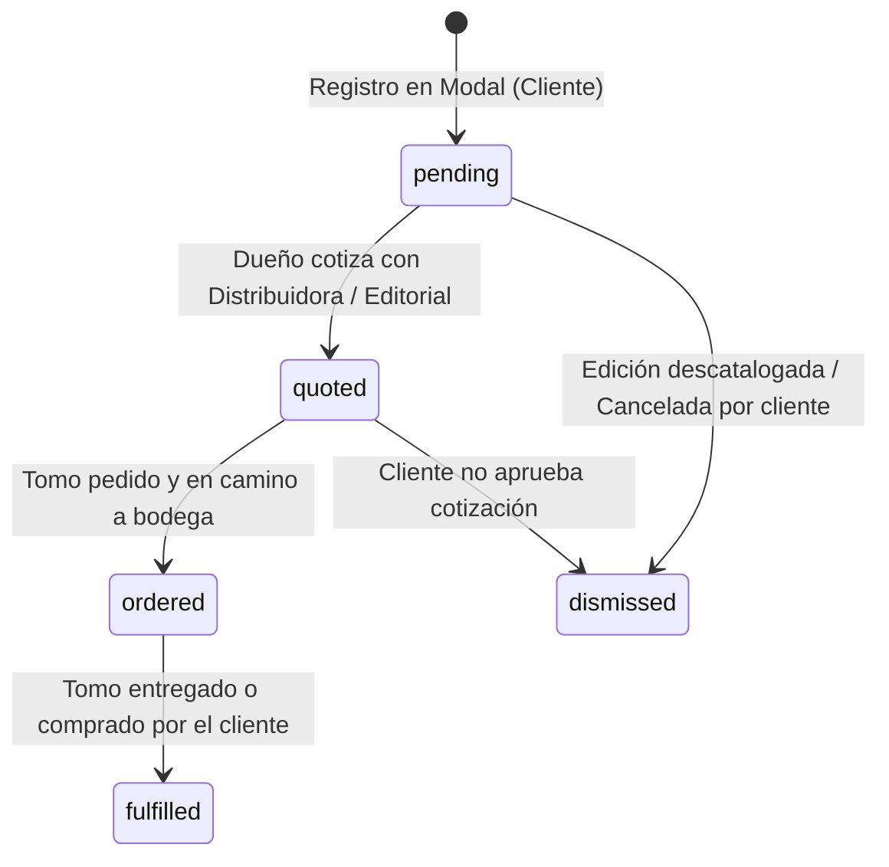
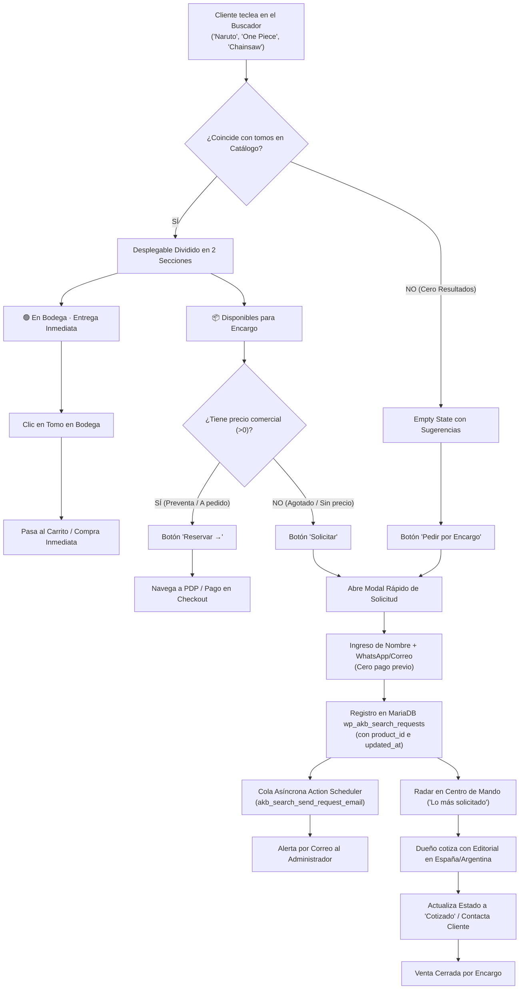
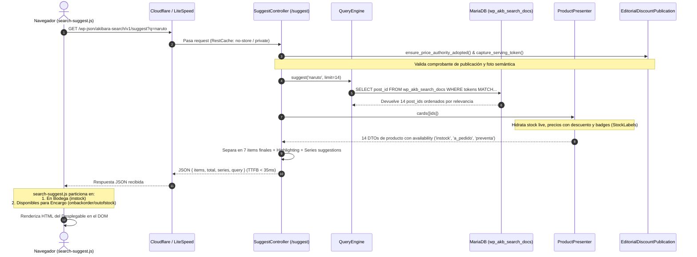

# Arquitectura Técnica y de Negocio del Motor de Búsqueda Soberano de Akibara

---

## 1. Visión General: Por qué existe y Filosofía de Diseño

El motor de búsqueda de Akibara (`akibara-search`) es un subsistema desacoplado y soberano desarrollado a medida para superar las deficiencias de WooCommerce nativo en tiendas de manga y cómics:

1. **Abandono de `LIKE '%term%'`:** El buscador estándar de WordPress/WooCommerce ejecuta escaneos completos de tabla (*Full Table Scan*) uniendo `wp_posts` y `wp_postmeta`, lo que degrada la base de datos a cientos de milisegundos y no comprende que «Jujutsu Kaisen 26» es el tomo 26 de una colección de 31 tomos.
2. **Arquitectura Bifurcada (Escritura vs. Lectura):**
   - **Riel de Escritura:** [`src/Indexer.php`](file:///Users/alefvaras/Documents/akibara/public_html/wp-content/plugins/akibara-search/src/Indexer.php) y [`src/DocumentBuilder.php`](file:///Users/alefvaras/Documents/akibara/public_html/wp-content/plugins/akibara-search/src/DocumentBuilder.php) procesan el catálogo y materializan una tabla optimizada en MariaDB ([`wp_akb_search_docs`](file:///Users/alefvaras/Documents/akibara/public_html/wp-content/plugins/akibara-search/src/Install.php#L73-L120)) con tokens lematizados, campos numéricos de tomo (`vol`), series y pesos de relevancia.
   - **Riel de Lectura:** [`src/SuggestController.php`](file:///Users/alefvaras/Documents/akibara/public_html/wp-content/plugins/akibara-search/src/SuggestController.php) y [`src/QueryEngine.php`](file:///Users/alefvaras/Documents/akibara/public_html/wp-content/plugins/akibara-search/src/QueryEngine.php) leen exclusivamente índices atómicos, respondiendo peticiones REST en **menos de 35 ms** de extremo a extremo.
3. **Principio Rector *Fail-Closed*:** Consignado en [`src/Support/FailsClosed.php`](file:///Users/alefvaras/Documents/akibara/public_html/wp-content/plugins/akibara-search/src/Support/FailsClosed.php#L5): *«un cero inventado es peor que un servicio apagado»*. Si hay una inconsistencia en la autoridad de precios o el esquema no está listo, el buscador se silencia de forma segura antes que mentirle al cliente con precios desactualizados o stocks ficticios.

---

## 2. Visualización y UX del Desplegable (Live Search)

El desplegable reactivo está orquestado en el cliente por [`assets/js/search-suggest.js`](file:///Users/alefvaras/Documents/akibara/public_html/wp-content/plugins/akibara-search/assets/js/search-suggest.js) y estilizado en [`assets/css/search-suggest.css`](file:///Users/alefvaras/Documents/akibara/public_html/wp-content/plugins/akibara-search/assets/css/search-suggest.css).

```
┌────────────────────────────────────────────────────────────────────────┐
│  🔍  [ one piece                        ]                 [ ⌘K ] [ × ] │
├────────────────────────────────────────────────────────────────────────┤
│  📚 SERIES COINCIDENTES                                                │
│  One Piece (107 tomos catalogados)                            Ver serie→│
├────────────────────────────────────────────────────────────────────────┤
│  🟢 EN BODEGA · ENTREGA INMEDIATA                                      │
│  [Portada]  One Piece 100                 $8.990   [Disponible]        │
│  [Portada]  One Piece 101                 $8.990   [Disponible]        │
├────────────────────────────────────────────────────────────────────────┤
│  📦 DISPONIBLES PARA ENCARGO                                           │
│  [Portada]  One Piece 01 (Reedición)      $8.990   [A pedido] [Reservar →]
│  [Portada]  One Piece 108                 $9.500   [Preventa] [Reservar →]
│  [Portada]  One Piece 03 (Descatalogado)           [Agotado]  [Solicitar]
├────────────────────────────────────────────────────────────────────────┤
│  💡 ¿Buscas otro tomo o edición?  Pedir por Encargo »                  │
├────────────────────────────────────────────────────────────────────────┤
│  🔍 Ver los 108 resultados para «one piece»                           →│
└────────────────────────────────────────────────────────────────────────┘
```

### Arquitectura de las Dos Secciones en el Desplegable

El cliente no espera lo mismo de un tomo que puede recibir mañana que de uno traído por importación. En la función `render()` ([`search-suggest.js:364-460`](public_html/wp-content/plugins/akibara-search/assets/js/search-suggest.js#L364-L460)), los ítems devueltos se particionan dinámicamente en dos colecciones:

1. **`bodegaItems`:** Aquellos productos donde `availability === 'instock'` o `badge_tone === 'ok'`.
   - **Subcabecera:** `<div class="akb-suggest-subhead akb-subhead--bodega"><span class="akb-subhead-dot akb-dot--ok"></span> En Bodega · Entrega Inmediata</div>`.
   - **Objetivo de Negocio:** Conversión rápida e impulso de despacho inmediato.
2. **`encargoItems`:** Aquellos productos clasificados como `a_pedido`, `preventa` o `outofstock`.
   - **Subcabecera:** `<div class="akb-suggest-subhead akb-subhead--encargo"><span class="akb-subhead-dot akb-dot--encargo"></span> Disponibles para Encargo</div>`.
   - **Diferenciación Comercial de Compra vs. Solicitud:**
     - **Compra Pagada (`preventa` o `a_pedido` con precio $>0$):** El cliente navega directamente a la ficha del producto (PDP) con la píldora `<span class="akb-suggest-reservar-tag">Reservar →</span>` para pagar y reservar de inmediato a través del checkout oficial.
     - **Modal Rápido de Solicitud (`outofstock` o sin precio):** Si el tomo está agotado o no tiene precio fijado, se inyecta la píldora interactiva `<span class="akb-suggest-encargo-tag">Solicitar</span>`, abriendo el Modal Rápido de Solicitud sin cobro por adelantado.
3. **Banner Dinámico de Encargo:** Si hay ítems de encargo o el catálogo en bodega es acotado, se renderiza al pie del bloque de tarjetas el disparador global:
   ```html
   <div class="akb-suggest-request-banner" role="presentation">
       <button type="button" class="akb-suggest-request-trigger" data-akb-request-term="...">
           ¿Buscas otro tomo o edición? <strong>Pedir por Encargo »</strong>
       </button>
   </div>
   ```

### Características de Interacción Avanzada

- **Resaltado `<mark>` en Servidor:** [`src/Highlighter.php`](file:///Users/alefvaras/Documents/akibara/public_html/wp-content/plugins/akibara-search/src/Highlighter.php) envuelve los tokens coincidentes en `<mark class="akb-hl">` antes de enviar el JSON, garantizando un renderizado seguro sin inyección de HTML en cliente. Si hubo corrección tipográfica (*fuzzy*), el highlight se calcula sobre el término corregido.
- **Series Coincidentes (`pa_serie`):** Mediante [`src/SeriesSuggestions.php`](file:///Users/alefvaras/Documents/akibara/public_html/wp-content/plugins/akibara-search/src/SeriesSuggestions.php), si la búsqueda coincide con una obra completa (ej. "Chainsaw Man"), se inyecta un bloque superior con enlace a la landing de serie (`/serie/chainsaw-man/`), evitando que el cliente tenga que buscar tomo por tomo.
- **Navegación de Accesibilidad por Teclado:**
  - Soporte completo de flechas `↑` y `↓`, con actualización de `aria-selected` y scroll automático de la vista (`scrollIntoView`).
  - Atajo global `⌘K` (Mac) y `Ctrl+K` (Windows/Linux) que enfoca la caja desde cualquier punto de la tienda.
  - Tecla `Escape` cierra el panel o el modal de solicitud sin perder el foco.

---

## 3. Clasificación Comercial de los 4 Estados

A diferencia de WooCommerce (que sólo conoce tres estados binarios de almacén: `instock`, `onbackorder` y `outofstock`), Akibara implementa una **matriz de 4 estados comerciales** gobernada por [`src/StockLabels.php`](file:///Users/alefvaras/Documents/akibara/public_html/wp-content/plugins/akibara-search/src/StockLabels.php) y presentada por [`src/ProductPresenter.php`](file:///Users/alefvaras/Documents/akibara/public_html/wp-content/plugins/akibara-search/src/ProductPresenter.php#L350-L380):

| Estado Comercial | Origen de Datos en Base | Filtro / Proveedor (`akibara-business`) | Tono CSS (`badge_tone`) | Semántica Comercial y Promesa al Cliente |
| :--- | :--- | :--- | :---: | :--- |
| **1. Disponible** | `_stock_status = 'instock'` | Fallback local: `'Disponible'` | `ok` *(Verde/Blanco)* | **Entrega Inmediata:** Tomo físicamente presente en las estanterías de Santiago. Despacho en 24h hábiles. |
| **2. Preventa** | `_stock_status = 'onbackorder'` | `akb_search_availability_value` evalúa `Availability::is_preventa($id) === true` | `pre` *(Ámbar)* | **Reserva de Lanzamiento:** Tomo oficial anunciado por editorial (España/Argentina) en tránsito de imprenta. Botón `Reservar →` directo a PDP. |
| **3. A pedido** | `_stock_status = 'onbackorder'` | `akb_search_availability_value` evalúa lanzamiento sin fecha futura activa | `order` *(Azul suave `#38bdf8`)* | **Importación Bajo Demanda:** Título activo en distribuidor internacional. Plazo estándar de 15 a 20 días hábiles. Botón `Reservar →` directo a PDP. |
| **4. Agotado** | `_stock_status = 'outofstock'` | Fallback local o estado desconocido | `out` *(Gris oscuro)* | **Aviso de Reposición:** Sin stock en bodega ni catálogo inmediato. Invita al cliente a pulsar `Solicitar` para abrir el modal sin pago previo. |

### Contrato de Integración con `akibara-business`

- **Hook Compartido:** El filtro `akb_stock_status_label` es el único punto de personalización de vocabulario para toda la tienda (buscador y fichas de producto). Si el plugin de negocio está desactivado, `StockLabels` degrada limpiamente a su mapa local sin lanzar excepciones.
- **Fail-Safe Estricto:** Cualquier estado desconocido en la base de datos se clasifica por defecto como **`outofstock` (`Agotado`)**, garantizando que jamás se prometa a un cliente la entrega de un producto cuya disponibilidad no esté comprobada.

---

## 4. Modal Rápido de Solicitud (Soberano MariaDB)

Para capturar la demanda de tomos que la tienda no tiene en stock, el buscador integra un flujo nativo gobernado por [`src/TitleRequests.php`](file:///Users/alefvaras/Documents/akibara/public_html/wp-content/plugins/akibara-search/src/TitleRequests.php), desacoplado al 100% de plataformas SaaS externas (como Brevo, Typeform o Google Forms).

```
[ Cliente en Desplegable o Empty State ]
                   │
                   ▼ (Clic en «Solicitar» o «Pedir por Encargo»)
         [ Modal Rápido JS ]
                   │
                   ▼ (POST /wp-json/akibara-search/v1/request)
    ┌──────────────────────────────┐
    │ Anti-spam (Honeypot + IP RL) │
    └──────────────┬───────────────┘
                   │
                   ▼
┌────────────────────────────────────────────────────────┐
│      Tabla MariaDB: wp_akb_search_requests             │
│  (id, product_id, query_norm, title, editorial,        │
│   customer_contact, status = 'pending', ip_hash,       │
│   created_at, updated_at...)                           │
└──────────────────┬─────────────────────────────────────┘
                   │
     ┌─────────────┴─────────────┐
     ▼                           ▼
[ Invalida Cache Ranking ]   [ Cola Asíncrona Action Scheduler ]
  (delete_transient)           (akb_search_send_request_email)
                                 │
                                 ▼
                               [ Despacho wp_mail en Background ]
```

### 1. Estructura de la Tabla Soberana (`wp_akb_search_requests`)

Creada y mantenida mediante `dbDelta` ([`src/TitleRequests.php`](public_html/wp-content/plugins/akibara-search/src/TitleRequests.php)):

```sql
CREATE TABLE wp_akb_search_requests (
    id BIGINT(20) UNSIGNED NOT NULL AUTO_INCREMENT,
    product_id BIGINT(20) UNSIGNED NULL DEFAULT NULL,
    query_norm VARCHAR(191) NOT NULL DEFAULT '',
    title VARCHAR(255) NOT NULL DEFAULT '',
    editorial VARCHAR(100) NOT NULL DEFAULT '',
    isbn VARCHAR(32) NOT NULL DEFAULT '',
    status_intended VARCHAR(20) NOT NULL DEFAULT 'a_pedido',
    customer_name VARCHAR(100) NOT NULL DEFAULT '',
    customer_contact VARCHAR(100) NOT NULL DEFAULT '',
    contact_type VARCHAR(10) NOT NULL DEFAULT 'email',
    user_id BIGINT(20) UNSIGNED NULL DEFAULT NULL,
    status VARCHAR(20) NOT NULL DEFAULT 'pending',
    notes TEXT NULL,
    ip_hash CHAR(64) NOT NULL DEFAULT '',
    created_at DATETIME NOT NULL DEFAULT CURRENT_TIMESTAMP,
    updated_at DATETIME NOT NULL DEFAULT CURRENT_TIMESTAMP ON UPDATE CURRENT_TIMESTAMP,
    PRIMARY KEY  (id),
    KEY idx_product_id (product_id),
    KEY idx_query_norm (query_norm),
    KEY idx_status (status),
    KEY idx_created (created_at),
    KEY idx_editorial (editorial),
    KEY idx_rl_ip (ip_hash, created_at)
) ENGINE=InnoDB DEFAULT CHARSET=utf8mb4 COLLATE=utf8mb4_unicode_ci;
```

### 2. Máquina de Estados del Encargo

Los encargos transicionan a través de 5 estados comerciales administrables desde el panel:



1. **`pending` (Pendiente):** Solicitud recién recibida. Muestra un badge de conteo en la pestaña de administración.
2. **`quoted` (Cotizado):** La tienda verificó con la distribuidora en España o Argentina y le envió el precio final al cliente vía WhatsApp/Email.
3. **`ordered` (Pedido a Editorial):** El tomo fue incluido en la orden de importación de la distribuidora.
4. **`fulfilled` (Completado):** El tomo llegó a bodega en Santiago y el pedido fue despachado o retirado.
5. **`dismissed` (Descartado):** Edición agotada sin stock editorial o cliente desistió.

### 3. Seguridad y Resiliencia Operativa

- **Honeypot Silencioso:** Campo señuelo `akb_hp_url` oculto por CSS y `tabindex="-1"`. Si un bot automatizado llena este campo, el endpoint responde `200 OK` simulado pero descarta la inserción sin tocar MariaDB.
- **Rate Limiting por IP y Contacto:**
  - Límite estricto de peticiones por minuto (`RL_TRACK_PER_MINUTE = 20`).
  - Detección de duplicados en ventana de 5 minutos: si el mismo cliente envía dos veces el mismo título, la base de datos no duplica la fila y responde con confirmación amigable.
  - Almacenamiento anonimizado de IP: `hash('sha256', $ip . wp_salt())` para cumplimiento estricto de privacidad.

---

## 5. El Centro de Mando Administrativo (`SearchAdminSection`)

Ubicado en **WP-Admin → Buscador**, el Centro de Mando ([`src/SearchAdminSection.php`](file:///Users/alefvaras/Documents/akibara/public_html/wp-content/plugins/akibara-search/src/SearchAdminSection.php)) proporciona telemetría y control operacional a través de 8 sub-paneles especializados:

```
┌──────────────────────────────────────────────────────────────────────────────────────────────────┐
│  CENTRO DE MANDO AKIBARA SEARCH                                                                 │
├─────────┬───────────┬──────────────┬─────────┬─────────┬───────────┬───────────────────┬─────────┤
│ [Índice]│[Búsquedas]│[Encargos (4)]│[Facetas]│[Precios]│[Sinónimos]│[Palabras Ignoradas]│[Ajustes]│
└─────────┴───────────┴──────────────┴─────────┴─────────┴───────────┴───────────────────┴─────────┘
```

1. **Pestaña «Encargos» (Gestión Operacional de Demanda):**
   - Tabla reactiva de solicitudes con filtros por pestaña: *Todas*, *Pendientes*, *Cotizados*, *Pedidos a editorial*, *Completados*, *Descartados*.
   - Muestra canal de contacto con enlace directo a `mailto:` o `https://wa.me/` formateado.
   - Selector en línea de cambio de estado y área de notas internas para tracking de cotización.
2. **Pestaña «Búsquedas» y Radar de Demanda (*Demand Gaps*):**
   - Analiza la tabla de log `wp_akb_search_qlog`.
   - Identifica términos con **cero resultados (`hits = 0`)** agrupados por volumen, proporcionando al dueño la lista de compra exacta de lo que el público busca pero no encuentra.
3. **Pestaña «Índice»:**
   - Estado de salud, conteo de documentos sincronizados contra WooCommerce, versión de generación (`index_gen`) y disparador de reindexación en segundo plano vía Action Scheduler.
   - Diagnóstico de consistencia: compara el hash de los productos de WooCommerce contra el índice en MariaDB.
4. **Pestaña «Sinónimos» y «Palabras Ignoradas»:**
   - Diccionario de equivalencias (ej. `snk` $\rightarrow$ `shingeki no kyojin`, `op` $\rightarrow$ `one piece`, `jojo` $\rightarrow$ `jojo no kimyou na bouken`).
   - Lematización y stopwords en español.
5. **Pestaña «Ajustes»:**
   - Interruptores de los 3 servicios maestros (`akb_search_indexing`, `akb_search_suggest`, `akb_search_facets`).
   - Configuración de búsqueda laxa/fuzzy y copys de fallback cuando no hay resultados.

---

## 6. Rendimiento, Latencias y Benchmarks Técnicos

El pipeline de búsqueda está optimizado para ejecutarse en hardware compartido o VPS sin sobrecargar la CPU del servidor web:

| Capa / Etapa | Mecanismo de Optimización | Tiempo Medido |
| :--- | :--- | :---: |
| **1. Debounce en Cliente** | Espera de 250 ms tras la última pulsación en el input | $250\text{ ms}$ |
| **2. Caché LRU de Navegador** | Almacenamiento en memoria JS (`state.cache`) de respuestas previas | **$0\text{ ms}$** *(Instantáneo)* |
| **3. Cancelación `AbortController`** | Aborta la petición HTTP previa si el usuario continúa escribiendo | Previene acumulación |
| **4. Red y TLS (HTTP/2 + CF)** | Conexión persistente reutilizada con Edge en Chile | $\sim 15 - 25\text{ ms}$ |
| **5. Micro-caché Servidor (60s)** | Memoria (Transient/Object Cache) vinculada a `index_gen` + `token` | **$< 2\text{ ms}$** *(Hit)* |
| **6. Consulta SQL MariaDB** | Indexación sobre tabla plana con orden por `vol` y `relevance` | **$\sim 2 - 8\text{ ms}$** *(Miss)* |
| **7. Hidratación `ProductPresenter`** | Lectura viva acotada a un *over-fetch* máximo de 14 tomos | $\sim 8 - 14\text{ ms}$ |
| **8. Resaltado e Inyección** | `Highlighter::mark` server-side de 7 tarjetas finales | $\sim 1 - 2\text{ ms}$ |
| **TIEMPO TOTAL SERVIDOR (TTFB)** | **Endpoint REST `/wp-json/akibara/v1/search/suggest`** | **$\mathbf{< 2\text{ ms}\text{ (hit)} \ /\ < 35\text{ ms}\text{ (miss)}}$** |

> [!TIP]
> **Purga Selectiva de Caché:** Las reindexaciones de texto del índice no disparan `litespeed_purge_all` para evitar desproteger la caché de página completa de toda la tienda. En su lugar, incrementan la versión de generación (`index_gen`), invalidando instantáneamente el buscador sin causar tormentas de tráfico sobre PHP.

---

## 7. Diagramas de Negocio y Técnico

### Diagrama 1: Flujo de Negocio y Conversión de Demanda

Visualiza cómo el buscador monetiza las búsquedas exitosas y rescata las búsquedas sin inventario para convertirlas en ventas por encargo:


    
    O --> P["Dueño cotiza con Editorial en España/Argentina"]
    P --> Q["Actualiza Estado a 'Cotizado' / Contacta Cliente"]
    Q --> R["Venta Cerrada por Encargo"]
```

---

### Diagrama 2: Arquitectura Técnica y Flujo de Datos

Detalla el recorrido desde la pulsación de una tecla en el navegador hasta la base de datos MariaDB y la respuesta JSON:



---

## 8. Interacción con Otras Funcionalidades del Ecosistema

El buscador no es una isla; interactúa armónicamente con todos los subsistemas del proyecto Akibara:

```
                  ┌──────────────────────────────────────────────┐
                  │          akibara-search (Buscador)           │
                  └───────┬──────────────┬──────────────┬────────┘
                          │              │              │
      ┌───────────────────┘              │              └───────────────────┐
      ▼                                  ▼                                  ▼
┌───────────────────────────┐  ┌───────────────────────────┐  ┌───────────────────────────┐
│     akibara-business      │  │     akibara-rewards       │  │   Cloudflare & LiteSpeed  │
├───────────────────────────┤  ├───────────────────────────┤  ├───────────────────────────┤
│• Descuentos editoriales   │  │• El buscador preserva     │  │• RestCache aplica cabecera│
│  (EditorialDiscountPub.)  │  │  los slugs canónicos      │  │  Cloudflare-CDN-Cache-    │
│• Distinción de preventas  │  │  que enlazan a la PDP,    │  │  Control: no-store para   │
│  (AvailabilityBridge)     │  │  donde se calculan los    │  │  evitar cache estancada   │
│• Series y ediciones       │  │  puntos a acumular en el  │  │• Purga selectiva al       │
│  (SeriesSuggestions)      │  │  ledger de recompensas.   │  │  reconstruir el índice.   │
└───────────────────────────┘  └───────────────────────────┘  └───────────────────────────┘
```

1. **Integración con `akibara-business`:**
   - **Precios Reales con Descuento:** `ProductPresenter` no lee simplemente el meta `_price`; consulta la autoridad de descuentos editoriales registrada por Business mediante el filtro `akb_search_effective_price`. Si Panini tiene 10% de descuento en el panel de promociones, el buscador muestra inmediatamente el precio tachado y el precio de oferta en vivo.
   - **Radar de Compras Compartido:** La función puente `akibara_search_demand_gaps()` alimenta directamente el widget «Lo más solicitado» en el escritorio principal de WordPress (`AdminDashboard.php`).
2. **Integración con `akibara-rewards`:**
   - Las tarjetas de producto en el desplegable y en la grilla de búsqueda mantienen URLs canónicas que conectan fluidamente con los badges de puntos y beneficios de referidos del plugin de lealtad.
3. **Caché y Red de Distribución (Cloudflare & LiteSpeed):**
   - Cloudflare suele cachear peticiones `GET` en APIs REST si las cabeceras estándar no son explícitas. [`src/Support/RestCache.php`](file:///Users/alefvaras/Documents/akibara/public_html/wp-content/plugins/akibara-search/src/Support/RestCache.php#L105-L118) emite cabeceras directas `Cloudflare-CDN-Cache-Control: no-store` y `CDN-Cache-Control: no-store`.
   - Cuando se ejecuta una reindexación completa de catálogo, `Search` incrementa monotónicamente la generación del índice (`index_gen`) e invalida selectivamente los transients del motor, evitando purgas masivas (`litespeed_purge_all`) para no desproteger la caché de página completa de la tienda.
