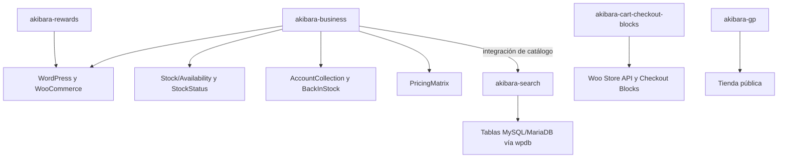

# Akibara · Contexto vivo y mapa de arquitectura

Revisión de fuentes: 2026-11-10 ([ADR-010](decisiones/ADR-010-erradicacion-preventa-a-pedido-packs-y-ediciones-pais.md), [ADR-011](decisiones/ADR-011-blindaje-shortcodes-legados-y-coherencia-transversal-precios-envio.md), [ADR-012](decisiones/ADR-012-optimizaciones-financieras-carencia-rewards-y-batch-atc.md), [ADR-013](decisiones/ADR-013-auditoria-zero-trust-erradicacion-codigo-muerto-y-relevancia-buscador.md), [ADR-014](decisiones/ADR-014-saneamiento-estructural-blindaje-reserva-y-suite-bluex.md), [ADR-015](decisiones/ADR-015-cierre-shims-legados-y-alineacion-reglas.md), [ADR-016](decisiones/ADR-016-hondana-2-0-integracion-manual-owned-y-cro-blocks.md), [ADR-017](decisiones/ADR-017-erradicacion-cusrev-y-evolucion-modulo-resenas-2-0.md)). Versiones en producción: `akibara-business 1.121.3`, `akibara-rewards 0.4.37`, `akibara-search 0.1.95`, `akibara-cart-checkout-blocks 2.2.37`, `akibara-gp 2.1.158`. El módulo legado «Arma tu Pack» (`SeriesBundles/`, `VolumeTierResolver.php`, `Support/Money.php`) se encuentra físicamente erradicado al 100% del sistema. Este mapa orienta; no certifica pruebas ni sustituye las reglas canónicas. La evidencia de cada entrega identifica versión y hashes por separado de Git.

## Identidad y entornos

Akibara Manga & Cómics, «Tu rincón de Akihabara en Chile». Tienda WooCommerce con catálogo importado y despacho inmediato desde bodega física en Santiago. Local Docker: http://localhost:8080. Producción: https://akibara.cl.

## Reglas y coordinación: fuentes únicas

Leer [AGENTS.md](../../AGENTS.md), [catálogo](../../.agents/rules/catalogo.md), [entrega](../../.agents/rules/entrega.md) y [ADR-010](decisiones/ADR-010-erradicacion-preventa-a-pedido-packs-y-ediciones-pais.md).

### Gobierno Nativo de Inventario y Precios (WooCommerce)
WooCommerce gobierna el inventario y los precios de forma 100% nativa. El código de Akibara jamás fuerza `_manage_stock`, `_backorders`, `_stock` ni borra `_sale_price`. El dueño de la tienda administra libremente el inventario y las ofertas en WooCommerce (incluyendo si decide habilitar `onbackorder` o precios promocionales en cualquier producto). Nuestro código solo lee el estado de WooCommerce (`is_in_stock()`, `get_stock_status()`) para pintar insignias visuales, alimentar `akibara-search` y activar el botón de reposición `BackInStock`.

### Cero Bloqueos al Cambiar Precios
WooCommerce congela de forma nativa los precios e ítems en `wp_woocommerce_order_itemmeta` al momento de crearse una orden. Por ende, actualizar precios en el catálogo jamás altera órdenes existentes ni requiere bloqueos artificiales de 24h/2h por estados `wc-pending`. `OrderLockGuard` fue completamente erradicado del repositorio.

Los antiguos dominios de Preventa / A Pedido (`OrderPreventa`, `EstimatedDelivery`, `MixedCartShipmentGuard`), Conmutadores de Familia/Edición (`SeriesEditions`, `BrandFamilyLanding`, `BrandLandingCallout`, `BrandLandings`), «Arma tu Pack» (`SeriesBundles` / BYP) e integraciones de Google Listings & Ads y Microsoft Clarity fueron erradicados de raíz en [ADR-010](decisiones/ADR-010-erradicacion-preventa-a-pedido-packs-y-ediciones-pais.md). Se conservan `BrandRegion` y `MenuInjector` para el mega-menú desplegable de Editoriales (`AR` / `ES`) y el directorio `/editoriales/`.

Pizarra operativa: [README](../../ops/coordinacion/README.md).

## Topología comprobada en fuentes

`akibara-search/src/Install.php`, `WorkRepository.php` e `Indexer.php` usan tablas WordPress mediante `wpdb`; el tema está en `public_html/wp-content/themes/akibara-gp/`. `akibara-rewards` gestiona el programa de lealtad y reseñas verificadas.

## Mapa de Disponibilidad, Colección y Reposición

- `Stock/Availability` y `StockStatus`: clasificación binaria estricta (`DISPONIBLE` / `instock` vs `AGOTADO` / `outofstock`).
- `BackInStock`: captura de alertas de reposición para tomos agotados (`CaptureRestController`, `SubscriberRepository`, `ConfirmationEmail`, `StockAlertEmail`).
- `AccountCollection`: estantería personal del cliente en `/mi-cuenta/coleccion/`, integrada con `SeriesFollow`, suscripción 1-clic a `BackInStock` cuando el siguiente tomo está agotado, y adición 1-clic al carrito (`NativeCart`) de tomos faltantes disponibles en stock.
- `PricingMatrix`: cálculo y sincronización de precios regulares por escala editorial (WooCommerce gobierna precios e inventario nativamente).

## Estado y límites del grafo

`graphify-out/graph.json` es un índice generado de fuentes. `graphify query` y `graphify explain` sirven para localizar clases y relaciones; verificar siempre el código citado. Las métricas de nodos y versiones no se mantienen a mano aquí.
