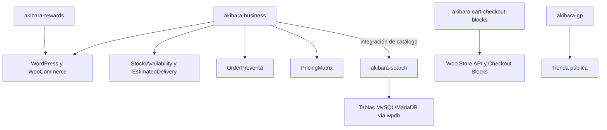

# Akibara · Contexto vivo y mapa de arquitectura

Revisión de fuentes: 2026-11-04. Este mapa orienta; no certifica pruebas ni sustituye las reglas canónicas. La evidencia de cada entrega identifica versión y hashes por separado de Git.

## Identidad y entornos

Akibara Manga & Cómics, «Tu rincón de Akihabara en Chile». Tienda WooCommerce con catálogo importado y despacho desde Santiago. Local Docker: http://localhost:8080. Producción: https://akibara.cl.

## Reglas y coordinación: fuentes únicas

Leer [AGENTS.md](../../AGENTS.md), [catálogo](../../.agents/rules/catalogo.md) y [entrega](../../.agents/rules/entrega.md). Se evita duplicarlas aquí: la versión anterior fijaba 5% sin recoger la discusión de configuración e identificaba como inmutables todos los metadatos operativos de las líneas.

Precio y promesa al comprar se conservan; cantidades recibidas, asignadas y reembolsadas evolucionan por operaciones trazables. Cambiar catálogo no equivale a cambiar un pedido. No reconstruir inventario productivo desde el espejo.

Pizarra operativa: [README](../../ops/coordinacion/README.md). Célula actual: [Preventa y A pedido](../../ops/coordinacion/abiertos/2026-11-04-pa-00-celula-preventa-a-pedido.md). Codex supervisa arquitectura y QA; Antigravity implementa. Desarrollo entrega a QA, que vuelve a medir.

## Topología comprobada en fuentes

La versión anterior situaba Search en SQLite y nombraba el tema `akibara-theme-gp`. Corrección: `akibara-search/src/Install.php`, `WorkRepository.php` e `Indexer.php` usan tablas WordPress mediante wpdb; el tema está en `public_html/wp-content/themes/akibara-gp/`. Rewards es otro plugin, no una clase del módulo de precios.

## Mapa del flujo Preventa y A pedido

- `Stock/Availability`: clasificación comercial; `StockStatus`: estado nativo Woo.
- `EstimatedDelivery/DateCalculator`: cálculo de ventanas. Lanzamiento editorial y llegada a Akibara son conceptos distintos.
- `OrderPreventa/LineItemSnapshot` y `OrderTagging`: datos al comprar e integración clásico/Store API/guardado genérico.
- `PreventaItems`, `SummaryRecalculator`, `PromiseWindow`: cantidades netas, pendientes y promesas.
- `PreventasScreen`: pantalla y handlers actuales de recepción, FIFO, apartado y des-apartado; no existe un servicio separado `StockReception` en el árbol auditado.
- `ReadyToShipCron`, `StockChangeListener`, `RefundListener`: reevaluación operativa.
- `ReadyEmailDispatcher`, `ReadyToShipEmail`, `RemindersCron`: comunicaciones y reintentos.
- `FulfillmentCapabilities`, `CompletionPolicy` e integraciones: retiro, carrier y cierre.

[Mapa detallado, riesgos y arquitectura propuesta](PREVENTA_A_PEDIDO.md). Las propuestas se distinguen del código existente: el fallback de stock global aún puede marcar listos pedidos sin asignación (PA-03).

## Estado y límites del grafo

`graphify-out/graph.json` es un índice generado de fuentes. `graphify query` y `graphify explain` sirven para localizar clases y relaciones; verificar siempre el código citado. Las métricas de nodos y versiones no se mantienen a mano aquí.

El hook `.githooks/post-commit` intenta actualización estructural, puede omitirse en rebase/merge y no demuestra despliegue ni QA. Tampoco sustituye la revisión semántica de documentos. Una extracción por encabezados no valida lo que afirma un ADR.

Esta auditoría corrige documentos y actualiza sólo sus entradas del grafo. La visualización HTML, la wiki y las comunidades de un build anterior no deben presentarse como certificación nueva. La auditoría registra alcance y hashes en `graphify-out/QA_PREVENTA_2026-11-04.md`.
