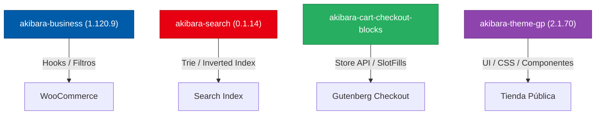

# Akibara Second Brain · Contexto Vivo y Mapa de Arquitectura

> **Propósito:** Ancla de contexto permanente para agentes de IA y desarrolladores de Akibara.
> Este documento se lee al inicio de cada sesión y se sincroniza continuamente con el grafo de conocimiento (`graphify-out/`).

---

## 1. Identidad y Misión de Akibara
- **Nombre:** Akibara Manga & Cómics (`akibara.cl`).
- **Lema e Identidad:** *«Tu rincón de Akihabara en Chile»*. Tienda especializada en manga, cómics, merchandising y novelas ligeras oficiales importadas directamente desde España y Argentina, despachando a todo Chile desde Santiago.
- **Entornos:**
  - **Local (Docker):** `http://localhost:8080` (espejo de staging/pruebas).
  - **Producción (Hostinger Cloud + Cloudflare):** `https://akibara.cl`.

---

## 2. Reglas Inviolables de Operación (Golden Rules)
1. **Regla de Oro (Proactividad Inmediata):** Si durante cualquier auditoría o tarea se detecta un error o inconsistencia en cualquier flujo, solucionarlo de inmediato (primero en local, luego en producción).
2. **Ciclo de Pruebas Obligatorio:** Local (Docker) $\rightarrow$ Verificación verde $\rightarrow$ Despliegue atómico $\rightarrow$ Medición en Producción. Nada está cerrado hasta medirse en producción.
3. **Cero Basura ni Respaldos en Producción:** Nunca dejar archivos `.bak`, `.zip`, volcados SQL ni options de backup en el servidor remoto. Todo respaldo vive exclusivamente en local.
4. **Intocabilidad de Pedidos Activos (FIFO Comercial):** Las líneas de pedidos de clientes (`order_items`, `order_itemmeta`) y sus precios acordados son 100% inmutables.
5. **Contrato Nativo de Inventario (Regla 18):**
   - `instock`: Gestión activa (`_manage_stock = yes`), `_stock > 0`, unidades físicas en bodega de Santiago.
   - `onbackorder` (A pedido / Reserva): Sin gestión de stock (`_manage_stock = no`), 5% de descuento obligatorio (`_sale_price = round_100(_regular_price * 0.95)`), distribuidor oficial activo (Candela / Pujol).
   - `outofstock`: Agotado en bodega y distribuidora (`_manage_stock = no`, `_sale_price = null`, término `outofstock` en `product_visibility`).

---

## 3. Topología de Plugins y Módulos de Akibara

### Mapa por Dominio de `akibara-business`:
1. **Núcleo & Guardas:** `OrderLockGuard` (fail-closed, 24h wc-pending lock), `InventoryGuard`, `UnpaidOrdersSweeper`.
2. **Precios & Distribución:** `PricingSynchronizer` (nivelación de tomos por serie, rescate con autorización Candela/Pujol), `PriceScale`.
3. **Carrito & Checkout:** `MixedCartShipmentGuard` (Store API bridge, 4 canales de persistencia: Blocks, Store API, clásico, generic save), `PreventaCheckoutNotice`, `PudoShipping`.
4. **Catálogo & Taxonomías:** `SeriesTaxonomy`, `SeriesFactsCache`, `UpsellsAutofill`, `ProductBrand`.
5. **Fidelización (Rewards):** `AkibaraRewards` (ledger transaccional de puntos, 1 punto = $1 CLP), `CustomerReviews`.
6. **Buscador & Facetas:** `SearchClient`, `FilterNormalizer`.
7. **SEO & Descubribilidad:** `RankMathBridge`, `ProductSchema`, `BlogEditorialManager`.

---

## 4. Estado de Memoria y Grafo de Conocimiento (Second Brain)
- **Grafo Estructural:** `graphify-out/graph.json` (26.375 nodos, 51.024 aristas, 902 comunidades).
- **Herramienta de Consulta Rápida:** `graphify query "<término>"` o `graphify explain "<nodo>"`.
- **Wiki Interconectada:** `graphify-out/wiki/index.md` (912 artículos enlazados tipo Obsidian).
- **Mapa Visual Interactivo:**
  - `graphify-out/graph.html` (Visualizador 3D/2D por comunidades y física de nodos).
  - `graphify-out/akibara-callflow.html` (Diagramas interactivos de llamadas y arquitectura Mermaid).
- **Sincronización:** Hook post-commit activo (`.githooks/post-commit`) actualiza el grafo con cada commit.
