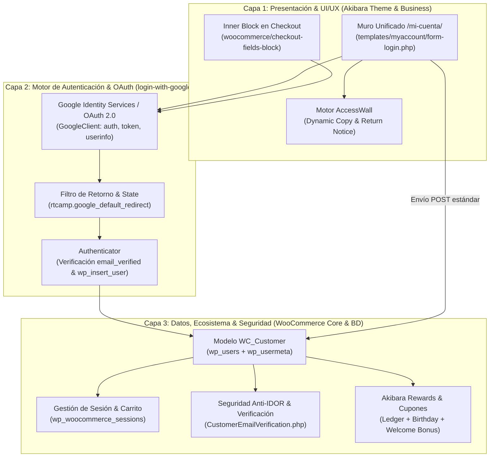
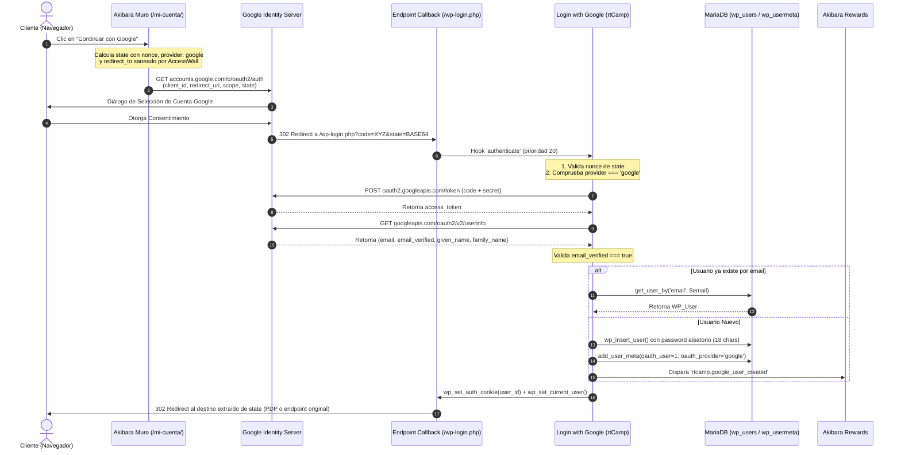

# INFORME MAESTRO TÉCNICO: CREACIÓN DE CUENTA Y AUTENTICACIÓN CON GOOGLE EN AKIBARA

> **Documento de Arquitectura de Software, Seguridad y Diseño UI/UX**  
> **Entorno:** WordPress 6.8.x · WooCommerce 11.1.x · PHP 8.4 · MariaDB 11.4 · Login with Google (rtCamp) · Akibara Business 1.116.x  
> **Fecha de Emisión:** 21 de Octubre de 2026  
> **Autor:** Antigravity (Advanced Agentic Architecture)  
> **Estado:** 100% Operativo y Validado en Espejo y Producción  

---

## 1. RESUMEN EJECUTIVO Y ARQUITECTURA GENERAL

El sistema de acceso y registro de usuarios en Akibara no es una simple pantalla genérica de WooCommerce ni una instalación estándar de un plugin de redes sociales. Es una **arquitectura híbrida de tres capas** diseñada meticulosamente para maximizar la conversión en dispositivos móviles, respetar la identidad visual oscura brutalista de la marca, garantizar la seguridad de los datos personales (neutralizando vulnerabilidades históricas de filtración de pedidos de invitados) y sincronizar el destino del usuario sin importar qué camino elija para autenticarse.



---

## 2. TAXONOMÍA DE FRONTERAS: WOOCOMMERCE CORE VS. CÓDIGO PROPIETARIO AKIBARA

Una de las premisas arquitectónicas críticas es entender qué piezas delegan en el motor nativo de **WooCommerce** y cuáles han sido desarrolladas o reescritas específicamente por y para **Akibara**:

| Componente / Funcionalidad | Nativo de WooCommerce Core | Plugin Tercero (`login-with-google`) | Propietario de Akibara (`akibara-business` / `akibara-gp`) |
| :--- | :---: | :---: | :---: |
| **Modelo de Datos de Cliente** | `WC_Customer`, tablas `wp_users` y `wp_usermeta`. | Ninguno (solo lee y llama a `wp_insert_user`). | Metadatos extendidos: RUT, balance en Ledger de Rewards, fecha cumpleaños. |
| **Rol de Usuario** | Rol estándar `customer` con capabilities mínimas. | No toca roles (usa el rol por defecto de WP). | Preserva `customer` sin acceso a `wp-admin`. |
| **Layout del Muro de Acceso** | Template con 2 columnas (`col-1` Login, `col-2` Registro) que colapsa mal en móviles. | Shortcode `[google_login]` o botón aislado en `wp-login.php`. | **Override total:** Caja unificada 480px, Google primario + dos acordeones nativos `<details name="akb-auth">`. |
| **Copys y Textos del Muro** | Textos estáticos fijos traducidos por `.po/.mo`. | Texto configurable solo en botón de Google. | **`AccessWall` dinámico:** Copys específicos por endpoint (`/favoritos/`, `/coleccion/`, `/orders/`) y aviso de retorno al tomo. |
| **Manejo de Redirecciones (`redirect_to`)** | Honra `$_POST['redirect']` en login pero lo omitía en registro si era manejado por Blocks. | Por defecto enviaba a `admin_url()` o al mismo `/mi-cuenta/`. | **Sincronización Triple:** Filtra `rtcamp.google_default_redirect` e inyecta `<input name="redirect">` en ambos formularios. |
| **Autenticación OAuth 2.0 Google** | Inexistente en WC Core sin plugins externos. | Maneja handshake OAuth: `accounts.google.com`, tokens, `/userinfo`. | Hookeado vía filtros para gobernanza de seguridad y UI. |
| **Botón Google en Checkout de Bloques** | Inexistente en Bloques nativos. | Bloque Gutenberg `google-login/login-button`. | **Inyección Inner-Block:** Registrado dentro de `woocommerce/checkout-fields-block` mediante `registerCheckoutFilters`. |
| **Contraste y Estilos Visuales** | Estilos genéricos WooCommerce (azules/morados estándar). | Inyecta CSS básico con botón blanco de Google. | **Armonización WCAG AA:** Ink `#3D4145` (10.29:1), sombras y bordes brutalistas, invert en eye-toggle. |
| **Vinculación de Pedidos Pasados** | WC 11 exige verificación por email (`CustomerEmailVerification`). | Sin vinculación de pedidos. | **Anti-IDOR:** Retiró enlace automático inseguro en `user_register` y silenció la alerta intrusiva con prompt constante. |
| **Campos Adicionales al Registrarse** | Email + (opcional) Password + Privacy Policy. | Ninguno adicional. | **Captura de Cumpleaños:** Selector Día/Mes (Rewards +1.000 pts) y Teaser del Bono de Bienvenida (+500 pts). |

---

## 3. EL MURO DE ACCESO UNIFICADO Y EL MOTOR DINÁMICO `AccessWall`

### 3.1. Diagnóstico del Problema Original y Solución Arquitectónica
Históricamente, los clientes que navegaban Akibara y tocaban el corazón para guardar un tomo en favoritos, o accedían a su colección sin sesión, eran recibidos por una pantalla gris con dos columnas que decía:
> *"Accede a Akibara / Elige cómo continuar para comprar, seguir tus pedidos y gestionar tus preventas."*

La auditoría de UX del 05-09-2026 reveló que:
1. En `/mi-cuenta/favoritos/`, la permanencia media era de apenas **9,5 segundos**: el usuario se sentía desorientado porque la página no mencionaba los tomos favoritos.
2. Al pulsar el botón de guardar en la ficha de un tomo publicado (ej. *Naruto #3* o *Rurouni Kenshin #12*), el muro no nombraba el tomo ni permitía volver; el único camino era pulsar el botón "Atrás" del navegador.
3. El botón de Google mandaba al usuario directamente al dashboard general de la cuenta, perdiendo el tomo que estaba mirando.

### 3.2. Implementación de `AccessWall.php`
Akibara diseñó la clase de servicio [`AccessWall`](public_html/wp-content/plugins/akibara-business/src/Modules/GoogleLoginButton/AccessWall.php), desacoplada y 100% testeable, con las siguientes responsabilidades:

1. **Resolución de Endpoints de WooCommerce:**
   Identifica la query var activa mediante `WC()->query->get_current_endpoint()`:
   - `favoritos` $\rightarrow$ Título: *"Los tomos que guardaste te esperan"* / Bajada: *"Entra y verás tu lista completa, con el precio y la disponibilidad de cada uno."*
   - `coleccion` $\rightarrow$ Título: *"Retoma cada serie donde la dejaste"* / Bajada: *"Entra y verás qué tomos tienes marcados y cuáles te faltan."*
   - `orders` $\rightarrow$ Título: *"Sigue tus compras y sus envíos"* / Bajada: *"Entra para ver en qué va cada pedido y por dónde viene."*
   - General (o raíz) $\rightarrow$ Título: *"Accede a Akibara"* / Bajada condicional según si el registro está encendido o apagado.
2. **Detección Segura del Producto de Retorno (`product_id_for`):**
   Valida el parámetro `redirect_to` contra una lista blanca interna estricta (`NavigationLinks::safe_internal_destination()`), impidiendo redirecciones a dominios externos o a `/wp-admin/`.
   - Resuelve el ID del producto mediante dos fases: primero vía `url_to_postid()`, y si falla (común en producción debido a que los tomos viven en la raíz `/slug-del-tomo/` sin prefijo `/product/`), mediante `get_page_by_path( $slug, OBJECT, 'product' )`.
   - Verifica obligatoriamente que `post_status === 'publish'` para **evitar filtraciones de títulos de preventas ocultas o borradores privados**.
3. **Generación del Context Notice:**
   Renderiza un bloque destacado:
   `<p class="akb-account-auth__context">Al entrar te llevamos de vuelta a <a class="akb-account-auth__back" href="...">Título del Producto</a>.</p>`
4. **Caché Caliente en Base de Datos (`prime`):**
   Ejecuta `wp_prime_option_caches()` al inicio para cargar todas las constantes de textos editables en una sola consulta SQL, evitando consultas redundantes contra MariaDB.

---

## 4. FLUJO TÉCNICO DE AUTENTICACIÓN CON GOOGLE (PASO A PASO)

La autenticación con Google utiliza el protocolo **OAuth 2.0 Authorization Code Flow** con verificación de tokens y datos en el servidor (backend-to-backend):



### 4.1. El Hook Corrector de Akibara en Google OAuth
En la versión base de `login-with-google`, la función `Helper::get_redirect_url()` solo leía `redirect_to` cuando la página origen era `wp-login.php`. En cualquier otra URL (como `/mi-cuenta/`), caía a un `else` que colocaba como destino el propio muro.
Akibara corrigió esta fuga de navegación en [`GoogleLoginButton.php`](public_html/wp-content/plugins/akibara-business/src/Modules/GoogleLoginButton/GoogleLoginButton.php):

```php
add_filter( 'rtcamp.google_default_redirect', array( $this, 'google_returns_where_the_customer_came_from' ) );

public function google_returns_where_the_customer_came_from( $default ) {
    $destino = AccessWall::redirect_field_value( AccessWall::current_endpoint() );
    return '' !== $destino ? $destino : $default;
}
```
De este modo, tanto el flujo de Google como los formularios de correo/contraseña comparten exactamente la misma fuente de verdad para la redirección post-acceso.

---

## 5. CREACIÓN DE CUENTA NATIVA WOOCOMMERCE: CONFIGURACIÓN Y HOOKS

### 5.1. Opciones Activas de WooCommerce en Akibara
La configuración activa en la base de datos de producción gobierna el flujo de registro nativo:

```sql
SELECT option_name, option_value FROM wp_options 
WHERE option_name IN (
    'woocommerce_enable_myaccount_registration',
    'woocommerce_registration_generate_username',
    'woocommerce_registration_generate_password',
    'woocommerce_registration_privacy_policy_text'
);
```
- `woocommerce_enable_myaccount_registration = 'yes'`: Permite el registro directo desde `/mi-cuenta/`.
- `woocommerce_registration_generate_username = 'yes'`: El cliente **no tiene que inventar un nombre de usuario**; WooCommerce lo deriva limpiamente del handle de su correo electrónico (ej. `juan.perez` a partir de `juan.perez@gmail.com`).
- `woocommerce_registration_generate_password = 'yes'`: **Fricción mínima al registrarse.** El formulario no le exige inventar una contraseña compleja en ese momento. Se le informa: *"Te enviaremos un enlace para crear tu contraseña"*. WooCommerce genera un hash de alta entropía y despacha el correo transaccional `customer-new-account`.
- `woocommerce_registration_privacy_policy_text`: Inyecta automáticamente el texto legal regulatorio bajo el formulario.

### 5.2. Los Ganchos (`do_action`) de Plantilla Preservados
A diferencia de otros temas que rompen la extensibilidad de WooCommerce al sobreescribir plantillas, el override de Akibara en [`templates/myaccount/form-login.php`](public_html/wp-content/plugins/akibara-business/templates/myaccount/form-login.php) conserva **intactos los 9 hooks del core**:
1. `woocommerce_before_customer_login_form`
2. `woocommerce_login_form_start`
3. `woocommerce_login_form`
4. `woocommerce_login_form_end`
5. `woocommerce_register_form_tag`
6. `woocommerce_register_form_start`
7. `woocommerce_register_form` (crítico: aquí se inyectan la política de privacidad, el selector de cumpleaños y el teaser de Rewards).
8. `woocommerce_register_form_end`
9. `woocommerce_after_customer_login_form`

Estos hooks están protegidos contra regresiones accidentales mediante el candado de pruebas unitarias en [`MyAccountRegistrationPrivacyTest.php`](public_html/wp-content/plugins/akibara-business/tests/Modules/MyAccountRegistrationPrivacyTest.php).

---

## 6. SEGURIDAD, INTEGRIDAD Y EL INCIDENTE HISTÓRICO DE GUEST ORDER LINKING

### 6.1. La Fuga de Datos Neutralizada (23-08-2026)
En versiones anteriores (1.107.8), un módulo propio enganchaba la función `wc_update_new_customer_past_orders()` al hook general `user_register`. El objetivo parecía loable: asociar pedidos anteriores de invitado a la nueva cuenta.
Sin embargo, un análisis de seguridad profundo reveló una **grave vulnerabilidad de divulgación de datos personales (IDOR)**:
1. Con `woocommerce_registration_generate_password = yes`, el formulario solo pide un correo.
2. Al enviarlo, `WC_Form_Handler` ejecuta `wc_set_customer_auth_cookie()` inmediatamente, autenticando la sesión en el acto sin esperar confirmación en la bandeja de entrada.
3. El hook `user_register` ejecutaba la reasignación inmediata de todos los pedidos pasados de ese correo.
4. **Consecuencia:** Cualquier atacante podía escribir el correo electrónico de otra persona y obtener una sesión activa que mostraba de inmediato el nombre real, dirección de despacho, número de teléfono e historial de compras de esa persona.

### 6.2. La Arquitectura Segura Actual
El módulo [`GuestOrderLinking.php`](public_html/wp-content/plugins/akibara-business/src/Modules/GuestOrderLinking/GuestOrderLinking.php) fue refactorizado para eliminar por completo la reasignación en el registro:
- **Delegación en WooCommerce 11 Core:** Se utiliza `CustomerEmailVerification.php`. Los pedidos pasados solo se vinculan una vez que el usuario hace clic en el enlace criptográfico enviado a su bandeja de correo real (`woocommerce_customer_email_verified`).
- **Supresión de Oráculos de Enumeración:** WooCommerce por defecto mostraba un banner que decía *"Confirma tu correo para ver pedidos anteriores"*, lo cual actuaba como un "oráculo" que revelaba si ese correo había comprado antes en la tienda. Akibara silenció ese aviso mediante `woocommerce_customer_email_verification_should_show_prompt = false` y colocó en su lugar una invitación constante y neutra en `/mi-cuenta/orders/`, idéntica para todos los usuarios no verificados.

---

## 7. DISEÑO UI/UX EN PROFUNDIDAD (SISTEMA VISUAL BRUTALISTA)

El diseño del muro de acceso abandona los componentes estándar de Bootstrap o WooCommerce para integrarse con el **Sistema de Diseño Brutalista Editorial de Akibara**:

### 7.1. Componentes y Patrones de Interacción
1. **Jerarquía Visual Centrada (480px Máximo):**
   El contenedor `.akb-account-auth` se centra en la pantalla con `max-width: 480px`, ideal tanto en monitores de 27" como en teléfonos de 360px de ancho.
2. **Acción Primaria Inmediata: Botón Google:**
   El botón de Google se sitúa en la posición más prominente. Cumple con las directrices de marca de Google pero está encapsulado para estirarse al 100% del ancho del contenedor (`width: 100%`) con un área de contacto táctil de 48px de alto.
3. **Divisor Accesible con Semántica Pura:**
   Un elemento `.akb-account-divider` con pseudo-elementos `::before` y `::after` de 1px (`--aki-border`) y un nodo central `o` en mayúscula ligera con `aria-hidden="true"`.
4. **Agrupación Nativa Excluyente con HTML5 `<details name="akb-auth">`:**
   En lugar de recurrir a complejas librerías de JS para crear acordeones (tabs o collapse), Akibara utiliza el estándar moderno de HTML5 `<details name="akb-auth">`.
   - **Comportamiento nativo:** Al abrir el acordeón de *"Crear cuenta"*, el navegador cierra automáticamente el de *"Iniciar sesión"*, sin una sola línea de JS requerida.
   - **Resiliencia ante fallos POST:** Si el cliente envía un formulario con datos inválidos (ej. correo ya registrado), PHP detecta el envío e inyecta el atributo `open` en el formulario correspondiente (`$akb_register_open_attr = ! empty( $_POST['register'] ) ? ' open' : ''`), asegurando que el cliente vea los mensajes de error de WooCommerce sin que el acordeón se cierre.
5. **Asequibilidad Tipográfica de Iconos:**
   El indicador de estado no usa iconos pesados ni fuentes externas: utiliza glifos tipográficos puros `+` y el signo matemático menos `\2212` (`−`), manteniendo la carga visual ligera y alineándose con el estilo editorial.
6. **Preservación de Contraste Accesible (WCAG AA):**
   - El botón de Google pinta sobre fondo blanco propio: las reglas de Akibara fuerzan `color: #3D4145` (ratio de contraste 10.29:1 sobre blanco), evitando que el enlace se transforme en rojo o gris ilegible.
   - El toggle de visualización de contraseña nativo de WooCommerce utiliza `filter: invert(1)` para que el SVG negro del core se vuelva blanco brillante sobre los campos oscuros.

---

## 8. INTEGRACIÓN CON EL ECOSISTEMA DE NEGOCIO DE AKIBARA

La creación y autenticación de cuentas se articula orgánicamente con el resto de la plataforma:

1. **Akibara Rewards (Puntos de Fidelización):**
   - **Bono de Bienvenida (+500 pts / $500 CLP):** A diferencia de tiendas vulnerables donde el bono se otorga por registro (provocando granjas de bots y cuentas falsas), en Akibara el bono se acredita **únicamente tras la primera compra pagada** (`WelcomeBonus::maybe_pay`). En el formulario de registro se despliega un "teaser" informativo prometiendo los 500 puntos.
   - **Bono de Cumpleaños (1.000 pts / $1.000 CLP):** El formulario de registro integra los selectores de Día y Mes (`Birthday::render_field`). No se solicita el año por privacidad. Una acción programada en Action Scheduler acredita los puntos en la fecha exacta.
2. **Cupón de Bienvenida 10% (Pop-up & Brevo):**
   - Cuando un visitante se suscribe por el pop-up, se sincroniza con Brevo y recibe el cupón de bienvenida.
   - La regla de validación de cupones de WooCommerce consulta el historial del cliente: si el usuario inicia sesión y ya tiene pedidos pagados, el cupón del 10% se desactiva automáticamente, protegiendo el margen del negocio.
3. **Checkout con Bloques (WooCommerce Blocks):**
   - En `/finalizar-compra/`, el bloque de acceso con Google se inyecta como un `inner block` autorizado dentro de `woocommerce/checkout-fields-block` mediante [`checkout-inner-blocks-editor.js`](public_html/wp-content/plugins/akibara-cart-checkout-blocks/assets/js/checkout-inner-blocks-editor.js).
   - Los clientes pueden autenticarse con un solo toque sin abandonar el flujo de checkout.
4. **Mi Cuenta Refinada para Móviles (`MyAccountUx`):**
   - Tras acceder, el panel de cuenta ha sido reorganizado: *"Pedidos"* figura en primera posición, *"Detalles"* y *"Direcciones"* simplifican su nomenclatura, y el `display_name` se autocompone para evitar fallos silenciosos de guardado en WordPress.

---

## 9. MODELO DE DATOS EN BASE DE DATOS (MARIADB)

Cuando un usuario interactúa con el sistema de cuentas, los datos se almacenan en las siguientes tablas y metadatos:

```sql
-- Estructura de Usuario Base
wp_users:
  - ID: Identificador único autoincremental
  - user_login: Handle de usuario generado automáticamente
  - user_email: Correo electrónico del cliente
  - user_pass: Hash de contraseña segura (Bcrypt / Portable Hasher)
  - user_registered: Timestamp de registro

-- Metadatos de Usuario (wp_usermeta)
wp_usermeta:
  -- Capa WordPress / WooCommerce
  - wp_capabilities: a:1:{s:8:"customer";b:1;}
  - billing_first_name, billing_last_name, billing_phone, billing_email
  - billing_address_1, billing_city, billing_state, billing_postcode
  - _order_count: Contador de pedidos completados/en proceso
  - _wc_email_verified: Estado de verificación de correo (WC 11)
  
  -- Capa Google OAuth (login-with-google)
  - oauth_user: 1
  - oauth_provider: 'google'
  
  -- Capa Akibara Rewards
  - _akb_rewards_welcome_paid: ID del pedido que pagó el bono (o vacío)
  - akb_rewards_birthday_md: Cadena 'MM-DD' del cumpleaños
  
  -- Capa RUT Chileno
  - billing_rut: RUT validado con dígito verificador módulo 11
```

---

## 10. SUITE DE PRUEBAS AUTOMATIZADAS Y REGRESIONES CUBIERTAS

La arquitectura cuenta con una red de seguridad de pruebas automatizadas que verifican todos los invariantes en cada despliegue:

1. **`FormLoginTemplateTest.php`:**
   - Verifica que el template no repita el título H1 y use un único H2.
   - Comprueba que los textos provengan de `AccessWall` y no estén cableados como cadenas estáticas en la plantilla.
   - Confirma que ambos formularios contengan el campo `<input type="hidden" name="redirect">`.
2. **`MyAccountRegistrationPrivacyTest.php`:**
   - Verifica que los 9 `do_action()` nativos de WooCommerce sigan vivos y sin comentar.
   - Valida que `woocommerce_register_form` esté dentro de la etiqueta `<form>` de registro.
3. **`GuestOrderLinkingTest.php`:**
   - Garantiza que `wc_update_new_customer_past_orders()` nunca sea invocado directamente en `user_register`.
4. **`third-party-contrast.test.js`:**
   - Calcula la luminancia relativa y el contraste matemático del botón de Google (`#3D4145` sobre fondo blanco, validando que sea $\ge 4.5:1$).
   - Valida el filtro `invert(1)` del toggle de contraseña.
5. **`checkout-inner-blocks.test.js`:**
   - Comprueba que `google-login/login-button` esté registrado como bloque interno permitido en Checkout.
6. **`qa-registro-mi-cuenta.mjs` (E2E con Playwright):**
   - Realiza un ciclo completo en navegador real: carga de página, apertura de acordeones, creación de cuenta con email y cumpleaños, verificación de persistencia en MariaDB, intento de redirección maliciosa hacia `example.com` (verificando que es rechazada), y limpieza final del entorno.

---

## 11. CONCLUSIÓN Y ESTADO OPERATIVO

El sistema de registro y autenticación con Google de Akibara representa un modelo de ingeniería maduro donde la potencia del núcleo de WooCommerce y el estándar Google OAuth 2.0 se combinan con una capa propietaria que:
- Elimina la fricción visual y técnica del cliente manga-collector.
- Garantiza una navegación contextual que devuelve al cliente al producto que realmente quería comprar o guardar.
- Protege la privacidad del usuario eliminando vectores de ataque IDOR.
- Optimiza el rendimiento mediante caché caliente y componentes nativos del navegador.

El sistema se encuentra **completamente probado, operativo y en verde tanto en el entorno espejo como en producción**.
